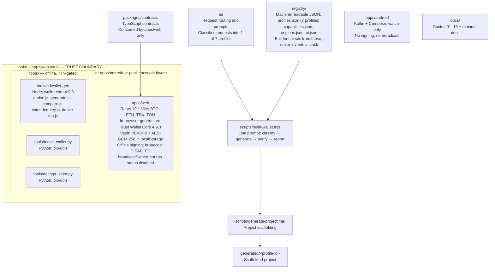

# Architecture

This is the code map for Bawa. Read it alongside `README.md` and `CONTRIBUTING.md`.

Branch state described here: `panel-rebuild/org-diagrams`, off adopt-proper
(`e493720`). On this branch the wallet is 4 chains (BTC, ETH, TRX, TON). The
13-chain registry lives on `panel-rebuild/multichain-create` — see the chain
diagram in `docs/12-chain-registry-and-assets/README.md`.

The builder routes requests through `ai/` and selects from `registry/`. Build and check entry points live in `scripts/`. The watch-only apps are deployables; wallet generation and recovery are separate offline tools under `tools/`.

## Repository architecture

The trust boundary is the point of the diagram: everything inside the
`secretBoundary` subgraph holds secrets; `apps/android` and the public network
layers never receive them. The web wallet's component diagram (screens, state,
vault, core, adapters) is in `docs/13-wallet-app-architecture/README.md`; the
build flow (request → classify → plan → generate) is in
`ai/request-routing.md`; chain support is in
`docs/12-chain-registry-and-assets/README.md`.

## Code map

### Root documents

`README.md` is the front door. `CONTRIBUTING.md` covers contributing, `AGENTS.md` holds repository instructions, and `WALLET_BUILDER.md` describes builder routing.

`CHANGELOG.md` records changes, `SECURITY.md` is the security document, and the root `LICENSE` is MIT. Starter licenses are noted below.

### `apps/web`

The web starter is a deployable built with React 19, Vite and Tailwind. It is MIT-licensed and consumes the TypeScript contracts from `packages/contracts`. It performs in-browser wallet generation and recovery, read-only balances/history via adapters, and offline send signing, with broadcast disabled.

### `apps/android`

The Android starter is a watch-only deployable built with Kotlin, Compose and Material 3. It is Apache-2.0-licensed.

It does not consume `packages/contracts` and does not perform offline wallet generation or recovery.

### `tools/`

- `tools/hdwallet-gen` contains Node tools using `@trustwallet/wallet-core` 4.9.3: `derive.js`, `generate.js`, `compare.js`, `extended-key.js`, `derive-ton.js` and `derive_daemon.js`.
- `tools/make_wallet.py` and `tools/decrypt_seed.py` provide Python wallet generation and recovery using `cryptography` 50.0.2 and `bip-utils` 2.12.3.
- `tools/bawa_cli.py` is the launcher, with 5 options and `--route`.

Wallet generation and recovery here belong to the offline, TTY-gated side of the repository.

### `registry/`

Machine-readable JSON defines 7 wallet profiles, plus capability, engine and UI registries.

These registries provide the builder’s allowed choices. The builder selects from them; it never invents a stack.

### `scripts/`

Build, setup, test and validation entry points live here:

`scripts/build-wallet.mjs`, `scripts/setup.mjs`, `scripts/build.mjs`, `scripts/test.mjs`, `scripts/validate-registry.mjs` and `scripts/quality-gates.mjs`.

### `packages/contracts`

`@bawa/contracts` is a TypeScript package consumed by `apps/web`.

It has one consumer today, not two. It is not a contract layer shared by the web and Android starters.

### `docs/`

`docs/` contains guides 01–16 and the `web-wallet`, `android-wallet` and `mainnet` documentation.

Other named documents are `docs/CAPABILITY-MAP.md`, `docs/BRANCH-AUDIT.md`, `docs/EXTERNAL-TOOLS.md` and `docs/MAINNET-GAP-ASSESSMENT.md`.

### `ai/`

Request routing and prompts for the builder live here. Read them with `WALLET_BUILDER.md`; the available wallet, capability, engine and UI choices come from `registry/`.

## Architectural invariants

### Derivation paths

| Asset | Path |
| --- | --- |
| BTC | `m/84'/0'/0'/0/i` |
| ETH | `m/44'/60'/0'/0/i` |
| TRX | `m/44'/195'/0'/0/i` |
| TON — generation-only | `m/44'/607'/0'` |

### Mnemonics, files and network behaviour

- **Mnemonic format:** BIP-39, 24 words, with an empty BIP-39 passphrase.
- **Secret permissions:** `secrets/` has mode `0700`; `seed.enc.json` has mode `0600`.
- **No broadcast:** Only broadcast is disabled: `broadcastSigned` returns `{ status: 'disabled' }`; send functions sign offline and do not throw.
- **Network direction:** mainnet-first in direction, testnet-safe in behaviour. Mainnet direction does not remove the no-broadcast invariant.
- **Fixtures:** published fixtures are public test vectors. Never fund them.

## Boundaries and deliberate exclusions

- **Offline secret handling:** wallet generation and recovery run offline and are TTY-gated. They do not run inside the online watch-only or payment layers.
- **Online public data:** the watch-only and payment layers are online and public-only. Secrets do not cross into them from generation or recovery. These sides never mix.
- **Builder choices:** the builder selects from registries, not from an invented stack.
- **Builder logs:** the builder never writes secrets to logs.
- **Contract consumption:** `packages/contracts` serves `apps/web` only today. Android is not a second consumer.

## Where to change what

| Change | Start here |
| --- | --- |
| Web starter | `apps/web` |
| Android starter | `apps/android` |
| TypeScript contracts used by web | `packages/contracts` and its consumer, `apps/web` |
| Derivation or offline generation/recovery | `tools/hdwallet-gen`, `tools/make_wallet.py`, `tools/decrypt_seed.py` |
| Launcher options or `--route` | `tools/bawa_cli.py` |
| Builder request routing or prompts | `ai/` and `WALLET_BUILDER.md` |
| Wallet profiles, capabilities, engines or UI choices | `registry/` |
| Build, setup, tests or validation gates | `scripts/` |
| Guides, maps, audits or mainnet documentation | `docs/` |
| Entry, contribution or repository instructions | `README.md`, `CONTRIBUTING.md`, `AGENTS.md` |

Update this map when components, boundaries or invariants change—not for every implementation edit.

## Change notes

- 2026-11-20 (Lane D, repo-organisation programme): added the repository
  architecture diagram; fixed the stale "on `feature/ai-wallet-builder`"
  branch line (this branch is `panel-rebuild/org-diagrams` off adopt-proper
  `e493720`); added pointers to the web-wallet component diagram, the build
  flow diagram and the chain diagram. No component, boundary or invariant
  changed.
