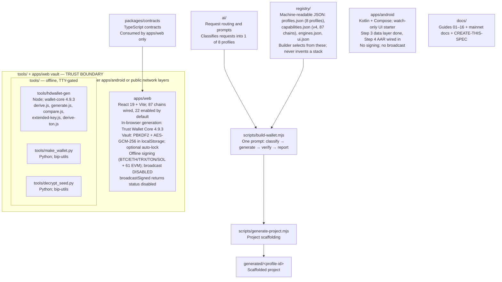

# Architecture

This is the code map for Bawa on the `panel-rebuild/token-gaps` line (base commit `ceade79`, 2026-11-28 — the token-gaps tip after the honest remains; the live site serves this build, `index-Brm7r34g.js`, gh-pages `c0cf697`). Read it alongside `README.md` and `CONTRIBUTING.md`.

Branch state described here: `panel-rebuild/token-gaps`. The web wallet wires **87 chains** — 22 curated chains plus 65 expansion chains, all in `apps/web/src/wallet/chains.ts` in production; the 65-chain dataset is kept canonically in `apps/web/src/wallet/chains-expanded.ts` (`EXPANDED_CHAIN_COUNT = 65`; 45 EVM + 10 non-EVM + 7 Cosmos-ecosystem + 3 OKX-reference: Cardano, Starknet, Kaspa). The registry lives in-tree at `registry/` (`capabilities.json` v4, 87 `chainSupport` keys) — see the chain diagram in `docs/12-chain-registry-and-assets/README.md` and the full 87-chain specification in `docs/CREATE-THIS-SPEC.md` §2.

The builder routes requests through `ai/` and selects from `registry/`. Build and check entry points live in `scripts/`. The starters under `apps/` are deployables; wallet generation and recovery are separate offline tools under `tools/`.

## Repository architecture

The trust boundary is the point of the diagram: everything inside the
`secretBoundary` subgraph holds secrets; `apps/android` and the public network
layers never receive them. The web wallet's component diagram (screens, state,
vault, core, adapters) is in `docs/13-wallet-app-architecture/README.md`; the
build flow (request → classify → plan → generate) is in
`ai/request-routing.md`; chain support is in
`docs/12-chain-registry-and-assets/README.md`.

## Code map

### Root documents

`README.md` is the front door. `CONTRIBUTING.md` covers contributing, `AGENTS.md` holds repository instructions, and `WALLET_BUILDER.md` describes builder routing.

`CHANGELOG.md` records changes, `SECURITY.md` is the security document, and the root `LICENSE` is MIT. Starter licenses are noted below.

### `apps/web`

The web starter is a deployable built with React 19, Vite and Tailwind. It is MIT-licensed and consumes the TypeScript contracts from `packages/contracts`. It performs in-browser wallet generation and recovery, read-only balances/history via adapters (balance on 66 chains, history on 18 — Gnosis joined via keyless gnosisscan.io in `d06a224`; bsc, opbnb, metis and fantom are still balance-only, no keyless source exists), prices via CoinGecko with CoinLore/Coinbase/DexScreener/TonAPI fallbacks (80 of 87 chains), and offline send signing, with broadcast disabled. Watch-only wallets show real balances on the dashboard and /assets (TRON falls back to the PublicNode RPC); /security offers change password (current verified by trial decrypt, vault re-encrypted); /wallets offers inline rename and per-account delete; an added token can be removed from its asset detail; asset charts retry with a Coinbase daily-candles fallback.

### `apps/android`

The Android starter is a watch-only UI starter built with Kotlin, Compose and Material 3. It is Apache-2.0-licensed. Step 3 of the Android programme is done (commit `e20cee6`, 2026-11-28): the data layer exists over the Step 1 JSON export (`registry/chains.json` + `registry/tokens.json`, 2026-11-27, commit `58d85c5`) — chain registry, 169 RPCs, 21 tokens, Balance/History repositories and icon resolvers, 77 unit tests. Step 4 is done (commit `f9f312b`, 2026-11-28): Trust Wallet Core 4.8.4 AAR built from source + `:core` wired in (`apps/android/core/libs/wallet-core-4.8.4.aar`, `CoreWalletEngine.kt`, `TWC-AAR.md`), so `ENGINE_BINDING_AVAILABLE` is now `true` — on-device derivation is bound, not stubbed. It still has no live prices and no network permission — see `docs/CREATE-THIS-SPEC.md` §2.6. Steps 5–6 not started. The Android toolchain is installed and proven on loud-stone (JDK 17.0.21.1, SDK with platforms android-34 + android-35; `./gradlew assembleDebug` BUILD SUCCESSFUL, clean build re-run 2026-11-27 in 32 s).

It does not consume `packages/contracts` and does not perform offline wallet generation or recovery.

### `tools/`

- `tools/hdwallet-gen` contains Node tools using `@trustwallet/wallet-core` 4.9.3: `derive.js`, `generate.js`, `compare.js`, `extended-key.js`, `derive-ton.js` and `derive-daemon.js`.
- `tools/make_wallet.py` and `tools/decrypt_seed.py` provide Python wallet generation and recovery using `cryptography` 50.0.2 and `bip-utils` 2.12.3.
- `tools/bawa_cli.py` is the launcher, with 5 options and `--route`.

Wallet generation and recovery here belong to the offline, TTY-gated side of the repository.

### `registry/`

Machine-readable JSON defines 8 wallet profiles, plus capability, engine and UI registries. `capabilities.json` (v4) covers 87 chains in `chainSupport`; its `coins` table holds 57 entries (53 prospective stubs, 4 supported). The validator (`scripts/validate-registry.mjs`) passes against it (exit 0 — re-run first-hand by the docs-currency lane, 2026-11-27: "OK: 4 files, 33 entries validated"; fixed in the registry v4 update, commit `2a0fa75`, 2026-11-26, which upgraded the validator from v3 to v4).

These registries provide the builder's allowed choices. The builder selects from them; it never invents a stack.

### `scripts/`

Build, setup, test and validation entry points live here:

`scripts/build-wallet.mjs`, `scripts/setup.mjs`, `scripts/build-platforms.mjs`, `scripts/run-test-suites.mjs`, `scripts/validate-registry.mjs` and `scripts/quality-gates.mjs`.

### `packages/contracts`

`@bawa/contracts` is a TypeScript package consumed by `apps/web`.

It has one consumer today, not two. It is not a contract layer shared by the web and Android starters.

### `docs/`

`docs/` contains guides 01–16, the `web-wallet`, `android-wallet` and `mainnet` documentation, and the canonical guide `docs/CREATE-THIS-SPEC.md` (§0–§19) plus the design system `docs/DESIGN-SYSTEM.md`.

Other named documents are `docs/CAPABILITY-MAP.md`, `docs/archive/branch-audit.md`, `docs/EXTERNAL-TOOLS.md` and `docs/archive/mainnet-gap-assessment.md`.

### `ai/`

Request routing and prompts for the builder live here. Read them with `WALLET_BUILDER.md`; the available wallet, capability, engine and UI choices come from `registry/`.

## Architectural invariants

### Derivation paths

| Asset | Path |
| --- | --- |
| BTC | `m/84'/0'/0'/0/i` |
| ETH | `m/44'/60'/0'/0/i` |
| TRX | `m/44'/195'/0'/0/i` |
| TON — generation-only | `m/44'/607'/0'` |

57 chains share the `m/44'/60'/0'/0/0` key (56 EVM chains plus Injective, which uses the same path but is Cosmos, not EVM) — see `docs/HOW-IT-WORKS.md`.

### Mnemonics, files and network behaviour

- **Mnemonic format:** BIP-39, 24 words, with an empty BIP-39 passphrase.
- **Secret permissions:** `secrets/` has mode `0700`; `seed.enc.json` has mode `0600`.
- **No broadcast:** Only broadcast is disabled: `broadcastSigned` returns `{ status: 'disabled' }`; send functions sign offline and do not throw.
- **Network direction:** mainnet-first in direction, testnet-safe in behaviour. Mainnet direction does not remove the no-broadcast invariant.
- **Fixtures:** published fixtures are public test vectors. Never fund them.

## Boundaries and deliberate exclusions

- **Offline secret handling:** wallet generation and recovery run offline and are TTY-gated. They do not run inside the online watch-only or payment layers.
- **Online public data:** the watch-only and payment layers are online and public-only. Secrets do not cross into them from generation or recovery. These sides never mix.
- **Builder choices:** the builder selects from registries, not from an invented stack.
- **Builder logs:** the builder never writes secrets to logs.
- **Contract consumption:** `packages/contracts` serves `apps/web` only today. Android is not a second consumer.

## Where to change what

| Change | Start here |
| --- | --- |
| Web starter | `apps/web` |
| Android starter | `apps/android` |
| TypeScript contracts used by web | `packages/contracts` and its consumer, `apps/web` |
| Derivation or offline generation/recovery | `tools/hdwallet-gen`, `tools/make_wallet.py`, `tools/decrypt_seed.py` |
| Launcher options or `--route` | `tools/bawa_cli.py` |
| Builder request routing or prompts | `ai/` and `WALLET_BUILDER.md` |
| Wallet profiles, capabilities, engines or UI choices | `registry/` |
| Build, setup, tests or validation gates | `scripts/` |
| Guides, maps, audits or mainnet documentation | `docs/` |
| Entry, contribution or repository instructions | `README.md`, `CONTRIBUTING.md`, `AGENTS.md` |

Update this map when components, boundaries or invariants change—not for every implementation edit.

## Change notes

- 2026-11-28 (docs audit, Lane A): base commit moved to the token-gaps tip `ceade79` — honest remains (`ff63077` BSC third RPC, `3db591e` dashboard 43 linked rows, `1253bf6` BNB header icon, `98f6ad9` + `ceade79` docs); live site republished from this tip (gh-pages `c0cf697`, serving `index-Brm7r34g.js`, root 200); web gates at `1253bf6` (vitest 3,429 passed + 5 skipped, 129 files; total JS 4,509,662 / 6,000,000). Android Step 4 done (`f9f312b`, AAR in-tree, `ENGINE_BINDING_AVAILABLE` now `true`); the spec is now §0–§19.
- 2026-11-28 (Lane C, README-preview lane): base commit moved to the token-gaps tip `7f24ef1` — fix programme (`f77b803`–`4adbd30`: change password, remove token, Activity switcher, wallets rename/delete, chart retry + Coinbase fallback, watch-only balances + TRON fallback, Gnosis history), mobile-overflow fix (`aea4b58`) and Receive QR-card redesign (`fec71be`); history coverage 17 -> 18 chains (Gnosis via gnosisscan.io); Android Step 4 done (`f9f312b`, AAR in-tree, `ENGINE_BINDING_AVAILABLE` now `true`); web gates re-verified first-hand on loud-stone (Node 22): build PASS, total JS 4,509,097 / 6,000,000, vitest 3,416 passed + 5 skipped (129 files, 0 failures). Live site still serves `734cfef` until this tip is republished.
- 2026-11-28 (docs-currency Lane A): base commit moved to the token-gaps tip `734cfef`; Android Step 3 done (data layer, `e20cee6`), Step 4 running (owner-authorized, not done); web gates re-verified (vitest 3,351 passed + 5 skipped, bundle 4,482,622 / 6,000,000).
- 2026-11-27 (docs-currency Lane 2): base commit moved to the token-gaps tip; registry validator now passes (exit 0, fixed at `2a0fa75`); Android JSON export exists and the toolchain builds the app — steps 3–6 blocked, not the toolchain; `broadcastSigned` returns `{ status: 'disabled' }` (this file already said so — the spec's "throws" wording was the wrong one).
- 2026-11-26 (guide-update pass, `panel-rebuild/guide-update`): rewritten to the 87-chain token-gaps tree (`7a170f4`); 8 profiles; registry in-tree with its validator failure honestly stated; Android starter described as a watch-only UI starter with the §2.6 data gap; web box lists the 87-chain wiring, balances/history coverage and the price fallbacks.
- 2026-11-20 (Lane D, repo-organisation programme; merged into
  `panel-rebuild/adopt-proper` by Lane B): added the repository
  architecture diagram; fixed the stale "on `feature/ai-wallet-builder`"
  branch line; added pointers to the web-wallet component diagram, the build
  flow diagram and the chain diagram. No component, boundary or invariant
  changed.
