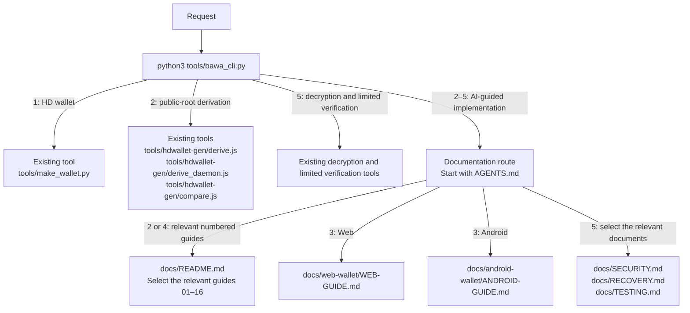

# Bawa
Bawa is an HD-wallet reference and command-line launcher for developers and AI agents to generate encrypted seed files and derive watch-only addresses. [Try it](#try-the-launcher).

Bawa (`Pr3eve6ti2o/bawa`) is a practical open-source reference for HD-wallet workflows and an **AI Wallet Builder**. A human or AI agent starts with one plain request—such as "Create an HD wallet" or "Create a Bitcoin watch-only wallet"—and uses the repository's tools and blueprints to build a real, buildable project.

> **Security first:** Never share mnemonics, private keys or data keys. xpubs/zpubs are privacy-sensitive. Generate secrets in a trusted offline environment; keep online work watch-only. Keep `secrets/` at `0700`, and `seed.enc.json` and `.env` at `0600`.

## 1. What Bawa is

### Try the launcher

After [cloning and installing](#clone-and-install), run this route check from the repository root:

```sh
python3 tools/bawa_cli.py --route "create an HD wallet"
```

Expected output:

```text
Route: Create an HD Cryptocurrency Wallet
Kind: [EXISTING TOOL]
Details: python3 tools/make_wallet.py
Command: python3 tools/make_wallet.py
```

### Why this exists — and when not to use it

Bawa (`Pr3eve6ti2o/bawa`) separates mnemonic generation and encrypted storage from public-root derivation, with executable checks for the covered results.

**Bawa is a guide and blueprint first**, not a hosted wallet, custodian, exchange, node client or security audit. You or your AI agent must implement, build and test documentation-only capabilities.

Use a wallet application instead if you need to check balances or construct, sign or broadcast transactions.

### Implemented on main

- [Generate an encrypted seed file](#launch-bawa) with `tools/make_wallet.py`, an interactive terminal tool using Trust Wallet Core `4.8.4` WASM. It generates a **24-word BIP-39 mnemonic with an empty BIP-39 passphrase** and writes encrypted `seed.enc.json` using AES-256-GCM, AAD `nova-shop-seed-v1` and file mode `0600`.
- [Derive and compare watch-only addresses](#pinned-derivation-scope) with `derive.js`, `derive_daemon.js` and `compare.js` in `tools/hdwallet-gen`. These tools operate from **public roots only**.
- [Check decryption](#check-decryption) with `tools/decrypt_seed.py`, which defaults to `secrets/seed.enc.json`. This executable check is **not a completed recovery rehearsal**.
- [Verify derivation results](#verify-the-tools) with derivation/comparison checks and a limited independent BTC/ETH comparison. The recorded results and scope are below.

### Pinned derivation scope

All paths use **account 0**; indexed receiving paths use **branch 0 only**.

| Chain | Pinned path |
|---|---|
| BTC — zpub | `m/84'/0'/0'/0/i` |
| ETH | `m/44'/60'/0'/0/i` |
| TRX | `m/44'/195'/0'/0/i` |
| TON — address only | `m/44'/607'/0'` |

TON has **no xpub**, and the derivation tools have **no TON mode**.

### What still needs development

Web/Android applications, payment tracking, monitoring, reconciliation and broader recovery utilities require new implementation and testing. **Web and Android starters exist only on the feature branch, not on main.**

Main contains **no transaction construction, signing or broadcast code**, and **no balance retriever**. Documentation must not be mistaken for implemented or tested functionality.

## 2. Getting started

### Prerequisites

- Node.js **`>=22 <23`**
- Python **`>=3.11`**

Tested environment: **Node `v22.23.4`** and **Python `3.12.3`**.

### Clone and install

Clone `main` and install the Node dependencies:

```sh
git clone --branch main https://github.com/Pr3eve6ti2o/bawa.git
cd bawa
npm --prefix tools/hdwallet-gen install
```

Verified output from `npm --prefix tools/hdwallet-gen install`:

```text
up to date, audited 15 packages
found 0 vulnerabilities
```

Create and activate a Python environment, then install its dependencies:

```sh
python3 -m venv .venv
source .venv/bin/activate
python -m pip install -r requirements.txt
```

### Launch Bawa

From the repository root, run the interactive launcher:

```sh
python3 tools/bawa_cli.py
```

The interactive launcher welcomes you with:

> Welcome to Bawa! Your AI-powered cryptocurrency development guide. What would you like to create or work on?

It routes each choice to an existing executable tool or to the exact documents you or an AI agent must follow. A documentation route is not a finished application.

To generate a wallet, run the tool printed by the route check in a trusted offline environment:

```sh
python3 tools/make_wallet.py
```

### Verify the tools

Run the smoke tests from the repository root:

```sh
npm --prefix tools/hdwallet-gen test
```

Expected output:

```text
SMOKE TESTS PASSED
```

The verified run completed **130 checks with 0 failures**. The launcher unit tests completed **25 tests**, with result `OK`.

The limited independent BTC/ETH differential test reported:

```text
bip_utils reference checks: PASS
```

Recorded address results:

| Chain | Checked path | Address |
|---|---|---|
| BTC | `m/84'/0'/0'/0/0` | `bc1qpsp72plnsqe6e2dvtsetxtww2cz36ztmfxghpd` |
| ETH | `m/44'/60'/0'/0/0` | `0xA3Dcd899C0f3832DFDFed9479a9d828c6A4EB2A7` |

Do not treat these checks as a mainnet or production-readiness claim.

### Check decryption

Run the executable decryption check in a trusted offline environment:

```sh
python3 tools/decrypt_seed.py
```

The default input is `secrets/seed.enc.json`. This checks decryption; it is not a completed recovery rehearsal.

## 3. The five-option launcher

Run the launcher:

```bash
python3 tools/bawa_cli.py
```

| Option | Status on main |
|---|---|
| 1. Create an HD wallet | **Existing executable tool:** [`tools/make_wallet.py`](tools/make_wallet.py) writes an encrypted seed file; it does not construct, sign or broadcast transactions. Find the relevant numbered guides in the [documentation map](docs/README.md). |
| 2. Create/configure a watch-only wallet | **Existing executable tools** for public-root derivation: [`derive.js`](tools/hdwallet-gen/derive.js), [`derive_daemon.js`](tools/hdwallet-gen/derive_daemon.js) and [`compare.js`](tools/hdwallet-gen/compare.js). **AI-guided implementation** for application and configuration work beyond those tools, using the relevant numbered guides in the [documentation map](docs/README.md). No balance retriever or TON derivation mode is provided. |
| 3. Build a wallet application (Web/Android) | **AI-guided implementation:** follow the [Web guide](docs/web-wallet/WEB-GUIDE.md) or [Android guide](docs/android-wallet/ANDROID-GUIDE.md). Starters are **unavailable on main**; Android build and on-device validation are **unverified**. |
| 4. Build cryptocurrency tools (payment tracking, monitoring, reconciliation) | **AI-guided implementation:** select the relevant numbered guides through the [documentation map](docs/README.md), then develop and test the required application and integrations. This option does not provide implemented trackers or monitoring services on main. |
| 5. Security, recovery and development | **Existing executable tools** for decryption and limited verification; **AI-guided implementation** for further work. Follow the [security guidance](docs/SECURITY.md), [recovery documentation](docs/RECOVERY.md) and [testing documentation](docs/TESTING.md), as relevant. The recovery rehearsal is **unverified and its gate is FAIL**. |

## 4. AI routing summary

Start with [AGENTS.md](AGENTS.md) for the full routing table, then **read only the documents relevant to the request**.

The launcher routes a request to an existing executable tool or to documents an AI agent must follow.



**A documentation route is not a finished application.**

- For HD-wallet, watch-only or cryptocurrency-tool work, select the relevant numbered guides through the [documentation map](docs/README.md).
- For a Web application, follow the [Web guide](docs/web-wallet/WEB-GUIDE.md).
- For an Android application, follow the [Android guide](docs/android-wallet/ANDROID-GUIDE.md).
- For security, recovery or verification, use the routed [security guidance](docs/SECURITY.md), [recovery documentation](docs/RECOVERY.md) and [testing documentation](docs/TESTING.md), as relevant.
- For mainnet work, apply the separate-change requirement below. Do not infer readiness from a document or a derivation result.

Reuse existing executable tools where appropriate. Write, build and test missing code, and report anything not executed as **unverified**. Never present a blueprint as implemented or an untested feature as working.

## 5. Mainnet-first direction

The owner’s direction is **mainnet-first**; testnet is secondary, for testing. That direction is not yet delivered: **mainnet is absent from the current main guide set**.

Treat any mainnet work as a **separate, reviewed change**. The [mainnet guide](docs/mainnet/MAINNET-GUIDE.md) does not establish implemented support or readiness. Bawa makes **no mainnet or production-readiness claim**.

## 6. Documentation map

| Topic | Documents |
|---|---|
| Map and numbered guides 01–16 | [Documentation map](docs/README.md), covering the sequence from [01: Fundamentals](docs/01-fundamentals/README.md) through [16: Security decision guide](docs/16-security-decision-guide/README.md). Use the map to reach the intermediate guides. |
| Wallet application blueprints | [Web guide](docs/web-wallet/WEB-GUIDE.md) · [Android guide](docs/android-wallet/ANDROID-GUIDE.md) |
| Mainnet document | [Mainnet guide](docs/mainnet/MAINNET-GUIDE.md) — not evidence of mainnet support or readiness |
| Security and recovery | [Security guidance](docs/SECURITY.md) · [Recovery](docs/RECOVERY.md) · [Repository security](SECURITY.md) |
| Testing | [Testing and verification](docs/TESTING.md) |
| Reference and help | [References](docs/REFERENCES.md) · [Glossary](docs/GLOSSARY.md) · [FAQ](docs/FAQ.md) |
| Architecture | [Architecture](ARCHITECTURE.md) |
| Changes | [Changelog](CHANGELOG.md) |
| Preserved README | [Full preserved README](docs/README-FULL.md) |

## 7. Essential commands

These instructions describe the `main` worktree based on `16c074e` (staging commit `2bb9a98`), not a released version.

Run from the repository root with your virtual environment active, except where noted.

1. `python3 tools/bawa_cli.py` — Launch the five-option interactive Bawa guide.
2. `python3 tools/make_wallet.py` — Run the interactive 24-word wallet generator and write encrypted `seed.enc.json`.
3. `echo "<zpub>" | node derive.js btc 1` — Run from `tools/hdwallet-gen` to derive BTC receiving index 1 from a public zpub only. Replace `<zpub>` with your public zpub.
4. `python3 tools/decrypt_seed.py` — Run the seed decryption check, using `secrets/seed.enc.json` by default. This does not establish that a recovery rehearsal has been completed.
5. `python3 test/differential_test.py` — Independently compare BTC and ETH derivation at **index 0 only** against `bip-utils`.

## 8. Gates and status

**Current verification: 2026-11-15.** Checks ran in the main worktree identified above, using Node `v22.23.4` and Python `3.12.3`.

- `npm --prefix tools/hdwallet-gen install` — `up to date, audited 15 packages`; `found 0 vulnerabilities`.
- `npm --prefix tools/hdwallet-gen test` — `SMOKE TESTS PASSED`: **130 checks, 0 failures**.
- `python3 test/differential_test.py` — `bip_utils reference checks: PASS`, for **BTC and ETH at index 0 only**:
  - BTC: `bc1qpsp72plnsqe6e2dvtsetxtww2cz36ztmfxghpd`
  - ETH: `0xA3Dcd899C0f3832DFDFed9479a9d828c6A4EB2A7`
- `python3 -m unittest discover -s test -p test_bawa_cli.py` — **25 tests, OK**.
- `python3 -m unittest discover -s test -p test_make_wallet.py` — **14 tests, OK**.

| Area | Recorded status |
|---|---|
| **Derivation and comparison** | Derive **9/9**; compare **9/9** — previously recorded under the **2026-11-08** verification (pin `e3b65fb8`), not the current test totals. |
| **Independent verification** | BTC/ETH **index 0 only** versus `bip-utils`; not full published-vector coverage. |
| **Root checks** | `npm test` and `npm run check` delegate to `tools/hdwallet-gen`; these checks are not a security audit. |
| **Recovery rehearsal** | **FAIL gate — never executed.** The decryption tool’s existence does not satisfy this gate. |
| **Live testnet spend** | No live testnet spend has ever been made. |
| **Android validation** | No debug APK has ever been built; the on-device Android gate has never been run. |
| **Release gates** | **5 of 6 unmet:** root lockfile, full published-vector coverage, secret/dependency scanning, reproducible releases and external security review. |
| **Readiness** | Mainnet and production readiness are **not established**. |

The full current README is preserved at [docs/README-FULL.md](docs/README-FULL.md).
