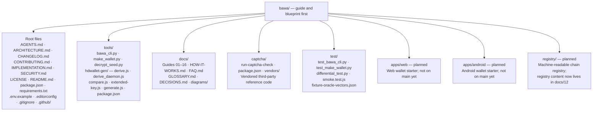

# Bawa

[](https://github.com/Pr3eve6ti2o/bawa/actions/workflows/ci.yml?query=branch%3Amain)
[](LICENSE)
[](https://github.com/Pr3eve6ti2o/bawa)
[](https://github.com/Pr3eve6ti2o/bawa/fork)
[](https://github.com/Pr3eve6ti2o/bawa/commits/main)
[](https://pr3eve6ti2o.github.io/bawa)

Bawa is an HD-wallet reference and command-line launcher for generating encrypted seed files, deriving watch-only addresses, and security and recovery checks, with AI-guided build routes. It is written for two readers: a developer — or an AI agent — building HD-wallet tooling from scratch, and anyone who wants to understand how a self-custodial wallet actually works. If you want a wallet to hold funds, this is not it — use a production wallet application instead. Unlike a generated wallet tutorial, every step resolves to something real — a tool in this repo, a guide, or a public-root derivation. Nothing in the guide is a placeholder. Built on Trust Wallet Core 4.9.3 (WebAssembly), with Python tooling and a Node.js generator.

**[Try the example wallet live](https://pr3eve6ti2o.github.io/bawa)** — no install, no clone. It serves the latest build of the example wallet, developed on `panel-rebuild/token-gaps`, not on `main`.

**136 checks** passing (smoke) · **48 launcher tests** · **26 make_wallet tests** · **0 funds ever sent** — no signing or broadcast code on `main`. (Counts verified at `667527e` on 2026-11-20; the test files are unchanged through `af828a9`, and the counts were re-confirmed statically at `af828a9` — see [Verification](#verification).)

## Showcase

Real screenshots of the example web wallet running from the active development branch (`panel-rebuild/token-gaps`), taken with a fresh unfunded test wallet (zero balances, live prices). Desktop is 1440 px, mobile is 390 px. The shots below are the current live build — try it at [https://pr3eve6ti2o.github.io/bawa/](https://pr3eve6ti2o.github.io/bawa/) (bundle `index-Brm7r34g.js`, 87 chains, dashboard 43 rows).

<!-- Screenshots are served from the token-gaps branch via raw.githubusercontent.com so this page always shows the current wallet without duplicating images into main. To extend this grid, add a row to the table below: one image per cell, height="360" on every image so all shots render at the same height. -->

| Dashboard (desktop) | Dashboard (mobile) |
| --- | --- |
|  |  |
| Portfolio, assets and recent activity. | The same wallet on mobile. |

| Wallets (desktop) | Wallets (mobile) |
| --- | --- |
|  |  |
| Vault and watch-only wallets, rename and per-account delete. | The same screen on mobile. |

| Receive (desktop) | Receive (mobile) |
| --- | --- |
|  |  |
| Receive with QR card and chain picker. | The same screen on mobile. |

The earlier dashboard screenshots (`docs/images/web-wallet-dashboard-desktop.png` and `docs/images/web-wallet-dashboard-mobile.png`) are kept in the tree as the record of the 2026-11-23 showcase.

## Live wallet (current state)

**Try it now: [https://pr3eve6ti2o.github.io/bawa/](https://pr3eve6ti2o.github.io/bawa/)** — no install, no clone. It serves the latest build of the example wallet from `panel-rebuild/token-gaps` (`ceade79`, 2026-11-28; bundle `index-Brm7r34g.js`), not from `main`: `main` has no web wallet code.

What the live wallet is today (verified 2026-11-28):

- **87 chains**, dashboard **43 rows** (22 native assets + 21 default tokens), history verified on 18 chains; 4 stay history-blocked (bsc, opbnb, metis, fantom).
- **Fix programme landed:** remove a user-added token, change password, watch-only balances, wallets rename and per-account delete, native TRX PublicNode fallback, price-chart retry, Activity wallet switcher.
- **QR-card redesign:** polished flat style (the paper/comic treatment is kept only for the QR share-card templates and the Welcome illustration).
- **Honest remains fixed:** BSC third RPC (DeFiBit), dashboard row count, BNB header icon (real chain logo, no fallback mark).
- **Auto-lock is optional and off by default** (toggle plus duration on /security; 5-minute default when enabled).
- **Still open at `ceade79`:** TRON USDT token-path PublicNode fallback, wallet creation under `vite dev` (WASM path), and a persistent path for `mmdc` (owner order 2026-11-28; fix in progress on `token-gaps`).

### Create your own

Prefer to build one yourself? Follow [Create the example web wallet](docs/CREATE-EXAMPLE-WALLET.md) — or run it straight from a terminal:

```sh
git clone --branch panel-rebuild/token-gaps https://github.com/Pr3eve6ti2o/bawa.git
cd bawa
cd apps/web
npm ci
npm run build
npm run preview
```

Then open <http://localhost:4173>. No account, no API key, no funds needed — everything runs locally, and broadcast stays disabled so the wallet cannot send funds.


How it fits together — the full box-by-box trace is in [How Bawa works](docs/HOW-IT-WORKS.md).

**Ask yourself:**

1. Where do your wallet's keys live — on your machine, or on someone else's server?
2. Could your wallet send funds without you meaning it to?
3. Where does each balance come from — a real public endpoint, or a number something made up?

Bawa exists so you can answer the first two from the code, not from a promise. Keys are generated locally by `tools/make_wallet.py` and stored encrypted; the launcher only prints routes and never executes them, and there is no signing or broadcast code on `main`, so nothing can be sent. Balances are out of scope on `main` — use a wallet application for balances, signing or broadcast.

> If Bawa helped you, please give it a star. ⭐ It costs nothing, it tells other builders this reference is worth their time, and it is the simplest way to support an open-source project maintained by one person. Thank you.

## Quickstart

Run this route check from the repository root:

```bash
python3 tools/bawa_cli.py --route "create an HD wallet"
```

Expected output:

```text
Route: Create an HD Cryptocurrency Wallet
Kind: [EXISTING TOOL]
Details: python3 tools/make_wallet.py
Runs with inherited stdio; exact YES confirmation is required.
Command (shown, not executed): python3 tools/make_wallet.py
```

`--route` prints a route and never executes it. If no route matches, it prints `No route matched for: <request>`, then the main menu, and exits with status `2`.

## Installation

- Node.js `>=22 <23`, tested with `v22.23.4`.
- Python `>=3.11`, tested with `3.12.3`; CI uses `3.13`.

Requirements: `cryptography 50.0.2`, `bip-utils 2.12.3`, and `mnemonic 0.21`.

Clone `main`, install the Node.js dependencies, then create and activate a Python virtual environment and install the Python requirements:

```bash
git clone --branch main https://github.com/Pr3eve6ti2o/bawa.git
cd bawa
npm --prefix tools/hdwallet-gen install

python3 -m venv .venv
source .venv/bin/activate
python -m pip install -r requirements.txt
```

## Usage

| Option | Purpose | Tools or route |
| --- | --- | --- |
| 1 | HD wallet | Existing tool: `tools/make_wallet.py` |
| 2 | Watch-only wallet | Existing tools: `tools/hdwallet-gen/derive.js`, `tools/hdwallet-gen/derive_daemon.js`, `tools/hdwallet-gen/compare.js` |
| 3 | Wallet application (Web/Android) | AI-guided; starters unavailable on `main` |
| 4 | Cryptocurrency tools | AI-guided |
| 5 | Security, recovery and development | Existing tools plus AI-guided work |

**Verified results:** At `667527e`, smoke tests reported `SMOKE TESTS PASSED`, with 136 checks and 0 failures; the launcher suite ran 48 tests, `OK`; the `make_wallet` suite ran 26 tests, `OK`; the differential test reported `bip_utils reference checks: PASS`. At index 0, BTC was `bc1qpsp72plnsqe6e2dvtsetxtww2cz36ztmfxghpd` and ETH was `0xA3Dcd899C0f3832DFDFed9479a9d828c6A4EB2A7`.

See [CONTRIBUTING.md](CONTRIBUTING.md) for the `bip-utils` version caveat.

Do not treat these checks as a mainnet or production-readiness claim.

## Architecture

Verified at `29b4b62` on 2026-11-28, Bawa's launcher prints routes and never executes them. Secret-handling tools sit inside a trust boundary; public-roots-only tools, documentation routes and unavailable printed routes sit outside it.

*The two diagrams above are static SVG images so they display in every viewer, including the GitHub mobile app.*


The CLI prints routes without executing them; secret-handling tools sit inside a trust boundary: M uses Trust Wallet Core 4.9.3 WASM and writes encrypted seed.enc.json using AES-256-GCM with AAD nova-shop-seed-v1 and file mode 0600; G exports verifySeedBundle and readDataKeyFromFd; D defaults to secrets/seed.enc.json. Outside the boundary, H lives in tools/hdwallet-gen/ and holds public-roots-only tools: derive_daemon.js is a JSONL daemon; compare.js compares addresses from public roots; the paths are BTC m/84'/0'/0'/0'/i, ETH m/44'/60'/0'/0'/i and TRX m/44'/195'/0'/0'/i; extended-key.js validates extended keys before WASM. Also outside the boundary, the AI-guided documentation route covers guides 01 to 16, and four launcher targets are unavailable.

### Inside the trust boundary

- **Option 1, `tools/make_wallet.py`:** an interactive 24-word BIP-39 generator using Trust Wallet Core 4.9.3 WASM. It writes encrypted `seed.enc.json` using AES-256-GCM, AAD `nova-shop-seed-v1` and file mode `0600`. It passes the data key to `generate.js` over the inherited pipe `BAWA_DATA_KEY_FD`, not through the environment. At `667527e`, `tools/make_wallet.py` calls `assert_bundle_decrypts` in its main flow.
- **`tools/hdwallet-gen/generate.js`:** reports the TON path `m/44'/607'/0'` for a single address, with no xpub. It exports `verifySeedBundle` and `readDataKeyFromFd`.
- **Option 5, `tools/decrypt_seed.py`:** a decryption check, not a completed recovery rehearsal.

### Outside the trust boundary

- **Public-roots-only tools:** `derive.js`, `derive_daemon.js`, `compare.js` and `extended-key.js`. The paths are BTC `m/84'/0'/0'/0/i`, ETH `m/44'/60'/0'/0/i` and TRX `m/44'/195'/0'/0/i`.
- **Documentation routes, options 3 and 4:** guides 01 to 16. The `main` branch has no wallet app code, no `apps/web`, no `WALLET_BUILDER.md`, no signing or broadcast code, and no balance retriever.
- **Unavailable printed routes:** `scripts/build-wallet.mjs`, `scripts/generate-project.mjs` and `tools/hdwallet-gen/derive-ton.js`.

For the detailed design, see [ARCHITECTURE.md](ARCHITECTURE.md).

## Repository structure

The diagram below is text (Mermaid), so it reads in the source as well as on GitHub. It shows `main` as it is: `apps/web`, `apps/android` and `registry/` are planned and not in this tree yet.



## Why this exists

Bawa separates mnemonic generation and encrypted storage from public-root derivation, with executable checks for the covered results. It is a guide and blueprint first, not a hosted wallet, custodian, exchange or security audit, and provides no node client.

Use a wallet application instead for balances, signing or broadcast. The `main` branch has no signing, broadcast or balance-retrieval code. Do not mistake documentation for implemented functionality.

## Features and status

**Existing tools:** Bawa includes `tools/make_wallet.py`; `derive.js`, `derive_daemon.js` and `compare.js` in `tools/hdwallet-gen`; and `tools/decrypt_seed.py`.

**AI-guided build routes:** Options 3 and 4 provide AI-guided build routes following guides 01 to 16 and the web-wallet and android-wallet guides. Starters are unavailable on `main`.

**Recorded test results:** All at `667527e`: smoke, 136 checks with 0 failures; launcher, 48 tests OK; `make_wallet`, 26 tests OK; differential `bip_utils` reference checks, PASS. See the [Verification](#verification) section below. Passing tests do not establish production readiness.

**Mainnet-first direction:** The owner’s direction is mainnet-first, with testnet secondary. This has not yet been delivered. The [mainnet guide](docs/mainnet/MAINNET-GUIDE.md) exists but does not establish mainnet readiness.

## Security

Never share mnemonics, private keys or data keys; xpubs and zpubs are privacy-sensitive. Generate secrets in a trusted offline environment and keep online work watch-only. Keep `secrets/` at `0700` and `seed.enc.json` and `.env` at `0600`. See [SECURITY.md](SECURITY.md) and [docs/SECURITY.md](docs/SECURITY.md) for guidance.

## Documentation map

Use the full catalogue for individual document links rather than duplicating it here.

| Documentation | Where to find it |
| --- | --- |
| Tutorials, How-to, Reference and Explanation | [Full catalogue](docs/README.md) |
| Guides 01 to 16 | [Full catalogue](docs/README.md) |
| FAQ, GLOSSARY, REFERENCES, RECOVERY, SECURITY and TESTING | [Full catalogue](docs/README.md) |
| web-wallet, android-wallet and mainnet guides | [Full catalogue](docs/README.md) |
| Architecture | [ARCHITECTURE.md](ARCHITECTURE.md) |
| Changelog | [CHANGELOG.md](CHANGELOG.md) |
| Contributing | [CONTRIBUTING.md](CONTRIBUTING.md) |
| Security | [SECURITY.md](SECURITY.md) |

## Contributing

- Open an issue first.
- Report bugs through [GitHub Issues](https://github.com/Pr3eve6ti2o/bawa/issues).
- Fork the repository and submit a pull request to `main`.
- Run the checks in the [canonical command list in CONTRIBUTING.md](CONTRIBUTING.md) before requesting review.
- Link the issue in your pull request.

## Contributors

Thanks to everyone who has contributed to Bawa.

<a href="https://github.com/Pr3eve6ti2o/bawa/graphs/contributors">
  
</a>

New contributors: open an issue first (see [CONTRIBUTING.md](CONTRIBUTING.md)). You will be listed here.

## Help

For troubleshooting answers and terminology, find the FAQ and GLOSSARY through the [documentation index](docs/README.md).

## Licence

Bawa is licensed under the MIT licence.

## Maintainers

Owner: `Pr3eve6ti2o`.

## Verification

Verified at commit `667527e` on 2026-11-20, and re-confirmed at `af828a9` on 2026-11-28: the test files (`test/`, `tools/`) are unchanged between `667527e` and `af828a9`, the smoke suite is deterministic and network-free, and the static counts at `af828a9` are 48 launcher tests (`test/test_bawa_cli.py`) and 26 `make_wallet` tests (`test/test_make_wallet.py`).

- Smoke: `136 checks 0 failures`
- Launcher: `48 tests OK`
- `make_wallet`: `26 tests OK`
- Differential: `bip_utils reference checks: PASS`

To re-run these checks, see [docs/10-operations-and-testing/README.md](docs/10-operations-and-testing/README.md) and [docs/TESTING.md](docs/TESTING.md).

[`docs/README-FULL.md`](docs/README-FULL.md) is the frozen 2026-11-08 archive, with 1,285 lines and 81,316 bytes, whose header names the `e3b65fb8` snapshot. It is not a verbatim copy of that commit’s root README, which has 1,019 lines and 55,192 bytes, and it is not the file of the same name at tag `archive/hd-wallet-professional`.

## UI/UX Fixes programme (2026-11-23)

The 21-item UI/UX Fixes programme (sticky-scroll fixes, devnet toggle,
mobile checks, QR image sharing, one-section 24/25-word import,
same-phrase accounts, bulk account creation, multichain + HD, rebuilt
Welcome, "SOON" cleanup, bug hunt, asset values, Add Token for every
chain, 9 new chains, copy button, watch wallet for all chains,
multi-account without deleting, HD primary tokens, RPC failover,
stepped Send/Receive flow, and this documentation) is complete and
merged into `panel-rebuild/token-gaps` (merge commit `4eb0242`).
Full record, gates and branch state:
[docs/UI-UX-FIXES-PROGRAMME.md](docs/UI-UX-FIXES-PROGRAMME.md).

No code from the programme was merged into `adopt-proper` or `main`.
The durable preview (GitHub Pages) still serves the saved
token-gaps-based build; to preview the programme, check out
`panel-rebuild/token-gaps` and run the web starter locally.

## UI/UX Round 2 programme (2026-11-23)

The 10-item UI/UX Round 2 programme (QR card with auto-select,
shared-link deep-link fix, watch-wallet search, Baloo 2 font,
plain-English copy rewrite, devnet prices, mobile layout pass,
no-scroll Send/Receive flow, scan icon, and this documentation) is
complete and merged into `panel-rebuild/token-gaps` (merge commit
`6147b74`). Full record, gates and branch state:
[docs/UI-UX-ROUND2-PROGRAMME.md](docs/UI-UX-ROUND2-PROGRAMME.md).

No code from the programme was merged into `adopt-proper` or `main`.
The durable preview (GitHub Pages) still serves the saved
token-gaps-based build; to preview the programme, check out
`panel-rebuild/token-gaps` and run the web starter locally.

## Reverify + Professional Polish programme (2026-11-23)

The five-lane Reverify + Professional Polish programme (reverify
checklist of every owner order from 2026-11-22 through 2026-11-23,
real wallet screenshots in the README, professional polish of the
README and docs, architecture/duplicates/dead-code pass, skills gap)
is complete and merged into `panel-rebuild/token-gaps` (fast-forward
to `ccb8195`). It fixed
three genuinely missed items in place: the 40 px Receive fix
restored to the token-gaps tree, a "Continue to your send" button
added to the import flow, and the item-14 chain list recorded. Full
record, gates and branch state:
[docs/REVERIFY-PROGRAMME.md](docs/REVERIFY-PROGRAMME.md).

No code from the programme was merged into `adopt-proper` or `main`.
The durable preview (GitHub Pages) still serves the saved
token-gaps-based build; to preview the programme, check out
`panel-rebuild/token-gaps` and run the web starter locally.
