# Bawa

[](https://github.com/Pr3eve6ti2o/bawa/actions/workflows/ci.yml?query=branch%3Amain)
[](LICENSE)

Bawa is an HD-wallet reference and command-line launcher for generating encrypted seed files, deriving watch-only addresses, and security and recovery checks, with AI-guided build routes.

## Quickstart

Run this route check from the repository root:

```bash
python3 tools/bawa_cli.py --route "create an HD wallet"
```

Expected output:

```text
Route: Create an HD Cryptocurrency Wallet
Kind: [EXISTING TOOL]
Details: python3 tools/make_wallet.py
Command (shown, not executed): python3 tools/make_wallet.py
```

`--route` prints a route and never executes it. If no route matches, it prints `No route matched for: <request>`, then the main menu, and exits with status `2`.

## Installation

- Node.js `>=22 <23`, tested with `v22.23.4`.
- Python `>=3.11`, tested with `3.12.3`; CI uses `3.13`.

Requirements: `cryptography 50.0.2`, `bip-utils 2.12.3`, and `mnemonic 0.21`.

Clone `main`, install the Node.js dependencies, then create and activate a Python virtual environment and install the Python requirements:

```bash
git clone --branch main https://github.com/Pr3eve6ti2o/bawa.git
cd bawa
npm --prefix tools/hdwallet-gen install

python3 -m venv .venv
source .venv/bin/activate
python -m pip install -r requirements.txt
```

## Usage

| Option | Purpose | Tools or route |
| --- | --- | --- |
| 1 | HD wallet | Existing tool: `tools/make_wallet.py` |
| 2 | Watch-only wallet | Existing tools: `tools/hdwallet-gen/derive.js`, `tools/hdwallet-gen/derive_daemon.js`, `tools/hdwallet-gen/compare.js` |
| 3 | Wallet application (Web/Android) | AI-guided; starters unavailable on `main` |
| 4 | Cryptocurrency tools | AI-guided |
| 5 | Security, recovery and development | Existing tools plus AI-guided work |

**Verified results:** At `667527e`, smoke tests reported `SMOKE TESTS PASSED`, with 136 checks and 0 failures; the launcher suite ran 48 tests, `OK`; the `make_wallet` suite ran 26 tests, `OK`; the differential test reported `bip_utils reference checks: PASS`. At index 0, BTC was `bc1qpsp72plnsqe6e2dvtsetxtww2cz36ztmfxghpd` and ETH was `0xA3Dcd899C0f3832DFDFed9479a9d828c6A4EB2A7`.

See [CONTRIBUTING.md](CONTRIBUTING.md) for the `bip-utils` version caveat.

Do not treat these checks as a mainnet or production-readiness claim.

## Architecture

On `main` at HEAD `667527e` (verified 2026-11-20), Bawa's launcher prints routes and never executes them. Secret-handling tools sit inside a trust boundary; public-roots-only tools, documentation routes and unavailable printed routes sit outside it.

*Diagrams are rendered as static SVG images so they display in every viewer, including the GitHub mobile app; the editable Mermaid sources are in [docs/diagrams/](docs/diagrams/).*


### Inside the trust boundary

- **Option 1, `tools/make_wallet.py`:** an interactive 24-word BIP-39 generator using Trust Wallet Core 4.9.3 WASM. It writes encrypted `seed.enc.json` using AES-256-GCM, AAD `nova-shop-seed-v1` and file mode `0600`. It passes the data key to `generate.js` over the inherited pipe `BAWA_DATA_KEY_FD`, not through the environment. At `667527e`, `tools/make_wallet.py` calls `assert_bundle_decrypts` in its main flow.
- **`tools/hdwallet-gen/generate.js`:** reports the TON path `m/44'/607'/0'` for a single address, with no xpub. It exports `verifySeedBundle` and `readDataKeyFromFd`.
- **Option 5, `tools/decrypt_seed.py`:** a decryption check, not a completed recovery rehearsal.

### Outside the trust boundary

- **Public-roots-only tools:** `derive.js`, `derive_daemon.js`, `compare.js` and `extended-key.js`. The paths are BTC `m/84'/0'/0'/0/i`, ETH `m/44'/60'/0'/0/i` and TRX `m/44'/195'/0'/0/i`.
- **Documentation routes, options 3 and 4:** guides 01 to 16. The `main` branch has no wallet app code, no `apps/web`, no `WALLET_BUILDER.md`, no signing or broadcast code, and no balance retriever.
- **Unavailable printed routes:** `scripts/build-wallet.mjs`, `scripts/generate-project.mjs` and `tools/hdwallet-gen/derive-ton.js`.

For the detailed design, see [ARCHITECTURE.md](ARCHITECTURE.md).

## Repository structure

### Overview

*Diagrams are rendered as static SVG images so they display in every viewer, including the GitHub mobile app; the editable Mermaid sources are in [docs/diagrams/](docs/diagrams/).*



### Root files (1 of 2)



### Root files (2 of 2)



### tools/ - files



### tools/ - hdwallet-gen/



### test/



### docs/



### captcha/


## Why this exists

Bawa separates mnemonic generation and encrypted storage from public-root derivation, with executable checks for the covered results. It is a guide and blueprint first, not a hosted wallet, custodian, exchange or security audit, and provides no node client.

Use a wallet application instead for balances, signing or broadcast. The `main` branch has no signing, broadcast or balance-retrieval code. Do not mistake documentation for implemented functionality.

## Features and status

**Existing tools:** Bawa includes `tools/make_wallet.py`; `derive.js`, `derive_daemon.js` and `compare.js` in `tools/hdwallet-gen`; and `tools/decrypt_seed.py`.

**AI-guided build routes:** Options 3 and 4 provide AI-guided build routes following guides 01 to 16 and the web-wallet and android-wallet guides. Starters are unavailable on `main`.

**Recorded test results:** All at `667527e`: smoke, 136 checks with 0 failures; launcher, 48 tests OK; `make_wallet`, 26 tests OK; differential `bip_utils` reference checks, PASS. See the [full records](docs/10-operations-and-testing/README.md). Passing tests do not establish production readiness.

**Mainnet-first direction:** The owner’s direction is mainnet-first, with testnet secondary. This has not yet been delivered. The [mainnet guide](docs/mainnet/MAINNET-GUIDE.md) exists but does not establish mainnet readiness.

## Security

Never share mnemonics, private keys or data keys; xpubs and zpubs are privacy-sensitive. Generate secrets in a trusted offline environment and keep online work watch-only. Keep `secrets/` at `0700` and `seed.enc.json` and `.env` at `0600`. See [SECURITY.md](SECURITY.md) and [docs/SECURITY.md](docs/SECURITY.md) for guidance.

## Documentation map

Use the full catalogue for individual document links rather than duplicating it here.

| Documentation | Where to find it |
| --- | --- |
| Tutorials, How-to, Reference and Explanation | [Full catalogue](docs/README.md) |
| Guides 01 to 16 | [Full catalogue](docs/README.md) |
| FAQ, GLOSSARY, REFERENCES, RECOVERY, SECURITY and TESTING | [Full catalogue](docs/README.md) |
| web-wallet, android-wallet and mainnet guides | [Full catalogue](docs/README.md) |
| Architecture | [ARCHITECTURE.md](ARCHITECTURE.md) |
| Changelog | [CHANGELOG.md](CHANGELOG.md) |
| Contributing | [CONTRIBUTING.md](CONTRIBUTING.md) |
| Security | [SECURITY.md](SECURITY.md) |

## Contributing

- Open an issue first.
- Fork the repository and submit a pull request to `main`.
- Run the checks in the [canonical command list in CONTRIBUTING.md](CONTRIBUTING.md) before requesting review.
- Link the issue in your pull request.

## Help

For troubleshooting answers and terminology, find the FAQ and GLOSSARY through the [documentation index](docs/README.md).

## Licence

Bawa is licensed under the MIT licence.

## Maintainers

Owner: `Pr3eve6ti2o`.

## Verification

Verified at commit `667527e` on 2026-11-20:

- Smoke: `136 checks 0 failures`
- Launcher: `48 tests OK`
- `make_wallet`: `26 tests OK`
- Differential: `bip_utils reference checks: PASS`

See the [full verification records](docs/10-operations-and-testing/README.md).

[`docs/README-FULL.md`](docs/README-FULL.md) is the frozen 2026-11-08 archive, with 1,285 lines and 81,316 bytes, whose header names the `e3b65fb8` snapshot. It is not a verbatim copy of that commit’s root README, which has 1,019 lines and 55,192 bytes, and it is not the file of the same name at tag `archive/hd-wallet-professional`.
