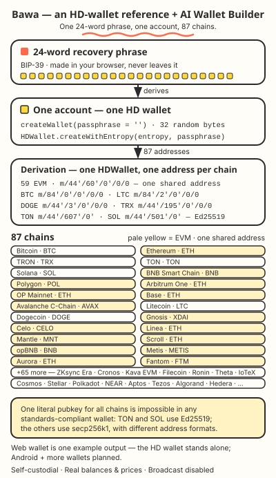
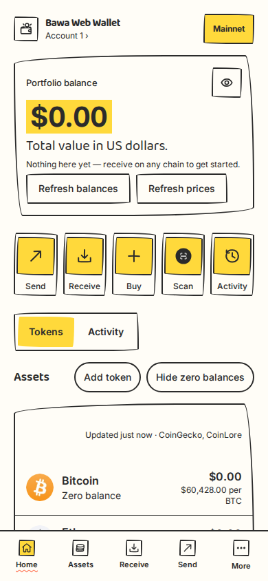

# Bawa

[](https://github.com/Pr3eve6ti2o/bawa/actions/workflows/ci.yml?query=branch%3Apanel-rebuild%2Ftoken-gaps)
[](LICENSE)
[](https://github.com/Pr3eve6ti2o/bawa/stargazers)
[](https://github.com/Pr3eve6ti2o/bawa/fork)
[](https://github.com/Pr3eve6ti2o/bawa/commits/panel-rebuild/token-gaps)
[](https://pr3eve6ti2o.github.io/bawa)

**One plain request in, a real, buildable wallet project out.**





How it fits together — the full box-by-box trace is in [How Bawa works](docs/HOW-IT-WORKS.md).

**[Try the example wallet live](https://pr3eve6ti2o.github.io/bawa)** — no install, no clone. It serves the latest build of this branch.

**87 chains** in the example wallet (22 enabled by default) · **168 chains** in the guide · **21 default tokens** · **440 checks** passing in a clean clone · **0 funds ever sent** — broadcast stays disabled.

## Showcase

Real screenshots of the example web wallet running from this branch, taken with a fresh unfunded test wallet (zero balances, live prices). Desktop is 1440 px, mobile is 390 px. Both shots show the dashboard, the wallet homepage.

<!-- To extend this grid, add a row to the table below: one image per cell, height="360" on every image so all shots render at the same height. -->

| Dashboard (desktop) | Dashboard (mobile) |
| --- | --- |
|  |  |
| Portfolio, assets and recent activity. | The same wallet on mobile. |

> **Note (2026-11-26, guide-update pass):** these two screenshots predate the November redesign (taken 2026-11-23) — they show the pre-redesign dashboard. Re-taking them via CDP is pending; no live browser was available in this lane. Treat them as stale until re-taken.

### Create your own

Prefer to build one yourself? Follow [Create the example web wallet](docs/CREATE-EXAMPLE-WALLET.md) — or run it straight from a terminal:

```sh
git clone --branch panel-rebuild/token-gaps https://github.com/Pr3eve6ti2o/bawa.git
cd bawa
cd apps/web
npm ci
npm run build
npm run preview
```

Then open <http://localhost:4173>. No account, no API key, no funds needed — everything runs locally, and broadcast stays disabled so the wallet cannot send funds.

Bawa is an open-source reference for HD-wallet workflows and an AI Wallet Builder. Give it one plain request — "Create a Web wallet" — and it produces a real project from resources that actually exist: real derivation, real balances and prices from public endpoints, no invented figures, no fake money. The example wallet cannot send funds: broadcast stays disabled. It is written for two readers: a developer — or an AI agent — building a wallet from scratch, and anyone who wants to understand how a self-custodial wallet actually works. If you want a wallet to hold funds, this is not it — see [If you want a wallet to use](#if-you-want-a-wallet-to-use). Unlike a generated wallet tutorial, every step resolves to something real — a file in this repo, an entry in the registry, or a public endpoint. Nothing in the guide is a placeholder. What it cannot do is stated as plainly as what it can: the [mainnet gap assessment](docs/archive/mainnet-gap-assessment.md) and [Security and honest limits](#security-and-honest-limits) list the gaps instead of hiding them.

**Ask yourself:**

1. Where do your wallet's keys live — on your machine, or on someone else's server?
2. Where does each balance come from — a real public endpoint, or a number something made up?
3. Could your wallet send funds without you meaning it to?

Bawa exists so you can answer all three from the code, not from a promise. Keys are generated and held locally in the browser. Balances and prices come from public read-only endpoints. Broadcast stays disabled, so the example wallet cannot send funds at all.

- **Self-custodial by construction.** Keys are generated and held locally in the browser; your recovery phrase never leaves your machine. See [How Bawa works](docs/HOW-IT-WORKS.md).
- **Real data only.** Balances and prices come from public read-only endpoints. When a provider cannot be reached, a balance shows as unavailable — never as an invented figure. See [Chain support](#chain-support).
- **87 chains out of the box, 168 in the guide.** The example wallet ships with 87 chains (22 enabled by default) and 21 default tokens. The guide covers the full Trust Wallet Core registry of 168 chains. See [Chain support](#chain-support).
- **Built on Trust Wallet Core 4.9.3.** The wallet engine is Trust Wallet Core as WebAssembly, loaded by a React 19 + Vite + Tailwind web starter and a Kotlin + Compose + Material 3 Android starter. See [Configuration](#configuration).

> If Bawa helped you, please give it a star. ⭐ It costs nothing, it tells other builders this reference is worth their time, and it is the simplest way to support an open-source project maintained by one person. Thank you.

If you arrived looking for a wallet to hold funds, read [If you want a wallet to use](#if-you-want-a-wallet-to-use) first. Bawa is builder material, not a wallet product.

## Quickstart

Install Node **22** (`22.23.4` verified) and Python **3.12+**. For the Android starter, also install **JDK 17** and **Android SDK 35**.

```sh
git clone --branch panel-rebuild/token-gaps https://github.com/Pr3eve6ti2o/bawa.git
cd bawa
```

Start the one-prompt workflow from the repo root:

```sh
node scripts/build-wallet.mjs "Create a Web wallet"
```

Replace the Web request with an Android or multi-chain request for those targets. Or use the menu launcher:

```sh
python3 tools/bawa_cli.py
```

To run the example web wallet directly, follow [Create the example web wallet](docs/CREATE-EXAMPLE-WALLET.md): `cd apps/web && npm ci && npm run build && npm run preview`.

Then open `http://localhost:4173`. You should see the Welcome screen, with Create, Import, and watch-only options.

Check the generator from the repo root:

```sh
cd tools/hdwallet-gen && npm ci && npm test
```

**Verified expected result:** in a clean clone of this branch, exit `0`, `440` checks pass, `0` fail. The output includes:

```text
All register-links checks passed
```

## The example web wallet

The web wallet in `apps/web` is a fully functional example wallet built using this guide. It runs entirely in the browser: create or import a wallet, add a watch-only wallet, and see real balances. Broadcast stays disabled, so it cannot send funds.

- Create, import (24/25 words) and watch-only wallets; multiple accounts from one phrase; bulk account creation.
- 22 native assets plus 21 default tokens (43 rows), with live prices.
- Receive with a QR card — three QR modes (address, payment request, share link) and seven card templates — plus copy and share.
- Add Token adds a token by contract address, and can enable any of the 87 chains.
- Send walks through a stepped flow, but broadcast stays disabled, so nothing is ever sent.

To run it, follow [docs/CREATE-EXAMPLE-WALLET.md](docs/CREATE-EXAMPLE-WALLET.md). To understand how it fits together, read [How Bawa works](docs/HOW-IT-WORKS.md) — two Mermaid diagrams (how it starts, what it can do), each box traced to a real file.

## What Bawa has produced

One prompt in, a real project out — the builder routes the request to a starter, and the starter is a complete project, not a sketch.

- **Web starter** (`apps/web`) — React 19 + Vite + Tailwind; MIT. The example wallet in this repo is built from it.
- **Android starter** (`apps/android`) — Kotlin + Compose + Material 3; Apache-2.0.
- **Machine-readable registries** (`registry/`) — capabilities, engines, profiles, and UI, so a builder (human or agent) works from data, not from prose.

If you build something with Bawa, tell us — open an issue and it will be listed here.

## Chain support

The example wallet supports **87 chains**: btc, eth, trx, ton, sol, bsc, matic, arb, op, base, avax, ltc, doge, gnosis, celo, linea, mantle, scroll, opbnb, metis, aurora, fantom, zksync, cronos, kava, filecoin, zora, mode, fraxtal, berachain, sei, arbnova, worldchain, manta, unichain, ink, abstract, soneium, apechain, sonic, hyperevm, monad, ronin, immutable, fuse, velas, syscoin, theta, iotex, xlayer, boba, taiko, astar, telos, conflux, core, songbird, rootstock, pulsechain, xdc, chiliz, etc, flare, zetachain, hemi, bob, flowevm, cosmos, osmosis, xrp, stellar, polkadot, near, aptos, tezos, algorand, hedera, injective, celestia, dydx, seicosmos, axelar, noble, juno, cardano, kaspa, starknet. Twenty-two are enabled by default (the curated set: btc, eth, trx, ton, sol, bsc, matic, arb, op, base, avax, ltc, doge, gnosis, celo, linea, mantle, scroll, opbnb, metis, aurora, fantom); the other 65 are reachable via Add Token. The list is `SUPPORTED_CHAINS` in `apps/web/src/wallet/chains.ts` and `chainSupport` in `registry/capabilities.json`.

Do not confuse that number with the guide's number. The guide covers the full Trust Wallet Core registry of **168 chains**. The example wallet supports 87 of them, 22 enabled by default. Add Token adds more tokens by contract address and can enable any of the 87 chains; a chain outside the 87 cannot be added from the wallet, it needs a change to the registry first.

Network operations are verified for btc, eth, trx, ton only. The 18 additional chains are scoped to the multichain-extended-wallet profile. See the [docs index](docs/index.md) for the per-chain status.

## How it works

The guide (`docs/`, sixteen sections, plus the machine-readable `registry/`) tells a person — or an AI agent — how to build a complete wallet from resources that actually exist. The example web wallet (`apps/web/`) is the working proof of that guide. The builder (`scripts/build-wallet.mjs`, `tools/bawa_cli.py`) routes one plain request to the right starter and build steps.

[How Bawa works](docs/HOW-IT-WORKS.md) explains it in plain terms, with two Mermaid diagrams kept as text in the Markdown file — not images — so they stay in step with the code. The full step-by-step version is [Create the example web wallet](docs/CREATE-EXAMPLE-WALLET.md).

## Documentation

The single entry point for Bawa documentation is [docs/index.md](docs/index.md).

| You need | Read |
| --- | --- |
| Full manual | [docs/README-FULL.md](docs/README-FULL.md) — the previous 1,308-line README, preserved with only its link paths adjusted |
| Guide map | [docs/README.md](docs/README.md) |
| Docs index | [docs/index.md](docs/index.md) |
| How it works | [docs/HOW-IT-WORKS.md](docs/HOW-IT-WORKS.md) |
| Create the example wallet | [docs/CREATE-EXAMPLE-WALLET.md](docs/CREATE-EXAMPLE-WALLET.md) |
| Builder routing | [WALLET_BUILDER.md](WALLET_BUILDER.md) |
| Repository instructions | [AGENTS.md](AGENTS.md) |
| Capability map | [docs/CAPABILITY-MAP.md](docs/CAPABILITY-MAP.md) |
| Wallet lifecycle | [docs/wallet-lifecycle.md](docs/wallet-lifecycle.md) |
| Security | [SECURITY.md](SECURITY.md) |
| Changelog | [CHANGELOG.md](CHANGELOG.md) |
| Licence | [LICENSE](LICENSE) |

## Configuration

| Item | Value or command |
| --- | --- |
| Builder request | `"Create a Web wallet"`; use an Android or multi-chain request for those targets |
| Menu launcher | `python3 tools/bawa_cli.py` |
| Routed launcher | `python3 tools/bawa_cli.py --route "Create a Web wallet"` |
| Wallet engine | `@trustwallet/wallet-core` `4.9.3` |
| Web starter libraries | Dependencies: `@scure/bip39` `2.4.0`, `decimal.js` `10.6.0`, `dinero.js` `2.0.2`, `mnemonic-words` `2.0.0`; devDependency (test oracle): `bip39` `3.1.2` (bitcoinjs/bip39); Python requirement: `mnemonic==0.21` (trezor/python-mnemonic). See ADR-0005. |

Use the starters:

- [Web starter](WALLET_BUILDER.md): `apps/web` — React 19 + Vite + Tailwind; MIT.
- [Android starter](WALLET_BUILDER.md): `apps/android` — Kotlin + Compose + Material 3; Apache-2.0.


*Bawa Balanced UI direction for builder output — not a screenshot of the running starter.*

## Security and honest limits

Use Bawa as a reference for [HD-wallet workflows](docs/README-FULL.md) and as a [builder](WALLET_BUILDER.md) that turns one plain request into a real, buildable project. It is **not** a hosted wallet, custody service, or exchange.

- Mainnet send/broadcast is not implemented; broadcast stays disabled. The repository is mainnet-first in direction but testnet-safe in behaviour; read the [mainnet gap assessment](docs/archive/mainnet-gap-assessment.md).
- The example wallet has never sent a transaction on any network, has no backup store for the vault, and recovery rehearsal has never been executed. If you want a ready-made wallet to hold funds, use a production wallet instead.

### Passphrase policy

Bawa uses BIP-39, 24 words, with an empty BIP-39 passphrase. Record the passphrase policy alongside the mnemonic: the same mnemonic with a different passphrase is a different wallet.

If a restored wallet looks empty, re-derive your recorded first address with the recorded path and recorded BIP-39 passphrase policy. If it matches, the restore used the recorded inputs — that alone does not prove funds exist. If the recorded first address itself shows no funds on the recorded network, do not conclude the funds were never sent to that address: the address may have received and subsequently spent funds. Never re-fund a guess. See the [full manual](docs/README-FULL.md) for the troubleshooting table.

Found a security issue? Report it through [GitHub Issues](https://github.com/Pr3eve6ti2o/bawa/issues), and never include a mnemonic, private key or other recovery material — in an issue, a screenshot, or a support message.

## If you want a wallet to use

Bawa is builder material: a reference and a starter kit, not a wallet product. If you arrived looking for a wallet to hold funds:

1. **Do not use this repository as your wallet.** The web starter is a reference implementation.
2. **Use a production wallet** (for example Trust Wallet, whose engine this repo's starter is built on) for real funds.
3. **If you want to try the starter**, cold-test it with a disposable wallet: create a fresh wallet in `apps/web`, write the phrase down on paper, lock and unlock it, import it watch-only, and delete the vault afterwards. Never fund it, and never import a phrase that holds real funds. The lifecycle is documented in [docs/wallet-lifecycle.md](docs/wallet-lifecycle.md).

## Contributing

Follow [CONTRIBUTING.md](CONTRIBUTING.md) when you contribute. Report bugs through [GitHub Issues](https://github.com/Pr3eve6ti2o/bawa/issues) using the bug report template there.

**First step:** open an issue before starting substantial work, so the approach can be agreed first.

## Contributors

Thanks to everyone who has contributed to Bawa.

<a href="https://github.com/Pr3eve6ti2o/bawa/graphs/contributors">
  
</a>

New contributors: open an issue first, so the approach can be agreed before substantial work starts (see [CONTRIBUTING.md](CONTRIBUTING.md)). You will be listed here.

## Licence

MIT — see [LICENSE](LICENSE).

## Maintainers

The repository owner, **Pr3eve6ti2o**, maintains Bawa.

## Project history

Recent programmes, each with its full record, gates and branch state in `docs/`:

- **UI/UX Fixes programme (2026-11-23)** — 21 items, merged into `panel-rebuild/token-gaps` (merge commit `4eb0242`). Record: [docs/UI-UX-FIXES-PROGRAMME.md](docs/UI-UX-FIXES-PROGRAMME.md).
- **UI/UX Round 2 programme (2026-11-23)** — 10 items, merged into `panel-rebuild/token-gaps` (merge commit `6147b74`). Record: [docs/UI-UX-ROUND2-PROGRAMME.md](docs/UI-UX-ROUND2-PROGRAMME.md).
- **Reverify + Professional Polish programme (2026-11-23)** — five lanes, merged into `panel-rebuild/token-gaps` (fast-forward to `ccb8195`). Record: [docs/REVERIFY-PROGRAMME.md](docs/REVERIFY-PROGRAMME.md).
- **Marketing Fix + Found-Bugs programme (2026-11-23)** — first-impression defects, found bugs, value proposition, README rewrite, architecture diagrams, branch cleanup, QR templates, browser-first re-verification; merged into `panel-rebuild/token-gaps` (merge commit `571f0fb`). Record: [docs/MARKETING-FIX-PROGRAMME.md](docs/MARKETING-FIX-PROGRAMME.md).
- **FIX-ALL programme (2026-11-24)** — branches under 4 (unique work merged into `token-gaps` first, only fully-merged branches deleted), file renames, the 980 px desktop-shell breakpoint ported from `desktop-layout-v2`, docs brought to the new state; merged into `token-gaps` (merge commit `7c98420`). Record: [docs/FIX-ALL-PROGRAMME.md](docs/FIX-ALL-PROGRAMME.md).
- **README Marketing programme (2026-11-24)** — Showcase grid, Create-your-own block, marketing gaps; 7 of 10 landed, the 3 blocked items later landed via the expansion programme. Merged into `token-gaps` (commit `f065128`); doc-only to `main` (`a550175`). Record: [docs/README-MARKETING-PROGRAMME.md](docs/README-MARKETING-PROGRAMME.md).
- **BSC native send fix (2026-11-24)** — generalised the EVM signer to chainId 56; merged into `token-gaps` (commit `31012a6`). Record: [docs/BSC-SEND-FIX.md](docs/BSC-SEND-FIX.md).
- **Token Everywhere programme (2026-11-24)** — Add Token by ticker, verified marks everywhere, token send/receive, full token names, Bitget-style QR card; merged into `token-gaps` (commit `047232e`). Record: [docs/TOKEN-EVERYWHERE-PROGRAMME.md](docs/TOKEN-EVERYWHERE-PROGRAMME.md).
- **Devnet Send crash fix (2026-11-24)** — picker offers only devnet chains in devnet mode; merged into `token-gaps` (commit `89a5804`). Record: [docs/DEVNET-SEND-CRASH-FIX.md](docs/DEVNET-SEND-CRASH-FIX.md).
- **Scan QR fix (2026-11-24)** — bare-address scan advances and prefills; merged into `token-gaps` (merge commit `2e8f128`). Record: [docs/SCAN-QR-FIX.md](docs/SCAN-QR-FIX.md).
- **Expansion programme (2026-11-24)** — diagrams redrawn, captcha merge + FuckCaptcha import onto `main`, Solana sending via @solana/web3.js, 22 → 84 chains, cold-load −43%; merged into `token-gaps` (commit `6c93e66`); `main` `7f9d364`. Record: [docs/EXPANSION-PROGRAMME.md](docs/EXPANSION-PROGRAMME.md).
- **Token Verify programme (2026-11-24)** — token verification by contract address, new-chains bug hunt, bundle gate kept under budget, npm audit 9 → 0, all 28 icon-less chains get real icons; merged into `token-gaps` (commit `7f12de4`); Pages republished from the final tip. Record: [docs/TOKEN-VERIFY-PROGRAMME.md](docs/TOKEN-VERIFY-PROGRAMME.md).
- **CI budget align (2026-11-25)** — CI bundle budget aligned to `CONSTRAINTS.md` (4,177,711); merged into `token-gaps` (commit `6a91cbd`). Superseded the same day by the owner-ordered re-baseline below.
- **Bundle budget re-baseline (2026-11-25)** — budget re-baselined to 4,650,000 by owner order; merged tree measures 4,648,952 total JS, passing by 1,048 bytes (commit `7a170f4`). Record: [docs/DECISIONS.md](docs/DECISIONS.md) §27.

No code from these programmes was merged into `adopt-proper`. Lanes E and F (captcha generalisation, FuckCaptcha guides) merged into `main` at `7f9d364`. The durable preview (GitHub Pages) serves the latest `token-gaps` build; to preview this branch, check out `panel-rebuild/token-gaps` and run the web starter locally.
