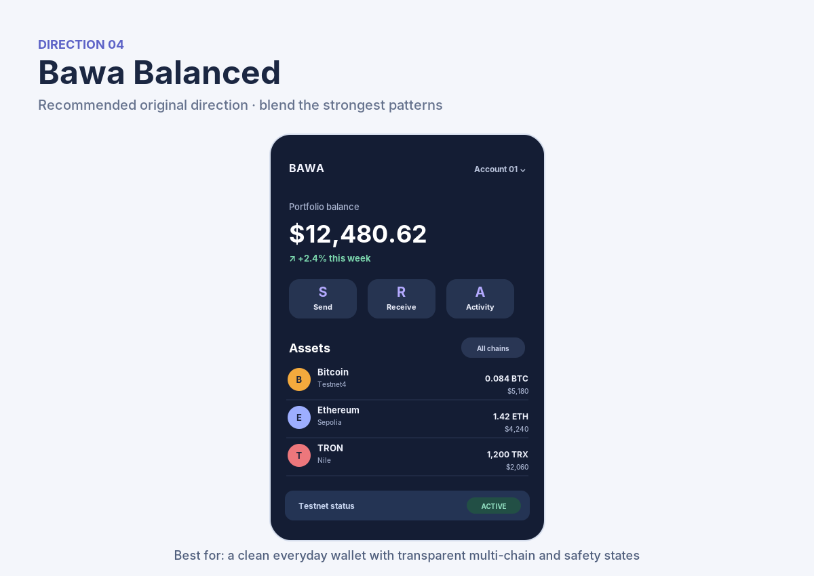

# Bawa

[](https://github.com/Pr3eve6ti2o/bawa/actions/workflows/ci.yml?query=branch%3Apanel-rebuild%2Fadopt-proper)
[](LICENSE)

Bawa is an open-source reference for HD-wallet workflows and an AI Wallet Builder. If you write wallet code or use an AI coding agent, give the agent one plain request; it uses this repo to produce a real, buildable project.

## Quickstart

[Install the requirements and clone this branch](#installation), then start the one-prompt workflow from the repo root:

```sh
node scripts/build-wallet.mjs "Create a Web wallet"
```

Replace the Web request with an Android or multi-chain request for those targets.

Check the generator from the repo root:

```sh
cd tools/hdwallet-gen && npm ci && npm test
```

**Verified expected result:** in a clean clone of this branch, exit `0`, `217` checks pass, `0` fail. The output includes:

```text
All register-links checks passed
```

## Installation

Install Node **22** (`22.23.4` verified) and Python **3.12+**. For the Android starter, also install **JDK 17** and **Android SDK 35**.

Clone this branch, install the generator dependencies, and return to the repo root:

```sh
git clone --branch panel-rebuild/adopt-proper https://github.com/Pr3eve6ti2o/bawa.git
cd bawa
cd tools/hdwallet-gen && npm ci
cd ../..
```

## Configuration

Choose your request text. Run the builder and launcher commands from the repo root.

| Item | Value or command |
| --- | --- |
| Builder request | `"Create a Web wallet"`; use an Android or multi-chain request for those targets. |
| Menu launcher | `python3 tools/bawa_cli.py` |
| Routed launcher | `python3 tools/bawa_cli.py --route "Create a Web wallet"` |
| Wallet engine | `@trustwallet/wallet-core` `4.9.3` |
| Web starter libraries | Dependencies: `@scure/bip39` `2.4.0`, `decimal.js` `10.6.0`, `dinero.js` `2.0.2`, `mnemonic-words` `2.0.0`; devDependency (test oracle): `bip39` `3.1.2` (bitcoinjs/bip39); Python requirement: `mnemonic==0.21` (trezor/python-mnemonic). See ADR-0005. |



*Bawa Balanced UI direction for builder output—not a screenshot of the running starter.*

Read the [full manual](docs/README-FULL.md): the previous 1,308-line README, preserved with only its link paths adjusted for the move from the root.

## Usage

### 1. [Derive one watch-only Bitcoin address](docs/README-FULL.md)

Run from `tools/hdwallet-gen`:

```sh
echo "zpub6rFR7y4Q2AijBEqTUquhVz398htDFrtymD9xYYfG1m4wAcvPhXNfE3EfH1r1ADqtfSdVCToUG868RvUUkgDKf31mGDtKsAYz2oz2AGutZYs" | node derive.js btc 1
```

Output (exit status `0`):

```text
bc1qnjg0jd8228aq7egyzacy8cys3knf9xvrerkf9g
```

This is a public test vector. **Never fund it.**

### 2. [Build a Web wallet](WALLET_BUILDER.md)

Run from the repository root:

```sh
node scripts/build-wallet.mjs "Create a Web wallet"
```

Verified routing result: the launcher routes your request as an existing tool.

Use the starters:

- [Web starter](WALLET_BUILDER.md): `apps/web` — React 19 + Vite + Tailwind; MIT.
- [Android starter](WALLET_BUILDER.md): `apps/android` — Kotlin + Compose + Material 3; Apache-2.0.

### 3. [Route a request through the launcher](WALLET_BUILDER.md)

Run from the repository root:

```sh
python3 tools/bawa_cli.py --route "build a web wallet"
```

Verified routing result: your request routes to the build command; exit status `0`.

## Documentation

| You need | Read |
| --- | --- |
| Full manual | [docs/README-FULL.md](docs/README-FULL.md) |
| Guide map | [docs/README.md](docs/README.md) |
| Docs index | [docs/index.md](docs/index.md) |
| Builder routing | [WALLET_BUILDER.md](WALLET_BUILDER.md) |
| Repository instructions | [AGENTS.md](AGENTS.md) |
| Capability map | [docs/CAPABILITY-MAP.md](docs/CAPABILITY-MAP.md) |
| Mainnet gap assessment | [docs/archive/mainnet-gap-assessment.md](docs/archive/mainnet-gap-assessment.md) |
| Contributing | [CONTRIBUTING.md](CONTRIBUTING.md) |
| Security | [SECURITY.md](SECURITY.md) |
| Changelog | [CHANGELOG.md](CHANGELOG.md) |
| Licence | [LICENSE](LICENSE) |

## Why this exists — and when not to use it

Use Bawa as a reference for [HD-wallet workflows](docs/README-FULL.md) and as a [builder](WALLET_BUILDER.md) that turns one plain request into a real, buildable project. It is **not** a hosted wallet, custody service, or exchange.

Mainnet send/broadcast is not implemented; broadcast stays disabled. The repository is mainnet-first in direction but testnet-safe in behaviour; read the [mainnet gap assessment](docs/archive/mainnet-gap-assessment.md). If you want a ready-made wallet to hold funds, use a production wallet instead.

## Passphrase policy

Bawa uses BIP-39, 24 words, with an empty BIP-39 passphrase. Record the passphrase policy alongside the mnemonic: the same mnemonic with a different passphrase is a different wallet.

If a restored wallet looks empty, re-derive your recorded first address with the recorded path and recorded BIP-39 passphrase policy. If it matches, the restore used the recorded inputs — that alone does not prove funds exist. If the recorded first address itself shows no funds on the recorded network, do not conclude the funds were never sent to that address: the address may have received and subsequently spent funds. Never re-fund a guess. See the [full manual](docs/README-FULL.md) for the troubleshooting table.

## Contributing

Follow [CONTRIBUTING.md](CONTRIBUTING.md) when you contribute.

## Help

Report bugs through the repository’s GitHub Issues.

## Licence

MIT — see [LICENSE](LICENSE).

## Maintainers

The repository owner, **Pr3eve6ti2o**, maintains Bawa.
