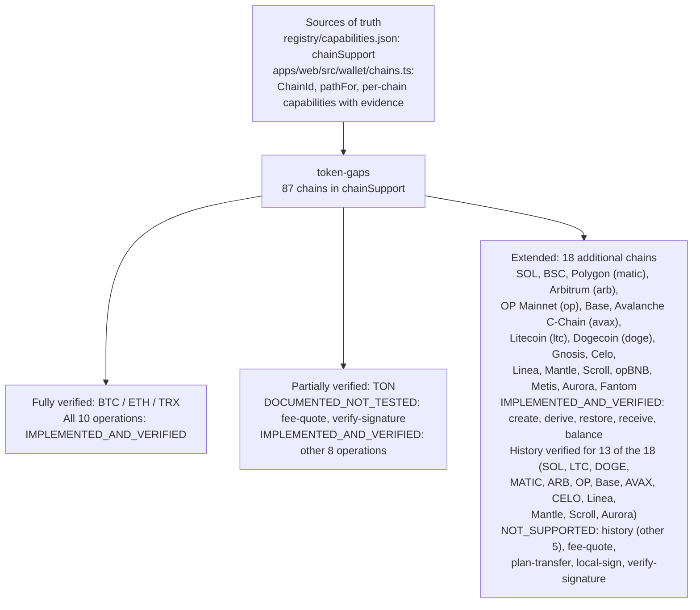

# Chain Registry & Asset Metadata

Reference.

> **Verified on:** 2026-11-08 (2026-11-28 docs-currency re-check, below)
> **Verification status:** Partially verified
> **Scope:** repo guide docs/12 against the pinned repo at 754721cd plus live registry checks
> **Repository commit:** 754721cd
>
> **Currency note (2026-11-28, token-gaps `734cfef`):** the 2026-11-08 verification rows below remain dated records. Re-checked at `734cfef`: `registry/capabilities.json` v4 holds 87 chains in `chainSupport` (22 curated + 65 expansion); `registry/chains.json` holds 87 chains and 169 RPC endpoints; history is `IMPLEMENTED_AND_VERIFIED` for 17 chains and `NOT_SUPPORTED` for the rest (among the 22 curated chains, only bsc, gnosis, opbnb, metis and fantom still read `NOT_SUPPORTED`); balance is `IMPLEMENTED_AND_VERIFIED` for 66 chains and `NOT_SUPPORTED` for 21 derive-only chains; chain logos number 87 (see below).
> **Tool versions:** Node v24.22.2 (VM), outside the repo's declared >=22 <23 range
> **Actually run:** Pinned-repository review; live `registry.json` checks
> **Not run:** A complete metadata contribution and validation workflow

## Contents

- [Trust Wallet Core registry](#trust-wallet-core-registry)
- [Bawa's four original chains in the registry](#bawas-four-original-chains-in-the-registry)
- [Bawa's own chain support](#bawas-own-chain-support)
- [Testnet and the registry](#testnet-and-the-registry)
- [Cosmos Chain Registry](#cosmos-chain-registry)
- [Trust Wallet Assets](#trust-wallet-assets)
- [Token identity](#token-identity)
- [Payment requests](#payment-requests)
- [Preparing registry and asset metadata](#preparing-registry-and-asset-metadata)
- [Reader checklist](#reader-checklist)

**Purpose:** Interpret upstream registry data, define token identity and organise metadata contributions.

**Audience:** Maintainers preparing chain or asset metadata changes.

**Prerequisites:** [Chain-specific rules and verified network scope](../02-chains/README.md); [Trust Wallet Core integration and independent verification](../11-trust-wallet-and-independent-verification/README.md).

**Status:** Metadata reference; contribution and validation procedures are incomplete.

Bawa ships a local chain registry: `registry/capabilities.json` (v4, with 87 chains in `chainSupport`), `registry/engines.json`, `registry/profiles.json`, and `registry/ui.json`. This section interprets Bawa’s local registry alongside the upstream Trust Wallet Core registry (`registry.json`) and Trust Wallet Assets, and explains what each can and cannot answer for Bawa.

The Trust Wallet Core registry is mainnet metadata: it holds 168 entries and zero testnet entries. It describes coin, derivation and address parameters for Trust Wallet Core; it does not define Bawa's supported networks. Trust Wallet Assets supplies asset metadata for identification and display; an entry there does not establish Bawa's engine compatibility or payment support.

For payment tracking, use the [canonical payment-request record and reconciliation guidance](../07-payment-tracking/README.md). Upstream metadata does not replace that record or its reconciliation rules.

## Trust Wallet Core registry

The field inventory in this section was verified against the four original Bawa entries (Bitcoin, Ethereum, TRON, TON) on 2026-11-08; the eighteen additional chains are covered in [Bawa's own chain support](#bawas-own-chain-support) below.

This is a selected subset of fields in `registry.json`, not a complete inventory:

- **internal chain ID** and display name.
- **Wallet Core coin ID** and optional [SLIP-44 coin type](https://github.com/satoshilabs/slips/blob/master/slip-0044.md); see [chain guidance](../02-chains/README.md) for chain-specific derivation rules.
- Native symbol and decimals.
- Blockchain implementation family.
- Derivation paths and alternate derivations.
- Bitcoin-style extended-key formats inside `derivation`; among Bawa's four chains, these are present only for Bitcoin.
- Elliptic curve and public-key type.
- Address prefixes and [HRP](../GLOSSARY.md) values (human-readable part: the readable prefix in an address encoding).
- Network identifiers, including the optional `chainId` field. In the Wallet Core 4.9.2 registry, this field is present on 100 of 168 entries, with all values stored as strings. It carries both EVM chain IDs and non-EVM network identifiers such as `cosmoshub-4`.
- Explorer and documentation links.

### Do not collapse identifiers

Keep these categories separate when interpreting metadata or preparing changes:

1. **Registry identity.** The **internal chain ID** identifies a registry entry; its display name is a label. Neither should stand in for an explicit network identifier.
2. **Coin identity.** The **Wallet Core coin ID** identifies a coin to the engine. The **SLIP-44 coin type** identifies the coin type used in derivation. Neither substitutes for network identity or a complete derivation policy.
3. **Network identity.** Specify the intended mainnet or testnet and its network identifier separately from the coin. An EVM chain ID belongs here; the optional `chainId` field is not a complete network catalogue.
4. **Token identity.** Combine the network with the token's chain-specific identifier, such as a contract address. Symbol and decimals describe the token; they do not uniquely identify it. Keep native assets distinct from token contracts.
5. **Wallet policy and formats.** Derivation paths, alternate derivations and Bitcoin-style extended-key formats describe available wallet options. Apply Bawa's chain-specific policy rather than treating every upstream option as enabled.
6. **Engine compatibility.** Blockchain family, elliptic curve and public-key type describe engine requirements. Their presence in the Trust Wallet Core registry does not verify Bawa's integration.
7. **Address encoding.** Prefixes and HRPs describe how an address is encoded. The resulting address string need not uniquely identify a network.
8. **References.** Explorer and documentation links provide supporting context; they do not define coin, network or token identity.

An EVM address can be identical across networks while the chain ID, native asset, token contracts, RPC endpoint and finality rules differ.

### Field map: what belongs where

This is a Bawa-focused interpretation map, not an exhaustive schema for all 168 entries. The categories are groupings; the "Fields to check" column gives the literal JSON keys and their nesting from the four-entry Bawa inventory. There is no top-level field called `coin`.

| Category | Fields to check | How to read them |
|---|---|---|
| Registry identity | `id`, `name`, `displayName` | `id` is the internal ID. `name` is the "More readable name"; optional `displayName` overrides `name` where visible to the user. |
| Coin identity | `coinId` | Wallet Core's internal chain ID. "In most cases" it is the BIP-44 derivation ID, but there are special cases. |
| Chain/blockchain metadata | `blockchain`, `chainId` | `blockchain` records the blockchain family. `chainId` is optional, stored as a string when present, and used for both EVM chain IDs and non-EVM network identifiers. Among the four Bawa entries, only Ethereum has `chainId`: its value is the string `"1"`, not a JSON number. |
| Token identity: native-asset metadata | `symbol`, `decimals`, `nativeTokenName` | These describe the native asset. `nativeTokenName` is optional and appears only on TON among the four entries. |
| Derivations and extended-key formats | `derivation` → `name`, `path`, `xpub`, `xprv` | The first derivation is the default; an alternative path is optional. `xpub` and `xprv` live inside `derivation` and define Bitcoin-style extended-key formats, present only for Bitcoin among the four entries. This is not a complete wallet-policy specification. |
| Cryptographic parameters | `curve`, `publicKeyType` | These are cryptographic parameters, not independent proof of integration compatibility. |
| Address-encoding metadata | `hrp`, `p2pkhPrefix`, `p2shPrefix` | Interpret the fields present in the selected entry. Do not assume every entry has every encoding field. |
| References | `explorer.url`, `explorer.txPath`, `explorer.accountPath`, `explorer.sampleTx`, `explorer.sampleAccount`, `info.url`, `info.source`, `info.rpc`, `info.documentation` | `explorer` is an object with URL-building sub-fields. Sample values must use existing IDs so the resulting full URL is valid. TRON has no `explorer.sampleTx` or `explorer.sampleAccount`. These fields are reference metadata, not evidence that an integration has been exercised. |

For the full SLIP-0132 prefix table (mainnet and testnet rows, labelled by network), see docs/01.

`slip44` is a real key in the wider 168-entry inventory, but it is absent from the four-entry field list. Keep it separate from `coinId`. The wider inventory also includes `staticPrefix`, `ss58Prefix`, `addressHasher`, `base58Hasher` and `publicKeyHasher`.

In `registry.json` at 4.9.2, the `explorer` object is present on 168/168 entries; `info.documentation` is present on 156/168 entries.

**Registry caveats**

- `chainId`: "Please note the chain id might not be always latest in registry. In transaction building current value has to be supplied each time."
- `coinId`: "In most cases" it is the BIP-44 derivation ID; shared IDs get `10000000` added and Ethereum-clone chains with no BIP-44 ID of their own generally use `10000000 + chainId`, but Optimism's `coinId` `10000070` (`slip44` `60`) is correct per the registry and is a legacy exception to that formula, while Arbitrum's `coinId` `10042221` (`slip44` `60`) is likewise not `10000000 + 42161`.
- `id`: "Lowercase letters only. Should be never changed."
- `explorer`: "the sample values should include existing IDs, so that the resulting full URL is valid."
- The field reference's Bitcoin example lists only segwit and legacy derivations; it does not cover the testnet derivation. Do not read that example as the complete derivation set.
- The registry's explorer URLs are mainnet defaults; use the guides' verified testnet endpoints (Web guide, Section E) for testnet work.

**Sources**

- [Core 4.9.3: field reference](https://github.com/trustwallet/wallet-core/blob/4.9.3/docs/registry-fields.md)
- [Core 4.9.3: raw registry](https://raw.githubusercontent.com/trustwallet/wallet-core/4.9.3/registry.json)

Pin for both sources: tag `4.9.3`, commit `7a21615fad32edd8dc0b040d845de3973cde2c5a`, published 2026-11-11, fetched and re-verified via the GitHub API 2026-11-20. R08 qualified 4.9.3 on 2026-11-12; E02 applied it on 2026-11-13. The Core 4.8.4 comparison commit is `d40d24a63d92619167903369308bf0e2f7eb3a59`. Re-pin and re-verify whenever the Core pin moves.

Verification recorded on 8 November 2026, on muse-vm, for repository snapshot e3b65fb832db287fdc8d54794980dd0b3456cc12. This page cites Wallet Core 4.9.2. Its registry was fetched live, and the 4.9.2 field reference returned HTTP 200. The four Bawa registry entries were byte-identical at 4.8.4, 4.9.2 and the then-current master. The equality check applies only to those four entries at that date, not to the whole registry or future master contents.

### Nine-chain pins (Core 4.9.3)

The following mainnet metadata pins were verified against [Wallet Core 4.9.3 `registry.json`](https://raw.githubusercontent.com/trustwallet/wallet-core/4.9.3/registry.json) and the `registry/capabilities.json` catalog. The nine rows were **prospective** metadata when verified; the nine chains are now implemented Bawa `CHAINS` entries (create, derive, restore, receive and balance verified — see [Bawa's own chain support](#bawas-own-chain-support)). This 4.9.3 check is separate from the existing four-chain 4.9.2 pin.

| Registry id | `coinId` | `slip44` | EVM `chainId` | Derivation path | Status |
| --- | --- | --- | --- | --- | --- |
| `solana` | `501` | — | — | `m/44'/501'/0'` | prospective |
| `smartchain` | `20000714` | `714` | `56` | `m/44'/60'/0'/0/0` | prospective |
| `polygon` | `966` | — | `137` | `m/44'/60'/0'/0/0` | prospective |
| `arbitrum` | `10042221` | `60` | `42161` | `m/44'/60'/0'/0/0` | prospective |
| `optimism` | `10000070` | `60` | `10` | `m/44'/60'/0'/0/0` | prospective |
| `base` | `8453` | — | `8453` | `m/44'/60'/0'/0/0` | prospective |
| `avalanchec` | `10009000` | — | `43114` | `m/44'/60'/0'/0/0` | prospective |
| `litecoin` | `2` | — | — | `m/84'/2'/0'/0/0` | prospective |
| `doge` | `3` | — | — | `m/44'/3'/0'/0/0` | prospective |

`—` under `slip44` means the registry does not carry that key, not that no SLIP-44 assignment exists; do not fill it by inference. `—` under EVM `chainId` marks a non-EVM chain. EVM chain IDs are shown in decimal.

Keep `coinId`, optional `slip44`, EVM `chainId` and the literal derivation path separate. Every EVM chain in this table derives on `60'`, regardless of `coinId` or `slip44`. SLIP-44 row `137` is Rootstock and row `10` is Blackcoin, so a chain ID must never be read as a coin type.

## Bawa's four original chains in the registry

The table gives Core's `registry.json` values at tag `4.9.2`, commit `17e3cd4df5d53f061ade3bbdc07d196f5ed5a8e3`, fetched 2026-11-08. These are the registry's values, not Bawa's derivation policy. For Bawa's pinned selections at repo commit `e3b65fb832db287fdc8d54794980dd0b3456cc12`, use docs/02's [Derivation and network policy](../02-chains/README.md#derivation-and-network-policy). The table covers the four original chains only; the eighteen additional chains are listed with their derivation paths in [Bawa's own chain support](#bawas-own-chain-support) below, and the nine newer EVM chains have no registry-pin table in this chapter yet — their entries live in `registry/capabilities.json`.

| Registry field | Bitcoin | Ethereum | Tron | TON (`id: "ton"`) |
| --- | --- | --- | --- | --- |
| `coinId` | `0` | `60` | `195` | `607` |
| `symbol` | `BTC` | `ETH` | `TRX` | `GRAM` |
| `decimals` | `8` | `18` | `6` | `9` |
| `curve` | `secp256k1` | `secp256k1` | `secp256k1` | `ed25519` |
| `publicKeyType` | `secp256k1` | `secp256k1Extended` | `secp256k1Extended` | `ed25519` |
| Derivations and registry `xpub` labels | segwit: `m/84'/0'/0'/0/0` (`xpub: "zpub"`)<br>legacy: `m/44'/0'/0'/0/0` (`xpub: "xpub"`)<br>testnet: `m/84'/1'/0'/0/0` (`xpub: "zpub"`)<br>taproot: `m/86'/0'/0'/0/0` (`xpub: "zpub"`) | `m/44'/60'/0'/0/0` | `m/44'/195'/0'/0/0` | `[{path: "m/44'/607'/0'"}]` (account node, with no `/0/0` level) |
| Other registry fields | `hrp: "bc"`; `p2pkhPrefix: 0`; `p2shPrefix: 5` | `chainId: "1"` (mainnet, stored as a string); `addressHasher: "keccak256"` | No `chainId` field | `nativeTokenName: "Gram"`; `blockchain: "TheOpenNetwork"`; `info.rpc: "https://toncenter.com/api/v2/jsonRPC"` (mainnet) |
| Explorer | `mempool.space` | `etherscan.io` | `tronscan.org` | `tonviewer.com` |
| Change from `4.8.4` to `4.9.2` | None: entry is byte-identical; the pin changes no registry value | None: entry is byte-identical; the pin changes no registry value | None: entry is byte-identical; the pin changes no registry value | None: entry is byte-identical; the pin changes no registry value |

All four entries were also byte-identical in the then-current `master` at the source date above.

Keep coin identity separate from network identity. Ethereum's `coinId` is 60, while its mainnet `chainId` is the string `"1"`. Tron's `coinId` 195 is not a network chain ID; its registry entry has no `chainId` field.

For these four chains, the SLIP-44 coin value is the `coinId`: 0, 60, 195 and 607 respectively. Only 12 of the 168 registry entries carry a separate `slip44` key, and none of these four does.

Bitcoin's testnet derivation is reproduced as stored, including the registry's `xpub: "zpub"` label. Do not treat that label as Bawa's testnet extended-key policy. Use the complete [testnet SLIP-0132 table in docs/02's policy section](../02-chains/README.md#derivation-and-network-policy) for that reference.

### TON: the native registry entry

The chain called TON in these guides is registry entry `ton`, with coin ID 607. In the checked upstream registry its symbol is `GRAM` and its native-token name is `Gram`. Do not locate this entry by expecting the symbol `TON`.

Use the entry ID `ton` as the lookup anchor, with coin ID 607 as corroboration. Moving from `4.8.4` to `4.9.2` does not remove this naming mismatch.

At tag `4.9.2`, the entry's derivation is `[{path: "m/44'/607'/0'"}]`: an account node with no `/0/0` level. That literal path comes from Core's registry, not from inferring a path from coin ID 607.

In Bawa's supplied implementation, TON support is **generation-only**. The generator outputs one deposit address per wallet, records `ton_address` and `ton_path`, and exports no TON xpub. Neither `derive.js` nor `derive-daemon.js` supports TON. Bawa stores the Wallet Core-derived value as `ton_path`, obtained from `CoinTypeExt.derivationPath(CoinType.ton)`; see docs/02's [Derivation and network policy](../02-chains/README.md#derivation-and-network-policy) for its interpretation.

For TON wallet configuration, the registry answers derivation only: it carries no wallet ID, no contract version and no testnet flag. The mainnet `info.rpc` endpoint does not supply those wallet settings.

The fixture below uses the published 15-word ripple test vector with an empty passphrase and the following wallet configuration. Its public key and addresses were verified in two independent ways (V3, 2026-11-08). See docs/11 for the full fixture record.

| Fixture field | Value |
| --- | --- |
| Wallet contract | Wallet V4 R2 |
| Wallet ID | `698983191` (`0x29A9A317`) |
| Workchain | `0` |
| ed25519 public key | `c8aeb00a8adb5879a58d031af01d6031fb743e1971a679c6ecea1354f022d0c9` |
| Raw address | `0:bb819bc655d0b16613c06b3663e376da80171261f36fc1066899e8de98ce700f` |
| Mainnet friendly address | `UQC7gZvGVdCxZhPAazZj43bagBcSYfNvwQZomejemM5wD3zn` |
| Bounceable mainnet address | `EQC7gZvGVdCxZhPAazZj43bagBcSYfNvwQZomejemM5wDyEi` |
| Bounceable testnet address | `kQC7gZvGVdCxZhPAazZj43bagBcSYfNvwQZomejemM5wD5qo` |
| Non-bounceable testnet address | `0QC7gZvGVdCxZhPAazZj43bagBcSYfNvwQZomejemM5wD8dt` |

The wallet ID was the missing configuration parameter: Wallet V4 R2 with wallet ID `0` gives a different address. The value `698983191` is this fixture's configuration, not a universal TON default.

The `UQC7…` form is a mainnet presentation, not a testnet address. Use the labelled testnet forms when referring to this fixture on testnet.

## Bawa's own chain support

This section is about Bawa's own registry (`registry/capabilities.json`,
`chainSupport`) and `apps/web/src/wallet/chains.ts` — not the upstream Trust
Wallet Core registry described above. Statuses are `IMPLEMENTED_AND_VERIFIED`,
`DOCUMENTED_NOT_TESTED` or `NOT_SUPPORTED`, as recorded in
`registry/capabilities.json`. The ten operations are: create, derive, restore,
receive, balance, history, fee-quote, plan-transfer, local-sign,
verify-signature.

**Re-validation note (2026-11-26, guide-update pass):**
`multichain-extended-wallet` (`registry/profiles.json`) lists 9
chains — SOL, BSC, Polygon (matic), Arbitrum (arb), OP Mainnet (op),
Base, Avalanche (avax), Litecoin (ltc), Dogecoin (doge) — and all 9
have balance `IMPLEMENTED_AND_VERIFIED` in `chainSupport` and a
balance adapter in the app (none is in the 21 derive-only chains,
`chain-registry.test.ts`). History in the registry no longer lags the app: the registry v4 update (commit `2a0fa75`, 2026-11-26) records history `IMPLEMENTED_AND_VERIFIED` for matic, arb, base and avax — 8 of the 9 profile chains have history I&V now; only bsc reads `NOT_SUPPORTED`, and bsc is blocked in `chains.ts` too. The profile's chains list itself is correct as written. The validator failure is closed — the v4 validator exits 0 with 0 errors (see `docs/index.md`).



Derivation paths below are Bawa's pinned `pathFor` values
(`apps/web/src/wallet/chains.ts`; `a` = account, `i` = index). TON and SOL
are single-address: their paths ignore account and index. The fifty-six EVM chains beyond ETH that share its derivation scheme all use coin type 60, the same path shape as ETH — they are distinct chains that share a derivation scheme, not the same chain. Five more EVM chains (Filecoin, Theta, IoTeX, Rootstock, Ethereum Classic) derive on their own coin paths.

| Chain | Derivation path | token-gaps (87 chains in chainSupport) |
| --- | --- | --- | --- |
| Bitcoin (btc) | `m/84'/0'/a'/0/i` | Fully verified (10/10) |
| Ethereum (eth) | `m/44'/60'/a'/0/i` | Fully verified (10/10) |
| TRON (trx) | `m/44'/195'/a'/0/i` | Fully verified (10/10) |
| TON (ton) | `m/44'/607'/0'` (one address) | Partial: fee-quote, verify-signature `DOCUMENTED_NOT_TESTED`; other 8 verified |
| Solana (sol) | `m/44'/501'/0'` (one address) | Extended (5/10) |
| BNB Smart Chain (bsc) | `m/44'/60'/a'/0/i` | Extended (5/10) |
| Polygon (matic) | `m/44'/60'/a'/0/i` | Extended (5/10) |
| Arbitrum One (arb) | `m/44'/60'/a'/0/i` | Extended (5/10) |
| OP Mainnet (op) | `m/44'/60'/a'/0/i` | Extended (5/10) |
| Base (base) | `m/44'/60'/a'/0/i` | Extended (5/10) |
| Avalanche C-Chain (avax) | `m/44'/60'/a'/0/i` | Extended (5/10) |
| Litecoin (ltc) | `m/84'/2'/a'/0/i` | Extended (5/10) |
| Dogecoin (doge) | `m/44'/3'/a'/0/i` | Extended (5/10) |
| Gnosis (gnosis) | `m/44'/60'/a'/0/i` | Extended (5/10) |
| Celo (celo) | `m/44'/60'/a'/0/i` | Extended (5/10) |
| Linea (linea) | `m/44'/60'/a'/0/i` | Extended (5/10) |
| Mantle (mantle) | `m/44'/60'/a'/0/i` | Extended (5/10) |
| Scroll (scroll) | `m/44'/60'/a'/0/i` | Extended (5/10) |
| opBNB (opbnb) | `m/44'/60'/a'/0/i` | Extended (5/10) |
| Metis (metis) | `m/44'/60'/a'/0/i` | Extended (5/10) |
| Aurora (aurora) | `m/44'/60'/a'/0/i` | Extended (5/10) |
| Fantom (fantom) | `m/44'/60'/a'/0/i` | Extended (5/10) |

- **Fully verified** = all 10 operations `IMPLEMENTED_AND_VERIFIED`.
- **Extended (5/10)** = create, derive, restore, receive, balance
  `IMPLEMENTED_AND_VERIFIED`; history, fee-quote, plan-transfer,
  local-sign, verify-signature `NOT_SUPPORTED`. An extended chain has no
  history or signing support in the repo — do not present it as a
  working wallet chain.
- No broadcast exists for any chain in the repo.

Note (resolved 2026-11-26 by the registry v4 update, commit `2a0fa75`): history is now `IMPLEMENTED_AND_VERIFIED` in the registry for SOL, LTC and DOGE and 14 further chains (17 total); only bsc, gnosis, opbnb, metis and fantom still read `NOT_SUPPORTED`. The two sources agree; the re-verification is closed.

## Testnet and the registry

Core's registry is not a testnet directory. The registry provides mainnet-scoped chain metadata, not Bawa's testnet identities. The guides target Bitcoin testnet4, Ethereum Sepolia, TRON Nile and TON testnet.

Sepolia's guide configuration uses chain ID `11155111`; the registry's Ethereum `chainId` value `1` describes mainnet and must not be substituted for it. The TRON registry entry supplies no `chainId`. Bitcoin's embedded testnet derivation is derivation metadata, not a separate testnet chain entry.

The following results come from live endpoint checks on **2026-11-08**, not from the registry. The heights and sequence number are dated snapshots, not values to hardcode as current.

| Chain | Guide testnet | Result checked on 2026-11-08 | Live check |
| --- | --- | --- | --- |
| Bitcoin | testnet4 | Tip height `159843` | `curl -s https://mempool.space/testnet4/api/blocks/tip/height` |
| Ethereum | Sepolia | Chain ID `11155111` | JSON-RPC `eth_chainId` against `https://ethereum-sepolia-rpc.publicnode.com`; expected result `0xaa36a7` |
| TRON | Nile | Latest block `72533032` | `curl -s -X POST https://nile.trongrid.io/wallet/getnowblock` |
| TON | testnet | `getMasterchainInfo`: `ok: true`, `seqno: 96592760` | `curl -s "https://testnet.toncenter.com/api/v2/getMasterchainInfo"` |

### The Bitcoin testnet4 deviation

> **Project deviation:** Bawa pins Core's default mainnet SegWit derivation, selected explicitly in `generate.js`, and applies it to testnet4. Bawa's Bitcoin testnet4 workflow retains `m/84'/0'/0'/0/i` and `zpub` serialisation. This is not the BIP-44/SLIP-44 testnet convention.
>
> See the **[canonical deviation explanation in docs/02](../02-chains/README.md#derivation-and-network-policy)**.

The registry states: "The first derivation is considered the default". Its first derivation is mainnet SegWit `m/84'/0'/0'/0/0`. That ordering rule does not specify automatic testnet selection.

The standards-conformant testnet pair under BIP-84 and SLIP-0132 is `m/84'/1'/0'/0/i` with `vpub` (`0x045f1cf6`). Core ships that derivation too. A standard BIP-84 testnet wallet following the coin-type-`1'` path will derive different keys and addresses from the same mnemonic, so it will not discover Bawa-path addresses or any associated funds.

The registry's embedded testnet row records `m/84'/1'/0'/0/0` with its `xpub` field set to `"zpub"`. Core's registry labels this testnet row `zpub`, whereas standard testnet BIP-84 serialisation uses `vpub` (`0x045f1cf6`). Do not assume the registry label establishes the exported version bytes; verify Core's actual testnet export behaviour.

The registry's `xpub` field declares its XPub/XPriv format metadata; it is not itself a SLIP-0132 registration. This testnet row is not a justification for Bawa's coin-type-`0'` path.

In a Bitcoin Core descriptor, the testnet extended public key is conventionally `tpub`, and the `wpkh(...)` wrapper carries the script type. For a BIP-84 testnet account export, the standards prefix is `vpub` (`0x045f1cf6`). Changing an extended-key prefix re-encodes the same node; it does not move it onto another derivation path. Reserialising `zpub` as `vpub` does not derive a different testnet account.

The [complete testnet rows in docs/02](../02-chains/README.md#derivation-and-network-policy) cover BIP-44 (`tpub`), BIP-49 (`upub`) and BIP-84 (`vpub`), including their version bytes and account paths. The SLIP-0132 table in docs/01 now carries both mainnet and testnet rows, each labelled by network; the complete testnet rows are also in docs/02's policy section.

## Cosmos Chain Registry

[`cosmos/chain-registry`](https://github.com/cosmos/chain-registry) is a complementary source for Cosmos testnet chain metadata: chain IDs, address prefixes, endpoints, asset lists and SLIP-0044 values. Its scope is chain metadata, not wallet signing, and listed endpoints carry no availability guarantee. It does not establish Cosmos as a supported Bawa chain.

## Trust Wallet Assets

Trust Wallet Assets is an asset/token metadata registry, not a wallet or signing library. Its documented domain includes token logos, `info.json` metadata and validation ([README, lines 9, 12, 47 and 50](https://github.com/trustwallet/assets)). It does not own wallet keys, derivation, signing or transaction handling.

Keep the following separate:

| Layer | Responsibility |
|---|---|
| Trust Wallet Core | Keys, derivation, addresses and signing |
| Trust Wallet Assets | Token metadata, logos and validation |
| RPC / node / indexer | Current chain state, history, logs and UTXOs |
| Application database | Address allocation, orders, payments and reconciliation |

Bawa's tools derive addresses for native assets only. BTC, ETH and TRX are watch-only; TON is generation-only, with one deposit address and no xpub. SOL is wired (adapter + balance + offline signing); ADA is derive-only (CIP-1852, receive works, no balance/history/send adapter). The tools provide no token derivation, token balances or token transfers.

Token tracking in `docs/06` and `docs/07` (ERC-20, TRC-20 and [SPL](https://github.com/solana-foundation/solana-com/blob/main/apps/docs/content/docs/en/tokens/index.mdx), indexers, `Transfer` events and token metadata) is downstream consumption of chain data, not Bawa functionality.

### Logos actually vendored in the app

> Lane C, FIX-ALL programme, 2026-11-24. The logos the wallet shows are copies of Trust Wallet Assets files, vendored into the repo — the app never fetches a logo from the network at runtime.

**Trust Wallet Assets — logo source.** What it is: the Trust Wallet token/asset metadata registry (`trustwallet/assets`); how the wallet uses it: the chain and token logos in `apps/web/src/assets/chains/` and `apps/web/src/assets/tokens/`, rendered by `ChainLogo` / `TokenLogo` in `apps/web/src/screens/token-logo.tsx`. Direct links: <https://github.com/trustwallet/assets>, <https://github.com/trustwallet/assets/blob/master/knowledge/architecture/repo-overview.md>.

- Pinned at commit `e8f61783ac6451fa8b7b1b4f72bf4a9607f6872e` (verified to exist on GitHub 2026-11-24). Re-pin and re-verify whenever the pin moves; a logo copied from a different commit is a different file until checked.
- Licence: MIT, Copyright (c) 2019-2023 Trust Wallet. No fee, no paid tier — it is a public registry.
- Chain logos live at `blockchains/<chain>/info/logo.png` upstream. The 87 vendored chain logos (one per chain in the 87-chain registry; the 22 listed below were the original curated set), with the directory corrections the registry itself requires: `bitcoin`, `ethereum`, `tron`, `ton`, `solana`, `smartchain` (BNB Smart Chain — NOT `binance`, which is the BNB Beacon Chain mark), `polygon`, `arbitrum`, `optimism`, `base`, `avalanchec`, `litecoin`, `doge`, `xdai` (Gnosis — `gnosis` does not exist upstream), `celo`, `linea`, `mantle`, `scroll`, `opbnb`, `metis`, `aurora`, `fantom`. Each logo's upstream `info.json` name was verified at fetch time.
- Token logos live at `blockchains/ethereum/assets/<contract>/logo.png` upstream. The 8 vendored token logos: USDC `0xA0b86991c6218b36c1d19D4a2e9Eb0cE3606eB48`, USDT `0xdAC17F958D2ee523a2206206994597C13D831ec7`, DAI `0x6B175474E89094C44Da98b954EedeAC495271d0F`, LINK `0x514910771AF9Ca656af840dff83E8264EcF986CA`, UNI `0x1f9840a85d5aF5bf1D1762F925BDADdC4201F984`, WBTC `0x2260FAC5E5542a773Aa44fBCfeDf7C193bc2C599`, WETH `0xC02aaA39b223FE8D0A0e5C4F27eAD9083C756Cc2`, and USDT0 on Arbitrum `blockchains/arbitrum/assets/0xFd086bC7CD5C481DCC9C85ebE478A1C0b69FCbb9/logo.png` (upstream name Tether USD, symbol USDT — the USDT0 contract on Arbitrum).
- Served as WebP: the same Trust Wallet images, resized to 96 px and re-encoded at quality 85 — 157,482 bytes total vs 2,044,496 bytes for the 87 PNGs (-92%). The original PNGs stay in `src/assets/chains` and `src/assets/tokens` as the canonical sources. (2026-11-28, token-gaps `734cfef`; the 39,670 / 303,787 figures were the 22-logo totals.)
- Trust Wallet resolves logos by contract address, not by symbol; the wallet's symbol map (plus aliases for the on-chain spellings the registry reports — `USD₮` → USDT, `USD₮0` → USDT0) is this wallet's simplification of that. A token with no registered logo renders an honest empty state (a plain ring, no fill, no ticker text), never a broken image and never a yellow text square (Lane B removed the yellow ticker badge, 2026-11-24). Full detail, including the per-logo fetch notes, is in `apps/web/README.md` ("Chain logos" and "Token logos").

### Token logos in the web wallet (canonical source)

The web wallet shows a real logo for every chain and every default
token, all the time. The canonical logo source is
[Trust Wallet Assets](https://github.com/trustwallet/assets)
(MIT licence, Copyright (c) 2019-2023 Trust Wallet), pinned at
commit `e8f61783ac6451fa8b7b1b4f72bf4a9607f6872e`. Nothing is
fetched from the repo at runtime: the logos are copied into the
app at `apps/web/src/assets/chains/` (natives) and
`apps/web/src/assets/tokens/` (ERC-20s), each stored twice — the
original PNG (canonical source) and a 96 px WebP at quality 85 (one exception at `734cfef`: WETH ships WebP only, no PNG in the tree) —
and rendered by `apps/web/src/screens/token-logo.tsx`
(`CHAIN_LOGOS` chain-keyed, `TOKEN_LOGOS` symbol-keyed with the
on-chain spelling aliases `USD₮` → USDT, `USD₮0` → USDT0).

Native chain logos live at `blockchains/<dir>/info/logo.png`
(`<dir>` is the Trust Wallet directory, not the Bawa chain id):

| Bawa chain | Trust Wallet directory | Bawa chain | Trust Wallet directory |
|---|---|---|---|
| btc (Bitcoin) | `bitcoin` | doge (Dogecoin) | `doge` |
| eth (Ethereum) | `ethereum` | gnosis (Gnosis) | `xdai` |
| trx (TRON) | `tron` | celo (Celo) | `celo` |
| ton (TON) | `ton` | linea (Linea) | `linea` |
| sol (Solana) | `solana` | mantle (Mantle) | `mantle` |
| bsc (BNB Smart Chain) | `smartchain` | scroll (Scroll) | `scroll` |
| matic (Polygon) | `polygon` | opbnb (opBNB) | `opbnb` |
| arb (Arbitrum One) | `arbitrum` | metis (Metis) | `metis` |
| op (OP Mainnet) | `optimism` | aurora (Aurora) | `aurora` |
| base (Base) | `base` | fantom (Fantom) | `fantom` |
| avax (Avalanche C-Chain) | `avalanchec` | ltc (Litecoin) | `litecoin` |

Directory corrections (a wrong directory shows the wrong mark):
BSC is `smartchain`, not `binance` (BNB Beacon Chain); Avalanche
C-Chain is `avalanchec`, not `avalanche`; Dogecoin is `doge`, not
`dogecoin`; Gnosis is `xdai`, not `gnosis` (no such directory).
Each logo's upstream `info.json` name was verified at fetch time.

ERC-20 token logos live at
`blockchains/ethereum/assets/<contract>/logo.png` (USDC
`0xA0b86991c6218b36c1d19D4a2e9Eb0cE3606eB48`, USDT
`0xdAC17F958D2ee523a2206206994597C13D831ec7`, DAI
`0x6B175474E89094C44Da98b954EedeAC495271d0F`, LINK
`0x514910771AF9Ca656af840dff83E8264EcF986CA`, UNI
`0x1f9840a85d5aF5bf1D1762F925BDADdC4201F984`, WBTC
`0x2260FAC5E5542a773Aa44fBCfeDf7C193bc2C599`, WETH
`0xC02aaA39b223FE8D0A0e5C4F27eAD9083C756Cc2`), except USDT0 at
`blockchains/arbitrum/assets/0xFd086bC7CD5C481DCC9C85ebE478A1C0b69FCbb9/logo.png`.
Trust Wallet resolves logos by contract address, not by symbol;
the symbol map is this wallet's simplification of that.

Fetchable form (pinned commit — use this to verify a logo, never
an unpinned `master` link):

`https://raw.githubusercontent.com/trustwallet/assets/e8f61783ac6451fa8b7b1b4f72bf4a9607f6872e/blockchains/<dir>/info/logo.png`

Live check 2026-11-24 (Lane B): six sampled URLs return HTTP 200
at the pinned commit — Gnosis (`xdai`), Mantle, Fantom, Ethereum
USDC, Arbitrum USDT0, Bitcoin.

Fallback chain — what happens when a logo is missing (real logo →
chain logo → honest empty state, never a yellow text square):
a registered logo renders as the image; a chain with no chain
logo falls back to its symbol's token logo; anything still
missing — or an image that fails to load — renders an honest
empty state (a plain ring, no fill, no ticker text), never a
broken image and never a yellow text square. Lane B (2026-11-24)
removed the yellow ticker badge the fallback used to render: it
read as a broken logo (owner, 2026-11-23 — token icons as yellow
text squares). The symbol is already shown as text beside the
logo, so nothing is lost.

Adding a logo: fetch `logo.png` from the pinned commit above,
verify its upstream `info.json` name matches the token, store
the PNG plus a 96 px WebP (quality 85) under
`src/assets/chains/` or `src/assets/tokens/`, and register it in
`token-logo.tsx` (`CHAIN_LOGOS` by chain id, `TOKEN_LOGOS` by
symbol). Re-pin the commit only when the repo moves and every
logo is re-verified against the new pin.

## Token identity

Never identify a token by symbol alone. Use this normalised identity:

```text
network_id + asset_id
```

This is the conceptual lookup key, not the complete identity record. For contract-based tokens, `asset_id` contains the canonical contract address, subject to the per-standard qualifications below.

Use a distinct `network_id` for each mainnet or testnet when you construct a token identity. It must also distinguish the relevant non-EVM network context.

A resolved identity record requires the network, the canonical token identifier, verified decimals and verified metadata. Expected decimals and metadata belong alongside the identity as verification data, not as substitutes for the token identifier or additional primary-key discriminators.

Verify decimals through chain-appropriate token data **or** an independently reviewed, network-scoped registry. A missing or conflicting decimals value leaves the asset unresolved. No registry is currently designated as reviewed in this guide set; that designation remains an open item.

Qualify the token identifier by standard:

| Standard | Token identifier in `asset_id` | Qualification |
|---|---|---|
| ERC-20 | Canonical token contract address | Use the contract on the specified network: for the Sepolia testnet, use the Sepolia ERC-20 contract. |
| TRC-20 | Canonical token contract address | Use the contract on the specified network: for the Nile testnet, use the Nile TRC-20 contract. |
| SPL | Mint address | Use the mint on the network identified by `network_id`. |
| [TON Jettons](https://docs.ton.org/v3/guidelines/dapps/asset-processing/jettons) | Jetton master contract address | Use the canonical master contract address, never a holder's Jetton wallet contract. |

A Jetton wallet contract concerns a holder's holdings and operations; it must not replace the master address as the token identifier. Adding a holder-specific wallet address to the global asset key would split one Jetton into different asset identities per holder.

A verified link to the governing TRC-20 documentation remains an open item.

### Assets identifier comparison

Keep these identifier representations distinct:

- **`docs/12` conceptual lookup key:** `network_id + asset_id`, with an explicit deployment-network identifier and the token identifier qualified above.
- **Trust Wallet Assets `asset_id`:** `c<coinId>_t<address>`, which already contains a coin identifier as well as the token address.

The abbreviated example `c60_t0x4Fabb...` denotes an Ethereum token (coinId 60) at the address shown. Here, 60 is Ethereum's coinId in the Assets format; it does not establish a deployment-network `network_id`. Do not substitute the coinId for that network identifier.

USDC's Ethereum and Base deployments have separate identities. Matching symbols do not merge the deployments. Each record must retain its network, canonical contract address and expected decimals and metadata, with the verification required above. Bawa's tools provide no USDC or Base token functionality.

### Worked identifier example

This is a walkthrough of the supplied fields from the Ethereum entry in 4.9.2, not a complete JSON reproduction.

#### Coin identity is not network identity

`coinId` is `60`. `chainId` is `"1"`, stored as a string. The coin ID identifies the coin; the EVM chain ID identifies the network. They are not interchangeable.

#### Read the native-asset metadata

`symbol` is `ETH` and `decimals` is `18`. These describe the native asset, not the tokens deployed on the network.

#### Read the supplied derivation

The supplied derivation path is `m/44'/60'/0'/0/0`. It describes key derivation, not network selection.

#### Read the cryptographic compatibility fields

`curve` is `secp256k1`, `publicKeyType` is `secp256k1Extended` and `addressHasher` is `keccak256`. These fields describe cryptographic compatibility; they do not establish network or token identity.

#### Read the explorer reference

The supplied explorer reference is `etherscan.io`. It does not replace the network or asset identifier.

#### USDC on Ethereum and Base

The following USDC metadata was verified on-chain on 2026-11-08:

| Network | EVM chain ID | Contract address | Name | Symbol | Decimals |
| --- | --- | --- | --- | --- | --- |
| Ethereum | `1` | `0xA0b86991c6218b36c1d19D4a2e9Eb0cE3606eB48` | USD Coin | `USDC` | `6` |
| Base | `8453` (`0x2105`) | `0x833589fCD6eDb6E08f4c7C32D4f71b54bdA02913` | USD Coin | `USDC` | `6` |

The name, symbol and decimals match exactly, while the network-and-contract pairs differ. Those pairs make the document's `network_id + asset_id` rule concrete: each token is identified by its network and contract, not by its name, symbol or decimals.

Economic asset grouping can relate the same branded asset across chains, including through bridges, while on-chain token identity remains the network-and-contract pair.

The Ethereum native-asset metadata gives `18` decimals for `ETH`; `USDC` has `6` on both networks shown here. Use the token's own decimals when interpreting its amounts. Do not substitute the native asset's decimal count. Running this example through an addition procedure, with observed output, is still open.

#### Identifier separation (placeholders)

Every value in angle brackets is a placeholder. This example illustrates identifier separation; it is not a validated chain or asset entry.

The same wallet address text is used on networks `<NET_A>` and `<NET_B>`.

| Token | Network | Contract address | Decimals | Symbol |
| --- | --- | --- | --- | --- |
| A | `<NET_A>` | `<CONTRACT_X>` | `<DECIMALS_X>` | `<SYMBOL_X>` |
| B | `<NET_B>` | `<CONTRACT_X>` | `<DECIMALS_X>` | `<SYMBOL_X>` |

Asset A ≠ asset B.

The networks differ, so these are different token identities even though the contract address text, decimals and symbol match. The shared wallet address does not select a network. Do not substitute an internal chain ID, Wallet Core coin ID or SLIP-44 coin type for the EVM chain ID.

## Payment requests

Use [docs/07](../07-payment-tracking/README.md) for the full payment-request record, payment matching and reconciliation.

Record the network, asset type, chain-specific asset identity, decimals verified under the shared identity policy, recipient, amount in atomic units, and memo/tag where required. Freeze the quote snapshot into the payment request before presenting the amount, retaining its timestamp and expiry where applicable. Keep live price collection separate from payment calculation. The watcher must compare the observed destination, asset and atomic amount against the saved request's frozen values, validate the required fields, and apply the confirmation/finality policy before accepting a match.

For ERC-20 requests, record the chain ID and token contract explicitly alongside the recipient and amount in atomic units. Keep request identity separate from the later observation record.

For ERC-20, a watcher can check whether an observed Transfer matches the requested chain, token contract, recipient and amount. A standard token-transfer event contains no invoice reference, so a shared recipient and matching amount do not establish unique invoice attribution. See [docs/07](../07-payment-tracking/README.md) for event evidence and attribution limits.

### Receive QR payload

Receive-QR encoding follows the payment-request record in [docs/07](../07-payment-tracking/README.md), where the full payload table and verification contract live. The Web guide contains the Web scanning specification.

Keep the six-field application request separate from the QR payload. Serialise only the fields allowed by the selected profile below, never an application-specific six-field QR object. Retain fields not carried by the payload in the associated request and display them with it. All profiles below are testnet-only. Currency note (2026-11-28): the live web wallet is mainnet-only, and mainnet Receive uses the same payload shapes with mainnet addresses (see docs/07 and `docs/web-wallet/WEB-GUIDE.md` §J); the web Receive card renders seven templates A–G with a Starknet receive-only warning on every template and in the exported PNG (77e4473). The testnet forms below remain the testnet procedure.

| Profile | Approved payload | Constraints |
| --- | --- | --- |
| BTC testnet4 | `bitcoin:?tb=<ADDRESS>`, optionally followed by `&amount=<BTC>` (decimal BTC) | [BIP-321](https://github.com/bitcoin/bips/blob/master/bip-0321.mediawiki) supersedes BIP-21. Leave the URI body empty; put the testnet address in `tb`. A BTC URI alone does not establish testnet4: retain the selected network and compare it with the associated request. |
| ETH Sepolia | `ethereum:pay-<ADDRESS>@11155111`, optionally followed by `?value=<WEI>` (scientific-notation wei) | [ERC-681](https://eips.ethereum.org/EIPS/eip-681). The network is explicit in `@11155111`. The amount is a suggestion. No gas parameters, ENS, ERC-20 or function path. |
| TON testnet | `ton://transfer/<TESTNET_ADDRESS>`, with optional `?amount=<NANOCOINS>` (nanocoins) and `?text=<TEXT>` (URL-encoded UTF-8) | A de facto Keeper/Tonhub vendor convention, not a standard. Use `&` between query parameters when both are present. Require the full testnet address presentation; never use `bin`, `jetton` or `exp`. |
| TRX Nile | Bare 34-character Base58 address beginning with `T` | No `tron:` payment URI exists to prescribe. The amount stays outside the QR. Nile identity comes from wallet configuration, never from the address. |

For TON, use a full testnet address presentation, such as `kQC7gZvGVdCxZhPAazZj43bagBcSYfNvwQZomejemM5wD5qo` or `0QC7gZvGVdCxZhPAazZj43bagBcSYfNvwQZomejemM5wD8dt`, never the `UQC7…` mainnet presentation.

All four forms carry the recipient. The BTC, ETH and TON profiles fix the asset to the native asset; TRX asset identity comes from context. Memo/tag is carried only by TON `text`; otherwise it is not carried. Expiry is not carried by any approved form and stays in the request record. "Not carried" refers to these approved Bawa output forms, not to the capabilities of the underlying protocols.

A supported amount-less payload, including TRX's address-only form, is not by itself a complete six-field request. If a scan has no associated request metadata, leave missing fields unavailable rather than assigning defaults or claiming they were verified.

Show the full recipient address and selected chain/testnet beside a matching QR, with any requested amount explicit. Validate explicit paste/scan against the chosen chain, review QR destination and amount, and reject unsupported payloads.

Set QR error correction explicitly to `M` (~15%); do not rely on an encoder default. Decode and verify the actual QR output before presenting it as verified. Apply the same checks to generated and scanned payloads through `P.renderAndVerifyQr`, `P.scanPaymentRequest`, `E.parsePaymentRequest` and `E.verifyPaymentRequest`, as defined in docs/07. Successful verification is not proof of payment.

## Preparing registry and asset metadata

Before adding a chain, confirm the Bawa chains' derivation and network policy in docs/02's "Derivation and network policy" section (Bitcoin, Ethereum, TRON, TON).

This checklist covers metadata preparation only; it is not a complete contribution procedure. Do not rely on Bawa for the exact JSON schemas, complete rules for required and optional fields, asset directory layout, validation commands and outputs, submission steps, or engine integration and testing requirements. This document does not reproduce the Assets contribution guide. Engine integration requirements are also undocumented; their home is `docs/11`.

Use this checklist to prepare and review an addition. Do not rely on it as a verified submission procedure. Treat the checks as review criteria rather than tool output.

1. **Chain: Wallet Core registry**

   List the fields and proposed values for the `registry.json` entry. Check them against the field reference and the registry. Mark unconfirmed values as unknown rather than guessing paths, prefixes or identifiers.

   For chain or engine changes, check Wallet Core's documentation and confirm integration and testing requirements with its maintainers. The Assets token procedure is not a Core chain-registration procedure. Do not apply Assets' `make check` to registry changes by assumption.

   **Expected result:** Registry, coin and network identifiers kept distinct, with metadata for wallet policy, key formats and address encoding recorded.

2. **Asset: Trust Wallet Assets**

   Confirm the network, canonical contract address and verified decimals before preparing token metadata.

   For Trust Wallet Assets additions, start with the Assets README's How to add token section (`https://github.com/trustwallet/assets/blob/master/README.md#how-to-add-token`) and use the Assets web app (`https://assets.trustwallet.com`) as directed there. Follow the README's documented `make add-token` and `make check` instructions.

   The developer contribution guide linked by that README was unavailable at its published URL when checked on 2026-11-08: it redirected to the Trust Wallet marketing homepage rather than the guide. Use the working entry points above while that link remains unavailable.

   The Assets web app is the preferred route; use it with a GitHub account. Brand new tokens are not accepted: projects must have non-minimal circulation.

   The [add-token guide](https://github.com/trustwallet/assets/blob/master/knowledge/guides/add-token.md), updated 2026-07-22, documents the following commands, fields and artefacts. Check which files are required for the addition; do not assume every file type is mandatory.

   - For manual scaffolding, use `make add-token` with a verified asset ID. This upstream README example creates an `info.json` asset template; its asset ID is not a value to reuse for an arbitrary new asset:

     ```sh
     make add-token asset_id=c60_t0x4Fabb145d64652a948d72533023f6E7A623C7C53
     ```

   - Fill the generated `info.json`, following the guide for Name, Symbol, Type, Decimals, Website, Explorer, Status, ID, Links and Tags.
   - For the logo, use the documented path: `blockchains/<chain>/assets/<address>/logo.png`.
   - Token-list preparation is optional: use `make add-tokenlist` or `make add-tokenlist-extended` where needed.
   - Run `make check` in the Assets repository. It validates the entire repository and must pass in CI.
   - Use `make fix` for automatic logo resizing and JSON formatting fixes.

   **Expected result:** A token identity that includes its network as well as the symbol.

The exact JSON schemas, complete field rules, full asset directory layout, validation outputs and submission steps remain unresolved here. The registry-change runbook also remains unresolved: schemas, required/optional rules, submission steps, review requirements and the engine integration/testing hand-off. The Assets instructions do not cover that registry-change procedure.

Do not treat this checklist as a ready-to-apply chain or asset patch, or present a metadata-only change as cryptographic engine support.

## Reader checklist

- [ ] Confirm the registry source is Core 4.9.2 against its recorded tag, commit and fetch date.
- [ ] Confirm the four Bawa entries against the values table.
- [ ] Confirm that you understand the `testnet4` deviation note before deriving testnet addresses.
- [ ] Confirm that each token identity includes its network, canonical contract address and verified decimals.
- [ ] Confirm that a payment request's quote is frozen before the request is presented.
- [ ] Confirm that every receive QR uses the approved per-chain payload and error correction M, and that its actual output has been decode-verified.
- [ ] Confirm that an asset addition follows the Assets README and web app, not the redirected developer guide.

**Expected result:**

The registry source is confirmed as Core 4.9.2, with its tag, commit and fetch date checked. The four Bawa entries match the values table. The `testnet4` deviation is understood before testnet addresses are derived.

Token identities include their network, canonical contract address and verified decimals. Payment-request quotes are frozen before presentation. Receive QRs use the approved per-chain payload and error correction M, with their actual output decode-verified. Asset additions follow the Assets README and web app, not the redirected developer guide.
