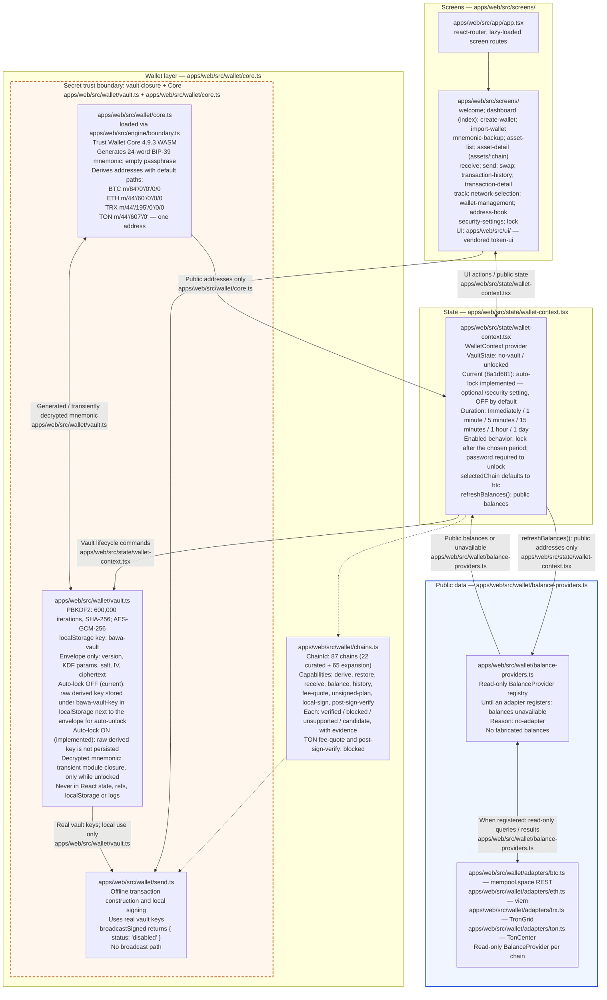

# Wallet App Architecture

How-to guide.

## Contents

- [Wallet app architecture: overview and layers](#wallet-app-architecture-overview-and-layers)
- [Key management layer](#key-management-layer)
- [Public does not mean unrestricted](#public-does-not-mean-unrestricted)
- [Key lifecycle: generation, storage, backup, recovery, deletion](#key-lifecycle-generation-storage-backup-recovery-deletion)
- [Signing layer and network/indexer layer](#signing-layer-and-networkindexer-layer)
- [UI flows](#ui-flows)

## Wallet app architecture: overview and layers

A wallet app combines three roles: **key manager, viewer and signer**. It manages access to keys, presents chain activity and authorises transactions. It is neither a custodian nor a node: the key holder retains signing authority, while nodes provide chain state. Assets are recorded on-chain, not held inside the app’s interface or database.

For Bawa’s watch-only deployment, these roles belong in separate environments. Key generation and signing stay on the trusted side; the online application handles public addresses, chain observations and payment records.

The conceptual stack separates responsibilities, rather than describing a single process:

```text
Protocol and key standards
↓
Per-chain wallet policy
↓
Trust Wallet Core primitives
↓
Public-only address handling
↓
Node RPC and searchable chain history
↓
Wallet views and observed payments
↓
Application records and order reconciliation
```

| Layer or component | Responsibility | Boundary, what it must never do |
| --- | --- | --- |
| Standards | Define shared rules for keys, derivation, addresses and transaction formats. | Perform live chain queries or make application-specific payment decisions. |
| Per-chain policy | Select the appropriate key scheme, derivation paths, address encoding and transaction rules for each supported network. | Fetch chain state or determine whether an order has been settled. |
| Trust Wallet Core | Implement wallet primitives, including key operations, address construction, derivation and transaction signing. | Act as a node client, history index or order-reconciliation service. |
| Trusted generator | Create private wallet material and account public roots on a trusted machine, without requiring a chain connection. | Export secrets to the watch-only host or take over online payment tracking. |
| Public-only address handling | Derive receiving addresses from a suitable public root, or use an explicitly provisioned public address. | Sign transactions or accept a mnemonic, seed, private key or private extended key. |
| Node / RPC access | Expose blocks, transactions and other chain-state information. | Derive wallet keys, sign on the application’s behalf or decide that an order is paid. |
| History indexer | Organise chain activity so that relevant transactions and address histories can be found efficiently. | Generate wallets, sign transactions or make order-payment decisions. |
| Wallet and payment tracking | Maintain the public wallet view and track observed transfers and their status. | Create wallets, handle signing secrets or perform signing. |
| Database and reconciliation | Persist observations, associate payments with orders and apply the application’s settlement policy. | Derive keys, sign transactions or substitute local records for chain evidence. |

### Web wallet components and data flow (`apps/web`)

The conceptual stack above is realised in the web starter as screens, one
state provider, a vault, Core, and read-only chain adapters. Secrets live only
inside the dashed boundary (the vault closure and Core); only public addresses
and balance results cross to the public-data side. Verified against
`apps/web/src/` on token-gaps (`8a1d681`); routes, screen list and chain count
re-checked at `ceade79` (Lane A docs audit, 2026-11-28).



The read-only `BalanceProvider` registry is in `apps/web/src/wallet/balance-providers.ts`. The original four adapters are BTC (mempool.space REST), ETH (viem), TRX (TronGrid), and TON (TonCenter); the full 22-chain endpoint table is below, and the remaining 65 expansion chains share the generic EVM adapter (`apps/web/src/wallet/adapters/evm.ts`) or their family adapter.

| Network | Adapter | Endpoint URL | Source |
| --- | --- | --- | --- |
| BTC | mempool.space REST | API: <https://mempool.space/api><br>Explorer: <https://mempool.space/tx/> | `apps/web/src/wallet/adapters/btc.ts:15` (API) |
| ETH | viem | RPC: <https://ethereum-rpc.publicnode.com><br>History: <https://eth.blockscout.com/api><br>Explorer: <https://eth.blockscout.com/tx/> | `apps/web/src/wallet/adapters/eth.ts:22–23` (RPC/history) |
| TRX | TronGrid | API: <https://api.trongrid.io><br>Explorer: <https://tronscan.org/> | `apps/web/src/wallet/adapters/trx.ts:14` (API) |
| TON | TonCenter | JSON-RPC: <https://toncenter.com/api/v2/jsonRPC><br>Explorer: <https://tonviewer.com/transaction/> | `apps/web/src/wallet/adapters/ton.ts:13` (JSON-RPC) |

[Trust Wallet Core](https://github.com/trustwallet/wallet-core) is the low-level, multi-chain library within this architecture, not the whole wallet application. The open-source project reports coverage of over 130 blockchains. Its cross-platform C++ implementation has bindings for iOS, Android and WebAssembly.

Internally, it separates the public API, core wallet types (`HDWallet`, `Mnemonic`, `StoredKey`, `Account`), multi-chain interfaces (`AnyAddress`, `AnySigner`, `CoinType`), cryptographic algorithms and individual chain modules. These implementation layers are described in [Trust Wallet Core repository](https://github.com/trustwallet/wallet-core) and [Core Wallet Architecture repository](https://github.com/vultisig/walletcore-spm). They provide key, address and transaction machinery; they do not replace chain observation or application reconciliation.

### Keep private material outside the watch-only runtime

Wallet provisioning has its own trust boundary:

```text
Trusted machine: offline wallet generation
↓
Trust Wallet Core
↓
Mnemonic, seed and private keys retained locally
↓
Export <account-public-root> or <public-address>
↓
Public-only provisioning boundary
↓
Online watch-only application
↓
Public address derivation where supported
↓
Chain observations from nodes and indexers
↓
Payment tracking and reconciliation
```

Use an account-level public root, such as an `xpub` or `zpub`, only where the chain and address policy support public derivation. Otherwise, provision public addresses. The watch-only tools must reject private extended keys rather than accepting them and extracting their public portion. Signing remains a trusted-side operation.

Assume the online host will be monitored, logged, restarted and potentially compromised. Mnemonics, seeds and private material must therefore be absent from its configuration, requests, database, logs and recovery procedures. Encrypting a secret before placing it there does not preserve this separation. Public roots do not confer signing authority on their own, but they can reveal related addresses, so restrict their distribution too.

An observed transfer is evidence, not an automatic “paid” result. Reconciliation must check the network, asset, recipient, amount and applicable confirmation or finality policy before accepting it against an order.

Expected result:

- [ ] Key generation and signing confined to the trusted environment.
- [ ] Public-only inputs throughout the watch-only runtime.
- [ ] Wallet Core kept separate from node access and history indexing.
- [ ] Chain observations distinguished from order-settlement decisions.

## Key management layer

Keep recovery material and signing authority inside the key-management component. Use account-scoped public material for address discovery, balance tracking and deposit-address allocation wherever the policy supports public derivation.

### From entropy to account keys

Keep entropy, mnemonics, passphrases, seeds and private keys distinct. Do not give them an ambiguous shared label such as “wallet key”.

Generate BIP-39 entropy with a cryptographically secure random generator, using 128 to 256 bits in 32-bit increments. Do not use timestamps, user-chosen words or ordinary application randomness. Treat entropy as recovery-sensitive material, not as a signing key.

Encode the entropy and its checksum using BIP-39’s prescribed word list. Use a permitted mnemonic length of 12, 15, 18, 21 or 24 words. For a 24-word mnemonic, encode 256 random bits plus 8 checksum bits. Do not treat word count as presentation: changing the word count changes the seed. Use the checksum to detect some transcription errors, not to conceal the entropy. Do not mistake the mnemonic for a single account’s private key or for the seed itself.

Use the BIP-39 passphrase as an additional seed-derivation input, with an empty string when none is configured. Keep it separate from a device PIN and the passphrase used to unlock locally stored wallet data. Treat a change to this input as a change of wallet, even when the mnemonic stays the same. Do not expect a “wrong password” result from a mistyped BIP-39 passphrase; it produces different keys instead.

NFKD-normalise both the BIP-39 mnemonic and passphrase. Encode the normalised mnemonic as UTF-8 for the password input, and encode the literal string "mnemonic" concatenated with the normalised passphrase as UTF-8 for the salt. Apply PBKDF2-HMAC-SHA512 with 2,048 iterations to produce the 64-byte seed. Treat this process as byte derivation, not mnemonic encryption. Protect the seed as sufficient material to regenerate the HD tree without the words or passphrase.

For BIP-32 derivation, use its HMAC-SHA512 master-node procedure to obtain a master private scalar and a 32-byte chain code from the seed. Treat those values, together with the serialisation metadata, as the master extended private key. Use the chain code for child derivation, not as another signing key. Do not treat a private scalar without its chain code as a complete extended private node.

Distinguish account extended private keys from leaf private keys. Use an account extended private key to derive that account’s private descendants, and a leaf private key to sign for its own keypair. Treat possession of a leaf private key as normally sufficient to spend the associated funds where that key alone satisfies the spending policy.

Keep storage-encryption keys separate from recovery and signing material. Never record entropy, mnemonics, passphrases, seeds or private keys in documentation, logs, issue reports, repositories or chat. Use placeholders such as `<mnemonic>` and `<account-extended-private-key>`.

### Paths and the hardened boundary

Read BIP-44 path components in order as the private root, purpose, coin type, account, change branch and address index. Interpret `m` as the private root, `44'` as the BIP-44 purpose and each apostrophe as a hardened step. Use the coin type to separate coin-specific branches and the account index to separate groups of keys. Do not equate an account with a single on-chain address.

Recognise branch 0 as external receiving and branch 1 as internal change. For account-based networks without UTXO change, document the supported branch policy rather than inventing change behaviour.

Keep hardened purpose, coin-type and account derivation inside key management. Never attempt to cross a hardened step with public-only derivation. Use an exported account public key to derive only non-hardened children below it. Restrict non-hardened child indices to 0 through 2³¹ minus 1.

Apply the fixed `bawa-derivation-policy-v1` policy. This policy covers Bawa-generated wallets; external hardware-signer exports follow the signer's own origin.

Use account 0 and receiving branch 0 only for BTC, ETH and TRX, with `i` denoting the address index:

Apply the fixed `bawa-derivation-policy-v1` policy. For BTC, use account origin `m/84'/0'/0'` and address path `m/84'/0'/0'/0/i`; require testnet4 for the BTC adapter. Bawa retains coin type `0'` on testnet4. This differs from SLIP-0044's testnet coin type `1` and SLIP-0132's association of `vpub` with `m/84'/1'`. The testnet derivation taught in docs/09 is therefore not the Bawa derivation used here. A standard testnet wallet using `m/84'/1'` will derive a different account from the same mnemonic and must not be assumed to reproduce Bawa's account or addresses.
- For ETH, use `m/44'/60'/0'/0/i`.
- For TRX, use `m/44'/195'/0'/0/i`.

Keep TON single-address from `m/44'/607'/0'` using ed25519. Provide a single deposit address and no xpub; the configured address is the V3 fixture in docs/11. ("Generation-only" described the CLI generator: the web app now also has TON balance and history adapters and offline signing — `signTonOffline` in `send.ts` — so the app is not generation-only for TON.) Treat compatibility with any specific wallet as unverified.

### Vault protection and unlock policy

Keep local vault protection separate from BIP-39 seed construction. Treat the Web validation draft’s PBKDF2-600k vault as a draft implementation choice, not a repo requirement. Do not substitute its work factor for BIP-39’s fixed 2,048 iterations.

Use the OWASP Password Storage Cheat Sheet’s FIPS-140 option as the basis for the 600,000-iteration PBKDF2-HMAC-SHA-256 figure. Match the rationale to its wording: “use PBKDF2 with a work factor of 600,000 or more and set with an internal hash function of HMAC-SHA-256” (verified live 2026-11-08). Treat 600,000 iterations as a defensible floor for that FIPS-140 branch, not as OWASP’s top recommendation. Recognise Argon2id as OWASP’s primary recommendation.

Use the shared minimum vault unlock passphrase length recorded in docs/14 section 3.6. Enforce weak-passphrase rejection and record the unlock-time measurement. Keep the recorded policy distinct from the secret passphrase itself.

### Adapter network identity and endpoint trust

Verify the configured endpoint’s network identity separately for each adapter. Consult `docs/10` for the endpoint URLs and their verification commands.

> **Currency note (2026-11-28, Lane A docs audit):** the four requirements below are the testnet identity checks for the testnet procedure; the live web wallet adapters are mainnet (BTC mempool.space mainnet, ETH mainnet, TRON mainnet, TON mainnet — see the per-chain endpoint table below).

- For the BTC adapter, require testnet4.
- For the ETH adapter, require Sepolia with chain ID `11155111`.
- For the TRON adapter, require Nile.
- For the TON adapter, require testnet.

> **Expected result:** The verified network identity matches the adapter’s intended testnet.

Fail closed on any mismatch.

Treat these checks as authenticating the network identity, not the provider. Do not interpret an ETH chain-ID check as authentication of RPC responses generally. Continue to rely on provider honesty for the data itself.

#### Public does not mean unrestricted

An **extended public key**, commonly called an xpub, serialises a public key together with its chain code and node metadata. Prefix variants do not change its fundamental role. By itself, it cannot sign, derive hardened children or reconstruct private ancestors.

It can, however, link addresses throughout its non-hardened subtree and reveal activity when combined with network data. Treat account public exports as sensitive wallet metadata, with controlled distribution and logging.

There is also a key-compromise hazard: an account xpub combined with a leaked descendant private key on an entirely non-hardened path can expose the account private node. Hardened ancestors limit upward propagation; they do not protect the exported account’s non-hardened subtree from this combination.

The root `.env` written by `make_wallet.py` contains only `XPUB_BTC`, `XPUB_ETH`, `XPUB_TRX` and `TON_DEPOSIT_ADDRESS`. It does not include the full account path, network or address-format policy alongside those values; record the path, network and address-format policy for each export in the wallet creation record instead. The xpub’s embedded metadata is not a complete wallet description.

Expected result:

- [ ] Recovery tests covering normalisation and empty/non-empty passphrases.
- [ ] Matching public derivations on the signer and watch-only sides.
- [ ] Hardened derivation rejected by public-only interfaces.
- [ ] Account-scoped public exports with explicit network and path policy.
- [ ] No recovery or signing secrets in diagnostics or examples.

### Key lifecycle: generation, storage, backup, recovery, deletion

Generation establishes a new wallet identity. It is a one-time provisioning operation, not an application startup task or a recovery mechanism. Keep the mnemonic and signing capability outside components that only need public address-derivation data.

#### Generation

Run `tools/hdwallet-gen/generate.js` on a trusted machine with verified dependencies and a private, unrecorded controlling terminal. Prepare dependencies before disconnecting from the network. Do not use CI, a recorded support session, or a terminal with persistent capture enabled. Rehearsals must use disposable testnet material, never an operational wallet or a published example phrase.

An existing `seed.enc.json` causes refusal unless `generate.js --force` is passed. When that flag is set and the file exists, the generator copies it to `seed.enc.json.bak.<timestamp>` and proceeds to replace it. `make_wallet.py` accepts `--force` or `--regenerate` and passes `--force` to `generate.js`.

An ordinary rename can overwrite its destination, so it is not itself a no-clobber safeguard. Never delete an established seed file simply to make another generation attempt succeed.

The 24-word mnemonic and independently generated data key are disclosed once through `/dev/tty`. Neither belongs on stdout, stderr, in application logs, or in clipboard and screenshot workflows. If a controlling terminal is unavailable, stop rather than falling back to ordinary output streams. TTY-only handling prevents ordinary output redirection from collecting secrets; it does not protect against terminal recording or a compromised host.

Before writing the encrypted seed file, the operator must:

1. Record the complete phrase offline, then enter its first word when challenged.
2. Store the displayed hexadecimal data key separately from the encrypted seed, then enter the case-sensitive acknowledgement `SAVED`.

A mismatch or interrupted input must abort without publishing the seed file, and diagnostics must remain redacted. These checks acknowledge the operator’s actions; they do not establish that either backup is complete or readable.

#### Storage

The encrypted payload is the mnemonic itself. Bawa encrypts it in-process using AES-256-GCM, a fresh 32-byte random data key and a 12-byte nonce. The key is not derived from a password: there is no password KDF or password-reset route.

The JSON envelope retains the nonce, encryption metadata and ciphertext followed by its authentication tag. Preserve the whole envelope. In particular, the AAD value `nova-shop-seed-v1` is an authentication input, not a display label that can be renamed during documentation or branding changes. Recovery must authenticate the payload before using any plaintext; see the [Node.js Crypto documentation](https://nodejs.org/api/crypto.html) for GCM API behaviour.

On the generation host:

- Restrict the secrets directory to its owner with mode `0700`.
- Write the encrypted temporary file with mode `0600`; never create a plaintext seed temporary file.
- Flush the temporary file, publish it under the final name, then flush the directory. This supports durable publication but does not replace no-overwrite enforcement.
- Keep the data key out of that directory, its configuration and its backup archives.

The normal path releases the Wallet Core wallet object after deriving public outputs and later clears the mutable data-key buffer. Require best-effort cleanup on failure as well. Neither operation proves that JavaScript strings, hexadecimal copies, terminal buffers or operating-system copies have been erased.

Normal output contains public wallet metadata, checks, the encrypted-file location and the Wallet Core version. Extended public keys cannot sign by themselves, but they can expose linked addresses and wallet activity; treat them as privacy-sensitive rather than harmless logging material.

#### Backup

Maintain two clearly distinguished recovery routes:

- **Offline phrase:** a complete, ordered copy of the 24 words on a durable medium with controlled physical access. This can recover the wallet without the encrypted JSON or its data key. Background on mnemonic-based recovery is available in [BIP-39](https://github.com/bitcoin/bips/blob/master/bip-0039.mediawiki).
- **Encrypted backup:** an intact copy of `seed.enc.json`, with the data key held in a separate security domain. Do not reunite them in a shared archive, synchronised folder or exported vault backup.

Inventory every copy, its custodian and its retention policy. Include removable media, replicas, snapshots and older backup versions. A backup that cannot be located cannot be reliably retired.

Also retain protected records of coin and derivation settings, expected public identities and the Wallet Core version. Back up application state separately: restoring the phrase does not recreate address-allocation history or other off-chain records.

#### Recovery

Recover in a new trusted, non-recorded session. Either import the offline phrase into a compatible wallet or recover it from the encrypted envelope using the separately held data key. Do not generate another phrase and expect it to recover the original addresses.

`tools/decrypt_seed.py` is the designated decryption helper. Before using it, verify that its input and output handling preserves the same boundary as generation: no key in command-line arguments or shell history, and no recovered phrase in ordinary output, logs or temporary files. Plaintext should remain in-process or be displayed only on a private controlling TTY. Do not assume the generator’s output restrictions automatically apply to another tool.

Reject authentication failure without importing or displaying partial plaintext. A wrong key, changed nonce, altered AAD or damaged ciphertext is a failed recovery, not permission to bypass verification.

Match the original coin, address type, account and derivation settings. Compare recovered public identities with the creation record: BTC `zpub`, ETH and TRX `xpub`, and the TON address and path. The TON export is a single address, not an extended public key. Repeat the public derivation checks before accepting the recovery. Practise the procedure with a separate testnet wallet rather than entering an operational phrase into an online checker.

#### Deletion

First establish whether the aim is **local decommissioning** or **irreversible wallet destruction**. Keeping a usable recovery backup means the wallet remains recoverable. Before destroying the last recovery route, confirm that assets have been moved as required or that loss of access is intentional.

Stop processes and automated jobs that could retain or recreate wallet material, then cover all three categories:

- **Keys and seed material:** plaintext phrases, imported or derived private keys, data-key copies, wallet objects, key-manager entries, encrypted seed files and abandoned `.tmp` files. Physically destroy retired offline phrase and key records using a method appropriate to their medium.
- **Caches and incidental copies:** application and browser storage where used, clipboard contents, terminal scrollback, session recordings, exports, debug artefacts, crash dumps and relevant swap or hibernation data. Remove cached extended public keys and address metadata where privacy requires it.
- **Backups and replicas:** archive copies, snapshots, cloud version history, removable media and retired devices. Ensure restore automation cannot silently reintroduce deleted material.

Unlinking a file is not proof of physical erasure, especially on SSDs, journalled filesystems and snapshot-backed storage. Use the storage platform’s sanitisation or cryptographic-erasure procedure. Destroying every data-key copy can make residual encrypted envelopes unusable, but it does nothing to disable a surviving plaintext phrase or private key.

Record any retained recovery route as an explicit exception, not completed destruction. Local deletion neither removes blockchain history nor revokes credentials already copied by someone else; suspected disclosure requires migration to a newly generated wallet.

**Expected result:**

- [ ] Repeat generation leaves an existing seed file untouched.
- [ ] TTY-only disclosure and both confirmations before publication.
- [ ] Owner-only encrypted storage, with the data key held separately.
- [ ] A tested recovery procedure that reproduces recorded public identities.
- [ ] Deletion covering keys, caches and backups, with retention exceptions recorded.

## Signing layer and network/indexer layer

Keep address derivation, transaction preparation, signing and chain access as separate responsibilities. Keep screens and navigation separate from wallet services; never let a screen controller become the network client and signing authority.

### Watch-only boundary

Restrict the watch-only runtime to public material only (xpubs, zpubs and addresses). Use it to derive and watch addresses; it cannot spend. Use watch-only derivation in Bawa’s `tools/hdwallet-gen` only for its supported chains, `btc`, `eth` and `trx`. Treat TON as generation-only.

Treat xpubs and zpubs as **sensitive public material**: an xpub cannot sign, but exposing it discloses an ongoing address catalogue, balances, payment history and relationships. Never upload an extended public key to a remote service. Treat fallback providers and multi-provider comparisons as additional disclosures.

Reject private material at every public-only boundary, including the derivation worker’s JSONL channel. Contain diagnostics so that no secret reaches logs.

Keep `tools/hdwallet-gen/derive-daemon.js` on the watch-only side: it uses Trust Wallet Core to derive and validate addresses, but does not establish ownership, find funds or authorise spending. Handle its startup readiness record separately from derivation replies. Allow only one outstanding request per worker because replies have no request identifier, and keep the request context alongside each returned address.

Use the worker’s recognised request fields, `chain`, `xpub` and `index`. Do not rely on additional properties to select another network or derivation branch. Require explicit, tested network-aware derivation for a testnet integration, rather than adding a property that the worker ignores.

### Signing boundary

Keep the implementation boundary explicit: offline transaction construction and local signing exist in the web app (`apps/web/src/wallet/send.ts` — signers for BTC/ETH/TRX/TON/SOL + the generalised EVM signer for 61 EVM chains; `broadcastSigned` returns disabled, no MAINNET send has ever run; devnet TON sends ran on `panel-rebuild/devnet-temp`). The repository tooling and the web app pin Trust Wallet Core version `4.9.3`; the Android Step 4 AAR build pins `4.8.4` (`DerivationPolicy.ENGINE_VERSION` is `4.8.4`, corrected when the AAR landed at `f9f312b`). Allow only the separate signer to create spending signatures. Require review of the destination, amount, change and fee on the signer’s own screen before it signs.

Give the signer an immutable unsigned transaction, an explicit chain/network context and the minimum evidence needed to validate the proposed spend. For Bitcoin, include previous-output information sufficient to check input values and scripts. Identify signing keys through a locally authorised key reference, not by passing private keys through application messages.

Keep account discovery, balance fetching, coin selection, fee selection, final transaction assembly and broadcasting outside the signer.

Build the review from the payload the signer will actually sign, rather than an application-generated description:

- **Identity and destination:** show the intended chain and network, sending account, complete recipient addresses and asset identity. Treat friendly address-book or token labels as supporting information, not authority.
- **Amounts and costs:** show transferred amounts, fees or maximum fee exposure, and distinguish estimates from limits. For Bitcoin, verify previous-output values before calculating the fee. Recognise change using the signer’s own wallet policy, not a caller-provided change label.
- **Signing scope:** check which fields the signature commits to. Account for Bitcoin signature flags that can weaken that commitment, and reject unsupported signing modes in ordinary transfer flows. Apply chain-specific replay protection where available.
- **Contract effects:** decode supported calls, including spenders and allowances for approvals. Expose the complete encoded payload for inspection. Refuse an operation the signer cannot explain reliably, rather than asking for approval of an opaque hash.

Bind approval to the frozen transaction. Require another review after any change to an approved field. Leave no usable signature after cancellation, invalid evidence or an unsupported operation.

Return **signature material only**, including the required input signatures where a transaction needs several. Do not return key material or a completed transaction. Verify the signatures in the application against the approved payload, attach them without changing approved fields, then pass the assembled transaction to the network adapter for broadcast.

Keep keys and approval within the chosen signing trust boundary. Use [Cryptograph’s security model](https://cryptograph.watch/security) to illustrate separating the device that prepares a request from the authority that permits signing. To protect against a compromised phone, require an approval path and key boundary that the phone cannot control. Do not treat an in-process module or OS Keychain storage alone as that guarantee.

### Network/indexer boundary

Derive addresses locally. Treat an address as a lookup target, not a balance. Build wallet state from discovered addresses and chain observations, rather than from derivation results alone.

For external hardware-signer exports, whose origin follows the signer's own policy, inspect both receiving and change branches for Bitcoin and apply a documented gap policy. For Bawa-generated wallets, which use receiving branch 0 only, there is no change branch to inspect. Do not treat a completed bounded scan as proof that nothing exists beyond it.

Track confirmations and chain reorganisations (reorgs). Account for the possibility that a transaction which looked confirmed can drop out.

### Live services the app is built from

> Lane C, FIX-ALL programme, 2026-11-24. Every endpoint below is taken from the registry in `apps/web/src/wallet/chains.ts` (`CHAINS[...].rpcEndpoints`, `historyBaseUrl`) and the adapters in `apps/web/src/wallet/adapters/`; nothing is listed that the code does not call. Free and paid limits were re-checked against each provider's own pages on 2026-11-24 and are cited per provider; where a provider publishes no number, the entry says so instead of guessing. Lane A is re-verifying every backup RPC in parallel — if its probes disagree with this table, the probe wins and this table must be corrected.
>
> How to read an entry: **Title** — what the service is and how the wallet uses it, in short — then the direct links, then one short line per thing it does for the wallet, then **Free** / **Paid**. Explorers that only supply transaction links (Tronscan, Tonviewer, Solana Explorer, Dogechain, Etherscan Sepolia, Litecoinspace) are named in the per-chain table but get no provider entry: the wallet never reads data from them, it only links out to them.

#### RPC endpoints

**PublicNode (Allnodes)** — free public JSON-RPC for most EVM chains and Solana, no key and no account. The wallet uses it as the primary or backup RPC for ETH, SOL, BSC, Polygon, Arbitrum, Optimism, Base, Avalanche, Gnosis, Celo, Linea, Mantle, Scroll, opBNB and Metis. Links: <https://publicnode.com>, e.g. <https://ethereum-rpc.publicnode.com>, <https://solana-rpc.publicnode.com>.

- Free: no key, no account, no published numeric limit, no SLA, no paid tier — it is a public good run by Allnodes, so a busy hour can 429 with no recourse except the backup endpoint.
- Paid: none exists. There is no paid PublicNode tier to buy; the only upgrade is a different provider.

**1RPC (Automata)** — a privacy relay that strips request metadata before forwarding to an RPC provider. The wallet uses it only as the Ethereum backup (`https://1rpc.io/eth`); it is never the primary for any chain. Links: <https://1rpc.io>, <https://docs.1rpc.io>.

- Free: Public plan 200 requests/day, keyless; Starter plan 1,000 requests/day with a free key. The wallet uses the keyless Public plan, so a heavy day can exhaust it — the primary carries the load.
- Paid: Personal $9.90/month, 40,000 requests/day, adds WebSocket and a 99.9% SLA; Developer $29.90/month, 100,000 requests/day, adds testnets. Source: 1rpc.io pricing, reviewed 2026-11-18.

**Binance public dataseed** — Binance's public BSC endpoint. The wallet uses it as the BNB Smart Chain backup — second of three endpoints (primary PublicNode, then this, then DeFiBit's dataseed `https://bsc-dataseed1.defibit.io`, added 2026-11-28 after the first two 429d the shared sandbox egress and Add Token by contract failed on CAKE).

- Free: public, no key.
- Paid / limits: no published per-client limit or paid tier found for this endpoint — unverified. Do not quote a number for it.

**Chain-operated public RPCs** — the public endpoints the chains themselves run, each used as the backup (or, for Fantom and Aurora, the primary) for one chain. Links: Celo Forno <https://forno.celo.org>; Gnosis <https://rpc.gnosischain.com>; Linea <https://rpc.linea.build>; Mantle <https://rpc.mantle.xyz>; Metis <https://andromeda.metis.io>; Aurora <https://mainnet.aurora.dev>; Fantom <https://rpc.fantom.network> and <https://rpc2.fantom.network>; Optimism <https://mainnet.optimism.io>; Avalanche <https://api.avax.network/ext/bc/C/rpc>; opBNB <https://opbnb-mainnet-rpc.bnbchain.org>; Scroll <https://rpc.scroll.io>.

- Free: public, no key, no SLA.
- Paid / limits: no published per-client limit found for any of these endpoints — unverified. No paid tier is attached to the public URLs themselves.

**TronGrid (TRON Foundation)** — the official TRON HTTP/gRPC API. The wallet uses it as the only TRON RPC (`https://api.trongrid.io`): native TRX balances, TRC-20 `balanceOf` reads and TRON history all go through it. Links: <https://www.trongrid.io>, <https://developers.tron.network/reference/rate-limits>.

- Free: keyless access is throttled; a free key gives about 100,000 requests/day (last readable pricing page — the current page renders as a JavaScript shell, so re-check before relying on the figure). The per-second figure is disputed: third-party comparisons report 15 QPS with a key, TronLink's docs report about 5 QPS — unverified on TronGrid's own page. Exceeding the limit blocks the key for 30 seconds with HTTP 403 (third-party reports). The wallet sends no key, so it runs on the throttled keyless tier.
- Paid: custom plans only, negotiated with the TRON team; no public price.

**TonCenter (TON)** — the TON HTTP JSON-RPC API in front of liteservers. The wallet uses it as the only TON RPC (`https://toncenter.com/api/v2/jsonRPC`): TON balances and history. Links: <https://toncenter.com>, <https://docs.ton.org/api/rate-limit>.

- Free: keyless 1 request/second; a free key (from the @toncenter Telegram bot) gives 10 requests/second, 1 key per network, on shared liteservers. The wallet sends no key, so it runs at the 1 request/second tier — the TON adapter enforces a 1,100 ms gap between requests for exactly this reason (see "Rate limits the app itself enforces" below).
- Paid: Plus 25 requests/second, Advanced 100 requests/second, Enterprise custom. Prices are quoted in GRAM (2.5 and 25 GRAM/month reported by secondary sources); the official rate-limit page publishes no prices, so the GRAM figures are unverified on the provider's own page.

**TonAPI (Tonkeeper / TON Console)** — the indexed TON REST API. The wallet uses it only as a TON balance fallback (`https://tonapi.io` — `/v2/accounts/{address}` when TonCenter fails) and for TON Jetton rates (`/v2/rates`). Links: <https://tonapi.io>, <https://console.tonapi.io>.

- Free: keyless default 1 request/second (the docs disagree with each other — 1 request per 4 seconds in one place, 1 per second in another — unresolved); a free key (Start plan) gives 1 request/second. TonAPI is also the price fallback for TON; its tiers are listed in full in [ADR-0007](../adr/0007-price-feed-provider.md).
- Paid: Lite $9.90/month, 10 requests/second; Standard $95/month, 100; Plus $290/month, 300; Heavy $890/month, 1,000. Source: console.tonapi.io pricing.

**Solana PublicNode** — a public Solana RPC. The wallet uses it only as the Solana backup (`https://solana.publicnode.com`).

- Free: public, no key.
- Paid / limits: no published limit or paid tier found — unverified.

**mempool.space** — the open-source Bitcoin explorer and Esplora-compatible REST API. The wallet uses it as the primary Bitcoin balance and history source (`https://mempool.space/api`). Links: <https://mempool.space>, <https://mempool.space/docs/api/rest>.

- Free: keyless, no published numeric limit — the team states its rate limits "aren't disclosed" and a 429 means the unpublished threshold was crossed. Self-hosting the open-source stack (AGPL-3.0, <https://github.com/mempool/mempool>) removes the limit entirely.
- Paid: a Mempool Enterprise tier exists with higher contracted limits and SLAs; no public price was verified on the provider's own pages — unverified.

**Blockstream Esplora** — Blockstream's open-source Esplora explorer and REST API. The wallet uses it as the Bitcoin backup (`https://blockstream.info/api`), same Esplora shape as mempool.space. Links: <https://blockstream.info>, <https://github.com/Blockstream/esplora/blob/master/API.md>.

- Free: keyless, no published numeric limit found — unverified.
- Paid: paid plans start at $40/month for 500,000 credits (secondary source — unverified on Blockstream's own pages).

**Litecoinspace** — the Litecoin equivalent of mempool.space (Esplora-compatible). The wallet uses it as the only Litecoin RPC (`https://litecoinspace.org/api`): LTC balances and history. Link: <https://litecoinspace.org>.

- Free: keyless.
- Paid / limits: no published limit or paid tier found — unverified.

**SoChain** — a REST API for Bitcoin, Litecoin, Dogecoin and Zcash. The wallet uses it as the primary Dogecoin balance and history source (`https://sochain.com/api/v3`). Links: <https://sochain.com>, <https://sochain.com/docs/limits>, <https://sochain.com/pricing>.

- Free: keyless 2,500 lookups/day per IP; a free key gives 75,000 requests/month. Past the quota, lookups carry on at the free rate (2,500/day) instead of breaking.
- Paid: Hobby $35/month, 500,000 requests/month; Starter $149/month, 1,500,000; Professional $499/month, 15,000,000; Behemoth $1,999/month, 150,000,000. Source: sochain.com/pricing.

**BlockCypher** — a multi-chain blockchain API. The wallet uses it only as a fallback: Dogecoin balance/history (`https://api.blockcypher.com/v1/doge/main`) and Litecoin balance/history (`https://api.blockcypher.com/v1/ltc/main`). Links: <https://www.blockcypher.com>, <https://www.blockcypher.com/pricing.html>, <https://www.blockcypher.com/dev/>.

- Free: read-only GETs need no token; 3 requests/second and 100 requests/hour (confirmed in the rate-limit docs). The daily figure conflicts on BlockCypher's own pages — the pricing card says 1,000 requests/day, the FAQ says 2,000 — so do not rely on either.
- Paid: the pricing page lists Prototype at $150/month (5,000 requests/day); the docs say paid plans start at $119/month. Both figures are on BlockCypher's own pages and they disagree — report both, rely on neither.

Per-chain endpoint table (registry order is primary first; the adapter tries them in order and reports which one answered):

| Chain | EVM chain id | Endpoints in order |
|---|---|---|
| Bitcoin (btc) | — | `https://mempool.space/api`, `https://blockstream.info/api` |
| Ethereum (eth) | 1 | `https://ethereum-rpc.publicnode.com`, `https://1rpc.io/eth` |
| TRON (trx) | — | `https://api.trongrid.io` |
| TON (ton) | — | `https://toncenter.com/api/v2/jsonRPC` (+ TonAPI balance fallback) |
| Solana (sol) | — | `https://solana-rpc.publicnode.com`, `https://solana.publicnode.com` |
| BNB Smart Chain (bsc) | 56 | `https://bsc-rpc.publicnode.com`, `https://bsc-dataseed.binance.org`, `https://bsc-dataseed1.defibit.io` |
| Polygon (matic) | 137 | `https://polygon-bor-rpc.publicnode.com` |
| Arbitrum One (arb) | 42161 | `https://arbitrum-rpc.publicnode.com` |
| OP Mainnet (op) | 10 | `https://optimism-rpc.publicnode.com`, `https://mainnet.optimism.io` |
| Base (base) | 8453 | `https://base-rpc.publicnode.com` |
| Avalanche C-Chain (avax) | 43114 | `https://avalanche-rpc.publicnode.com`, `https://api.avax.network/ext/bc/C/rpc` |
| Litecoin (ltc) | — | `https://litecoinspace.org/api` (+ BlockCypher fallback in the adapter) |
| Dogecoin (doge) | — | `https://sochain.com/api/v3`, `https://api.blockcypher.com/v1/doge/main` |
| Gnosis (gnosis) | 100 | `https://gnosis-rpc.publicnode.com`, `https://rpc.gnosischain.com` |
| Celo (celo) | 42220 | `https://celo-rpc.publicnode.com`, `https://forno.celo.org` |
| Linea (linea) | 59144 | `https://linea-rpc.publicnode.com`, `https://rpc.linea.build` |
| Mantle (mantle) | 5000 | `https://mantle-rpc.publicnode.com`, `https://rpc.mantle.xyz` |
| Scroll (scroll) | 534352 | `https://scroll-rpc.publicnode.com`, `https://rpc.scroll.io` |
| opBNB (opbnb) | 204 | `https://opbnb-rpc.publicnode.com`, `https://opbnb-mainnet-rpc.bnbchain.org` |
| Metis (metis) | 1088 | `https://metis-rpc.publicnode.com`, `https://andromeda.metis.io` |
| Aurora (aurora) | 1313161554 | `https://mainnet.aurora.dev`, `https://1rpc.io/aurora` |
| Fantom (fantom) | 250 | `https://rpc.fantom.network`, `https://rpc2.fantom.network` |

Two cross-checks against the code: the adapters hardcode the same defaults as the registry (ETH adapter pins `ethereum-rpc.publicnode.com`, the BTC adapter pins mempool.space then Blockstream, the Solana adapter pins PublicNode for both endpoints (solana-rpc.publicnode.com primary, solana.publicnode.com backup)) — registry and adapter agree. And `https://ethereum.publicnode.com` appears only in a comment (`apps/web/src/engine/destination.ts:548`, a chain-id probe note) — it is **not** a configured endpoint, so it is not listed above. The owner can add a custom endpoint per chain in the RPC manager; `validateRpcEndpoint` (`chains.ts`) requires https only, no embedded credentials, no query or fragment, at most 3 endpoints per chain (`MAX_RPC_ENDPOINTS_PER_CHAIN`), and registry endpoints can never be removed — only demoted.

#### History indexers — summary

The full per-chain history table and the indexer provider entries live in [docs/06](../06-tracking/README.md#3-rpc-is-not-an-indexer) ("RPC is not an indexer"), where a reader of history looks. The summary: 18 of 87 chains have a verified keyless history indexer — Bitcoin (mempool.space / Blockstream), Ethereum, Polygon, Arbitrum, Optimism, Base, Celo, Scroll, Aurora (Blockscout instances), Avalanche and Mantle (Routescan), TRON (TronGrid), TON (TonCenter), Solana (Solana RPC), Litecoin (Litecoinspace / BlockCypher), Dogecoin (SoChain / BlockCypher), Linea (Etherscan V2, wired 2026-11-24), Gnosis (gnosisscan.io keyless, `d06a224`, 2026-11-28). Four chains have **no** working keyless indexer and their history stays blocked, never faked: **BNB Smart Chain, opBNB, Metis, Fantom** — an Etherscan API key or another indexer is an owner decision, not a code fix.

One flag on the Blockscout and Scrollscan hosts: Blockscout moved all API traffic to its keyed Pro API on 1 July 2026 and retired the per-instance APIs the wallet calls keyless — but Lane B probed those same per-instance hosts live on 2026-11-23 and they returned real transactions with no key. The keyless calls work today and are documented as they are; if they stop answering, history on those chains needs a Pro key (free tier: 100,000 credits/day at 5 requests/second, key required; Builder $49/month). See docs/06 for the full note.

#### Rate limits the app itself enforces

The providers above are all free tiers with unpublished or tight limits, so the app throttles itself — this is why the wallet behaves the way it does under load.

**Refresh limiter — 4 concurrent network calls.** One shared limiter caps balances + history + token balances together at 4 concurrent calls (`REFRESH_CONCURRENCY_LIMIT`, `apps/web/src/state/wallet-context.tsx:510`). Before it, unlocking fired the whole 43-row dashboard at once — about 50 requests in the first second, most of them JSON-RPC against the same free-tier hosts — the free tiers 429'd and the hero read "$0.00 (Partial)". Pure promise queueing, no timers; raise the cap only with a live 429 measurement behind the change.

**Read retries — 3 attempts, then stop.** `fetchWithRetry` (wallet-context) retries a failed read-only fetch 3 times with 1s then 2s delays, honouring the provider's `Retry-After` capped at 30s. `withRetry` (`apps/web/src/wallet/retry.ts`) retries 3 attempts inside a 30-second total budget, base delay 200 ms, max 5 s, full jitter, `Retry-After` honoured for rate-limit errors. Only transient failures retry: 429, 5xx, timeouts and network errors. A failed refresh never blanks data — the last good value stays and the failure is reported.

**EVM endpoint failover — chain id checked on every call.** The generic EVM adapter (`apps/web/src/wallet/adapters/evm.ts`) asks each endpoint for its chain id first; a wrong chain id fails that endpoint and the next one is tried. The viem transport is set to `retryCount: 0` so a dead endpoint fails fast in one attempt instead of burning retries inside the transport.

**TON pacing — 1,100 ms between TonCenter requests.** The TON adapter enforces a minimum 1,100 ms gap between the start of one TonCenter request and the next (`apps/web/src/wallet/adapters/ton.ts`) because the keyless TonCenter tier allows about 1 request/second. Production must not lower it.

**Price freshness — 10-minute quotes, 10-second timeout, no polling timer.** A price quote is fresh for at most 10 minutes (`MAX_QUOTE_AGE_MS`, `apps/web/src/wallet/prices.ts`), each price fetch times out after 10 seconds, and a failed refresh keeps the last good cached quote instead of blanking it. There is no polling timer in the tree: prices load on mount and on manual refresh. "Refresh ~60s" in the prices header is CoinGecko's server-side data refresh, not an app timer.

**Balance cache — 10 minutes.** Balances are cached for 10 minutes (`BALANCE_CACHE_MAX_AGE_MS`, wallet-context) before a refresh re-reads them.

**DexScreener batching — 30 addresses per call, one call per chain.** Token price lookups batch at most 30 token addresses per `tokens/v1` call, one call per chain, so a wallet with many unlisted tokens costs one call per chain, not one per token.

## UI flows

### Canonical screen contract

Adopt the Android guide's 14 numbered screens, H.1 to H.14, as the wallet app's single canonical screen list:

1. **Welcome** (H.1)
2. **Create wallet** (H.2)
3. **Import wallet** (H.3)
4. **Mnemonic backup** (H.4)
5. **Portfolio dashboard** (H.5)
6. **Asset list** (H.6)
7. **Asset detail** (H.7)
8. **Receive** (H.8)
9. **Send** (H.9)
10. **Transaction history** (H.10)
11. **Transaction details** (H.11)
12. **Network selection** (H.12)
13. **Wallet management** (H.13)
14. **Security and backup settings** (H.14)

Use docs/14 section 5.1 as the wallet app's sole canonical fourteen-screen list and permitted-data reference. Review is a required state of the Send flow; Lock is a required app state. Both platform guides must link to this contract instead of restating the full screen list. Platform-specific guidance must refer to the relevant canonical screen or state without defining an alternative inventory.

> **Currency note (2026-11-28, Lane A docs audit):** the app now also ships Swap, Track and Address book as screens beyond the 14 (`/swap`, `/track`, `/address-book` in `apps/web/src/app/app.tsx`), and Lock as a screen as well as a state (`/lock`). See the docs/14 §5.1 update.

### Backup gate and mnemonic handling

Keep wallet actions behind a persisted **backup pending** gate until backup confirmation succeeds. Do not let navigation, skipping or restarting bypass the gate.

Do not offer copying, sharing or QR export of recovery words. Exclude analytics from the create, import and backup-confirmation flows. Never include recovery words in logs or error reports.

### Create wallet

Generate and validate the mnemonic through Wallet Core. Use a reviewed cryptographic library and the operating system's cryptographic random source for generation. On a generation or validation failure, discard partial state and offer a retry.

Continue to Mnemonic backup for the single offline phrase reveal and confirmation. Do not reveal the phrase again when retrying within the same creation attempt.

Ask the user to check that their private, offline copy contains every word in the displayed order and is readable. Do not treat that acknowledgement as backup confirmation or enable wallet actions. If the copy is lost, offer explicit discard-and-restart only for a newly generated, unused wallet. On leaving or skipping before confirmation, warn the user and retain the backup-pending gate.

### Import wallet

Keep mnemonic entry masked throughout entry and correction. Never retain import text in persisted forms or navigation state.

Apply Unicode normalisation and handle accidental spacing without changing words or their order. Validate the supported word count and wordlist, then the checksum, through Wallet Core. Reject unsupported word counts, including any counts the application does not support among the BIP-39 standard lengths of 12, 15, 18, 21 and 24 words.

For an unsupported count, unrecognised word or checksum mismatch, identify the failed check without echoing the phrase. Keep the input editable, disable confirmation and do not commit an imported wallet. Let the user correct the input and run all checks again. Never guess replacement words.

After all checks pass, present a read-only public-address preview. Ask the user to check that the phrase belongs to the intended wallet, that its word order is correct, and that the selected network and previewed address match their expectations where known. Do not treat a valid checksum as proof of wallet identity. On an unexpected address, stop and review the recovery settings.

Required behaviour: After explicit confirmation, import the wallet through Wallet Core and open Mnemonic backup without lifting the backup-pending gate. Lift the gate only after successful full, ordered re-entry of all 24 words from the user's saved copy. Successful import alone must not count as backup confirmation.

Draft status at commit 754721cd: The Web import handler in main.js instead calls setBackupConfirmed(w.id) immediately after import, with the comment "import demonstrates possession of the phrase", and navigates to the portfolio without a backup-confirmation step. This is a draft deviation from the required import and backup-gate behaviour, not an allowed exception.

### Mnemonic backup and confirmation

Show the mnemonic once, offline. For creation, use the single reveal described in the Create wallet flow, not an additional display. Do not redisplay the mnemonic on a confirmation retry.

Require the user to re-enter the entire mnemonic from their saved copy using protected entry: all 24 words, in their original order. Ask the user to consult that copy rather than rely on memory. Compare every entered word with the corresponding position in the generated or imported mnemonic. Accept backup confirmation only when all 24 words match in order. Do not accept selected words, a partial match or a tick-box acknowledgement.

On a mismatch, show a generic error, keep **Confirm backup** disabled and retain the backup-pending gate. Allow editing and retry through protected entry. Enable **Confirm backup** only after all 24 words match in order.

After the user explicitly confirms, persist the confirmed backup status, clear temporary buffers and lift the backup-pending gate.

On a skip, show the following warning and keep wallet actions blocked:

> Without a usable recovery copy, losing this device could mean losing access permanently. Wallet actions stay locked until you confirm the backup.

Do not let dismissing the warning change backup status. Retain a clear **Resume backup** route, subject to the Lock-state restrictions below.

> **Expected result:**
> - One offline phrase reveal per creation attempt, with no repeat reveal on retry.
> - Masked, editable input for invalid imports, with confirmation disabled and no imported wallet committed.
> - Backup-pending status preserved after mismatches, skips, navigation and restarts.
> - Removal of the backup-pending gate only after full, ordered 24-word re-entry and explicit confirmation, followed by temporary-buffer clearing.

### Receive

In Receive, show the full address and chain/testnet as text, and display a QR code for the receive address. Follow docs/14 section 5.3 for the shared clipboard rule. Use the Receive QR payloads table in docs/07. Construct the payload for the selected chain and network using only its approved forms. Do not encode a bare address except for TRX Nile. Keep request information not carried by the payload outside the QR. Use `P.renderAndVerifyQr` for generated receive QRs. Decoded generated or scanned requests must pass through `E.parsePaymentRequest` and `E.verifyPaymentRequest`, using the shared and per-chain checks in docs/07.

Receive-QR and scanning both stay in scope (user decision, 8 November 2026). The Web implementation exists: `receive.tsx` renders the derived address as a QR card in one of seven templates A–G, with a Starknet receive-only warning on every template and in the exported PNG (77e4473); QR payment-request scanning is implemented at the decode level through `apps/web/src/wallet/qr-scanner.tsx` (jsQR, camera + image upload, lazy-loaded), wired into Send — URI parsing is not implemented (the scanned value is used as a bare address) and the live camera on a real phone is unverified. The Android draft Receive screen currently encodes the bare derived address as a QR using ZXing core 3.5.3 with default error correction L, not the required M. It has no decode-verification step or payment-request fields. The Web guide's scanning specification is in its Section F; the Android verification half remains to be built. Add the Android verification half before treating it as implemented.

### Send and Review

Collect the recipient, asset and amount in Send. Estimate fees and prepare a reviewable action, not a signature. Present the collected values and estimated fees in the required Review state within Send. Do not treat action preparation or entry into Review as signing.

### History, empty and locked states

Distinguish pending, included, confirmed, failed and replaced transactions in Transaction history and Transaction details. Keep included and confirmed visibly distinct.

Provide explicit empty states when there are no assets or transactions to display.

In the required Lock state, reveal no wallet screens until unlocked. Keep Lock separate from the backup-pending gate, and do not let unlocking confirm a backup or enable actions while backup remains pending. Retain a clear Resume backup route for a pending backup, but do not expose the backup screen through that route before unlocking.

> **Expected result:**
> - The full Receive address and chain/testnet displayed as text, with a QR code for the receive address.
> - A reviewable Send action rather than a signature.
> - Distinct transaction statuses and explicit empty states.
> - No wallet screens exposed while locked, and no bypass of backup confirmation through unlocking.

