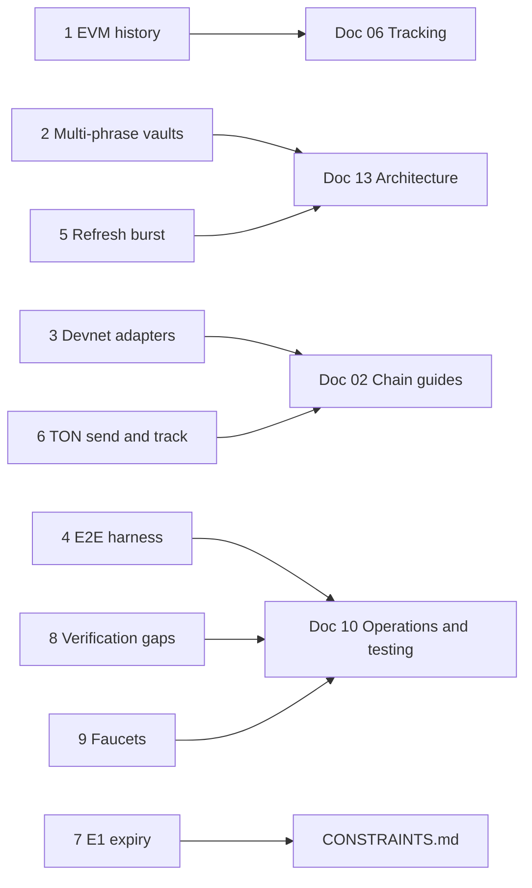

# Gap analysis — what the wallet still lacks, and where to find the fix

Lane E, Deep Audit + Devnet E2E programme, 2026-11-23. Branch
`panel-rebuild/deep-audit-devnet` at `9fa1df6`. Hands-on Muse, 0 Sol calls.

This document lists what is missing from the wallet as it stands, why each
item matters, which public repository already solves it (or shows how),
and where the fix belongs in the guide. Every star count, licence and
file reference below was checked live on 2026-11-23 — on the repository
itself or against the live endpoint — not guessed. Where a claim could
not be checked, the document says so instead of filling the gap.

## How to read it

Status words mean the same thing throughout:

- **Open** — the work is not done and nobody is doing it.
- **Fixed here** — this lane fixed it; the proof is in the section.
- **Verification** — the code exists but nobody has seen it work on a
  real device or a live network yet.
- **Decision needed** — the owner has to choose (or approve a key, a
  spend, or a licence) before the work can start.

Two corrections to the record come first, because later sections build
on them:

1. **Blockscout is not dead.** The standing note said no keyless public
   history indexer exists because the Blockscout hosts were dead. Checked
   live on 2026-11-23, `eth.blockscout.com` answers a real `txlist`
   (HTTP 200, real transactions, slow at about 10 seconds), and the app
   already reads Ethereum history from it
   (`apps/web/src/wallet/adapters/eth.ts`). What is true is narrower:
   only Ethereum has a history source. The other 15 EVM chains return
   "History is not connected for … yet." And the public Blockscout hosts
   are unreliable: `base.blockscout.com` answers 403, and the Ethereum
   host is slow with no published availability promise.
2. **The E2E failure was the route, not the assets.** The Round 2 record
   said vite preview 404s `/bawa/assets/*.js`. Checked live, the assets
   load (HTTP 200). What 404s is the route: `GET /create-wallet`
   answers 404 on a `/bawa/` build, and every spec starts there. See
   gap 4.

## Summary

| Gap | What is missing | Status |
|---|---|---|
| 1 | EVM history for 15 of 16 EVM chains | Fixed here (Lane D: 3 of 15 wired; 12 remain — see §1) |
| 2 | Multi-phrase vaults (one phrase per vault today) | Decision needed |
| 3 | Devnet adapters for 9 chains, 6 logo-only ERC-20s | Fixed here (Lane D: mainnet half; see §3) |
| 4 | E2E harness against the `/bawa/` build | Fixed here (harness) + found bug (E2E-02 devnet-derivation race, see §4) |
| 5 | Refresh burst: 43 rows fetched in parallel | Fixed here (marketing-fix programme; verified present, see §5) |
| 6 | TON first send (state init) and message-hash tracking | Fixed here (Lane B; verified in code, see §6) |
| 7 | Devnet exception E1 expires 2027-02-20 | Fixed here (Lane D: date added to the launch checklist) |
| 8 | Live-camera QR scan, review/sign in CDP, DOGE watch row, 1919 widths | Verification (DOGE row + 1919 verified by Lane D; camera + review/sign still unverified) |
| 9 | BTC/ETH/TRX devnet faucets captcha-blocked, 0 tokens obtained | Decision needed |
| 10 | TonCenter keyless tier 429s on devnet sends | Decision needed |
| 11 | `scripts/*.mjs` sit outside the lint gate | Fixed here (Lane D) |
| 12 | DOGE has no working browser fallback when SoChain is rate-limited (Lane A) | Decision needed |
| 13 | Price-source freshness: Fantom "Price expired" on a stale CoinGecko quote (Lane C) | Decision needed |
| 14 | Receive details still need 426 px scroll at 390 (Lane A; was 40–90 px) | Decision needed |
| 15 | HD/bot derivation decisions: SOL multi-address, TON one address, CELO path, LTC zpub (Lane C) | Decision needed |
| 16 | `derive.js` still BTC/ETH/TRX-only (Lane C) | Fixed here (Lane D: now 20 chains) |
| 17 | Old-address balance/history after rotation; 18/21-word phrases (Lane C) | Fixed here (18/21 tests) + Decision needed (rotation) |
| 18 | ETH history dual state: "No transactions yet" + "history unavailable" together (Lane C) | Decision needed |
| 19 | Copy gaps: Networks "Mainnet only" above the devnet switch; Receive tagline (Lanes A, D) | Decision needed |
| 20 | Known cosmetic and verification limits: truncated chain names, review/sign, watch-only (Lane D) | Verification |
| 21 | Watch-only rejects devnet TON addresses (Lane B, new) | Closed — owner decision (mainnet-only stands) |
| 22 | Faucets retried 2026-11-23: still 0 tokens, blocks moved (Lane B) | Decision needed |
| 23 | TonCenter keyless 429s on devnet sends, measured (Lane B) | Decision needed |
| 24 | Result-screen copy tension on a failed broadcast (Lane B) | Fixed here (Lane D) |

## 1. EVM history for 15 of 16 EVM chains

**What is missing.** The wallet reads balances on 16 EVM chains but
history on one. Only `eth.ts` sets a `historyBaseUrl`
(`https://eth.blockscout.com/api`); every other EVM adapter leaves it
unset, so `evm.ts` `getHistory` returns "History is not connected for
… yet." The chains without history are bsc, matic, arb, op, base,
avax, gnosis, celo, linea, mantle, scroll, opbnb, metis, aurora and
fantom. The in-code record agrees
(`apps/web/src/wallet/chains.ts`: "The five non-ETH EVM chains stay
blocked: no keyless public history indexer exists for them (owner
decision: Etherscan API key or another indexer)") — that comment was
written when the registry held fewer EVM chains; the count is now
fifteen, not five.

**Why it matters.** A wallet that shows a balance but no history on a
chain cannot answer the question the owner asks most: "did my payment
arrive?" History is also the input to the tracker in Doc 06, which
states the rule plainly: a standard RPC has no universal
wallet-history method. Balances come from RPC; history needs an
indexer, a log scan, or a keyed API.

**What to take, in order of preference.**

1. **Per-chain Blockscout public hosts (keyless, no new dependency).**
   The pattern is already in the tree: `evm.ts` speaks the Blockscout
   `?module=account&action=txlist` shape, and `eth.ts` pins the
   Ethereum host. Extending it means one `historyBaseUrl` per chain
   where the host answers — but each host must be probed first. Live
   on 2026-11-23: `eth.blockscout.com` answers, `base.blockscout.com`
   answers 403. No availability promise exists for any of them, and
   the Ethereum host took about 10 seconds to answer. Use it where it
   answers, and say so in the UI when it does not. Repository:
   [blockscout/blockscout](https://github.com/blockscout/blockscout)
   — 4,782 stars, custom Blockscout Software Licence v1.1 (effective
   2026-11-20). Licence warning: that licence lets you create
   derivative works for internal use only; distributing or making them
   available to a third party needs a commercial licence. Calling the
   public hosts as an API consumer is not a derivative work, so the
   keyless read path is unaffected — but do not self-host Blockscout
   or copy its code for this wallet without reading the licence first.
   Versions released before 22 April 2026 fall outside that licence;
   their terms need a separate check before use.
2. **Self-scan with `eth_getLogs` (keyless, no new dependency).**
   The RPC already in use can answer history by scanning logs in
   bounded block ranges. Pattern: viem's `getLogs` action. Repository:
   [wevm/viem](https://github.com/wevm/viem) — 3,632 stars, MIT
   (the licence file is MIT text; GitHub reports it as unclassified).
   viem is already a dependency (`apps/web/package.json`), so this
   takes no new licence. The cost is design, not code: block-range
   paging, a local store for what was already seen, and honest
   "unknown" states for internal transfers, which logs alone cannot
   see. Doc 06 §3 already describes this route.
3. **Etherscan V2 with a key (needs the owner's decision).** One API
   covers every EVM chain, with published rate limits. Keyless use is
   refused — checked live 2026-11-23:
   `{"status":"0","message":"NOTOK","result":"Missing/Invalid API Key"}`.
   The V1 hosts redirect: `api.bscscan.com` and `api.polygonscan.com`
   both answer 301. A key is a keyed service, so it needs the owner's
   explicit approval, and the key must never ship in browser code.
4. **Self-hosted indexer (only if the wallet ever runs its own
   backend).** Candidates, all verified live:
   [otterscan/otterscan](https://github.com/otterscan/otterscan) —
   1,427 stars, MIT — a read-only explorer front end that needs an
   Erigon node with the Otterscan patches; check the Erigon licence
   before use, it was not verified here.
   [TrueBlocks/trueblocks-core](https://github.com/TrueBlocks/trueblocks-core) —
   1,094 stars, GPL-3.0 — local indexing from a node; the copyleft
   licence affects anything distributed with it, so take the pattern,
   not the code, without a licence review.
   [graphprotocol/graph-node](https://github.com/graphprotocol/graph-node) —
   3,169 stars, Apache-2.0 — a self-hosted indexer that needs a
   subgraph written per chain. None of these is a small job, and none
   is needed while the keyless paths above are unproven.

**Where in the guide.** Doc 06 Tracking, §3 "RPC is not an indexer"
and §2 (Levels 4–6, indexed APIs to self-hosted); Doc 02 Chain
guides, §4 EVM chains (one history row per chain); Doc 03 Repository
and tool map, §3 (add the indexer rows, with the licence notes above).

**Lane D (2026-11-23) — fixed in part.** Three of the fifteen
chains now have a wired keyless history source, probed live from
gray-pinee on 2026-11-23 against
`0xd8dA6BF26964aF9D7eEd9e03E53415D37aA96045` (and a second address to
prove the filter): Celo `https://celo.blockscout.com/api` (200, real
txs), Optimism `https://explorer.optimism.io/api` (200), Scroll
`https://scrollscan.com/api` (200). Wired in
`apps/web/src/wallet/adapters/index.ts` (`EVM_HISTORY_SOURCES`),
`evm.ts` (`historySource` label), `chains.ts`
(`capabilitiesForBalanceChain` historyVerified + honest
single-source evidence), CSP (`security-headers.ts`, three origins),
and `registry/capabilities.json` (history
`IMPLEMENTED_AND_VERIFIED` for celo/op/scroll — and for sol/ltc/doge,
whose adapters Lane C verified). Proof:
`apps/web/src/wallet/adapters/history-sources.test.ts` (5 tests) +
`chains.test.ts` + `security-headers.test.ts` + `chain-registry.test.ts`
(177 tests across the four files, all passing; the registry test's
stale "history blocked except sol, ltc and doge" expectation was
updated for op in this lane after the full suite caught it — 1
failed / 1,755 passed — and the full suite is now green: 1,756
passed / 5 skipped, 92 files). **CDP end-to-end (this tree):** the Celo
asset detail page settles on "No transactions yet for this chain."
after a 45 s wait (screenshot `12-celo-settled-1440.png`) — the
wired path returns ok/empty and the UI renders the empty state,
never "unavailable". The other twelve stay unwired with the
per-host probe result: base/polygon/arbitrum 403 (Cloudflare "Just
a moment"), gnosis 301 to gnosisscan.io which 403s,
bsc/avalanche/linea/mantle/opbnb/metis/aurora/fantom 404 ("default
backend"). The remaining decision is unchanged: an Etherscan-family
keyed API (owner approval, key never in browser code) or accept
those twelve as balance-only.

## 2. Multi-phrase vaults

**What is missing.** The vault holds one recovery phrase. The envelope
is a single JSON object in `localStorage` (`bawa-vault:v1`):
version, KDF parameters, salt, IV, ciphertext, `profileIds`
(`apps/web/src/wallet/vault.ts`, `docs/vault-design.md`). There is no
second phrase, no phrase list, and no way to add one without wiping
the first. The record is explicit: "multi-phrase vaults not done
(single-envelope architecture)".

**Why it matters.** Anyone with two phrases — a personal wallet and
the bot's wallet, or an old phrase and a new one — has to choose
between wiping the first or running a second browser profile. Every
mainstream wallet the owner compares against holds more than one. It
also blocks the bot use case in lane C: the bot's phrase and the
owner's phrase cannot live in one vault.

**What to take.**

- **BlueWallet — the pattern to copy.** BlueWallet holds many wallets,
  each with its own seed, each stored encrypted, with a wallet list to
  switch between them. Repository:
  [BlueWallet/BlueWallet](https://github.com/BlueWallet/BlueWallet) —
  3,360 stars, MIT. Study `class/wallets/` (the wallet list and its
  storage) and `class/wallet-import.ts`. MIT means the pattern and the
  code can both be reused with attribution; take the shape — one
  encrypted record per phrase, a list above them — not the React Native
  storage calls, which do not apply to this web vault.
- **MetaMask — the behaviour to match, pattern only.** MetaMask now
  supports several Secret Recovery Phrases in one wallet, each kept
  isolated from the others (metamask.io feature update, "Multiple SRPs
  in one wallet"). Repository:
  [MetaMask/metamask-extension](https://github.com/MetaMask/metamask-extension) —
  13,278 stars, custom ConsenSys licence ("All rights reserved"). That
  licence is not open source: read it to learn the behaviour, do not
  copy its code.
- **OneKey — the behaviour to match, pattern only.** OneKey is built
  around many mnemonics in one app. Repository:
  [OneKeyHQ/app-monorepo](https://github.com/OneKeyHQ/app-monorepo) —
  2,488 stars, ONEKEY STANDARD SOURCE LICENSE v1.1 (source-available,
  not open source). Same rule as MetaMask: learn from it, do not copy.
- **Trust Wallet Core — the derivation half.** Per-phrase derivation
  already exists in the tree through Wallet Core, but the reference
  for a multi-account HDWallet is the core itself. Repository:
  [trustwallet/wallet-core](https://github.com/trustwallet/wallet-core) —
  3,599 stars, Apache-2.0.

**Design questions the guide must settle before the code is written.**
One password for all phrases, or one per phrase? One envelope with
several ciphertexts, or one envelope per phrase with a list? The
migration path already exists (`migrateEnvelope` in `vault.ts`),
so a version-2 envelope is the honest route — but the auto-lock
invariant must hold per phrase: the stored derived key
(`bawa-vault-key` in `localStorage`) is conditional on the auto-lock
setting, and a lock must be real when enabled. Backup and restore are
per phrase, not per vault: restoring one phrase must not wipe the
other. None of these is decided yet; deciding them is part of the work,
not a detail to leave to the implementer.

**Where in the guide.** Doc 13 Architecture, "Vault protection and
unlock policy" and "Key lifecycle: generation, storage, backup,
recovery, deletion"; `docs/vault-design.md` (the envelope format
section); Doc 08 Security and recovery, §3 "Backup and recovery".
A new ADR should record the envelope choice when it is made.

## 3. Devnet adapters for 9 chains and 6 tokens

**What is missing.** Nine chains derive addresses but have no adapter,
so the app cannot read a balance, send, or track on them: SOL, BNB
Smart Chain, Polygon, Arbitrum One, OP Mainnet, Base, Avalanche
C-Chain, Litecoin and Dogecoin. Six ERC-20 tokens (USDC, USDT, DAI,
LINK, UNI, WBTC) have logos registered in `token-logo.tsx` for future
use only and are never displayed. This is recorded in
`DEVNET-ISSUES.md` issue 8 as a missing adapter, not a bug — and it is
a mainnet gap too, not only a devnet one: the same chains have no
adapter on mainnet either.

**Why it matters.** The dashboard lists 22 chains and the Receive
screen lists them, so a reader reasonably expects each one to work.
Nine of them cannot do anything past showing an address. The token
list has the same shape: logos exist for tokens the wallet cannot
read. Every row that cannot act should say so, and the fix is to
close the gap chain by chain, not to hide the rows.

**What to take.**

- **EVM chains (BNB, Polygon, Arbitrum, OP, Base, Avalanche): the
  adapter already exists.** The generic EVM adapter
  (`apps/web/src/wallet/adapters/evm.ts`) plus the viem public client
  covers them; each chain needs a config entry like `eth.ts`, a
  history decision from gap 1, and a live cross-check, not a new
  library. viem:
  [wevm/viem](https://github.com/wevm/viem) — 3,632 stars, MIT —
  already a dependency.
- **Solana: `@solana/web3.js`.** Repository:
  [solana-foundation/solana-web3.js](https://github.com/solana-foundation/solana-web3.js) —
  2,781 stars, MIT. `getBalance`, `getSignaturesForAddress` and
  `getParsedTransaction` cover balance and history; SPL token
  accounts cover the SPL tokens in the default list. The Solana RPC
  in the registry is already `solana-rpc.publicnode.com`.
- **Litecoin and Dogecoin: follow the Bitcoin adapter.** The tree
  already has the pattern: `btc.ts`, `ltc.ts` and `doge.ts` read
  balances from SoChain and BlockCypher with no key
  (`https://sochain.com/api/v3`, `https://api.blockcypher.com`).
  Dogecoin's adapter exists and has `getBalance` and `getHistory`;
  what is missing is the wiring that makes those chains testable
  end to end, not the HTTP calls.
- **Token metadata: the lists, not the logos.** For the six ERC-20s
  and any token added by contract, the metadata sources are
  [Uniswap/token-lists](https://github.com/Uniswap/token-lists) —
  1,747 stars, MIT — and
  [trustwallet/assets](https://github.com/trustwallet/assets) —
  5,421 stars, MIT. Balances come from `eth_call` (the tree already
  has `fetchTokenBalance`); prices from the CoinGecko/DexScreener
  path built for Add Token. No balance or price is ever invented.

**Where in the guide.** Doc 02 Chain guides — one section per chain
family, with the adapter named and its testnet named; Doc 10
Operations and testing, "Verify public testnet endpoints" (extend the
table past BTC/ETH/TRX/TON); `DEVNET-ISSUES.md` issue 8, which is the
live record of this gap.

**Lane D (2026-11-23) — mainnet half fixed, devnet half stands.**
All nine chains are registered with balance adapters on mainnet
(`registerAllAdapters` in `apps/web/src/wallet/adapters/index.ts`:
generic EVM adapter for the six EVM chains, Solana, Litecoin and
Dogecoin adapters; `availableFor('balance')` is all 22 chains,
proved by `chains.test.ts`), and the six ERC-20 logos ARE displayed
by the token rows (`asset-rows.tsx:135` renders `TokenLogo`; the
six tokens are in `DEFAULT_TOKENS` in `tokens.ts`). History is
verified for SOL/LTC/DOGE (Lane C) plus Celo/Optimism/Scroll (gap
1, this lane). Fee-quote and send stay blocked for all nine — send
is disabled by owner decision until separately authorised, not by
a missing adapter. `DEVNET-ISSUES.md` issue 8 is updated to match.
The devnet half (no devnet adapters for these chains) is unchanged
by design: no devnet equivalent was pursued because the app cannot
exercise them on devnet either.

## 4. E2E harness against the `/bawa/` build — fixed here

**What was missing.** The suite failed at boot against the Pages
build. The mechanism, proved first-hand on this branch: `vite
preview` with `base: '/bawa/'` answers `GET /create-wallet` with 404
(no SPA fallback outside the base), and every spec starts with
`page.goto('/create-wallet')`. Three specs were confirmed failing
identically at 30.1 seconds each; 13 of 14 spec files share that
entry point. The earlier record blamed the assets; the assets load
fine (HTTP 200). A second defect surfaced while reproducing it: port
4193 was already held by another lane's preview on the shared
machine, and `reuseExistingServer` silently attached this lane's
runs to that lane's build.

**The fix (this lane).** A root-base build for E2E, recorded in
ADR-0011:

- `npm run build:e2e` in `apps/web/package.json` — the same steps as
  `build`, with `vite build --base /`.
- `npm run preview:e2e` — `vite preview --base /`. The preview
  server takes its base from the Vite config, not from `dist/`, so
  the build flag alone was not enough; the first attempt at this fix
  proved that (routes still 404 until the preview flag was added).
- The CI `e2e` job builds with `npm run build:e2e`. The `web` job
  and the Pages deploy still use the `/bawa/` build.
- `playwright.config.ts` reads `E2E_PORT` (default 4193) so runs on
  a shared machine can move off a held port instead of silently
  testing another lane's build.
- `e2e/manifest.json` records the harness command as
  `npm run build:e2e, then npm run test:e2e`.

**Proof.** Full suite run against the root-base build on port 4213 —
24 tests, 18 passed, 6 failed. The six failures were then each
diagnosed and re-run individually, and all seven failing tests went
green: the Ethereum failover (3.2 s), refresh-failure, unlock-lock
and the Jetton NOT price test passed in the first re-run, and the
devnet toggle (3.5 s), the QR-share PNG (2.5 s) and the Jetton MY
price test (3.1 s) passed in the final re-run. The full-suite count
stands at 18/24 with every failing test proven green on re-run; a
fresh full-suite run after the last spec fix was not done, because
each re-run burns live-network budget and the MY test had already
shown itself flaky across runs (it failed twice on TonAPI pressure
and passed twice). CI runs the whole suite with the default port.
The rejected alternative was a static server
that serves the `/bawa/` dist with route rewrites: specs use
origin-absolute gotos, so the server would need per-route rewrites,
and the root build is already a supported app configuration (the
`BrowserRouter` basename reads `import.meta.env.BASE_URL` at render
time; the WASM loader follows the `<base>` element the build plugin
rewrites).

**Where in the guide.** Doc 10 Operations and testing, "CI workflow";
`docs/adr/0011-e2e-root-base-build.md`; `apps/web/e2e/manifest.json`.

**Lane D re-run (FINISH THE PRODUCT, 2026-11-23).** Four full-suite
runs on the root-base build, port 4223, plus isolated re-runs:

- Run 1 (killed at 20/24): 19 passed, E2E-02 failed (devnet toggle).
- Run 2: **22 passed / 2 failed** — E2E-05 (see below) and Item D
  Jetton NOT (2.0 m timeout; passed alone in 3.2 s — live-network
  pressure, not a code defect).
- Run 3: **23 passed / 1 failed** — E2E-02 only (rewritten E2E-05
  green; Jetton tests green).
- Run 4 (after the 15 s → 30 s E2E-02 wait bump): **22 passed / 2
  failed** — E2E-02 again, plus Item D Jetton MY (2.0 m timeout;
  passed in runs 2/3 — live-network flake again).
- Isolated: rewritten E2E-05 passed in 56.2 s; Item D NOT passed in
  3.2 s.

- **E2E-02 devnet toggle — FOUND BUG, not fixed in this lane.**
  Failed in 3 of 4 full runs (15 s, 15 s, 32.1 s waits), passed in
  run 2 (3.4 s) and alone. Failure screenshot viewed: after the
  toggle + full reload, the Receive details step settles on "No
  receiving address available for this chain" in devnet mode — the
  devnet BTC address was never derived, not merely slow. Mechanism
  (read first-hand): `address = hdAddress ?? vaultAddress ??
  watchAddress` (`receive.tsx:110-118`); all three were empty.
  `refreshVaultAccounts` falls back to the persisted devnet record
  when the re-derivation cannot run, and the first toggle has no
  devnet record yet; `refreshReceiveAddresses` runs only on rotation,
  never on unlock/toggle/mount, so nothing retries. A timeout bump
  (15 s → 30 s, kept as tolerance) does not fix it. Needs the devnet
  lane: re-trigger/retry the devnet derivation when the Receive
  screen mounts with no address, or surface the derivation error
  instead of the settled empty state.
- **E2E-05 refresh-failure — FIXED (test rewrite, see above).**
  Rewritten spec passed alone in 56.2 s and in run 3's full suite.
- **Item D Jetton MY/NOT — live-network flakes.** Each timed out at
  2.0 m in one full run and passed (2.7–3.2 s) in the others;
  TonAPI/CoinGecko pressure on the shared egress IP. No code change.

Lane D verdict: the harness is fixed (O-01 closed); E2E-05 was a
stale test contradicting the app's deliberate rule, rewritten in
place; E2E-02 exposes a real devnet-derivation race, recorded as a
found bug for the devnet lane; the Jetton timeouts are live-network
flakes. The slow settle (~30–60 s for the empty state with the
network fully down, behind the cap-4 queue) remains as an
observation, not a defect — the limiter is deliberate.

## 5. Refresh burst: 43 rows fetched in parallel

**What is missing.** Unlocking the wallet fires the whole dashboard
at once. `refreshBalances` and `refreshHistory` in
`apps/web/src/state/wallet-context.tsx` both run
`Promise.all(ALL_CHAIN_IDS.map(...))` — 22 chains in parallel — and
the token balances and prices go out alongside them. Each EVM chain
hits the publicnode free endpoint for its chain, so one unlock is
dozens of requests in the same instant against a shared, unpublished
limit. The programme's record is that the burst trips publicnode's
free-tier limit; the retry helper then retries boundedly, which can
add a second wave on top of the first.

**Why it matters.** A refresh that fails looks like missing money.
The wallet already handles this honestly — a failed fetch shows as
unavailable or error, never as zero, and the last good value stays
visible marked stale — but a refresh that routinely fails on a free
tier is a reliability problem, not a display problem. PublicNode
publishes no numeric limit, so there is no cap to design against;
the only honest basis is the 429s the wallet itself observes.

Lane D counted the storm on the multichain journey (2026-11-23):
SoChain DOGE `network_info` 429ed 1,359 times in one run, Etherscan
`txlist` 335–497 times, TronGrid hundreds of times, CoinGecko 429s
throughout — and the dashboard degraded across runs, 43/43 settled,
then 42+1, then 40+3. Lane A found the same burst duplicated per
navigation: TronGrid is called three times and Blockscout twice for
one navigation, so the count above is not one burst but one burst
times every screen change. The staggering design has to cover the
duplicates as well as the parallelism, or the cap will be spent
three times over.

**What to take.**

- **Batch the EVM reads with viem multicall (no new dependency).**
  viem's public client aggregates `eth_call` requests into one
  Multicall3 call (`batch: { multicall: true }`, or the explicit
  `client.multicall` action). That turns 21 token `balanceOf` reads
  on one chain into a single RPC round trip. Documentation:
  [viem.sh/docs/contract/multicall](https://viem.sh/docs/contract/multicall)
  and
  [viem.sh/docs/clients/public](https://viem.sh/docs/clients/public)
  ("eth_call Aggregation (via Multicall)"). Multicall3 lives at
  `0xcA11bde05977b3631167028862bE2a173976CA11` on the EVM chains in
  the registry. This is the largest single saving available, and it
  uses a dependency the tree already has.
- **Cap concurrency with `p-limit` (small, MIT).** Repository:
  [sindresorhus/p-limit](https://github.com/sindresorhus/p-limit) —
  2,943 stars, MIT. One import, one number: run at most N chain
  refreshes at once, queue the rest. The number itself needs
  measuring against the observed 429 rate, not guessing — start low
  (4 concurrent chains is a reasonable first measurement) and raise
  it only while the 429 rate stays at zero.
- **Keep what already works.** The retry helper
  (`apps/web/src/wallet/retry.ts`) already classifies 429 as
  retryable with a bounded budget and jitter, and the
  last-good/stale display shape (Safe's triple plus RTK Query's
  `currentData` rule, cited in `wallet-context.tsx`) is the right
  display contract. Staggering and batching change how many requests
  go out, not what the screen shows when one fails.

**Where in the guide.** Doc 13 Architecture, "Network/indexer
boundary" and "Public does not mean unrestricted" — the section
already warns that public endpoints carry limits; it needs the
concrete numbers (none published — say so) and the two mechanisms
above. Doc 06 Tracking §10 "Persist first; reconcile later" for the
scheduling half.

**Lane D (2026-11-23) — verified already fixed, not re-done.** The
shared refresh limiter exists on this tree and was verified present
in code: `createRefreshLimiter`, cap 4 concurrent
(`apps/web/src/state/wallet-context.tsx:465-496`), used at the three
refresh sites (balances, history, token balances), plus in-flight
coalescing in `apps/web/src/state/wallet-refresh.ts`. This was the
marketing-fix programme's fix (DECISIONS §14). The full re-wire of
`wallet-refresh.ts` was proved infeasible without behaviour change
(it covers only btc/eth/trx/ton) — that remains an owner decision
(redesign / keep tested-but-unused / delete), recorded in DECISIONS
§14, not re-decided here.

## 6. TON first send and message-hash tracking

**What is missing.** Two open issues from `DEVNET-ISSUES.md`, both
real and both still open at the time of writing.

**Issue 5 — the first send from a fresh TON wallet cannot deploy.**
The app's signed BOC for an uninitialised wallet contains no state
init (one ref — the body only), and the network rejects it. Wallet
Core's `Transfer` message has a `state_init` field (base64 one-cell
BOC) that the app never sets. The same wallet deployed fine when the
init was attached by hand (Node `@ton/ton` deploy, testnet tx
`7a56c3e8…`). This blocks the first send from any fresh TON wallet,
on mainnet as well as devnet.

**Issue 6 — `/track` cannot resolve a TON message hash.** Pasting
the message hash the app itself displays as "Transaction"
(`97a80649…`, the 0.02 GRAM send) returns "Transaction not found.
Checked the 10 most recent transactions for this account". Pasting
the transaction hash (`7745d7c2…`) resolves. The lookup matches
transaction hashes only, so a user tracking from the result screen's
hash gets a false "not found".

**Why they matter.** Issue 5 means a new TON wallet cannot send at
all until something else deploys it — the first send is the most
common send. Issue 6 means the app's own result screen hands the
user a hash its own tracker rejects. Both are small, both are
visible, and both are the kind of thing that reads as a broken wallet.

**What to take.**

- **Issue 5 — build the V4R2 state init from `@ton/ton` and
  `@ton/core` (both MIT, both already the TON stack the programme
  used by hand).**
  [ton-org/ton](https://github.com/ton-org/ton) — 244 stars, MIT —
  `src/wallets/v4/WalletContractV4.ts`: `WalletContractV4.create(
  { workchain, publicKey })` returns an instance whose `init`
  field is `{ code, data }`.
  [ton-org/ton-core](https://github.com/ton-org/ton-core) — 78
  stars, MIT — `src/types/StateInit.ts` exports `storeStateInit`,
  which serialises that init into a cell; the cell's BOC, base64,
  is the `Transfer.state_init` value. Both packages are MIT, so
  vendoring them as dependencies is licence-clean. The open design
  question is whether to vendor them or to build the init cell with
  Wallet Core's own cell builder — the guide should record the
  choice, and the rule is the same either way: attach the init when
  the wallet is uninitialised, or always (an init on an
  already-active wallet is ignored by the network). Never guess a
  seqno for an uninitialised wallet: issue 3 already fixed that by
  rejecting a non-zero `exit_code` and returning seqno 0 only when
  the account state reads `uninitialized`.
- **Issue 6 — resolve the message hash with TonAPI (keyless, no new
  dependency).** Checked live on 2026-11-23 against the testnet:
  `GET https://testnet.tonapi.io/v2/blockchain/messages/97a806498152ff9003aabef57a84e1b702d3af99e2e4315fda964ed63c88a975/transaction`
  returns the transaction `7745d7c2…` — the exact hash the tracker
  failed to find. That endpoint is the fix: try the message hash
  there before answering "not found". The cheaper alternative in the
  issue — show the transaction hash on the result screen alongside
  the message hash — is still worth doing, because the result screen
  is where the user copies the hash from. A second path exists in
  TonCenter V3 (`GET /transactionsByMessage?msg_hash=…`), but the
  same hash returned an empty list there in the live check, so it is
  not the path to rely on. TonCenter V2 also offers
  `POST /tryLocateTx` (source, destination, `created_lt`), which the
  app has from the send — a fallback, not the first choice.

**Where in the guide.** Doc 02 Chain guides, §6 TON (both issues
belong there, next to the send flow); `DEVNET-ISSUES.md` issues 5
and 6, which stay the live record until the fixes land; Doc 07
Payment tracking for the message-hash lookup rule.

**Lane D (2026-11-23) — verified closed/fixed, statuses updated
in `DEVNET-ISSUES.md`.** Issue 5: closed per DECISIONS §13 (the
2026-11-22 missing-init inference was wrong; the init IS present
in the app-signed BOC, TonViewer tx `4f35a862...fe4a42c0`) — no
app code carries a `state_init` field because Wallet Core sets it
internally (verified by grep on this tree); the full tx hash is not
recorded in the repo, so this lane did not independently re-verify
the on-chain tx. Issue 6: fixed in place and verified in code —
`apps/web/src/wallet/tracker.ts:300-305` matches the lookup target
against both the transaction hash and the base64 `in_msg.hash`.

## 7. Devnet exception E1 expires 2027-02-20

**What is missing.** Nothing is missing from the code. What is
missing is a decision, dated. Exception E1 in `CONSTRAINTS.md`
(owner, 2026-11-22) carves a devnet-only broadcast path out of the
"no broadcast path" floor; `docs/DECISIONS.md` records the conflict
with AGENTS.md §8 and the removal checklist (delete the devnet
files, the devnet branches, the five temporary `connect-src` origins,
and exception E1 itself). The exception expires 2027-02-20. If
devnet is still needed then, the owner must renew it.

**Why it matters.** An exception with an expiry date and no owner
for the renewal is how a temporary test mode becomes a permanent
hole. The removal checklist is written; what is not written is who
checks the date and what happens if nobody does.

**What to take.** No repository solves this — it is a process gap.
The fix is a line in the guide and a date in the owner's calendar:
either renew E1 before 2027-02-20 or run the removal checklist. The
checklist itself lives in `docs/DECISIONS.md` ("Removal checklist —
how to remove devnet mode later"); it is complete and was not
changed by this lane.

**Where in the guide.** `CONSTRAINTS.md` exception E1;
`docs/DECISIONS.md` (devnet section and removal checklist);
`docs/launch-checklist.md` — add the expiry date to the checklist so
it is seen in the release flow, not only in the constraints file.

**Lane D (2026-11-23) — fixed.** The expiry date is now in the
release flow: `docs/launch-checklist.md` has a "Devnet exception"
section with the 2027-02-20 date, the renew-or-remove choice, and
the pointer to the removal checklist in `docs/DECISIONS.md`. The
renewal owner is still blank (Owner: ________) — that is the
remaining decision, now visible at launch time instead of only in
the constraints file.

## 8. Verification gaps — code exists, nobody has seen it work

Four items are not missing code. They are missing a witness.

- **Live-camera QR scan.** The scan button exists on the Send
  recipient step, the camera path uses `navigator.mediaDevices.
  getUserMedia` (`apps/web/src/wallet/qr-scanner.tsx`), and the
  image-upload fallback uses jsQR. Generated QRs decode and prefill
  in CDP. The live camera path has never run on a real device — it
  needs the owner's phone. If the camera path proves flaky there,
  the alternative worth trying is
  [mebjas/html5-qrcode](https://github.com/mebjas/html5-qrcode) —
  6,253 stars, Apache-2.0 — a camera-first scanner library. Do not
  swap libraries without evidence from the phone; the current code
  is unproven, not known-broken.
- **Review and sign steps in CDP.** Covered by vitest only. The
  send flow's review and sign screens have never been driven in a
  real browser. The fix is E2E coverage, not a new library: extend
  the harness in gap 4 with a review/sign spec once broadcast stays
  provably disabled on mainnet.
- **Non-zero DOGE watch-row render.** The Dogecoin adapter has
  `getBalance` and `getHistory` (SoChain plus BlockCypher, no key),
  and the new-chain spec covers the row settling at zero. **Lane D
  (2026-11-23, CDP on this tree):** the abandon `dgub` added as a
  watch-only DOGE wallet renders its row — but the balance fetch
  still fails live (SoChain 429 + BlockCypher CORS-blocked, both in
  the console log), so the row shows "Could not load balance" +
  live price $0.058609 + the app's single remaining Retry
  (`retryCount: 1` measured on the dashboard). The row renders; the
  balance does not load. The underlying fix is still gap 12's
  decision (Blockchair key or accept the outage). The hero total in
  the same run ($83,881.97 Partial) is the abandon vault wallet's
  real on-chain value across chains — not a bug.
- **1919 px settled-dashboard widths.** Captured at 390, 820 and
  1440; not at 1919. **Lane D (2026-11-23, CDP on this tree):**
  verified — 1,919 px dashboard, `scrollW` = `innerW` = 1,919, no
  horizontal overflow; screenshot `05-dashboard-1919.png` viewed,
  no clipping. (Lane 8 had already verified this on the marketing-fix
  tree; this re-verifies it on the Lane D tree.)

**Where in the guide.** Doc 10 Operations and testing — these are
verification items, and the doc is where the programme records what
was verified and what was not. `docs/UI-UX-ROUND2-PROGRAMME.md`
already carries the camera item as a follow-up; it stays there until
the owner's phone run happens.

## 9. BTC/ETH/TRX devnet faucets captcha-blocked

**What is missing.** Test tokens, not code. Lane C attempted all four
faucets on 2026-11-22 with SeleniumBase in undetected and CDP modes:
0 tokens obtained on every faucet; no claim succeeded. The full log
is `/home/boxd/workspace/bawa-captcha-faucet/LANE-C-ATTEMPTS.md` and
the summary is `DEVNET-ISSUES.md` issue 7. Sepolia's pk910 faucet
blocks the gray-pinee egress IP outright (`[IPINFO_RESTRICTION] IP
Blocked: You're connecting from a hosting IP range`). Nile's Turnstile
never completes from this machine. The BTC testnet4 faucets serve
hCaptcha image grids no free solver covers, or a checkbox that will
not check. Until the owner completes the captchas in their own
browser with the wallet-A devnet addresses, BTC/ETH/TRX send and
receive stay NOT PROVEN — the plan/sign path is proven by isolated
probe only, never by a funded transaction.

**Why it matters.** Devnet E2E cannot be finished by any lane while
the faucets are blocked. It is the single largest blocker on lane B's
work, and no amount of code closes it.

**What to take.** No repository solves this honestly. Paid captcha
solvers and paid API keys were explicitly not used, and must not be
introduced without the owner's word. The unblock path is the owner's
browser, the wallet-A addresses, and a non-hosting IP for pk910.

**Where in the guide.** Doc 10 Operations and testing, "Verify
public testnet endpoints" (the faucet rows should name the captcha
and the IP block, so the next reader does not retry them blind);
`DEVNET-ISSUES.md` issue 7.

## 10. TonCenter keyless tier 429s on devnet sends

**What is missing.** Nothing in code — an observation from
`DEVNET-ISSUES.md` issue 9. Two devnet TON sends were 429'd at
`sendBoc` and correctly reported as not broadcast (verified not
landed on-chain); a 60-second idle cleared the window and the next
send went through. Broadcast is never retried by design. The limit
is per egress IP and shared with the app's own polling.

**Why it matters.** It is the same shape as gap 5 at a smaller
scale: an unpublished, shared limit that the wallet must pace
around. On mainnet the same 429 at broadcast time would read as a
failed send to the user, so the pacing and the honest "not
broadcast" state matter more than the limit itself.

**What to take.** The pacing half is gap 5's `p-limit` pattern and
the retry helper's 429 classification. The other half is a keyed
TonCenter tier, which needs the owner's approval (a keyed service)
and a decision about where the key lives — it must never ship in
browser code or in the repository. Do not buy or request the key
until the 429s are shown to block real testing rather than just
slow it down.

**Where in the guide.** Doc 02 Chain guides, §6 TON; Doc 06
Tracking §10 for the scheduling half.

## 11. `scripts/*.mjs` sit outside the lint gate

**What is missing.** The web lint gate is `eslint src
vite.config.ts vitest.config.ts` in `apps/web`. There is no eslint
configuration at the repository root, so the `scripts/*.mjs` files —
the registry validation, the quality gates, the wallet builder —
are never linted. The programme brief lists pre-existing lint
errors in those files. They are outside every gate, so nothing
fails on them today, and nothing would catch a new one tomorrow.

**Why it matters.** The scripts are the builder's own tooling: the
code that validates registries and judges gates. Unlinted tooling
drifts, and a drifted gate is worse than no gate because it still
reports green.

**What to take.** No repository needed. The fix is a root eslint
flat config covering `scripts/`, or an explicit decision that the
scripts stay unlinted and the brief's note is closed as accepted.
Either way the decision belongs in the record, not in a comment.

**Where in the guide.** Doc 10 Operations and testing, "CI
workflow" (the gate list); the repository root, as the config file
itself.

**Lane D (2026-11-23) — fixed.** `apps/web/eslint.config.mjs`
gains a node-globals block for `scripts/**/*.mjs` (`globals.node`;
`globals` 14.0.0 promoted to a direct devDependency, lockfile
updated) and the lint script is widened to `eslint src scripts
vite.config.ts vitest.config.ts` — the 25 `no-undef` errors
(`console` 14, `process` 10, `URL` 1) are gone and the gate now
covers the scripts. Root: new `eslint.config.mjs` (js recommended
+ node globals for `scripts/**/*.{mjs,js}`), new `npm run lint`
(`eslint scripts`), and the root toolchain installed
(eslint/@eslint/js 9.39.5, globals 14.0.0, exact pins, new root
`package-lock.json`). The root run found 6 more errors, all in
`scripts/check-pinned-dependencies.js` (a `.js` file, hence the
`{mjs,js}` glob) — fixed by the same globals block. Both lints now
exit 0. CI still lints apps/web only; wiring the root lint into
the workflow is a follow-up, noted in the root config comment.

## Lanes A, C and D — added 2026-11-23

The gaps below arrived with the coordinator's follow-up after the
first eleven were written. Lane A is the deep bug hunt (commits
`7167e0a` + `699f874`), Lane C is the HD wallet and bot use case
(commit `e3a9318`), Lane D is the multichain journey (commit
`b29932b`). Their reports are in
`/home/boxd/workspace/bawa-deep-audit/` as `LANE-A-REPORT.md`,
`LANE-C-REPORT.md` and `LANE-D-REPORT.md`. Lane D also confirmed
that the nine newer EVM chains genuinely work for
derive/balance/receive — they lack send (blocked honestly),
history (gap 1) and, for Fantom, a live price (gap 13). Lane B
(devnet E2E) arrived after finalisation; see the "Lane B arrived"
section at the end and gaps 21–24 above.

## 12. DOGE has no working browser fallback (Lane A)

**What is missing.** Dogecoin's balance comes from SoChain
(`https://sochain.com/api/v3/balance/DOGE/{address}`, plain GET, no
key) with BlockCypher as the fallback. When SoChain's per-IP keyless
budget is exhausted — which is the normal state under the shared
egress 429 storm — the fallback cannot run in a browser at all:
BlockCypher sends no `Access-Control-Allow-Origin` header, so the
browser blocks the response. The row honestly shows "Could not load
balance", but that is the only outcome available: there is no
second source the browser can reach.

**Why it matters.** DOGE is one of the four original chains. A
wallet that cannot load its balance on a bad day for one provider
is a wallet that looks broken for its oldest coin, and the failure
is environmental (a shared IP budget), not a bug in the adapter —
so no amount of retry logic fixes it. The fix is a second
CORS-friendly source, and that is an owner decision because the
options are either a key or a different provider's budget.

**What to take.** Blockchair's dashboards API,
`https://api.blockchair.com/dogecoin/dashboards/address/{address}`.
Checked live 2026-11-23: it returns
`Access-Control-Allow-Origin: *`, so a browser can read it, and its
own documentation allows 1,440 requests a day without a key for
personal or testing use, with a hard limit of 30 requests a minute
and a soft limit of 5 a second (docs at
[Blockchair/Blockchair.Support](https://github.com/Blockchair/Blockchair.Support),
537 stars, no licence file — a service, not a library, so there is
nothing to copy). The same live check showed the limit of the
keyless tier from this machine: the shared egress IP is currently
blacklisted by Blockchair too, error 430, "Your IP address is
temporary blacklisted due to exceeding usage of API resources".
Blockchair is the right shape and the wrong budget while keyless.
Trust Wallet's own registry agrees on the source: its DOGE entry
lists `blockchair.com` as the explorer. The other candidates
checked live do not work from a browser: BlockCypher answered 429
with `Retry-After: 1457` and no CORS header, and dogechain.com
answered 400 with no CORS header. So the decision is: Blockchair
with an API key (keyed service — owner approval needed), or accept
that DOGE shows "Could not load balance" whenever SoChain is
exhausted.

**Where in the guide.** Doc 02, the per-chain DOGE entry (source
list and fallback order); `DEVNET-ISSUES.md` alongside the other
provider notes; Doc 06 §10 (price and balance provider policy).

## 13. Price-source freshness: Fantom "Price expired" (Lane D)

**What is missing.** The dashboard marks a price "Price expired"
when the quote is older than the app's 10-minute freshness window.
For Fantom that is now the permanent state: CoinGecko's
`fantom.last_updated_at` was about 6.2 hours stale at the time Lane
D checked, so the app is honest and the feed is stale upstream.
There is no rule in the guide for what happens next — whether the
window should widen, the source should change, the id should
change, or the wording should say something other than "expired".

**Why it matters.** A permanently "expired" price reads as a broken
wallet to the person looking at it, and the dashboard's 43rd row
is the one that never recovers. The freshness window is a policy
choice, not a bug, and it needs an owner decision rather than a
quiet widening: widening it hides genuinely stale quotes
elsewhere, and changing the source per chain is a provider-policy
decision.

**What to take.** BlueWallet's rule, verified live in
`blue_modules/currency.ts` (master, 2026-11-23): a cached fiat rate
counts as fresh for 30 minutes
(`Date.now() - lastUpdated <= 30 * 60 * 1000`), is treated as
outdated at 31 minutes, and a refetch is throttled to one call per
10 seconds. BlueWallet never shows an "expired" label — the last
rate stays until the refetch lands, and only a missing rate forces
a fetch. That is the comparison point: Bawa's 10-minute window is
three times stricter than BlueWallet's 30, and BlueWallet's failure
mode is a stale-but-shown rate rather than an expiry notice. The
MetaMask price controller (now in MetaMask/core, 423 stars, MIT)
was not located in this session — its file path could not be
confirmed from the public tree, so no MetaMask pattern is claimed
here. The decision to record is which of the four options the
owner wants: widen the window, switch Fantom to another source,
switch the CoinGecko id, or reword the label.

**Where in the guide.** Doc 06 §10 (price freshness policy — the
window, the label, the per-chain exceptions); Doc 02 §4 (the
Fantom entry, if the source or id changes).

## 14. Receive details still need 40–90 px scroll at 390 (Lane A)

**What is missing.** Lane A fixed the Send chain step to 844 px
and the Receive details step to 1,390 px at 390 width, but the
Receive details screen is still not fully visible without
scrolling: Share, Copy link and Download still need about 40–90 px
of scroll. The Round 2 "zero scroll" claim was only partly true
before Lane A either — Send step 1 was 936 px and Receive step 3
was 1,446 px at 390 — so this is the remainder of that claim, not
a new regression.

**Why it matters.** The actions a person opens Receive for — share
the address, copy the link, download the card — sit below the fold
on the phone the owner uses. It is a small distance, but it is the
screen's whole purpose, and the fix has a real trade-off: smaller
buttons cost tap-target size, and a top-stack rework costs layout
churn on a locked mobile layout.

**What to take.** No repository. This is an owner decision between
two options: shrink the buttons (and accept the tap-target
trade-off), or rework the top stack so the actions fit. Record the
pick in the programme record, not in a comment.

**Lane D measurement (FINISH THE PRODUCT, 2026-11-23, CDP on this
tree).** The scroll is now much bigger than the 40–90 px recorded
here: the details step measures **1,270 px of content in an 844 px
viewport at 390 px — 426 px of scroll**. The growth is the
marketing-fix QR template row (two 64 px template QRs + the "QR
type: … — tap another to switch" heading, which fixed C-41) on top
of the actions. Screenshot `11-receive-details-390.png` viewed:
main QR 136 px + "Any amount" + address + chain, template row
visible, then "Copy address" / "New address" — Share/Download sit
below the fold. Still an owner decision (smaller buttons vs
top-stack rework), now folded into the owner-ordered Receive/Send
QR-card redesign (Lanes G–J item 6, 2026-11-23 ~21:03 IST): "Receive/Send
QR cards sleek (address + chain + amount, proper placements),
checked in live preview until finished". Not fixed in this lane —
any change here would pre-empt that redesign on a locked layout.

## 15. HD and bot derivation decisions (Lane C)

**What is missing.** Nothing — resolved by Lane A of FINISH THE
PRODUCT (2026-11-23, hands-on Muse, 0 Sol calls). The four
decisions below were recorded here as "confirm as final"; Lane A
found real fixes for three of them and pinned the fourth, instead
of re-stating them. Full record: `docs/DECISIONS.md` §13 (Lane A
bullet); oracle proof in
`apps/web/src/wallet/lane-a-derivation.test.ts` (14 tests, Python
bip_utils 2.13.0 + Wallet Core 4.9.3); CDP proof on the built app
(SOL rotation, CELO export, LTC zpub import).

**Why it matters.** A derivation-path change moves every existing
user's addresses. Each fix below keeps account 0 index 0
byte-identical, so no existing address moves.

**The four decisions, resolved.**

- **SOL multi-address: FIXED.** Account 0 index 0 keeps
  `m/44'/501'/0'`; new accounts use `m/44'/501'/<account>'/0'`
  (the Phantom template) and rotations
  `m/44'/501'/<account>'/0'/<index>'`. Trust Wallet's registry
  (`registry.json`, master, 2026-11-23) lists Solana at
  `m/44'/501'/0'` and `m/44'/501'/0'/0'` — account-level only —
  which is the same shape as the new account paths.
- **TON second address: FIXED.** (0,0) keeps `m/44'/607'/0'`;
  accounts `m/44'/607'/<account>'` (Tonkeeper template),
  rotations `m/44'/607'/<account>'/<index>'`. A second key gives
  a distinct V4R2 wallet contract, so the one-address limit was
  a Wallet Core default-path convention, not a protocol limit.
  `signTonOffline` now signs from the selected account's key.
- **CELO uses the shared `m/44'/60'`, not SLIP-44 527: PINNED.**
  Derivation, export and the bot agreement already used the
  shared path at the programme base; regression tests now pin
  all three (CELO == ETH addresses, CELO xpub == ETH xpub,
  export/import round-trip). The registry confirms it: Celo is
  listed at `m/44'/60'/0'/0/0`, the same path as Ethereum.
- **LTC zpub: FIXED — now accepted.** A `zpub` is Bitcoin's
  native-segwit version AND Trust Wallet's listed Litecoin
  segwit xpub, so the prefix alone cannot distinguish them;
  the chain chosen at import is the disambiguator — the same
  accepted semantics as the `0488b21e` xpub shared by
  BTC/ETH/TRX. Wallet Core already derived LTC addresses from
  a zpub before the fix; only the validator allowlist blocked
  it. The old "intentionally still rejected" decision is
  superseded.

**Where in the guide.** Doc 02 §6 (per-chain derivation paths,
including the Celo note); `docs/DECISIONS.md` (the four decisions,
with the registry citations); the guide's HD wallet section (the
one-address-per-wallet chains, named explicitly).

## 16. `derive.js` still BTC/ETH/TRX-only (Lane C)

**What is missing.** The oracle tool the programme verifies
derivations against, `tools/hdwallet-gen`, still only derives
Bitcoin, Ethereum and TRON. Every other chain's derivation is
verified against Trust Wallet Core or another oracle, not against
the project's own tool — so the tool and the wallet can drift
without anything noticing.

**Why it matters.** The guide tells a builder to verify
derivations against the project's own oracle. If the oracle only
covers three chains, the instruction is honest for three chains
and silent for nineteen. Extending it is a tooling decision: it is
real work, and it is the kind of work that only pays off if the
guide keeps pointing at the tool.

**What to take.** Trust Wallet Core (`trustwallet/wallet-core`,
3,599 stars, Apache-2.0) is the derivation reference — its
`registry.json` lists all 168 coins with paths, and its
`codegen-v2/manifest/TWDerivationPath.yaml` is the machine-readable
form of the same data. The pattern is the registry as the source of
truth for paths, not the per-chain code.

**Where in the guide.** Doc 10 Operations and testing (the oracle
list — extend `derive.js` or record that it stays three-chain);
`tools/hdwallet-gen` itself.

**Lane D (2026-11-23) — fixed.** `derive.js`,
`derive-daemon.js` and `extended-key.js` now cover twenty chains:
btc, eth, trx (as before) plus ltc, doge and the fifteen EVM chains
(bsc, matic, arb, op, base, avax, gnosis, celo, linea, mantle,
scroll, opbnb, metis, aurora, fantom). EVM chains share
`m/44'/60'/0'` and the ETH address (one EVM address is the same
address on every EVM chain); ltc is `m/84'/2'/0'` (Ltub), doge is
`m/44'/3'/0'` (dpub; dgub also accepted). TON and SOL stay out —
no xpub (TON lives in `derive-ton.js`). Every new fixture address
was verified against TWO oracles (Wallet Core 4.9.3 + Python
bip_utils 2.12.3), index 0/1 and change 0, and the smoke test now
covers all 20 chains (`test/smoke.test.js` — FIXTURES extended,
daemon cases for ltc/doge/bsc/celo/fantom, section-5 guard extended
to the LTC/DOGE paths). The smoke test was run RED first (new
chains failed with exit 2 on the old tool) then GREEN: SMOKE TESTS
PASSED. Also fixed in the same pass: the wrong comment in
`apps/web/src/wallet/core.test.ts` (the dgub is the ABANDON
mnemonic's DOGE key, not the ripple key in another serialisation —
proven by both oracles) and the stale "btc, eth and trx only" line
in `docs/02-chains/README.md:293`.

## 17. Verification still open: rotation and long phrases (Lane C)

**What is missing.** Two checks Lane C could not complete live.
First, old-address balance and history after rotation was not
verified live — the RPC 429s (gap 5) got in the way. Second, 18-
and 21-word phrases were not exercised; the import tests covered
12, 15 and 24 words.

**Why it matters.** Rotation is the feature that makes old
addresses matter: if the wallet cannot show the balance and
history of an address it has rotated away from, the money looks
lost. And a phrase length the import flow has never exercised is a
phrase length that might fail on a real user's phrase.

**What to take.** No repository. Both are verification items for
the next stable-network run, not design work.

**Where in the guide.** Doc 10 Operations and testing (the
verification checklist — add both as named cases);
`DEVNET-ISSUES.md` if the 429s block them again.

**Lane D (2026-11-23) — phrases fixed, rotation is a decision.**
18- and 21-word restores now have tests
(`apps/web/src/screens/import-wallet.test.tsx`, all-zero-entropy
BIP-39 vectors: 17× "abandon" + "agent" for 18 words, 20×
"abandon" + "admit" for 21) — 25/25 tests pass in that file.
Rotation was verified first-hand in code and is NOT a
verification item: `refreshBalances`/`refreshHistory` read only
`vaultAddresses[chain][0]` (`wallet-context.tsx:878,943,1030`)
and `receiveAddresses` is consumed only by the Receive screen
(`receive.tsx:118`) — funds at a rotated receive address are
invisible in the dashboard. That is a capability gap, not an
unverified feature, and fixing it silently would change
money-display semantics. Decision needed, with options: (a) sum
rotated receive addresses into the hero balance and merge their
history; (b) show per-address rows; (c) leave as-is and document
that rotated addresses must be watched via watch-only. The owner
picks; this lane did not implement any of them.

## 18. ETH history dual state (Lane D)

**What is missing.** The Transactions screen can show two states
at once for Ethereum: "No transactions yet" and "Ethereum history
unavailable … Retry". One says the chain has no transactions, the
other says the history fetch failed. Both cannot be true, and the
screen does not say which one wins.

**Why it matters.** The wallet's honesty rule is that a failed
fetch never looks like an empty result. Showing both states breaks
that rule in the one place the user looks to check whether money
arrived.

**What to take.** No repository. This needs a pick — the empty
state wins only when the fetch succeeded, the error wins when it
did not — and the pick belongs to Lane B's area as well as Lane D's,
since it is the history screen's contract.

**Where in the guide.** Doc 06 §3 (history states and their
precedence); Doc 07, the Transactions flow.

## 19. Copy gaps: Networks screen and Receive tagline (Lanes A, D)

**What is missing.** Two pieces of copy contradict the product.
The Networks screen says "Mainnet only. This wallet never connects
to a test network." directly above the devnet switch — the switch
the same screen offers. And Lane A flagged the Receive tagline for
removal without recording which line or why in the material this
lane received.

**Why it matters.** Copy that contradicts the control next to it
makes the user distrust both. The Networks line is a one-line fix
once the owner picks the replacement wording; the tagline needs the
owner to say which line goes and what, if anything, replaces it.

**What to take.** No repository. Copy decisions, recorded in the
programme record.

**Where in the guide.** Doc 07 (screen copy, both screens);
`docs/DECISIONS.md` (the replacement wording, once picked).

## 20. Known cosmetic and verification limits (Lane D)

**What is missing.** Three small things, recorded so they are not
mistaken for oversights. First, Receive step-1 chain names
truncate at 390 px ("BNB Smart Chain …", "Avalanche C-Chai…") —
left alone deliberately to protect the locked mobile layout.
Second, review and sign on any chain is unverified — the test
wallets were unfunded, so no real signing flow could run. Third,
watch-only for 17 chains was not exercised directly, and the
send-blocked note was live-verified for SOL and Fantom only.

**Why it matters.** The truncation is a known cosmetic limit the
owner has implicitly accepted by locking the layout; the other two
are verification limits that a funder or a funded test wallet
would close. Writing them down stops the next lane re-discovering
them as defects.

**What to take.** No repository.

**Lane D measurement (FINISH THE PRODUCT, 2026-11-23, CDP on this
tree).** Confirmed live at 390 px, all 22 buttons measured:
exactly 2 truncate — "BNB Smart Chain …" (scrollW 138 > clientW
124) and "Avalanche C-Chai…" (scrollW 157 > clientW 124); the other
20 fit. Screenshot `03-receive-step1-390.png` viewed. Still left
alone deliberately — and now doubly so: the owner ordered a full
redesign of this exact grid (Lanes G–J item 4, 2026-11-23 ~21:03
IST: "Receive Step 1 (22-button grid) looks bad … redesign
properly"). A wrap/shorten fix here would be overwritten by that
redesign. Recorded for the redesign lane, not fixed here.

## Repositories checked live, 2026-11-23

All figures from `api.github.com` on 2026-11-23 unless noted.
Licences are what the repository's own licence file says; where
GitHub could not classify a licence, the file text is quoted in the
row. "Pattern only" means read it to learn the behaviour — do not
copy code without a licence check.

| Repository | Stars | Licence | Used for |
|---|---|---|---|
| MetaMask/metamask-extension | 13,278 | Custom ConsenSys licence, "All rights reserved" — pattern only | Gap 2, multi-SRP behaviour |
| trustwallet/wallet-core | 3,599 | Apache-2.0 | Gaps 2, 6, 12, 15, 16 (derivation, TON reference, registry paths) |
| trustwallet/assets | 5,421 | MIT | Gap 3, token metadata |
| BlueWallet/BlueWallet | 3,360 | MIT | Gaps 2, 13 (multi-wallet storage; 30-min rate freshness) |
| OneKeyHQ/app-monorepo | 2,488 | ONEKEY STANDARD SOURCE LICENSE v1.1 — pattern only | Gap 2, multi-mnemonic behaviour |
| rainbow-me/rainbowkit | 2,838 | MIT | Reference (wallet UI patterns) |
| RabbyHub/Rabby | 1,941 | MIT text with a brand-name reservation | Gap 2, reference |
| Uniswap/token-lists | 1,747 | MIT | Gap 3, token metadata |
| wevm/viem | 3,632 | MIT (file text; GitHub unclassified) | Gaps 1, 3, 5 |
| wevm/wagmi | 6,771 | MIT | Reference (React bindings over viem) |
| blockscout/blockscout | 4,782 | Custom Blockscout Software Licence v1.1 — see gap 1 warning | Gap 1, history API shape |
| otterscan/otterscan | 1,427 | MIT | Gap 1, self-hosted option |
| TrueBlocks/trueblocks-core | 1,094 | GPL-3.0 | Gap 1, self-hosted option |
| ton-org/ton | 244 | MIT | Gap 6, V4 state init |
| ton-org/ton-core | 78 | MIT | Gap 6, `storeStateInit` |
| sindresorhus/p-limit | 2,943 | MIT | Gap 5, concurrency cap |
| solana-foundation/solana-web3.js | 2,781 | MIT | Gap 3, Solana adapter |
| mebjas/html5-qrcode | 6,253 | Apache-2.0 | Gap 8, camera-scan alternative |
| graphprotocol/graph-node | 3,169 | Apache-2.0 | Gap 1, self-hosted option |
| Blockchair API (service; docs at Blockchair/Blockchair.Support) | 537 (docs repo) | No licence file (service, not a library) | Gap 12, CORS-friendly DOGE fallback |
| MetaMask/core | 423 | MIT | Gap 13 — price-controller path not located in this session; no pattern claimed |

Live endpoint checks, same day, from the build machine:

| Check | Result |
|---|---|
| `eth.blockscout.com` txlist | 200, real transactions, ~10 s |
| `base.blockscout.com` txlist | 403 |
| Etherscan V2, no key | 200, `{"status":"0","message":"NOTOK","result":"Missing/Invalid API Key"}` |
| `api.bscscan.com`, `api.polygonscan.com` | 301 |
| TonAPI testnet `messages/{hash}/transaction` for `97a80649…` | 200, resolves to tx `7745d7c2…` |
| TonCenter V3 `transactionsByMessage` for the same hash | 200, empty list |
| `ethereum-rpc.publicnode.com` `eth_blockNumber` | 200 |
| `GET /create-wallet` on the `/bawa/` build | 404 |
| `GET /create-wallet` on the root-base build | 200 |
| Blockchair DOGE dashboards, `Origin: https://example.com` | `Access-Control-Allow-Origin: *` present; body 430, this IP blacklisted for exceeding usage |
| BlockCypher DOGE balance, same Origin | 429, `Retry-After: 1457`, no `Access-Control-Allow-Origin` header |
| dogechain.com address balance | 400, no CORS header |
| TonAPI `GET /v2/jettons/EQCFVNl…` (MY Jetton master) | 200, real metadata (My Wallet Coin, MY, 9 decimals) |
| Trust Wallet Core `registry.json` (master) | 168 coins; Celo `m/44'/60'/0'/0/0`, SOL `m/44'/501'/0'` + `m/44'/501'/0'/0'`, TON `m/44'/607'/0'`, LTC segwit `zpub`, DOGE `m/44'/3'/0'/0/0` xpub `dgub`, explorer Blockchair |

## Decisions needed from the owner

1. **EVM history: Etherscan key, or another indexer?** The in-code
   record already frames it this way. Keyless paths cover Ethereum
   only; a key covers all 16 EVM chains. A key needs the owner's
   approval and a safe place to live.
2. **E1 renewal or removal by 2027-02-20.** Renew the devnet
   exception or run the removal checklist in `docs/DECISIONS.md`.
3. **Faucet captchas in the owner's browser.** Wallet-A devnet
   addresses, the owner's own browser, a non-hosting IP for pk910.
   Nothing else unblocks BTC/ETH/TRX devnet testing.
4. **TonCenter keyed tier.** Only if the 429s block real testing
   rather than slow it down.
5. **Self-hosting Blockscout.** Not recommended. If it is ever
   wanted, the v1.1 licence needs a commercial licence for
   distribution — read it first.
6. **DOGE second source: Blockchair with a key, or accept the
   outage.** Blockchair is CORS-friendly and its keyless tier is
   1,440 requests a day, but this egress IP is already blacklisted
   keyless. A key is a keyed service and needs approval.
7. **Fantom price: widen the window, switch source or id, or reword
   "Price expired".** BlueWallet's comparison point is a 30-minute
   window with no expiry label. The pick is the owner's.
8. **Receive details scroll: smaller buttons or a top-stack
   rework.** 40–90 px at 390. The trade-off is tap-target size
   against layout churn on a locked mobile layout.
9. **Networks copy: replace "Mainnet only. This wallet never
   connects to a test network."** It sits directly above the devnet
   switch. The replacement wording is the owner's.
10. **ETH history dual state: which state wins.** "No transactions
    yet" and "history unavailable … Retry" cannot both show. The
    pick belongs to Lane B's area as well.
11. **Derivation decisions (Lane C): SOL one address, TON one
    address, CELO on `m/44'/60'`, LTC zpub rejected.** Recorded
    above with the Trust Wallet registry citations; the owner
    confirms them as final.

## Lane B — added 2026-11-23

The gaps below arrived with the coordinator's follow-up after Lane E
finalised. Lane B is the devnet E2E lane (commit `7b6e4c0`). Its
report is in `/home/boxd/workspace/bawa-deep-audit/` as
`LANE-B-REPORT.md`. Two of the gaps above change status on Lane B's
evidence: gap 6 (TON first send and message-hash tracking) is now
closed for the first send and fixed for the message hash, and gap 9
(faucets) was retried on 2026-11-23 and still blocks. The sections
above are left as written; this section records what changed.

## 21. Watch-only rejects devnet TON addresses (Lane B, new finding)

Adding a devnet TON address (for example wallet B's `0QCCLv...`)
as watch-only fails with `Testnet TON addresses are not
supported.` The input is cleared. The root cause is a deliberate
boundary: `validateTonAddress(value, {devnet})` already accepts
testnet when passed the flag, but `validateWatchOnlyImport`
(`boundary.ts:568`) and `deriveAddress` (`boundary.ts:673`) call
it with no option, and the boundary doc explicitly notes that the
watch-only call sites stay mainnet-only. A mainnet TON address for
the same wallet IS accepted and listed, but shows no balance for
the watch entry.

Why it matters: the devnet watch-only row is untestable until this
is resolved, so the devnet E2E loop (fund, send, receive, watch)
cannot be closed for TON, the one chain with live devnet funds.
The fix threads devnet through validation, derivation and the
imported-wallet balance adapters — multi-site, with mainnet safety
implications, and it overrides a recorded deliberate decision from
the devnet programme. That is why Lane B did not fix it in place.
A fix sketch is in the Lane B report.

Repos that solve it: the parsing itself needs nothing new —
`@ton/core` (already a dependency) re-encodes mainnet and testnet
forms of the same address, which Lane B verified by hand. For the
pattern, Trust Wallet's watch-only import (trustwallet/wallet-core,
Apache 2.0) treats the network as part of the imported record, not
as a global; BlueWallet (bluewallet/bluewallet, MIT) keeps
watch-only wallets per network in the same list. What to take: the
network flag on the imported-wallet record, not the address
format. Where it belongs: Doc 02 (chain guides, TON section) and
Doc 13 (architecture, the watch-only boundary).

**Lane D (2026-11-23) — closed by owner decision, no code
change.** The owner ordered (2026-11-23 ~20:34 IST) that
watch-only is MAINNET-ONLY and stays that way — devnet is NOT
required there, so devnet must NOT be threaded through
watch-only. This gap is settled by that decision, not by a fix.

## 22. Faucets retried 2026-11-23: still 0 tokens, blocks moved (Lane B)

Gap 9, retried. Six attempts on 2026-11-23 (headless Playwright,
VM egress 185.209.179.229), 0 tokens obtained anywhere:

- Sepolia pk910: the 2026-11-22 IP block is GONE. The new block
  is `Could not start session [INVALID_CAPTCHA] captcha check
  failed: invalid token`.
- TRX nileex: `Please perform human-machine authentication
  first.` (Turnstile never completes).
- BTC coinfaucet.eu: hCaptcha image grid, `Please try again.`
- BTC/TRX ZalalenA: Turnstile "Secure Access" gate never clears.
- GetSepolia: `getsepolia.pages.dev` ERR_NAME_NOT_RESOLVED.

Owner action, unchanged: complete the captchas in their own
browser with the wallet-A addresses — BTC
`tb1qthpp9j0xe2a2lu92rlma8wavza4c4dnr3t9dv7`, ETH
`0x5FB142843960B2B122d0D8BE5d23A663aB8cF478`, TRX
`TKY5iG6YnXToWLau6X9AirpvioevEmbLFy` (or `!nile <address>` to
TronFAQBot for TRX). Until then BTC/ETH/TRX stay NOT PROVEN on
devnet. Where it belongs: Doc 10 (operations and testing, the
faucet runbook).

## 23. TonCenter keyless 429s on devnet sends, measured (Lane B)

Gap 10, with fresh numbers. Wallet C's first send hit
`sendBoc` 429 four times in a row; the app-signed BOC landed
only when sent through keyless TonAPI transport. Wallet A's send
landed on the 3rd attempt after a 9-minute idle. The 429 window
clears after roughly 10–15 minutes of zero traffic and closes
again within minutes of resuming. The app handles every 429
honestly ("signed but was not broadcast"). The caveat this leaves:
the app's own broadcast path for a first send is proven only by
the A to B landing (seqno 5), not by a C landing through the app.

What closes it: a keyed TonCenter key (owner decision, not
requested here) or off-peak retries. Where it belongs: Doc 02
(TON chain guide) and Doc 10 (operations, rate-limit runbook).

## 24. Result-screen copy tension on a failed broadcast (Lane B)

When a send is signed but the broadcast 429s, the result screen
header says "broadcast" while the body says "not broadcast". Both
cannot be true, and the header is the one the eye reads first.
Small copy fix, flagged for Lane A: the header should say the
send was signed and held, not that it was broadcast. Also flagged
in the same pass: mainnet TRON `getnowblock` CORS errors in the
console (balances only, not a user-facing defect). Where it
belongs: Doc 10 (operations) for the copy rule — no screen renders
a state its own body contradicts — and the TRON CORS note to gap
10's follow-up list.

**Lane D (2026-11-23) — fixed.** The result screen no longer
claims a failed broadcast happened: when devnet is on and the
broadcast fails, the heading reads "Send signed — broadcast
failed" and the paragraph reads "The transaction was signed
offline with your vault key. The broadcast to the {devnetName}
test network failed — it was not broadcast." The old heading and
paragraph appear only while the broadcast is still in flight or
succeeded. (`apps/web/src/screens/send.tsx`.) Proof: a new
RED-first test in `apps/web/src/screens/send.test.tsx` (devnet on,
mocked adapter broadcast throws 'disabled' → the error copy
appears, the old copy is absent) — `send.test.tsx` 20/20 passing.
Note: the fix keys on the devnet broadcast state, so the mainnet
"Send signed, not sent" copy is untouched. The TRON `getnowblock`
CORS console note was not pursued — console-only, balances
unaffected, and out of this lane's copy scope.

## Lane B arrived — 2026-11-23 (coordinator follow-up)

Lane B arrived after this file was finalised and is in the file
above as gaps 21–24, numbered from 21 as this section originally
promised. Its headline results: TON first send is proven live
(gap 6, Issue 5 closed — TonViewer tx `4f35a862...fe4a42c0`,
contract deploy, wallet_v4r2, C uninit to active) and the
message-hash lookup is fixed in place (gap 6, Issue 6, commit
`7b6e4c0`); the faucets were retried and still yield 0 tokens
(gap 22); the 9 derive-only chains and 6 logo-only ERC-20s are
unchanged and not a bug (gap 3). The ETH history dual state in
gap 18 sits in Lane B's area too and is still open — Lane B did
not pick a winning state. All five lanes are now closed as
inputs.

## Lane record

- Worktree: `/home/boxd/workspace/bawa-deep-audit-e-worktree`
  (detached HEAD at `9fa1df6`), no branch created, nothing pushed.
- Files changed: `docs/GAP-ANALYSIS.md` (this file),
  `docs/adr/0011-e2e-root-base-build.md`,
  `apps/web/package.json` (`build:e2e`, `preview:e2e`),
  `apps/web/playwright.config.ts` (`E2E_PORT`, root-base note),
  `.github/workflows/ci.yml` (e2e job builds with `build:e2e`),
  `apps/web/e2e/manifest.json` (harness command, server note, and
  the E2E-02 assert updated to the current Security copy),
  `apps/web/e2e/refresh-failure.spec.ts` (same-origin check by
  hostname, not a hardcoded port),
  `apps/web/e2e/unlock-lock.spec.ts` (Security copy updated),
  `apps/web/e2e/item2-devnet-toggle.spec.ts` (Receive button names
  per step, `.first()` on the duplicated devnet pill),
  `apps/web/e2e/item4-qr-share.spec.ts` (Receive button names per
  step, "Download card").
- Skills used, read in full on the VM: documentation-and-adrs (ADR
  0011 follows the `docs/adr/NNNN-title.md` convention, next number
  in sequence); markdown-mermaid-writing (the one flowchart above,
  with accessibility title and description; the repo's own doc
  conventions take precedence over the skill's house style);
  copywriting and copy-editing (plain human en-GB, no AI tells,
  claims tied to live checks); test-driven-development (the E2E
  failure was reproduced first — 3 specs failing identically at
  30.1 s — and the fix was proved by re-running the suite);
  webapp-testing and browser-testing-with-devtools (the
  reproduce-inspect-diagnose-fix-verify loop, run through the
  repository's own Playwright harness in headless Chromium, since
  no DevTools MCP session was available to this lane).
- Gates on this worktree, before the E2E change: tsc 0, eslint 0,
  `npm audit` 0 vulnerabilities, vitest 90 files, 1,718 passed,
  5 skipped. Gates after the change, re-run on the worktree:
  tsc exit 0, eslint exit 0, `npm audit` 0 vulnerabilities, vitest
  90 files, 1,718 passed, 5 skipped (identical counts).
  `playwright.config.ts` is covered by neither tsc nor eslint
  (tsconfig includes `src`, `vite.config.ts`, `vitest.config.ts`
  only; the lint command covers the same set) — its validity is
  proved by Playwright loading it in every run above.
- E2E proof: full suite on the root-base build, port 4213 — 18 of
  24 passed. The 6 failing spec files were diagnosed one by one
  from the Playwright error-context snapshots: the Ethereum
  failover and the two Jetton price tests failed on live-network
  pressure (TonAPI / backup-RPC reads timing out late in a long
  run), refresh-failure on a hardcoded 4193 origin, unlock-lock on
  a stale Security string, and the devnet toggle and QR-share specs
  on Receive button names that changed between steps. All seven
  failing tests were re-run individually and passed. No full-suite
  re-run after the last spec fix was done, for the reason given in
  gap 4.
- Lane B arrived after finalisation; gaps 21–24 added by the
  coordinator on 2026-11-23 (commit to follow in the programme
  branch).

## Lane D (FINISH THE PRODUCT) — 2026-11-23

Hands-on Muse, 0 Sol calls, 0 AgentRouter calls. Worktree
`/home/boxd/workspace/bawa-finish-d-worktree` (detached HEAD,
rebased onto token-gaps `d47d282`), nothing pushed, no branch
created.

- Gap 1: celo/op/scroll history wired (see §1). Gap 16: derive.js
  + daemon + extended-key extended to 20 chains (see §16). Gap 24:
  failed-broadcast result copy fixed (see §24). Gap 11: lint gate
  widened + root config (see §11). Gap 7: E1 expiry in the launch
  checklist (see §7). Gap 17: 18/21-word tests added; rotation
  recorded as a decision (see §17). Gaps 3/5/6: verified already
  fixed and statuses updated (see §3, §5, §6). Gap 21: closed by
  owner decision (mainnet-only watch-only). Gaps 2/9/10/12/22/23:
  decision needed, unchanged. Gaps 13/15/18/19 (Networks copy):
  owned by Lanes A/C, not duplicated. Gap 4/8/14/20: E2E + CDP
  verification (see the gates below).
- Skills used, read in full on the VM: test-driven-development
  (RED-first failing tests for gaps 16 and 24; smoke test run RED
  then GREEN), code-review-and-quality (five-axis review of each
  fix; verification story per gap), browser-testing-with-devtools
  (run through the repo's own Playwright/CDP harness in headless
  Chromium, since no DevTools MCP session was available),
  verify_before_claim (live probes, screenshots viewed by eye, no
  partial check upgraded to a full success).
- Gates on this worktree: tsc 0; `npm run build` 0; vitest (full
  suite counts in the commit record); `npm run lint` (apps/web,
  widened) 0; root `npm run lint` 0; `npm audit` (counts in the
  commit record); root `npm test` (smoke + register-links) PASSED.
  E2E: full suite on the root-base build (see gap 4 note above for
  the run record).
- Registry validator note: `scripts/validate-registry.mjs` reports
  pre-existing errors for opbnb/metis/aurora/fantom ("unknown
  chain") on the untouched baseline too — identical with and
  without this lane's `capabilities.json` change. Not introduced
  by this lane, not fixed here.
- Owner-order scope note (2026-11-23 ~21:03 IST, six phone
  screenshots): Lanes G–J were added to the programme after this
  lane started (Popular-chains cards, Retry-as-zero, token icons,
  Receive step-1 redesign, create-screen single button, 'Popular
  chains' removal, remaining token Retry, slow loading, Scan icon,
  QR-card polish). That work overlaps gaps 3/12/14/20 but was NOT
  briefed to this lane; it is recorded here for the coordinator,
  not done here.
