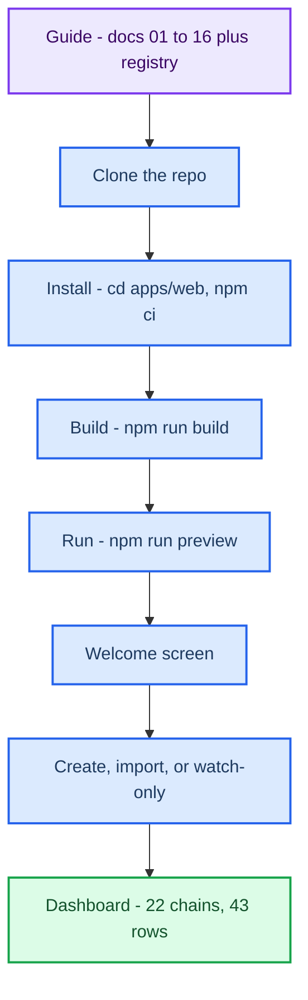
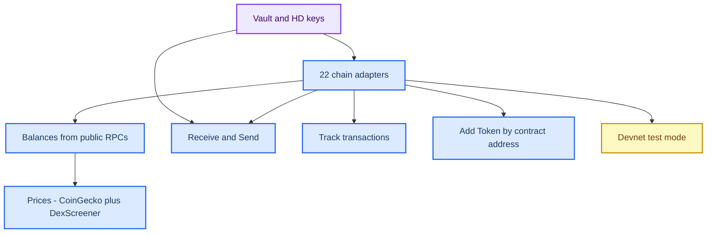

# How Bawa works

This page explains, in plain terms, how this repository works, how it
starts, and what it can do. The diagrams are
[Mermaid](https://mermaid.js.org/) text inside this Markdown file — not
images. GitHub renders them as diagrams on github.com web. They are kept
small on purpose: eight nodes at most per diagram, so they stay readable
and inside GitHub's rendering limits.

> **Known trade-off, stated plainly:** the GitHub **mobile app** shows
> Mermaid blocks as raw code, not as a rendered diagram. The diagrams
> render on github.com in a browser (desktop and mobile web). The owner
> ordered Mermaid text anyway, so this page uses Mermaid and accepts
> that trade-off rather than shipping a PNG or SVG that would go stale
> every time the code changes.

Every box in both diagrams is traced to a real file in this repository
in the [accuracy trace](#accuracy-trace--every-box--a-real-file) below.
Nothing here is invented: if a box has no file behind it, it does not
belong in the diagram.

## The repository in one paragraph

The **guide** (`docs/`, sixteen sections, plus the machine-readable
`registry/`) tells a person — or an AI agent — how to build a complete
professional wallet from resources that actually exist. The **example
web wallet** (`apps/web/`) is the working proof of that guide: a fully
functional example wallet built using it. It creates a real HD wallet in
the browser, derives addresses on 22 chains, reads real balances and
prices from public endpoints, and lets you receive, track, and add
tokens. It never invents a balance or a price, and it cannot send funds
on mainnet: broadcast stays disabled.

## Diagram 1 — How it starts

The full step-by-step version, verified from a clean checkout, is
[Create the example web wallet](CREATE-EXAMPLE-WALLET.md). In short:

1. **Clone** — `git clone https://github.com/Pr3eve6ti2o/bawa.git`.
2. **Install** — `cd apps/web && npm ci`. Node 22 is required
   (`apps/web/.npmrc` sets `engine-strict=true`, so any other Node
   fails here).
3. **Build** — `npm run build`. This type-checks, builds with Vite,
   copies the wallet-core WASM file, and checks its SHA-256 against the
   pinned `@trustwallet/wallet-core` 4.9.3 release.
4. **Run** — `npm run preview` serves the built app at
   `http://localhost:4173` (`npm run dev` instead for hot reload on
   `http://localhost:5173`).
5. **Welcome screen** — create a wallet, import one, or add a
   watch-only wallet.
6. **Dashboard** — a fresh wallet opens on 22 native assets plus 21
   default tokens: 43 rows. A balance shows as unavailable when its
   provider cannot be reached; it is never shown as an invented figure.

No account, no API key, and no funds are needed. Everything runs
locally; balances come from public read-only endpoints.

## Diagram 2 — What it can do

What each part means, in the wallet's own terms:

- **Vault and HD keys** — a 24-word BIP-39 phrase is created in the
  browser and kept in an encrypted vault on the device (PBKDF2 with
  600,000 iterations, AES-GCM 256-bit). Keys never leave the device.
  Addresses are derived per chain with Trust Wallet Core 4.9.3 (WASM).
- **22 chain adapters** — one adapter per chain (Bitcoin, Ethereum,
  TRON, TON, Solana, BNB Chain, Polygon, Arbitrum, Optimism, Base,
  Avalanche, Litecoin, Dogecoin, Gnosis, Celo, Linea, Mantle, Scroll,
  opBNB, Metis, Aurora, Fantom), each talking to public RPC endpoints
  (up to three per chain, with fallbacks).
- **Balances from public RPCs** — the dashboard refreshes every enabled
  chain's balance from its adapter. A failed fetch shows as unavailable,
  never as zero or as a made-up number.
- **Prices** — CoinGecko for listed assets, with a keyless DexScreener
  fallback for unlisted tokens. Prices are cached for ten minutes. When
  no source has a price, the wallet says the price is unavailable.
- **Receive and Send** — Receive shows the address and QR code for any
  chain. Send builds and signs the transaction offline — but mainnet
  broadcast stays **disabled** until separately authorised, so the
  wallet cannot move real funds. (Test-only sending lives in devnet
  mode, below.)
- **Track transactions** — look up a transaction by hash on Bitcoin,
  Ethereum, TRON, and TON (and other chains through their adapters) and
  see its confirmations and status.
- **Add Token by contract address** — add any token, listed or not: the
  wallet reads its real name, symbol, and balance from the chain, and
  its price where a source has one.
- **Devnet test mode** — a temporary, test-only switch that re-points
  the wallet at test networks with valueless tokens, so send and receive
  can be tried end to end without touching real funds. It is removable
  without touching mainnet behaviour.

Watch-only wallets fit the same picture: instead of a phrase, the
wallet stores only public extended keys (xpubs) and derives addresses
from them, so it can show balances without ever holding a secret.

## Accuracy trace — every box → a real file

| Diagram box | Real file(s) in this repo | What the file does |
| --- | --- | --- |
| Guide | `docs/01-fundamentals/` … `docs/16-security-decision-guide/`, `registry/capabilities.json`, `registry/engines.json`, `registry/profiles.json`, `registry/ui.json`, `WALLET_BUILDER.md` | The sixteen-section guide and the machine-readable registries the wallet is built from |
| Clone the repo | `docs/CREATE-EXAMPLE-WALLET.md` (Step 1) | Verified clone + install + build + run steps from a clean checkout |
| Install | `apps/web/package.json` (`engines`, `npm ci`), `apps/web/.npmrc` (`engine-strict=true`) | Node 22 requirement; dependency install |
| Build | `apps/web/package.json` (`build` script: `tsc --noEmit && vite build`), `apps/web/scripts/copy-wasm.mjs`, `apps/web/scripts/wasm-integrity.mjs` | Type check, Vite build, WASM copy + SHA-256 check against wallet-core 4.9.3 |
| Run | `apps/web/package.json` (`preview` / `dev` scripts), `apps/web/vite.config.ts` | Serves the built app (`:4173`) or dev server (`:5173`) |
| Welcome screen | `apps/web/src/screens/welcome.tsx`, `apps/web/src/app/app.tsx`, `apps/web/src/main.tsx` | App entry point; the Welcome screen offers create / import / watch-only |
| Create, import, or watch-only | `apps/web/src/screens/create-wallet.tsx`, `apps/web/src/screens/import-wallet.tsx`, `apps/web/src/wallet/vault.ts`, `apps/web/src/engine/boundary.ts` (`validateWatchOnlyImport`), `apps/web/src/state/wallet-context.tsx` (watch-only xpubs, `bawa-watch-only-xpubs`) | HD creation, phrase import, watch-only xpub import |
| Dashboard — 22 chains, 43 rows | `apps/web/src/screens/dashboard.tsx`, `apps/web/src/wallet/chains.ts` (`SUPPORTED_CHAINS`, 22 entries), `apps/web/src/wallet/tokens.ts` (`DEFAULT_TOKENS`, 21 entries) | 22 native assets + 21 default tokens |
| Vault and HD keys | `apps/web/src/wallet/vault.ts` (PBKDF2 600,000, AES-GCM, `bawa-vault`), `apps/web/src/engine/boundary.ts` (`loadCore`, `deriveAddress`, `deriveAddresses`), `apps/web/src/wallet/bip39-validation.ts` | Encrypted on-device vault; BIP-39 + Trust Wallet Core 4.9.3 derivation |
| 22 chain adapters | `apps/web/src/wallet/chains.ts` (`CHAINS`, `resolveRpcEndpoints`, max 3 endpoints per chain), `apps/web/src/wallet/adapters/index.ts` (`registerAllAdapters`), `apps/web/src/wallet/adapters/btc.ts`, `apps/web/src/wallet/adapters/eth.ts`, `apps/web/src/wallet/adapters/evm.ts`, `apps/web/src/wallet/adapters/trx.ts`, `apps/web/src/wallet/adapters/ton.ts`, `apps/web/src/wallet/adapters/sol.ts`, `apps/web/src/wallet/adapters/ltc.ts`, `apps/web/src/wallet/adapters/doge.ts` | One adapter per chain over public RPCs |
| Balances from public RPCs | `apps/web/src/state/wallet-refresh.ts`, `apps/web/src/state/ensure-adapters.ts`, `apps/web/src/wallet/balance-state.ts` | Balance refresh across enabled chains; failures show as unavailable |
| Prices — CoinGecko plus DexScreener | `apps/web/src/wallet/prices.ts` (CoinGecko, 10-minute cache, `PRICE_CACHE_KEY`), `apps/web/src/wallet/dex-prices.ts` (DexScreener fallback), `apps/web/src/wallet/token-prices.ts` | Live prices; honest "unavailable" when no source has one |
| Receive and Send | `apps/web/src/screens/receive.tsx`, `apps/web/src/screens/send.tsx`, `apps/web/src/wallet/send.ts` (`isBroadcastAllowedFor`, `assertNotTestAccount`), `apps/web/src/wallet/core.ts` (`createTransactionIntent`) | Address + QR receive; offline signing; mainnet broadcast disabled |
| Track transactions | `apps/web/src/screens/track-transaction.tsx`, `apps/web/src/wallet/tracker.ts` (`parseBtcTx`, `parseEthTx`, `parseTrxTx`, `parseTonTxEntry`) | Transaction lookup and confirmation status per chain |
| Add Token by contract address | `apps/web/src/screens/add-token.tsx`, `apps/web/src/wallet/tokens.ts` (`validateEvmContractAddress`, `validateTronContractAddress`, `validateSolMintAddress`, `validateTonJettonAddress`, `readCustomTokens` / `writeCustomTokens`) | Any token by contract address; real name, symbol, balance |
| Devnet test mode | `apps/web/src/wallet/devnet.ts` (`bawa-devnet-enabled`), `apps/web/src/wallet/devnet-endpoints.ts`, `apps/web/src/screens/devnet-setting.tsx` | Temporary test-only switch to test networks; devnet-only broadcast |

Supporting pieces named above: shared types in
`packages/contracts/src/index.ts` (including `WatchOnlyWallet`), the
offline derivation CLI in `tools/hdwallet-gen/`, and the guide's
architecture sections `docs/13-wallet-app-architecture/` and
`docs/14-wallet-app-implementation/`.

## How this page was verified

- Both Mermaid blocks were rendered to SVG with
  `@mermaid-js/mermaid-cli` on the development VM (Node v22.23.4,
  headless Chromium) — a successful render proves the syntax is valid
  Mermaid that GitHub's renderer can also parse. The rendered SVGs
  contain every node label from both diagrams.
- Every box was checked against the file listed for it in the trace
  table above, in the `panel-rebuild/token-gaps` tree at the time of
  writing. No module or flow in either diagram is invented.
- The README rewrite (a separate lane) will link to this page; this page
  does not edit the root README itself.
