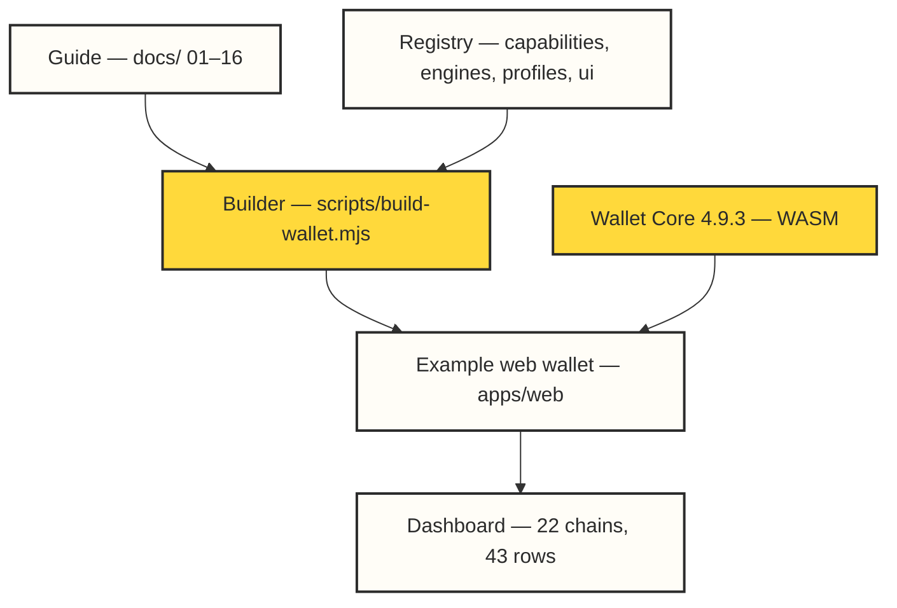
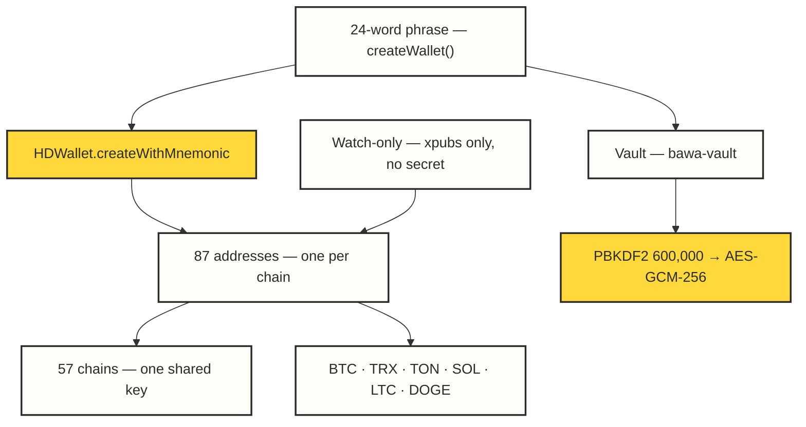
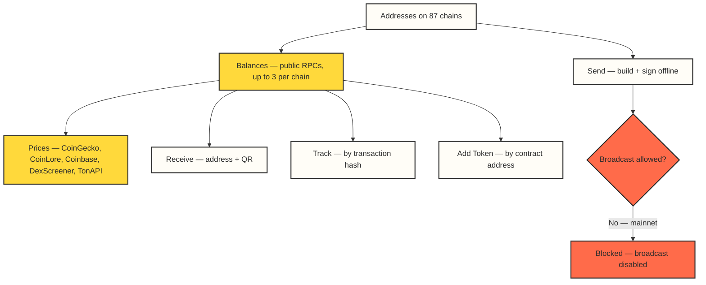

# How Bawa works

> Scope: this page describes the wallet as built on `panel-rebuild/token-gaps`, where the traced files live. `main` has no `apps/web/`, `registry/` or `scripts/build-wallet.mjs`. The trace table below was verified against `panel-rebuild/token-gaps` at `2c161b7` on 28 November 2026; the current tip is `1a85258` (2026-11-28), and the live site serves that build — [https://pr3eve6ti2o.github.io/bawa/](https://pr3eve6ti2o.github.io/bawa/) (bundle `index-B9gxTjOm.js`, 87 chains, dashboard 43 rows). The trace table has not been re-verified line by line against `ceade79`; where it disagrees with that tree, the tree is authoritative.

This page explains, in plain terms, how this repository works, how it
starts, and what it can do. The same architecture is drawn as
hand-crafted SVG at the top of the [README](../README.md) — those
diagrams render everywhere, including the GitHub mobile app. This page
carries the same content as Mermaid text: editable, diffable, and
rendered by github.com in a browser. The diagrams are kept small on
purpose: nine nodes at most per diagram, so they stay readable and
inside GitHub's rendering limits.

> **Known trade-off, stated plainly:** the GitHub **mobile app** shows
> Mermaid blocks as raw code, not as a rendered diagram. The diagrams
> render on github.com in a browser (desktop and mobile web). That is
> why both formats exist: the SVG in the README is what renders
> everywhere, and the Mermaid here is the editable source of the same
> architecture. The owner ordered both formats (2026-11-23).

Every box in every diagram is traced to a real file on `panel-rebuild/token-gaps`
in the [accuracy trace](#accuracy-trace--every-box--a-real-file) below.
Nothing here is invented: if a box has no file behind it, it does not
belong in the diagram.

## The repository in one paragraph

The **guide** (`docs/`, sixteen sections, plus the machine-readable
`registry/` on `panel-rebuild/token-gaps`) tells a person — or an AI agent — how to build a complete
professional wallet from resources that actually exist. The **example
web wallet** (`apps/web/` on `panel-rebuild/token-gaps`) is the working proof of that guide: a fully
functional example wallet built using it. It creates a real HD wallet in
the browser, derives addresses on 87 chains, reads real balances and
prices from public endpoints, and lets you receive, track, and add
tokens. It never invents a balance or a price, and it cannot send funds
on mainnet: broadcast stays disabled.

## Diagram 1 — System map

## Diagram 2 — Keys and vault

## Diagram 3 — Balances, prices and flows

There is no Yes edge out of the guard on mainnet — the only Yes lives
in devnet mode (`bawa-devnet-enabled`), a temporary test-only switch
that re-points the wallet at test networks with valueless tokens. It is
removable without touching mainnet behaviour.

What each part means, in the wallet's own terms:

- **Guide and registry** — sixteen sections (`docs/01-fundamentals/`
  through `docs/16-security-decision-guide/`) plus four machine-readable
  registries (`capabilities.json`, `engines.json`, `profiles.json`,
  `ui.json`). The builder (`scripts/build-wallet.mjs`, or the menu
  launcher `tools/bawa_cli.py`) turns one plain request — "Create a Web
  wallet" — into a real project from those resources. The guide covers
  the full Trust Wallet Core registry of 168 chains; the example wallet
  ships with 22 enabled.
- **Wallet Core 4.9.3** — Trust Wallet Core as WASM, loaded by
  `loadCore`. It owns the mnemonic, the derivation and the address
  checks; the app never implements cryptography itself.
- **24-word phrase** — `createWallet` takes 32 random bytes from the
  browser's secure random source and opens one HD wallet from them; the
  mnemonic is exactly 24 words. One phrase, one account, one wallet
  identity: there is no keypair per token and no single address that
  works on every chain.
- **87 addresses** — `deriveAddresses` opens the one HD wallet and derives one address per chain (via `deriveOneAddress`). The 57 chains at `m/44'/60'/0'/0/0` share one key. The other 30 have their own
  paths: Bitcoin `m/84'/0'/0'/0/0`, Litecoin `m/84'/2'/0'/0/0`, TRON
  `m/44'/195'/0'/0/0`, Dogecoin `m/44'/3'/0'/0/0`, TON `m/44'/607'/0'`
  (Wallet V4 R2, workchain 0), Solana `m/44'/501'/0'`. Both are
  account-0 paths: per-account derivation rotates them — Solana to a
  fresh address per account, TON to a second address — while the phrase
  stays the same (`deriveAddressesAt`, `core.ts:369`; `pathFor`,
  `chains.ts:883`).
- **Vault** — the phrase is stored in `bawa-vault` as an envelope
  (`version`, `kdf`, `saltB64`, `ivB64`, `ciphertextB64`) encrypted with
  AES-GCM-256 under a key derived by PBKDF2 with 600,000 iterations
  (SHA-256). No plaintext secret is stored anywhere. Auto-unlock keeps
  the raw derived key in `bawa-vault-key` next to the ciphertext it
  decrypts; backups live in `bawa-vault-backup`, accounts in
  `bawa-vault-accounts:v1`. Auto-lock is optional and off by default
  (toggle plus duration on /security; 5-minute default when enabled):
  with auto-lock off the derived key is stored so the vault
  auto-unlocks, with it on no key is stored while locked.
- **Watch-only** — instead of a phrase, the wallet stores only public
  extended keys (`bawa-watch-only-xpubs`) and derives addresses from
  them, so it can show balances without ever holding a secret.
  Watch-only is mainnet-only.
- **22 chain adapters** — one adapter per chain (Bitcoin, Ethereum,
  TRON, TON, Solana, BNB Chain, Polygon, Arbitrum, Optimism, Base,
  Avalanche, Litecoin, Dogecoin, Gnosis, Celo, Linea, Mantle, Scroll,
  opBNB, Metis, Aurora, Fantom), each talking to public RPC endpoints
  (up to three per chain, with fallbacks).
- **Balances from public RPCs** — the dashboard refreshes every enabled
  chain's balance from its adapter. A failed fetch shows as unavailable,
  never as zero or as a made-up number.
- **Prices** — CoinGecko first for listed assets, with a 10-minute
  cache. When a CoinGecko quote is stale or missing, native assets fall
  back to CoinLore and Coinbase (LTC only); unlisted tokens fall back to
  DexScreener (EVM, Solana, TRON) and TonAPI rates (TON Jettons). When
  no source has a price, the wallet says the price is unavailable.
- **Receive and Send** — Receive shows the address and QR code for any
  chain. Send builds the transaction offline and signs it
  (`createTransactionIntent`) — but mainnet broadcast stays **disabled**
  (`isBroadcastAllowedFor`), so the wallet cannot move real funds.
  (Test-only sending lives in devnet mode, above.)
- **Track transactions** — look up a transaction by hash on Bitcoin,
  Ethereum, TRON, and TON (and other chains through their adapters) and
  see its confirmations and status.
- **Add Token by contract address** — add any token, listed or not: the
  wallet reads its real name, symbol, and balance from the chain, and
  its price where a source has one. Custom tokens are stored in
  `bawa:custom-tokens:v1`.

## Running it

The full step-by-step version, verified from a clean checkout, is
[Create the example web wallet](CREATE-EXAMPLE-WALLET.md). In short:

1. **Clone** — `git clone https://github.com/Pr3eve6ti2o/bawa.git`.
2. **Install** — first `git checkout panel-rebuild/token-gaps` (the web wallet is not on `main`), then `cd apps/web && npm ci`. Node 22 is required
   (`apps/web/.npmrc` sets `engine-strict=true`, so any other Node
   fails here).
3. **Build** — `npm run build`. This type-checks, builds with Vite,
   copies the wallet-core WASM file, and checks its SHA-256 against the
   pinned `@trustwallet/wallet-core` 4.9.3 release.
4. **Run** — `npm run preview` serves the built app at
   `http://localhost:4173` (`npm run dev` instead for hot reload on
   `http://localhost:5173`).
5. **Welcome screen** — create a wallet, import one, or add a
   watch-only wallet.
6. **Dashboard** — a fresh wallet opens on 22 native assets plus 21
   default tokens: 43 rows. A balance shows as unavailable when its
   provider cannot be reached; it is never shown as an invented figure.

No account, no API key, and no funds are needed. Everything runs
locally; balances come from public read-only endpoints.

## Accuracy trace — every box → a real file

| Diagram box | Real file(s) in this repo | What the file does |
| --- | --- | --- |
| Guide | `docs/01-fundamentals/` … `docs/16-security-decision-guide/`, `WALLET_BUILDER.md` | The sixteen-section guide the wallet is built from |
| Registry | `registry/capabilities.json`, `registry/engines.json`, `registry/profiles.json`, `registry/ui.json` | Machine-readable registries the builder reads |
| Builder | `scripts/build-wallet.mjs`, `tools/bawa_cli.py` | One prompt in, a real project out |
| Example web wallet | `apps/web/`, `apps/web/package.json` | The working proof of the guide |
| Wallet Core 4.9.3 | `apps/web/package.json:39` (`@trustwallet/wallet-core: 4.9.3`), `apps/web/src/engine/boundary.ts:256` (`loadCore`) | WASM core: mnemonic, derivation, address checks |
| Dashboard — 22 chains, 43 rows | `apps/web/src/screens/dashboard.tsx`, `apps/web/src/wallet/chains.ts:1685` (`SUPPORTED_CHAINS`, 87 entries), `apps/web/src/wallet/tokens.ts:182` (`DEFAULT_TOKENS`, 21 entries) | 22 curated native assets + 21 default tokens (43 rows); the registry holds 87 chains |
| 24-word phrase | `apps/web/src/wallet/core.ts:216` (`createWallet`), `core.ts:227` (32-byte entropy, `new Uint8Array(32)`), `core.ts:232` (`HDWallet.createWithEntropy`) | 24-word BIP-39 phrase from secure entropy |
| HDWallet.createWithMnemonic | `apps/web/src/wallet/core.ts:303` (`deriveAddresses`), `apps/web/src/engine/boundary.ts:937` (`deriveAddresses`) | Opens the one HD wallet from the phrase |
| 87 addresses | `apps/web/src/wallet/core.ts:303` (`deriveAddresses`, via `deriveOneAddress` per chain), `core.ts:40-128` (`DEFAULT_PATHS`), `core.ts:523` (`deriveAddressesAt`, per-account SOL/TON), `apps/web/src/wallet/chains.ts:584` (`CHAINS`), `chains.ts:59` (`pathFor`) | One address per chain from one phrase; SOL/TON rotate per account |
| Vault — bawa-vault | `apps/web/src/wallet/vault.ts:80` (`VAULT_STORAGE_KEY`), `vault.ts:81` (`bawa-vault-backup`), `vault.ts:83` (`bawa-vault-key`), `vault.ts:863` (`bawa-vault-accounts:v1`) | Encrypted on-device vault; localStorage keys |
| PBKDF2 600,000 → AES-GCM-256 | `apps/web/src/wallet/vault.ts:85` (`PBKDF2_ITERATIONS = 600_000`), `vault.ts:97` (`SHA-256`), `vault.ts:100` (`AES-GCM`), `vault.ts:109` (`VaultEnvelope`) | Key derivation and envelope fields |
| 57 chains — one shared key | `apps/web/src/wallet/core.ts:40-128` (`DEFAULT_PATHS`: 57 chains `m/44'/60'/0'/0/0`) | One key across 57 chains; 55 render the same 0x address |
| BTC · TRX · TON · SOL · LTC · DOGE | `apps/web/src/wallet/core.ts:40-128` (`DEFAULT_PATHS`), `apps/web/src/wallet/chains.ts:623-626` (`pathFor` per chain; TON V4 R2, workchain 0) | Per-chain derivation paths |
| Watch-only — xpubs only, no secret | `apps/web/src/engine/boundary.ts:780` (`validateWatchOnlyImport`), `apps/web/src/state/wallet-context.tsx:76` (`bawa-watch-only-xpubs`) | Public extended keys only; mainnet-only |
| Addresses on 87 chains | As "87 addresses" above | The addresses every flow starts from |
| Balances — public RPCs, up to 3 per chain | `apps/web/src/wallet/chains.ts:1878` (`MAX_RPC_ENDPOINTS_PER_CHAIN = 3`), `chains.ts:1959` (`resolveRpcEndpoints`), `apps/web/src/wallet/adapters/index.ts:89` (`registerAllAdapters`), `apps/web/src/state/wallet-context.tsx:855` (`refreshBalances`) | Balance refresh across enabled chains; failures show as unavailable |
| Prices — CoinGecko, CoinLore, Coinbase, DexScreener, TonAPI | `apps/web/src/wallet/prices.ts:68` (`PRICE_PROVIDER_BASE_URL`, CoinGecko base), `prices.ts:254` (`MAX_QUOTE_AGE_MS`, 10 minutes), `prices.ts:258` (`PriceSource`), `prices.ts:577` (`PRICE_CACHE_KEY`), `prices.ts:819` (`fetchPrices`), `prices.ts:1374` (`usePrices`), `apps/web/src/wallet/price-fallbacks.ts` (`applyPriceFallbacks`, CoinLore + Coinbase native fallbacks), `apps/web/src/wallet/dex-prices.ts:254` (`fetchDexScreenerPrices`), `apps/web/src/wallet/token-prices.ts:178` (`fetchTokenPrices` — CoinGecko, DexScreener, TonAPI in parallel), `token-prices.ts:417` (`useTokenPrices`) | Live prices; honest "unavailable" when no source has one |
| Receive — address + QR | `apps/web/src/screens/receive.tsx` | Address + QR card for any chain |
| Track — by transaction hash | `apps/web/src/screens/track-transaction.tsx`, `apps/web/src/wallet/tracker.ts:101` (`parseBtcTx`), `tracker.ts:191` (`parseEthTx`), `tracker.ts:248` (`parseTrxTx`), `tracker.ts:311` (`parseTonTxEntry`) | Transaction lookup and confirmation status per chain |
| Add Token — by contract address | `apps/web/src/screens/add-token.tsx`, `apps/web/src/wallet/tokens.ts:761` (`CUSTOM_TOKENS_KEY`) | Any token by contract address; real name, symbol, balance |
| Send — build + sign offline | `apps/web/src/screens/send.tsx`, `apps/web/src/wallet/send.ts`, `apps/web/src/wallet/signing-intent.ts` (`createTransactionIntent`) | Offline signing; nothing leaves the device unsigned |
| Broadcast allowed? | `apps/web/src/wallet/send.ts:1298` (`isBroadcastAllowedFor`) | The guard: mainnet broadcast is not allowed |
| Blocked — broadcast disabled | `apps/web/src/wallet/send.ts:1325-1331` (status `disabled`, `BROADCAST_DISABLED_MESSAGE`) | Send stops here on mainnet |
| Devnet mode (prose) | `apps/web/src/wallet/devnet.ts:30` (`DEVNET_ENABLED_KEY`), `apps/web/src/wallet/devnet-endpoints.ts`, `apps/web/src/screens/devnet-setting.tsx` | Temporary test-only switch to test networks; devnet-only broadcast |

Supporting pieces named above: shared types in
`packages/contracts/src/index.ts` (including `WatchOnlyWallet`), the
offline derivation CLI in `tools/hdwallet-gen/`, and the guide's
architecture sections `docs/13-wallet-app-architecture/` and
`docs/14-wallet-app-implementation/`.

## How this page was verified

- All three Mermaid blocks were rendered to SVG with
  `@mermaid-js/mermaid-cli` on the development VM (Node v22.23.4,
  headless Chromium) — a successful render proves the syntax is valid
  Mermaid that GitHub's renderer can also parse. The rendered SVGs
  contain every node label from all three diagrams.
- Both hand-crafted SVGs in `docs/diagrams/` were rendered in headless
  Chromium and viewed as screenshots at README width (900 px) and at
  mobile width (390 px). The architecture SVG is legible at README
  width; the explainer SVG stays legible at mobile width.
- Every box was checked against the file listed for it in the trace
  table above, in the `panel-rebuild/finish-product` tree at the time of
  writing. No module or flow in any diagram is invented.
- The README embeds both SVGs at the top, right after the one-line
  description; this page is linked from there.
