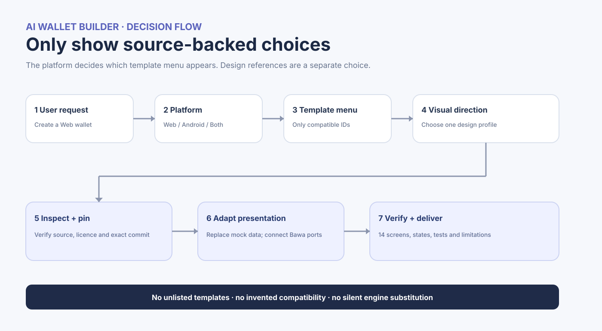
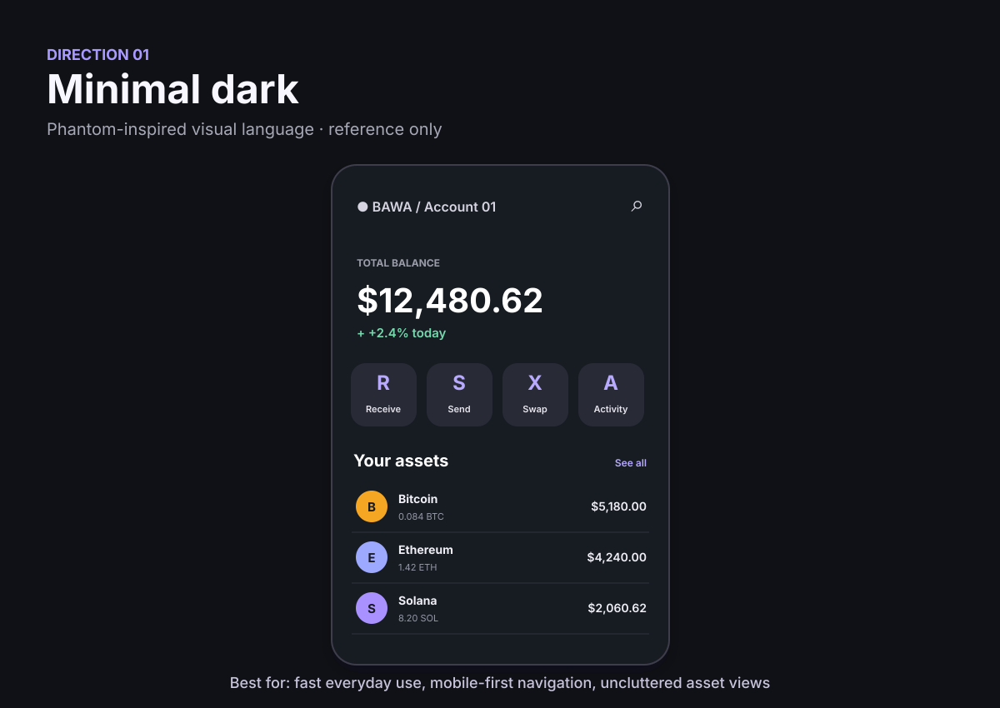
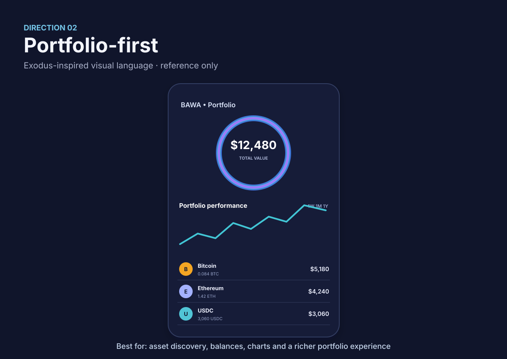
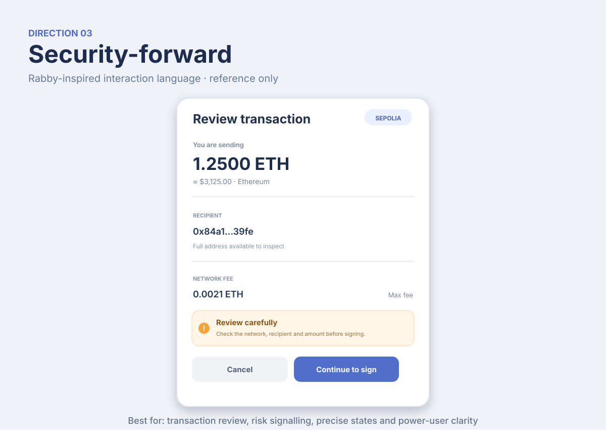
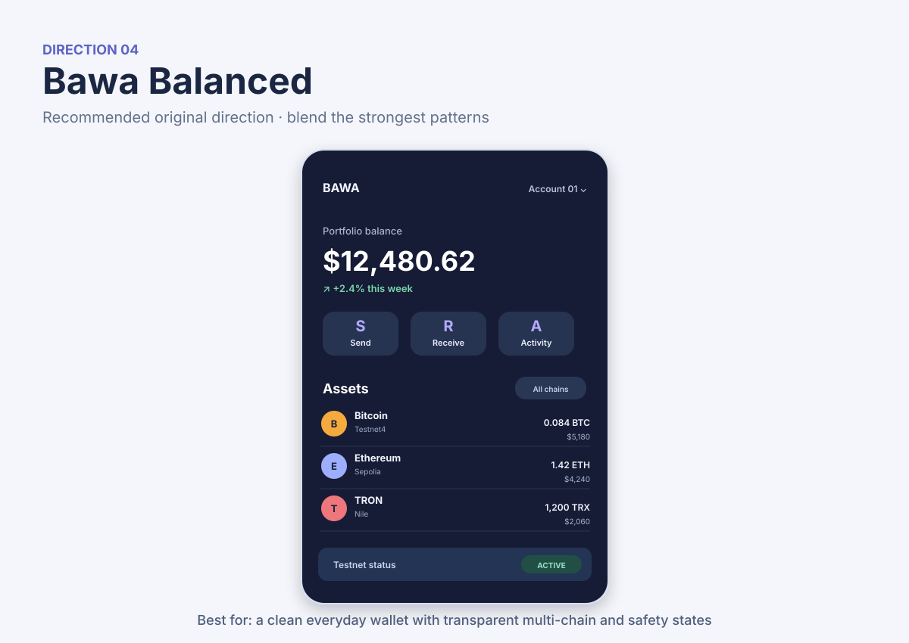

# Bawa UI/UX Catalogue and AI Template Selection Guide

**Version:** 1.0  
**Reviewed:** 10 November 2026  
**Purpose:** A source-backed, bounded choice catalogue for any AI agent building a wallet with Bawa.

> **Core rule:** Do not ask the user to choose from an imaginary universe of templates. Show only platform-compatible choices recorded in [`UI-TEMPLATE-REGISTRY.yaml`](./UI-TEMPLATE-REGISTRY.yaml), and distinguish actual code foundations from visual references. Hide any source that is not locally available or whose exact upstream revision cannot be reached and verified.

This file is designed to become the canonical UI/UX entry point for Bawa. It is a companion to the existing wallet, chain, security and implementation documentation; it does not replace them.

---

## 1. What this catalogue is for

Bawa already contains substantial wallet-engine and implementation guidance. It also has a canonical 14-screen wallet contract. The missing bridge is a controlled way for an AI agent to select an existing UI foundation, choose a visual direction, adapt the presentation layer and connect it to Bawa without confusing a design reference with working wallet code.

This catalogue gives the AI three separate things:

1. **Code foundation choices** - real repositories or implementation paths that can supply UI code.
2. **Visual direction choices** - documented design patterns that guide the look and feel. These are not source-code templates.
3. **Mandatory Bawa UI/security contract** - the 14 screens, states, permitted data and transaction review behaviour that every implementation must preserve.

The AI should ask the user to choose only when the choice has not already been made. The user can always say **"choose for me"**; in that case use the recommended foundation and the Bawa Balanced design direction.

## 2. Important repository reality: catalogue is not the same as vendoring

The Bawa `main` snapshot inspected for this catalogue was commit [`b3814e0b69becf74247577915ab62da19dfaa2d6`](https://github.com/Pr3eve6ti2o/bawa/commit/b3814e0b69becf74247577915ab62da19dfaa2d6), with 74 tree entries. That snapshot did not contain a local `apps/`, `templates/`, Web application or Android application directory. It contains the Bawa documentation and wallet-generation/watch-only tools.

The external projects listed below are **catalogued upstream sources**, not code already bundled in that Bawa snapshot. The registry marks them `fetch_required`. They become locally vendored only after the maintainer or an authorised agent adds them under a controlled `templates/` or equivalent directory (or pins them as submodules).

Therefore:

- Never tell a user that an external template is already included in Bawa when it is not.
- If internet access is unavailable, do not offer `fetch_required` entries as locally ready. Offer the custom implementation choice only, or explain that the source cannot be fetched.
- Once a template is copied or submoduled into Bawa, update the registry to `vendored`, record the exact commit and rerun its build checks.
- The menu must be generated from the registry, not improvised from general AI knowledge.

### Selection flow

## 3. The correct questions to ask the user

Ask only what is missing. Do not ask the user to repeat a platform or style they have already specified.

### Step 1 - Platform

If the request does not identify a target, ask:

> **What are we building?**
> 1. Web wallet
> 2. Android wallet
> 3. Web + Android wallet
> 4. HD wallet / CLI only (no visual UI menu)

After the user chooses, show only the matching template choices from the registry.

### Step 2 - Code foundation

Show the platform-specific menu in Section 4. State each option's availability accurately (`Available locally`, `Fetch required`, or `Unavailable`). Do not call a component library a complete wallet template. Do not present a research-only full wallet as an approved starter.

### Step 3 - Visual direction

Offer the five registered visual directions in Section 5. The names Phantom, Exodus, Rabby and imToken describe **inspiration/reference patterns only**. Bawa must create its own original visual identity; do not copy logos, trademarks, brand assets or an exact screen design.

### Step 4 - Plan before implementation

Before editing files, produce a brief implementation plan containing:

- platform and selected code foundation;
- exact upstream commit and licence, where relevant;
- selected visual direction;
- Bawa engine and chain scope to be used;
- which of the 14 screens will be implemented;
- security boundary and protected ceremonies;
- build/test commands and acceptance gates;
- known gaps and anything needing maintainer approval.

Do not change derivation policy, replace the Bawa engine or expand network scope as a side effect of choosing a UI template.

## 4. Code foundations: the only template choices to show

The exact source records, revisions and capabilities are in [`UI-TEMPLATE-REGISTRY.yaml`](./UI-TEMPLATE-REGISTRY.yaml). Re-check every upstream link and licence when using it; a pinned source record is a review snapshot, not a promise that the upstream still exists or is compatible with every current build.

### 4.1 Web

#### WEB-01 - imToken Wallet UI Starter Kit (recommended Web foundation)

- **Source:** [consenlabs/token-ui](https://github.com/consenlabs/token-ui)
- **Reviewed revision:** `6380d5d4dfeebf89704c0527e3c552be6ee2d231`
- **Licence:** MIT
- **Stack:** React, Vite and pnpm workspace
- **What it contains:** a runnable wallet-style UI starter, design tokens, light/dark themes, reusable UI components, wallet-dashboard composition, `DESIGN.md` and `AGENTS.md`.
- **What it does not contain:** Bawa's wallet engine, derivation, vault, custody, signing, RPC adapters or transaction indexing.

Why it is the first choice: its stated purpose is AI-assisted wallet UI composition; the design rules and agent instructions give an AI a consistent baseline to extend. The dashboard source uses mock wallet data, so the agent must replace the mock store with typed Bawa application ports before calling anything real.

**Important:** the inspected repository tree did not contain screenshot assets for the starter itself. Do not represent an imToken consumer-app screenshot as a screenshot of this starter kit. Inspect `DESIGN.md`, `AGENTS.md`, the app source and component source.

#### WEB-02 - shadcn/ui component foundation

- **Source:** [shadcn-ui/ui](https://github.com/shadcn-ui/ui)
- **Reviewed revision:** `8ab27715521cbd4f87ae6886cd989cbb678f6de7`
- **Licence:** MIT
- **Role:** component library, not a complete wallet application.

Choose this when the user prefers a custom-designed wallet and wants a strong collection of composable web components. The AI still needs to implement the full Bawa screen set, routing, wallet-specific states and integration.

#### WEB-03 - Custom React UI (Bawa specification)

Use the existing Bawa specification to build an original React UI without copying a third-party wallet template. It is the fallback when external source fetch is unavailable or the user wants a distinctive design. Do not add dependencies without following the repository's dependency-review process.

### 4.2 Android

#### AND-01 - Tether WDK Starter Kotlin: UI layer only (recommended Android foundation)

- **Source:** [tetherto/wdk-starter-kotlin](https://github.com/tetherto/wdk-starter-kotlin)
- **Reviewed revision:** `a4fa21729ba621c095d8638bc8c50de541008214`
- **Licence:** Apache-2.0
- **Stack:** Kotlin, Jetpack Compose and Material 3
- **Visible/source components:** Welcome, create, import, home, send, receive and sign screens plus reusable Compose components and dark-theme setup.

It is a useful source of real Compose wallet UI, but its README describes a Tether WDK-backed sample with a different seed and chain scope. **Take the presentation layer only.** Do not adopt its WDK engine, derivation, 12-word phrase policy, vault, private-key handling or signing as Bawa behaviour. Replace those calls with Bawa-backed application ports and implement Bawa's protected 24-word ceremony.

The inspected repository tree did not contain app screenshot files; the Android phone preview in this catalogue is an original schematic, not an upstream screenshot.

#### AND-02 - BDK DevKit Wallet `app-ui-only` (legacy reference)

- **Source:** [thunderbiscuit/devkit-wallet/app-ui-only](https://github.com/thunderbiscuit/devkit-wallet/tree/master/app-ui-only)
- **Reviewed revision:** `36392bfcea2fab8e772a4e89d5f8e465ab3da439`
- **Licence:** Apache-2.0
- **Status:** archived; last observed push 12 February 2025.

This is a genuine separate Compose UI-only module with Home, Send, Receive, Transactions, navigation and recovery-related screens. It is a secondary, legacy reference, not the recommended starting point. Its age means the AI must check Gradle, Compose and dependency compatibility. Never copy engine/derivation behaviour from its sibling app modules.

#### AND-03 - Android Jetpack Compose Samples (generic foundation)

- **Source:** [android/compose-samples](https://github.com/android/compose-samples)
- **Reviewed revision:** `25631e8f544a9a1e3f01e296eaf1b4c28428196c`
- **Licence:** Apache-2.0
- **Role:** maintained Android UI and architecture examples, not a cryptocurrency wallet template.

Use selected sample patterns for navigation, adaptive layouts, accessibility and Compose architecture. Build all wallet-specific screens and security ceremonies from Bawa's contract.

#### AND-04 - Custom Jetpack Compose UI (Bawa specification)

Build an original Android interface using Bawa's Android guide and the canonical 14-screen contract. Keep mnemonic entry and display inside a protected vault-owned ceremony. Ordinary composables, saved state and navigation arguments must not hold secret material.

### 4.3 Sources not offered as normal templates

These projects are useful for inspection, but they are not in the selectable starter menu:

| Project | Why it is research-only |
|---|---|
| [Edge React GUI](https://github.com/EdgeApp/edge-react-gui) | A complete, active multi-currency application coupled to its own engine and architecture. BSD-3-Clause; study UX and components, do not treat as a drop-in Bawa UI. |
| [XChain Platform Wallet](https://github.com/XChain-Platform/xchain-wallet) | A separate large wallet platform under AGPL-3.0. Architecture reference only unless maintainers explicitly review and approve its licensing obligations. |
| [Phantom](https://phantom.com/) | Product/visual reference, not an approved source-code template in this registry. |
| [Exodus](https://www.exodus.com/) | Product/visual reference, not an approved source-code template in this registry. |
| [Rabby](https://rabby.io/) | Product/visual reference, not an approved source-code template in this registry. |

Do not add a new item to the menu just because the AI remembers it. Add it to the registry only after repository, revision, licence, platform, actual contents and compatibility have been checked.

## 5. Visual directions: choose a design language, not another codebase

These images are **original schematic previews** created for this catalogue. They are not screenshots, not exact replicas and not source assets from Phantom, Exodus, Rabby or Bawa. Each direction is a set of visual rules the AI can implement using the selected code foundation.

### STYLE-01 - Minimal dark (Phantom-inspired)

Use a dark-first canvas, clean balance hierarchy, short action row, compact assets and uncluttered navigation. Best when the user prioritises a simple everyday wallet experience. Keep testnet status visible; do not let visual minimalism hide important network context.

### STYLE-02 - Portfolio-first (Exodus-inspired)

Use a stronger portfolio summary, asset allocation/chart area, richer asset rows and more detailed asset pages. Best when the user wants a portfolio-oriented interface. Charts must disclose missing/stale price data and must not imply unverified balances.

### STYLE-03 - Security-forward (Rabby-inspired)

Use structured transaction details, explicit chain labels, full recipient inspection, fee visibility and risk messages. Best when clarity and signing safety are the dominant UX goal. This is particularly important for Send and Review; warnings must be accurate and actionable, not decorative.

### STYLE-04 - Bawa Balanced (recommended)

Combine simple navigation and action layout, portfolio clarity, asset-list readability and Rabby-like transaction-review discipline. Use an original Bawa brand, palette, typography and components. This is the recommended default for Web + Android consistency.

### STYLE-05 - Calm token-centric (imToken Design System reference)

Use bright neutral surfaces, semantic design tokens, restrained blue accent, clear component variants and a well-supported light/dark theme. This is a design-system reference associated with WEB-01; it is not a claim that the imToken consumer app screenshot depicts the token-ui starter.

### Genuine upstream visual references

These reference images are included as links for visual inspection, not as permission to copy artwork or branding. When viewing this Markdown on GitHub or in a Markdown viewer with internet access, the remote image embeds should display.

**Phantom - official help-centre example of Home and Receive/network selection:**

Source: [Phantom Help - View your account addresses](https://help.phantom.com/hc/en-us/articles/28355153389075-View-your-account-addresses-in-Phantom).

**Exodus - official asset-page image showing mobile portfolio/asset screens:**

Source: [Exodus Bitcoin Wallet](https://www.exodus.com/bitcoin-wallet).

**Rabby - transaction/security-check visual example from the official site:**

Source: [Rabby Wallet](https://rabby.io/).

**BDK DevKit Wallet - upstream Android/Compose screenshots:**

Source: [BDK DevKit Wallet repository](https://github.com/thunderbiscuit/devkit-wallet). The source is archived and is listed only as a legacy reference.

**imToken product screenshot - product visual reference only, not the token-ui starter screenshot:**

Source: [imToken support article](https://token.im/blog/en-us/articles/360035597853).

The Tether WDK Starter Kotlin repository did not contain screenshot image assets in the inspected tree; use its `Screens.kt`, `Components.kt` and `WalletViewModel.kt` source to inspect actual code. Do not use an unrelated image as a screenshot of that project.

## 6. Canonical Bawa screen coverage (14 screens)

The single source of truth remains `docs/14-wallet-app-implementation/README.md`, section 5.1. A UI template never changes this list.

| # | Required screen | Visual pattern to borrow | Bawa-specific requirement |
|---:|---|---|---|
| 1 | Welcome | Minimal onboarding | Create/import choice, recovery responsibility and supported network context. |
| 2 | Create wallet | Guided steps | Create through the Bawa engine; do not display the mnemonic on this ordinary screen. |
| 3 | Import wallet | Clear form and progressive guidance | Protected/masked import; never persist import text in ordinary state. |
| 4 | Mnemonic backup | Purpose-built protected ceremony | Display once offline; require ordered full 24-word re-entry in protected entry. No copy/share/QR. |
| 5 | Portfolio dashboard | Minimal + portfolio-first | Account/chain context, balance freshness, recent activity and explicit testnet status. |
| 6 | Asset list | Rich, scannable rows | Selected account/chain, asset balances and freshness. |
| 7 | Asset detail | Portfolio detail | Full account address, asset information and related history. |
| 8 | Receive | Simple QR/address screen | Explicit network, full address and generated/decoded QR verification per Bawa docs. |
| 9 | Send | Structured form | Recipient, asset, amount, sender, network and fee; preparing a review, not signing. |
| 10 | Transaction history | Clear status chips and rows | Pending, included, confirmed, failed and replaced remain distinct. |
| 11 | Transaction details | Audit-style detail | Transaction hash, network, inclusion, confirmations and RPC/indexer status. |
| 12 | Network selection | Simple selector | Explicitly show each allowed network; do not silently switch or fall back. |
| 13 | Wallet management | Clear account settings | Accounts, chains, full addresses; no private-key export. |
| 14 | Security & backup settings | Calm settings | Authentication, auto-lock and backup metadata; never display mnemonic here. |

**Review** is a required state within Send, not a fifteenth screen. **Lock** is an app state, not a separate screen.

## 7. States and behaviours that must appear in the design

Every relevant screen needs proper state design, not just a happy-path screenshot.

- **Loading:** explain what is being checked/fetched; never show a blank wallet or zero balance merely while waiting.
- **Empty:** say what is empty and provide an appropriate next action.
- **Stale:** keep last-known data labelled stale/not refreshed and show the observation time where possible.
- **Locked:** give lock precedence over cached values; clear protected values from the visible surface.
- **Gate-failed:** identify that the action did not proceed without exposing secret-bearing details.
- **Error:** provide a safe, actionable message and retry/recovery path; do not display raw RPC or vault exceptions.

Additional behaviour:

- Show text/status labels; never communicate state by colour alone.
- Distinguish **signed**, **submitted**, **seen by a node** and **confirmed**. Never upgrade a status without evidence.
- On a failed refresh, retain last-known data with `Not refreshed`; if no prior data exists, show `Unavailable`. Never substitute zero for a failed request.
- Make the full recipient address available at Send Review. Bind approval to the exact reviewed payload; any relevant change requires fresh review and authorisation.
- Keep all network labels explicit, including testnet names.

## 8. Security boundaries for template adaptation

The UI may display safe public data and collect public transaction intent. It must not take ownership of wallet secrets or signing authority.

**The presentation layer must not store or receive:**

- mnemonics, individual mnemonic words, entropy or BIP-39 seeds;
- BIP-39 passphrases, data keys, wrapping keys or private signing keys;
- decrypted vault records or secret-bearing native key objects;
- secret containers/backup contents, raw auth tokens or secret-bearing device objects;
- RPC credentials or API keys embedded in URLs.

**Do not copy from a UI template:**

- its wallet generation or import engine;
- its derivation paths, coin-type mapping or address policy;
- its local vault/key storage or mnemonic display logic;
- its signing coordinator or transaction approval bypass;
- its analytics, telemetry, clipboard sync or remote persistence for secrets.

Instead, keep secret operations in the approved Bawa key/vault boundary. UI buttons should invoke typed application ports that return safe presentation models, never secret strings or generic decryption handles.

Follow the Bawa shared security baseline and the [OWASP Wallet UX Security Handbook](https://scs.owasp.org/handbooks/09-ux-security/). Use [WCAG 2.2](https://www.w3.org/TR/WCAG22/) as the accessibility baseline. This catalogue is not a security audit or legal review.

## 9. AI implementation workflow (mandatory)

Any AI agent asked to build a wallet using Bawa must follow this order:

1. Read this file and `UI-TEMPLATE-REGISTRY.yaml`.
2. Inspect the current Bawa checkout, branch, commit and working tree. Do not rely on a stale README description.
3. Read the relevant Bawa engine, architecture, implementation and platform guides (including docs/13, docs/14 and the Web or Android guide).
4. Resolve the requested platform. If missing, ask the platform question from Section 3.
5. Display only source-backed template choices for that platform. Label local versus upstream-fetch status. Do not offer research-only references.
6. Ask for a visual direction if it has not been specified. Keep this separate from the code-foundation choice.
7. Produce the concise implementation plan before changing files.
8. Inspect the exact chosen upstream source, `README`, agent instructions, licence, relevant screen/components and pinned commit. Record the pin in the generated project.
9. Build/adapt the presentation layer only. Replace mock values and no-op actions with Bawa interfaces; never label mock functionality as real.
10. Implement the complete 14-screen contract and all required states.
11. Run formatting, lint, type checks, unit tests, platform build and available security checks. Do not weaken tests to make them pass.
12. Report completed functionality, verified results, untested flows, remaining blockers, upstream licences and any source code copied/adapted.

Do not silently expand the chain list, use mainnet, alter derivation policy, change wallet engine, add token swaps/staking/bridges or create new signing behaviour as part of UI work. Treat each as a separate scope decision and review.

## 10. Exact menu text the AI should use

The agent should adapt the labels to the user's platform and omit any option that is not currently available. Example for a Web wallet:

> **Choose the Web UI foundation**
>
> 1. **imToken Wallet UI Starter Kit (recommended)** - React/Vite wallet UI starter with design system and AI agent instructions. MIT. Upstream fetch required unless already vendored.
> 2. **shadcn/ui components** - component library only; Bawa screens and wallet flows must be built. MIT. Upstream fetch required unless already vendored.
> 3. **Custom React UI** - implement Bawa's screen contract with an original design.
>
> **Choose the visual direction**
>
> A. Minimal dark - Phantom-inspired.
> B. Portfolio-first - Exodus-inspired.
> C. Security-forward - Rabby-inspired.
> D. Bawa Balanced - original combination; recommended.
> E. Calm token-centric - imToken Design System-inspired.
>
> Reply with a foundation number and a visual direction letter, or say **"choose for me"**.

Example for Android:

> **Choose the Android UI foundation**
>
> 1. **Tether WDK Starter Kotlin (recommended)** - Compose wallet UI to adapt; use UI only, replace WDK logic with Bawa ports. Apache-2.0. Upstream fetch required unless already vendored.
> 2. **BDK DevKit app-ui-only (legacy)** - separate Compose UI module, archived in 2025. Apache-2.0. Compatibility work required.
> 3. **Android Compose Samples** - maintained generic Compose foundation, not a wallet template. Apache-2.0.
> 4. **Custom Jetpack Compose UI** - build the Bawa screen contract from scratch.
>
> **Choose the visual direction**
>
> A. Minimal dark.
> B. Portfolio-first.
> C. Security-forward.
> D. Bawa Balanced - recommended.
> E. Calm token-centric.
>
> Reply with a foundation number and a visual direction letter, or say **"choose for me"**.

If the platform is Web + Android, show both compatible foundation menus. If the user only asked for a CLI/HD generator, do not present wallet UI options.

## 11. Registry maintenance rules

- Keep the YAML registry as the machine-readable source of truth; keep this Markdown as the human-readable explanation.
- Re-check branch, commit, licence file, README, last push and the exact UI paths before upgrading a pin.
- Record whether the source is vendored or requires an upstream fetch.
- Do not mark an external source `vendored` until its code is physically present in Bawa and the integration is built/tested.
- Reclassify archived, unmaintained, incompatible or licence-unclear sources as reference-only or unavailable.
- Add a new template only after a maintainer has inspected its source, platform, licence, framework, actual screen coverage, dependency health and security boundaries.
- Keep copied-code attribution and licence notices with the copied files.
- Review this catalogue after each platform-app release or whenever an upstream pin changes.

## 12. Sources checked for this edition

All repository metadata, source trees, licences and file locations below were checked on **10 November 2026**. The exact commits recorded in the YAML file are the review pins for this edition.

### Selectable upstream UI foundations

- [consenlabs/token-ui](https://github.com/consenlabs/token-ui) - MIT; `6380d5d4dfeebf89704c0527e3c552be6ee2d231`.
- [shadcn-ui/ui](https://github.com/shadcn-ui/ui) - MIT; `8ab27715521cbd4f87ae6886cd989cbb678f6de7`.
- [tetherto/wdk-starter-kotlin](https://github.com/tetherto/wdk-starter-kotlin) - Apache-2.0; `a4fa21729ba621c095d8638bc8c50de541008214`.
- [thunderbiscuit/devkit-wallet](https://github.com/thunderbiscuit/devkit-wallet) - Apache-2.0; archived; `36392bfcea2fab8e772a4e89d5f8e465ab3da439`.
- [android/compose-samples](https://github.com/android/compose-samples) - Apache-2.0; `25631e8f544a9a1e3f01e296eaf1b4c28428196c`.

### Research and UX standards

- [EdgeApp/edge-react-gui](https://github.com/EdgeApp/edge-react-gui) - BSD-3-Clause; `95f46b8fb856e1e15531ab800c88f55df7411e38`.
- [XChain-Platform/xchain-wallet](https://github.com/XChain-Platform/xchain-wallet) - AGPL-3.0; `3e550d05e913e29e5c3cf24527bf504f1a4fe942`.
- [OWASP Wallet UX Security Handbook](https://scs.owasp.org/handbooks/09-ux-security/).
- [OWASP UX Security Scoring Matrix](https://scs.owasp.org/handbooks/09-ux-security/part2-ux-security-scoring-matrix/).
- [WCAG 2.2](https://www.w3.org/TR/WCAG22/).
- [Phantom Help - account addresses and Receive](https://help.phantom.com/hc/en-us/articles/28355153389075-View-your-account-addresses-in-Phantom).
- [Exodus Bitcoin Wallet interface reference](https://www.exodus.com/bitcoin-wallet).
- [Rabby Wallet](https://rabby.io/).

---

## Maintainer note

This catalogue is **ready to add to Bawa**, but it does not itself clone, vendor or integrate any upstream UI. The Web and Android sources remain external fetch choices until they are deliberately added to the repository. A successful menu selection is not proof that a complete wallet has been built. Build, integration, security and release gates remain mandatory.
