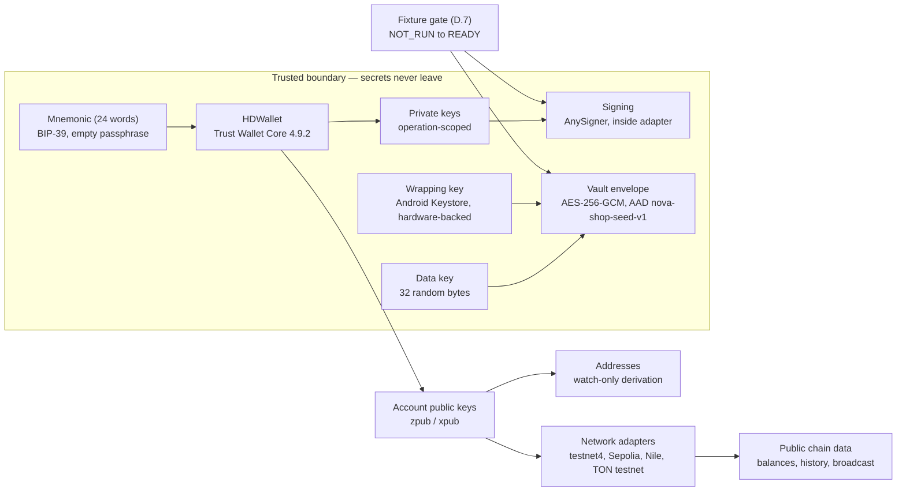

# Building the Bawa Android wallet

_How-to guide. Read from top to bottom on your first pass._

> **Verified on**
>
> - Verification status: Partially verified — sections A to K rewritten and checked first-hand on 8 November 2026; the procedures they specify have not been executed end to end.
> - Verified on: 2026-11-08.
> - Verification scope: rewrite of sections A–K of the Android guide, against the pinned repository at e3b65fb832db287fdc8d54794980dd0b3456cc12 and the validation drafts.
> - Repository commit: e3b65fb832db287fdc8d54794980dd0b3456cc12 (Pr3eve6ti2o/bawa).
> - Tool versions (observed, not declared pins): Node v24.22.2; Python 3.12.3 with cryptography==50.0.2 and bip-utils==2.12.2; Trust Wallet Core 4.8.4 WASM for the fixture verification runs; Core 4.9.2 is the testnet source-build pin this guide prescribes for the demonstrated scope (a GitHub prerelease, not a stable release); the repository pin remains 4.8.4 and the upgrade candidate is 4.9.1 (Doc 4 section 21 M-21).
> - Environment/runner: muse-vm (Boxd, Ubuntu 24.04.5 LTS).
> - Actually run: Core 4.8.4 fixture verification (12 checks, all pass — see section D.7); TON path confirmation (m/44'/607'/0'); Core tag resolution (4.9.2 → 17e3cd4d…, 4.8.4 → d40d24a… via the GitHub API); first-hand reads of the pinned repo files, the validation draft's build files, NetworkConfig.kt, Fixtures.kt, TonConfig.kt and VaultEnvelope.kt.
> - Not run / unresolved: no Gradle build, no APK, no device or emulator run, no Core AAR build; the Android wallet creation, restore and testnet spend as specified here have not been exercised end to end; verification ran on Node 24, outside the declared >=22 <23 range; the EIP-1559 proof and the full verification pass were run against 4.8.4, not 4.9.2; the on-device fixture gate has never run. (Live creation and restore were exercised for the repository CLI tools (V1) and live 24-word creation for the web draft in a real browser (V2); send, signing and broadcast were exercised nowhere.)
> - Live verification cited (8 November 2026, muse-vm): V2 web-draft browser flow, 14 PASS / 0 FAIL (Playwright 1.65.0 + Chromium 158.0.8127.18); V3 TON fixture, verified two independent ways (Core 4.8.4 + SLIP-0010/PyNaCl + @ton/ton). Both ran on Node v24.22.2, outside the declared >=22 <23 range.
> - Evidence: w4-and-a/verify-fixtures/verify.mjs and verify-ton-path.cjs; NOTES.md; REWRITE-NOTES.md.
> - Sources fetched on: 2026-11-08.

## Pick a starting point

Read from top to bottom on your first pass. If you're building and only need one part, read section A first, then jump to that section; you must still pass the fixture gate in D.7 before any wallet action.

### Warning convention

Throughout this guide, each warning explains what could go wrong, tells you what to do to avoid it, then gives a check or recovery step to confirm the action worked.

## Contents

- **A. Scope and boundaries** — Review what this testnet-only guide builds, the four testnets it covers, the boundary you must preserve, the claims the wallet must never make and the repository baseline.
- **B. Prerequisites and toolchain** — Verify the JDKs, Android SDK, native toolchain, Core pin, Gradle and the wrapper, and project setup in one ordered pass.
- **C. Building the Core AAR from source** — Check out Core 4.9.2, run code generation, build the AAR and protobuf JAR, check the entry points, stage the artefacts and compile Bawa.
- **D. Engine integration** — Implement the WalletEngine boundary, fixed derivation policy, mnemonic handling, the empty BIP-39 passphrase policy, public-only boundaries, TON integration, the mandatory offline fixture gate using only published test vectors, signing and native lifetime management.
- **E. Vault and backup** — Set up the AES-256-GCM envelope, Android Keystore protection, backup confirmation with one mnemonic reveal followed by full re-entry, screen protection, auto-lock and backup exclusions.
- **F. Connectivity** — Connect only to the four testnets, with per-adapter network-identity checks, request discipline and confirmation thresholds.
- **G. Send and signing** — Run the seven-step frozen-payload sequence, recover interrupted operations, and apply the chain notes.
- **H. UI contract** — Build the fourteen screens against the screen-to-implementation traceability matrix, with the vault-owned ceremonies.
- **I. Testing** — Run the offline host harness, the fixture gate, import and recovery checks, approval and watch-only tests, and the testnet and device passes.
- **J. Security documentation** — Apply the trust-boundary rules, vault and key integrity, import and backup confirmation, transaction validation, endpoint trust, the threat slice, the review gate and the incident playbook.
- **K. Deployment, setup, environment, and implemented versus unimplemented** — Set up the project, configure the environment, install on a device or emulator, complete the release work, and pass the mandatory gates.
- **L. Recovery by symptom** — Diagnose a failure by its symptom, with the cause, the fix and the check.
- **Consolidated open-items register — Docs 1–3** — The single canonical register for all three guides.
- **Appendix — Optional pre-existing UI templates: no drop-in fit** — Ranked templates and the vetting checklist; using one is optional.
- **Improve this guide / Need help?**
- **Prose credit**

## Routes into this guide

Use Kotlin for the Android route. No complete sample application exists to link, so this guide links none.

- Use the Bawa repository `Pr3eve6ti2o/bawa`, pinned at `e3b65fb832db287fdc8d54794980dd0b3456cc12`, as the engine reference.
- The validation draft is a local-only, unpushed Android project that has never produced a Gradle build, an APK or a device run.

## A. Scope and boundaries

### A.1 Scope and responsibilities

Use this guide with the Bawa repository pinned at `e3b65fb832db287fdc8d54794980dd0b3456cc12`. The guide covers the engine and derivation behaviour, the vault (the encrypted store) and its unlock lifecycle, watch-only connectivity, transaction construction, review and signing, tests and the UI contract for a non-custodial, testnet-only Android wallet. Supply the application around those parts, the toolchain, testnet access and a device or emulator for the later device checks. Use published test vectors only.

Non-custodial means the user controls signing and recovery material, with no operator-held recovery copy.

Provide a UI that meets this contract, using your own implementation or a suitable pre-existing template; choose the look, framework and components. Do not let the UI or a template redefine derivation, weaken transaction review or introduce its own secret storage. No template is named in sections A to E; the optional template appendix sits after section K.

The repository guide (Doc 1) is the single canonical home for repository-level troubleshooting and FAQ. This guide covers only what is specific to building the Android wallet and links to Doc 1 for everything shared.

Evidence labels are **VERIFIED** (checked first-hand), **APPROVED BUT UNEXECUTED** (specified, never run) and **OPEN** (unresolved).

### A.2 Network boundaries

**VERIFIED** — the network scope in this table has been checked first-hand.

| Chain | Allowed network |
| --- | --- |
| Bitcoin | testnet4 |
| Ethereum | Sepolia |
| TRON | Nile |
| TON | testnet |

Do not substitute testnet3 for testnet4, another Ethereum testnet for Sepolia or Shasta for Nile.

Mainnet is absent from this guide set; any mainnet work is a separate, reviewed change outside this set, and passing the gates does not authorise it.

Do not provide hidden network switches or a user-supplied endpoint escape hatch. Reject imported requests and deep links that select an unsupported network.

Use test funds only; do not use recovery material that controls real assets.

### A.3 Required wallet operations

The operations below are **APPROVED BUT UNEXECUTED**: they define what the completed wallet must do. Live wallet creation has been performed from the web draft in a real browser (V2, 8 November 2026: 24-word creation, exact ordered backup re-entry accepted, wallet saved, portfolio shown); the Android draft has never had a live creation, restore or testnet spend. No live testnet spend has been made from either draft, and no mnemonic restore has been exercised from either draft — send, signing and broadcast were not exercised.

Keep the BIP-39 passphrase empty by policy. Use the separate vault unlock passphrase as the PBKDF2 input for the vault.

| Operation | Required behaviour |
| --- | --- |
| Create | Generate a 24-word BIP-39 mnemonic and initialise the vault. |
| Import | Import an existing mnemonic using the specified derivation. |
| Restore | Restore the wallet from your mnemonic or seed bundle. |
| Receive | Derive and display an address for the selected network. |
| Balances | Fetch and display balances for the selected network with their refresh status. |
| History | Fetch and display transaction history for the selected network with distinct transaction states. |
| Send | Construct, review, sign and submit a transaction on the selected network. |
| Multi-network use | Use the allowed networks while keeping addresses, balances, history and transactions tied to the correct network. |
| Backup | Back up the mnemonic and export the encrypted seed bundle as `seed.enc.json`. |

If a request fails, show 'Not refreshed' and retain any last-known data with that status. If no earlier data exists, show 'unavailable'. Never substitute zero for a failed request.

Keep 'Signed', 'submitted', 'seen by a node' and 'confirmed' as distinct states; display only the state supported by evidence.

Test restoration on a separate clean installation.

### A.4 Preserve the boundary

Separate trusted key operations from watch-only infrastructure, and signing from balance and transaction tracking. Keep secret creation/import, derivation, vault access, authorised recovery/export, signing and secret-carrying bridges within the trusted boundary. Validate UI/connectivity signing requests as input, never authority to spend; bind reviewed intent to the transaction signed within that boundary.

Limit watch-only providers to public-chain data and broadcasting signed transactions; never send them secrets. Treat responses as potentially stale, unavailable, inconsistent or malicious. Minimise disclosure through address and transaction queries: watch-only is not private.

Limit ordinary screens to public data; treat unlock, import and recovery screens as secret-handling components. Keep secrets out of logs, analytics, crash reports, UI state and watch-only requests. WASM alone establishes no security boundary.

Bawa contains no transaction construction or signing implementation; signing exists only in the built apps, via Trust Wallet Core.

### A.5 Keep claims within verified bounds

Use testnet only. Bawa offers no custody, exchange or hosted wallet.

- Never call anything unverified "secure" or "safe"; never describe the wallet as "secure because encrypted".
- Never claim "production-ready" or "ready for real money".
- Never use "audited" without the scope, reviewer, date and retained evidence.
- Never describe the whole wallet as "hardware-signed" or "hardware-backed". A hardware-backed Keystore wrapping key does not make signing hardware-isolated.
- Never claim "memory erased", "secure wipe" or "guaranteed erasure".
- Never call any security property "guaranteed"; state the exact verified bound instead.

Do not infer readiness from address generation alone. Require independent security review, chain-specific verification, tested recovery and reproducible builds, and pass every release gate.

### A.6 Pin the checkout and keep the references

Clone and pin exactly as the repository guide (Doc 1, section 4, 'Clone and verify the commit') prescribes; the pin is e3b65fb832db287fdc8d54794980dd0b3456cc12.

Keep the checkout detached. Verify the commit:

```sh
git rev-parse HEAD
```

Expected result: a commit hash starting with `e3b65fb832db287fdc8d54794980dd0b3456cc12`.

Keep the README run guide, `docs/RECOVERY.md`, `tools/hdwallet-gen` and docs 01, 02, 04, 05, 08, 09, 13, 14, 15 and 16 beside this guide. Include docs 03, 06, 07, 10, 11 and 12, which the repository guide also carries.

The pinned checkout at `e3b65fb832db287fdc8d54794980dd0b3456cc12` was inspected first-hand for the files this guide cites (re-inspected 9 November 2026; the repair changed exactly the four JavaScript tools and `decrypt_seed.py`, and all four tools pass `node --check` at this pin). Every repository-derived claim that depends on a file not cited here remains unverified.

Docs 03 and 12 are the shallowest in the repository and have never received a deep pass. Treat anything taken from them as unreviewed until the repository guide deepens them. **Open item (OI-017):** docs 03 and 12 received a deep pass (D01–D16, 2026-11-08). The docs/12 findings are folded into the repo guide at merge; the docs/03 findings (D01–D09) are recorded in the merge notes and remain to be folded (OI-089).

Never change a derivation policy. If the documentation, recovery instructions and reference implementation disagree, record the discrepancy and stop the affected work. Use only published test vectors or explicit placeholders in examples.

Figure 1 — Where keys live, what leaves the device, and what never does. Takeaway: secrets stay inside the trusted boundary (Core, vault, Keystore); only public keys and public chain data cross to the network; the fixture gate opens the wallet, nothing else does.



## B. Prerequisites and toolchain

Work through this section as one ordered verification pass against the pins in B.1, in order, and record the full version output of every tool in the build record.

### B.1 Version pins

This guide is testnet only. VERIFIED means the value was checked first-hand on 8 November 2026; OPEN marks outstanding release verification.

| Component | Scope | Declared value | Required release-verification pin | Status |
|---|---|---|---|---|
| Trust Wallet Core | App + Core build | 4.9.2 | 4.9.2, commit `17e3cd4df5d53f061ade3bbdc07d196f5ed5a8e3` | VERIFIED (tag resolves to that commit; GitHub API, 8 Nov 2026) |
| Trust Wallet Core (previous pin) | Reference only | 4.8.4 | 4.8.4, commit `d40d24a63d92619167903369308bf0e2f7eb3a59` | VERIFIED (tag resolves to that commit; GitHub API, 8 Nov 2026) |
| App JDK | App build | JDK 21 | JDK 21, vendor and patch unpinned | OPEN (OI-001) |
| Core JDK | Core module build | JDK 17 | JDK 17, vendor and patch unpinned | OPEN (OI-001) |
| App Gradle | App build | Gradle 8.9 | Gradle 8.9 from the draft wrapper properties; validation baseline, not a project pin | OPEN (OI-007: no wrapper JAR is committed) |
| Core Gradle | Core module build | Gradle 8.10.2 | Gradle 8.10.2 (upstream wrapper + CI) | VERIFIED |
| Android Gradle Plugin, app | App build | 8.5.2 | 8.5.2 (draft version catalogue) | VERIFIED |
| Android Gradle Plugin, Core | Core module build | 8.8.0 | 8.8.0 (upstream) | VERIFIED |
| Kotlin, app | App build | 2.0.21 | 2.0.21 (draft version catalogue) | VERIFIED |
| Kotlin, Core | Core module build | 2.1.0 | 2.1.0 (upstream) | VERIFIED |
| Android SDK, app | App build | API 34 | `platforms;android-34`; Build Tools `34.0.0` is the AGP 8.5.2 default (AGP 8.5 release notes) — the draft declares no `buildToolsVersion`, so confirm the installed revision from `source.properties` | VERIFIED |
| Android SDK, Core | Core module build | API 35 | `platforms;android-35` (upstream Core module) | VERIFIED |
| NDK | Core module build | 28.0.12674087 | 28.0.12674087 | VERIFIED |
| CMake | Core module build | 3.18.1 | 3.18.1 | VERIFIED |
| protoc | Core code generation | 3.20.3 | libprotoc 3.20.3, from `build/local/bin/protoc` via `tools/install-dependencies` | VERIFIED |
| protobuf-javalite | Core module build | 3.22.3 | 3.22.3 (upstream) | VERIFIED |
| Node | Repo tools verification | `>=22 <23` | Node 22 (declared range); verification ran on Node v24.22.2, outside the declared range, and was re-run on Node v22.23.4 on 2026-11-08 with identical results (D22) | VERIFIED |
| Python | Repo tools verification | `>=3.11` | Python 3.12.3 with `cryptography==50.0.2` and `bip-utils==2.12.2` | VERIFIED |

Record each version's exact pin once, in this table. Keep version ranges only as compatibility declarations: a range is not a pin and must never serve as a reproducible pin.

**Open item (OI-001):** Pin the vendor and patch for each JDK.

**Open item (OI-007):** Commit and verify the app wrapper JAR before treating the draft wrapper's Gradle version as a project pin.

Version pins are not a lockfile — until a lockfile generated from a clean install is committed, no install reproduces the exact dependency graph that was tested.

**Open item (OI-008):** Partially resolved (2026-11-08): `tools/hdwallet-gen/package-lock.json` was added by the phase-1 repair at e3b65fb832db287fdc8d54794980dd0b3456cc12. No Android-app dependency lockfile is evidenced; Android dependency locking remains open. The Node-tooling lockfile is present at the documented clone pin e3b65fb832db287fdc8d54794980dd0b3456cc12. Owner: W4 (Android follow-up).

### B.2 Toolchain invariants

Treat the app build and the Core module build as two different builds: they use different JDKs (21 versus 17), different Gradle versions (8.9 versus 8.10.2), different Android Gradle Plugin and Kotlin versions, and different compile SDKs (34 versus 35). Never unify them by upgrading one to match the other.

- Distinguish the JDK running Gradle, the compiler toolchain and the bytecode target: they are three different things. A Java 17 compiler toolchain is not a complete build running on Java 17.
- Do not change `sourceCompatibility`, `targetCompatibility`, Kotlin `jvmTarget`, toolchain declarations or any derivation policy to work around a JDK selection problem.
- Follow the later sub-sections as one ordered verification pass against B.1, and record the full version output of every tool in the build record.
- Treat a passing fixture as evidence of basic wiring only; it does not validate native integration, wallet behaviour or derivation policy.

### B.3 Java: two JDKs

Keep two full JDK installations for Bawa's testnet builds: **JDK 21 for the wallet build** and **JDK 17 for the Core module build**. These are stated Bawa major-version requirements, not a general Android rule. Do not replace Core's JDK 17 with JDK 21 because it is newer, or downgrade the wallet build to JDK 17 to match Core.

**Open item (OI-001):** Vendor and patch-level pins were never supplied; use a supported security update within each required major and record the complete version output.

The build JDK runs Gradle and JVM tooling. A compiler toolchain can select a different JDK, while bytecode targets describe the output. Setting a target of 17 does not prove that JDK 17 ran the build.

**Confirm both installations**

Replace `<wallet-jdk-root>` and `<core-jdk-root>` with your own installation roots containing the `bin` directory. Keep the quotes and run the four checks for your operating system. A runtime without the `javac` compiler is not enough.

**Linux/macOS**

```sh
"<wallet-jdk-root>/bin/java" -version
```
**Expected result:** The wallet installation's `java` reports major 21.

```sh
"<wallet-jdk-root>/bin/javac" -version
```
**Expected result:** The wallet installation's `javac` reports major 21.

```sh
"<core-jdk-root>/bin/java" -version
```
**Expected result:** The Core installation's `java` reports major 17.

```sh
"<core-jdk-root>/bin/javac" -version
```
**Expected result:** The Core installation's `javac` reports major 17.

**Windows (PowerShell)**

```powershell
& "<wallet-jdk-root>\bin\java.exe" -version
```
**Expected result:** The wallet installation's `java` reports major 21.

```powershell
& "<wallet-jdk-root>\bin\javac.exe" -version
```
**Expected result:** The wallet installation's `javac` reports major 21.

```powershell
& "<core-jdk-root>\bin\java.exe" -version
```
**Expected result:** The Core installation's `java` reports major 17.

```powershell
& "<core-jdk-root>\bin\javac.exe" -version
```
**Expected result:** The Core installation's `javac` reports major 17.

**Select and check the build JDK**

Select the JDK explicitly for each build invocation: set `JAVA_HOME` to the required installation root and prefix `PATH` with that installation's `bin` directory. Keep the wallet build on JDK 21 rather than relying on the default `java` on `PATH`.

One Gradle invocation has one daemon JVM. Selecting a Core task does not switch the wallet build's daemon from JDK 21 to JDK 17. Core's JDK 17 requirement is met by its separate source build in section C, which runs under its own JDK 17 invocation—not by switching the wallet build's daemon. Do not assume Core has a separate wrapper; follow section C's build procedure.

Check the wrapper's Gradle version against these compatibility facts:

- Gradle 8.5 first supports running on Java 21.
- Gradle 8.4 supports Java 21 toolchains, but not running Gradle on Java 21.
- Gradle 7.3 first supports running on Java 17.

Read the wrapper's `--version` output under the same per-build JDK selection. Where it lists `Launcher JVM` and `Daemon JVM` separately, distinguish them: the launcher's version alone does not prove which JDK runs the build.

Inspect `org.gradle.java.home` and `gradle-daemon-jvm.properties` for daemon settings that can override your environment selection. In Android Studio, open **Settings → Build, Execution, Deployment → Build Tools → Gradle → Gradle JDK** and select the wallet installation's JDK 21.

If the daemon JVM selection remains unclear, add `--info` to the build invocation and inspect any daemon-startup output for the Java executable used.

**Sources**

- [Android Developers: Java versions in Android builds](https://developer.android.com/build/jdks)
- [Gradle compatibility matrix](https://docs.gradle.org/current/userguide/compatibility.html)
- [Gradle toolchains](https://docs.gradle.org/current/userguide/toolchains.html)
- [Gradle daemon JVM selection](https://docs.gradle.org/current/userguide/gradle_daemon.html)

### B.4 Android SDK

Install and verify the SDK before running Gradle for the testnet wallet.

| Component | SDK package identifier | Version evidence required |
|---|---|---|
| App build | `platforms;android-34` | Verified against the validation draft's `app/build.gradle.kts`: `compileSdk = 34`, `targetSdk = 34`, `minSdk = 26`; the draft declares no `buildToolsVersion` — `34.0.0` is the AGP 8.5.2 default (AGP 8.5 release notes); confirm installed API level `34` and the installed Build-Tools package revision from `source.properties`. |
| Core module build | `platforms;android-35` | Upstream Core module pin; confirm installed API level `35`. |

Install both platform packages. Check the Bawa checkout's `compileSdk` settings and any explicit `buildToolsVersion`; substitute exact package identifiers only if the checkout requires a newer validated combination. Do not infer a Core Build-Tools version or a Java language target from its platform pin.

**Choose and prepare the SDK root**

Choose one SDK root: Linux `$HOME/Android/Sdk`, macOS `$HOME/Library/Android/sdk`, or Windows `%LOCALAPPDATA%\Android\Sdk`. Make `ANDROID_HOME`, `ANDROID_SDK_ROOT` and `sdk.dir` in `local.properties` resolve to that same absolute path. Expand environment variables and escape the `local.properties` value as required. Never commit a machine-specific SDK path.

Download Command-line Tools for your OS from Android Developers SDK downloads. Calculate the archive's SHA-256 and compare it with the published checksum before extracting it; stop if they differ. Place the extracted contents so that your SDK root's `cmdline-tools/latest` directory contains `bin`, `lib` and `source.properties` directly. `cmdline-tools/latest/cmdline-tools` is one directory too deep.

Prepend the absolute paths to that root's `cmdline-tools/latest/bin`, `platform-tools` and `build-tools/34.0.0` directories to your session's `PATH`. Use a POSIX shell on Linux or macOS, or PowerShell on Windows, and run only the OS-specific file checks that apply.

Command-line Tools and Platform-Tools have independent release numbers; neither follows the platform API level.

**Open item (OI-026):** Verify and record the current Command-line Tools and Platform-Tools revisions, each installed platform package revision and the downloaded Command-line Tools archive's SHA-256 checksum for your build; no current-release numbers are asserted here.

**Install and verify the packages**

Review licence prompts and accept licences only where authorised. Do not hide prompts behind an unchecked `yes` pipeline.

```text
sdkmanager --licenses
```

**Expected result:** The required licences are accepted or reported as already accepted; stop if you lack authorisation to accept a required licence.

```text
sdkmanager --install "platform-tools" "build-tools;34.0.0" "platforms;android-34" "platforms;android-35"
```

**Expected result:** The table's packages and `platform-tools` are installed in your chosen SDK root without errors.

```text
sdkmanager --list_installed
```

**Expected result:** The table's packages and `platform-tools` appear as installed. A package listed under **Available Packages** is not installed.

```text
adb version
```

**Expected result:** A version report identifies `adb` under your chosen SDK root; record the output.

```text
aapt2 version
```

**Expected result:** An `aapt2` version report appears without an execution error.

```text
d8 --version
```

**Expected result:** A `d8` version report appears without an execution error.

```text
apksigner version
```

**Expected result:** An `apksigner` version report appears without an execution error.

Use `source.properties` to verify package revisions; individual tool version strings need not match the Build-Tools package revision.

**Linux and macOS file checks**

```sh
command -v zipalign
```

**Expected result:** The path identifies `zipalign` in your chosen SDK root's `build-tools/34.0.0` directory.

```sh
test -r "$ANDROID_HOME/platforms/android-34/android.jar"
```

**Expected result:** A successful exit with no output confirms that the app platform's `android.jar` is readable.

```sh
test -r "$ANDROID_HOME/platforms/android-35/android.jar"
```

**Expected result:** A successful exit with no output confirms that the Core platform's `android.jar` is readable.

```sh
grep -H -E '^(Pkg\.Revision|AndroidVersion\.ApiLevel)[[:space:]]*=' \
  "$ANDROID_HOME/cmdline-tools/latest/source.properties" \
  "$ANDROID_HOME/platform-tools/source.properties" \
  "$ANDROID_HOME/build-tools/34.0.0/source.properties" \
  "$ANDROID_HOME/platforms/android-34/source.properties" \
  "$ANDROID_HOME/platforms/android-35/source.properties"
```

**Expected result:** Build-Tools reports `Pkg.Revision=34.0.0`; the platform files report `AndroidVersion.ApiLevel=34` and `AndroidVersion.ApiLevel=35`, respectively, without read errors. Record all reported package revisions, keeping platform package revisions distinct from API levels.

**Windows file checks — PowerShell**

```powershell
(Get-Command zipalign -CommandType Application -ErrorAction Stop).Source
```

**Expected result:** The path identifies `zipalign` in your chosen SDK root's `build-tools/34.0.0` directory.

```powershell
@(
    "$env:ANDROID_HOME/platforms/android-34/android.jar"
    "$env:ANDROID_HOME/platforms/android-35/android.jar"
) | ForEach-Object { ([System.IO.File]::OpenRead($_)).Dispose() }
```

**Expected result:** No output or errors confirms that both platform `android.jar` files opened for reading.

```powershell
Select-String -LiteralPath @(
    "$env:ANDROID_HOME/cmdline-tools/latest/source.properties"
    "$env:ANDROID_HOME/platform-tools/source.properties"
    "$env:ANDROID_HOME/build-tools/34.0.0/source.properties"
    "$env:ANDROID_HOME/platforms/android-34/source.properties"
    "$env:ANDROID_HOME/platforms/android-35/source.properties"
) -Pattern '^(Pkg\.Revision|AndroidVersion\.ApiLevel)\s*=' -ErrorAction Stop
```

**Expected result:** Build-Tools reports `Pkg.Revision=34.0.0`; the platform files report `AndroidVersion.ApiLevel=34` and `AndroidVersion.ApiLevel=35`, respectively, without read errors. Record all reported package revisions, keeping platform package revisions distinct from API levels.

Record the installed-package list, tool outputs and file-check results. Resolve any failed check before building.

Installing Build-Tools `34.0.0` does not force Gradle to use them. Confirm and record the version Gradle selects: check any explicit `buildToolsVersion`, or confirm the default selected by the project's Android Gradle Plugin when no explicit version is set.

**Sources**

- [Android Developers SDK downloads](https://developer.android.com/studio#command-tools)
- [sdkmanager](https://developer.android.com/tools/sdkmanager)
- [Platform-Tools release notes](https://developer.android.com/tools/releases/platform-tools)
- [Build-Tools release notes](https://developer.android.com/tools/releases/build-tools)
- [Set up the Android 14 SDK](https://developer.android.com/about/versions/14/setup-sdk)
- [SDK environment variables](https://developer.android.com/tools/variables)
- [Android Gradle Plugin 8.5 release notes](https://developer.android.com/build/releases/past-releases/agp-8-5-0-release-notes)

### B.5 Native toolchain: NDK, CMake, protoc

Use Core **4.9.2** for this testnet-only build. These pins belong to the Core module build:

| Tool | Required version |
|---|---|
| NDK | `28.0.12674087` |
| CMake | `3.18.1` |
| protoc | `3.20.3` |

The pins are identical at Core `4.8.4`, `master` and `4.9.2`. Keep this build tied to `4.9.2`.

Verify the Core release reference and checkout path. Confirm that the Core Android module build file selects NDK `28.0.12674087` and CMake `3.18.1`, and record the declaration locations.

Run the commands below in Bash from the Core checkout root. Keep that working directory throughout, and stop if any check fails or differs from its expected result.

**Install and check the SDK packages**

Verify the SDK root selected for this build, then locate SDK Manager:

```bash
command -v sdkmanager
```

**Expected result:** The SDK Manager executable belongs to the selected SDK root.

Install the exact packages:

```bash
sdkmanager --install "ndk;28.0.12674087" "cmake;3.18.1"
```

**Expected result:** `ndk;28.0.12674087` and `cmake;3.18.1` are installed in that SDK root.

If SDK Manager cannot supply either exact package, stop. Do not substitute another NDK 28 build, a newer CMake, or an unversioned system installation.

At each prompt below, enter the existing absolute path from the matching installed package under the verified SDK root.

Check the NDK package metadata:

```bash
read -r -p 'Absolute path to the NDK package source.properties: ' NDK_PROPERTIES &&
grep '^Pkg\.Revision' "$NDK_PROPERTIES"
```

**Expected result:** `Pkg.Revision` reports `28.0.12674087`.

Check the installed CMake executable:

```bash
read -r -p 'Absolute path to the installed CMake executable: ' CMAKE_BIN &&
"$CMAKE_BIN" --version
```

**Expected result:** The version output begins with `cmake version 3.18.1`.

Check the installed NDK Clang executable:

```bash
read -r -p 'Absolute path to the installed NDK Clang executable: ' NDK_CLANG &&
"$NDK_CLANG" --version
```

**Expected result:** NDK Clang runs successfully and prints its compiler version. Do not treat Clang's version as the NDK package revision.

**Obtain and check protoc**

Core's own native dependency metadata pins **protobuf `3.20.3`**. Its dependency setup builds protoc at `build/local/bin/protoc`. The separate **protobuf-javalite `3.22.3`** dependency does not determine the protoc version.

Obtain protoc through Core's dependency setup. Do not substitute a compiler installed through `apt` or `brew`, or whichever `protoc` happens to be on `PATH`.

```bash
tools/install-dependencies
```

**Expected result:** Core's dependency setup completes, with protobuf `3.20.3` providing `build/local/bin/protoc`.

Print and record the compiler's absolute path:

```bash
printf '%s/build/local/bin/protoc\n' "$(pwd -P)"
```

**Expected result:** The absolute path to `build/local/bin/protoc` inside the verified Core `4.9.2` checkout.

Invoke that absolute path for the version check:

```bash
"$(pwd -P)/build/local/bin/protoc" --version
```

**Expected result:** `libprotoc 3.20.3`

Require that exact version output.

Include the Core release reference, module pin locations, SDK root and installed package IDs, NDK package revision, CMake version output, and a successful NDK Clang invocation in the toolchain record. Also record the protoc source—Core's protobuf `3.20.3` dependency declaration and `tools/install-dependencies`—along with its absolute path and version output.

**Sources**

- Android Developers: [Install and configure the NDK and CMake](https://developer.android.com/studio/projects/install-ndk)
- Android Developers: [sdkmanager](https://developer.android.com/tools/sdkmanager)
- Protocol Buffers: [Compiler installation](https://protobuf.dev/installation/)
- Protocol Buffers: [Version support](https://protobuf.dev/support/version-support/)

### B.6 Trust Wallet Core pin

Pin Trust Wallet Core to exactly `4.9.2` for the Bawa Android wallet's testnet-only builds. This is the testnet source-build pin for the scope demonstrated on 4.9.2 (the D21 construction/signing demonstration); `4.9.2` is a GitHub prerelease, not a stable release. It is not the repository pin — the repository pin remains `4.8.4` — and it is not the upgrade candidate — the upgrade candidate is `4.9.1`, pending its own qualification run (Doc 4 section 21 M-21). Do not present this testnet-build pin as the repository pin, and never relabel 4.9.2 demonstration results as 4.9.1 results.

- **Upstream repository:** `https://github.com/trustwallet/wallet-core.git`
- **Git tag:** `4.9.2`
- **Required full commit:** `17e3cd4df5d53f061ade3bbdc07d196f5ed5a8e3`

Keep both the tag and the full commit as review-controlled constants. The tag-to-commit mapping was verified against the GitHub API on 8 November 2026; the tag object is the commit itself.

A version range is not a pin. Never use `4.+`, `4.9.+`, `[4.9.2,5.0)`, `latest.release` or a moving branch.

Run the following Bash command from a writable parent directory, with Git available. Make it a required builder gate: allow the build to continue only if it succeeds. The command derives the source directory name from the repository URL and refuses any existing entry with that name.

```bash
bash <<'BASH'
set -euo pipefail

readonly repository='https://github.com/trustwallet/wallet-core.git'
readonly tag='4.9.2'
readonly expected_commit='17e3cd4df5d53f061ade3bbdc07d196f5ed5a8e3'

source_dir=${repository##*/}
source_dir=${source_dir%.git}
readonly source_dir

# Refuse to reuse an existing source directory, file or symlink.
[[ ! -e "$source_dir" && ! -L "$source_dir" ]]

git clone --no-checkout --branch "$tag" --single-branch \
    "$repository" "$source_dir"

git -C "$source_dir" fetch --no-tags origin \
    "refs/tags/${tag}:refs/tags/${tag}"

tag_commit=$(git -C "$source_dir" rev-parse --verify \
    "refs/tags/${tag}^{commit}")
[[ "$tag_commit" == "$expected_commit" ]]

git -C "$source_dir" checkout --detach "$expected_commit"

head_commit=$(git -C "$source_dir" rev-parse --verify 'HEAD^{commit}')
[[ "$head_commit" == "$expected_commit" ]]

checkout_status=$(git -C "$source_dir" status \
    --porcelain --untracked-files=all --ignore-submodules=none)
[[ -z "$checkout_status" ]]

printf 'Pin gate passed.\n'
BASH
```

**Expected result:** Git creates a fresh checkout, and `Pin gate passed.` appears only after tag `4.9.2` and `HEAD` both match the required full commit and the checkout is clean. An existing source entry, missing tag, failed Git command, hash mismatch or dirty checkout fails the gate and must stop the builder job.

Never obtain `expected_commit` from the remote tag during the build: that compares the remote with itself. Never repair a mismatch by replacing `expected_commit` with whatever upstream returns. After the gate passes, do not pull, switch refs or apply local source patches.

Core's `.gitmodules` file is empty at the pinned releases, so there is nothing to recurse into. For any submodules, use only the revisions recorded by the required commit; never use `git submodule update --remote`.

Where you consume Core as a Maven module, require `strictly("4.9.2")` in the dependency's Gradle `version` block. Do not accept an artefact labelled `4.9.2` without evidence that it was built from the required commit. Record the SHA-256 of the Core artefact actually used in the build, alongside that evidence.

Reject the `4.6.0` Maven Central republish because it would break the exact `4.9.2` pin. Availability on Maven Central does not make a different Core release an acceptable substitute. Do not relabel a `4.6.0` artefact as `4.9.2`.

The repository pin, `4.8.4` at commit `d40d24a63d92619167903369308bf0e2f7eb3a59`, is NOT superseded by this testnet-build pin: it remains the repository version until `4.9.1` passes its qualification run (Doc 4 section 21 M-21). Do not build the repository tools against `4.9.2`.

**Open item (OI-004):** The EIP-1559 demonstration was completed on Core 4.9.2 for the construction/signing demonstration scope (D21, 2026-11-08); the in-browser proof, send, sign and broadcast remain open.

**Open item (OI-019):** The full verification pass was run against `4.8.4`; D30 recorded 6/6 WASM parity MATCH on Core 4.9.2 and 4.8.4 (2026-11-08), and D31 Core-confirmed the TRX anchor and the three account-0 public nodes on 4.9.2. The remaining 4.9.2 verification (in-browser parity run, live device pass) stays open before treating the new pin as fully verified.

**Sources**

- [Wallet Core tag 4.9.2](https://github.com/trustwallet/wallet-core/tree/4.9.2)
- [Required commit](https://github.com/trustwallet/wallet-core/commit/17e3cd4df5d53f061ade3bbdc07d196f5ed5a8e3)
- [Git rev-parse](https://git-scm.com/docs/git-rev-parse)
- [Gradle rich version constraints](https://docs.gradle.org/current/userguide/rich_versions.html)

### B.7 Gradle, the wrapper, and loopback

The validation draft's `gradlew` is a thin launcher note: `gradle/wrapper` holds only `gradle-wrapper.properties`, and no wrapper JAR is committed. A script without that JAR is not a working wrapper. Bawa has no checked-in Android project in the repository; the draft is local-only.

Use either a full Gradle 8.9 installation or a complete standard Gradle Wrapper with a genuine wrapper JAR whose provenance you have checked.

**Open item (OI-007):** No wrapper JAR is committed and no `distributionSha256Sum` is recorded.

**Gradle 8.9 — Validation baseline, not project pin.** This is the version used in the validation work. Keep Gradle and AGP pins separate: Gradle 8.9 does not imply AGP 8.9. Apply these steps to testnet only.

**Prepare the tooling**

For a full installation, download Gradle 8.9, compare its checksum against the trusted Gradle distribution checksum, unpack it, and add its `bin` directory to `PATH`.

If no wrapper is available to check, create a validation project yourself and generate its standard wrapper from that checksum-verified Gradle 8.9 installation. Record Gradle 8.9 as the wrapper's originating version. Do not treat the local draft as an existing Android project or complete wrapper.

Use a POSIX shell with `mktemp` available for the commands below. Select the Java 17 JDK for command-line Gradle through `JAVA_HOME`, and put that JDK's tools on `PATH`.

**Validate the wrapper before running it**

Follow this sequence for the wrapper route. Complete the provenance and configuration checks before any wrapper invocation.

1. Pin `distributionUrl` in `gradle/wrapper/gradle-wrapper.properties` to the approved validation distribution: `https://services.gradle.org/distributions/gradle-8.9-bin.zip`. The draft already records this URL.

2. Obtain the trusted checksum for that exact distribution. Record it as `distributionSha256Sum` and check the recorded value against the trusted reference. Stop if the checksum is missing or does not match.

3. Compare the SHA-256 of `gradle/wrapper/gradle-wrapper.jar` against an authenticated Gradle reference for the JAR's originating version. Do not infer that version from `distributionUrl`. Stop if its provenance or checksum cannot be verified.

4. Use a fresh `GRADLE_USER_HOME` to exercise download verification rather than reuse a cached distribution:

   ```sh
   GRADLE_USER_HOME="$(mktemp -d)" && export GRADLE_USER_HOME
   ```

   **Expected result:** `GRADLE_USER_HOME` names a newly created, empty directory and is exported for subsequent commands.

5. From the project you created, ensure `gradlew` is executable, then trigger the fresh download and confirm the version:

   ```sh
   ./gradlew --version
   ```

   **Expected result:** The distribution downloads into the fresh user home, passes the configured SHA-256 verification, and reports Gradle 8.9.

After these checks pass, commit the complete wrapper together in that project: `gradlew`, `gradlew.bat`, `gradle/wrapper/gradle-wrapper.jar` and `gradle/wrapper/gradle-wrapper.properties`.

For the full-installation route, check the installation after completing the checksum, unpacking and `PATH` steps:

```sh
gradle --version
```

**Expected result:** The installed Gradle reports Gradle 8.9.

**Require working loopback**

The sandbox validation attempt was blocked because Gradle's client–daemon loopback connection was unusable, before any wallet compilation.

Permit working localhost TCP between the Gradle client and daemon, typically through `127.0.0.1` or `::1`. If the environment intercepts or blocks loopback, move to another machine. Do not patch Gradle, remap localhost or weaken security controls.

`--no-daemon` is not an escape route: Gradle can still require a single-use daemon. A successful version check does not prove that daemon communication works.

**Run the remaining checks in order**

1. **Check Java per module.** Select each module's JDK according to B.1, put its tools on `PATH`, and align Gradle's JDK selection with it. Require Java 17 for the fixture.

   ```sh
   java -version
   ```

   **Expected result:** The runtime matches the module's B.1 pin; for the fixture, it reports Java 17.

   ```sh
   javac -version
   ```

   **Expected result:** The compiler matches the module's B.1 pin; for the fixture, it reports Java 17.

2. **Check the SDK packages.** Put `sdkmanager` from the SDK selected for the build on `PATH`.

   ```sh
   sdkmanager --list
   ```

   **Expected result:** The installed packages include Android SDK platform 34 and build-tools 34.0.0. An entry under available packages does not count as installed.

3. **Check the CMake binary.** Put the CMake binary selected for the module on `PATH`.

   ```sh
   cmake --version
   ```

   **Expected result:** The selected binary runs and reports its version. Compare that version against the applicable module pin before continuing.

4. **Create and run the hello-world Android library fixture.** Set its inputs explicitly from the B.1 pin table:

   | Fixture input | Required setting |
   |---|---|
   | `AGP_VERSION` | `8.5.2` |
   | `COMPILE_SDK` | `34` |
   | `BUILD_TOOLS_VERSION` | `34.0.0` |
   | `MIN_SDK` | `26` |
   | `TARGET_SDK` | `34` |
   | `ANDROID_JAVA_MAJOR` | `17` |
   | `GRADLE_JAVA_HOME` | Set to the actual home of your local Java 17 JDK and record that choice. |

   Set `JAVA_HOME` to the same JDK home; do not assume Gradle reads `GRADLE_JAVA_HOME` automatically. Set Android Java source and target compatibility to 17.

   Include Android Java source and a task that prints `Hello, world.`. Using the validated Gradle route with the daemon enabled, run the greeting task and build the debug AAR.

   **Expected result:** The fixture prints `Hello, world.`, executes Android Java compilation rather than reporting `NO-SOURCE`, and produces a non-empty debug AAR.

A complete fixture pass establishes daemon, loopback and SDK wiring only; it does not validate wallet compilation. Reject a partial pass. Never weaken a version pin or skip a later gate.

**Sources**

- [Gradle 8.9 installation](https://docs.gradle.org/8.9/userguide/installation.html)
- [Gradle 8.9 Wrapper](https://docs.gradle.org/8.9/userguide/gradle_wrapper.html)
- [Gradle 8.9 daemon](https://docs.gradle.org/8.9/userguide/gradle_daemon.html)
- [Android Developers: Java versions in Android builds](https://developer.android.com/build/jdks)
- [Android Developers: sdkmanager](https://developer.android.com/tools/sdkmanager)
- [CMake command-line manual](https://cmake.org/cmake/help/latest/manual/cmake.1.html)

### B.8 Project setup and verification

Take every verification input from the B.1 pin table: app JDK 21, Core JDK 17, SDK packages `platforms;android-34` and `build-tools;34.0.0`, CMake 3.18.1, and Core tag 4.9.2. Use its approved Gradle wrapper and plugin pins for the smoke build. Do not accept a newer wrapper, Android Gradle Plugin or SDK level because a project wizard selected it.

Create two Gradle modules: `app` for screens and navigation, and `core` for the engine boundary and verification. Include `:app` and `:core` in `settings.gradle.kts`, and make `:app` depend on `:core`. Keep the upstream Core checkout separate from the Android project.

For the initial smoke build, create only a hello-world screen in `:app` and leave `:core` empty. Pass this build before implementing `WalletEngine`.

Use this dependency boundary when implementation starts:

`app → WalletEngine → fixture-gated Core adapter → real Core library`

Put `WalletEngine` in `:core`. Use Bawa-facing types in its public contract; do not expose upstream Core or JNI types.

Enforce availability at this boundary through the fixture gate:

- Start the gate closed.
- Block every wallet action while it is closed, including actions initiated by background workers, services and deep links.
- Open it only after the real Core build passes the approved fixture set. Use published test vectors only.
- Do not carry a passing result to a different engine build or fixture set.
- Do not allow a placeholder or mock to satisfy the gate.

There is no testnet-only build variant. Testnet-only operation comes from endpoint selection plus the fixture gate, not from a build flavour. Select testnet endpoints.

**Open item (OI-025):** no testnet-only variant exists; deciding whether one is needed is open.

The empty-project build has never been run from this guide. No Gradle build has run for this Android project, no APK has been produced, and no device or emulator run has happened. The sandbox loopback block stopped Gradle before any build logic ran; this establishes nothing about the application code, only about that sandbox. The fixture in B.7 and the smoke build here are **APPROVED BUT UNEXECUTED** until you record a passing run for each.

Run the following checks in order. Make the selected B.1 tools available on your shell's `PATH`, record the results and stop on any mismatch. The Expected results below are acceptance criteria, not recorded outcomes.

1. **Check the JDKs.** Select the B.1 app JDK in your shell, with `JAVA_HOME` and `PATH` pointing to the same JDK, then run:

   ```sh
   java -version
   ```

   **Expected result:** Reports Java 21 from the selected app JDK.

   Select the B.1 Core JDK in the same way, then run:

   ```sh
   java -version
   ```

   **Expected result:** Reports Java 17 from the selected Core JDK.

   Restore the app JDK before continuing.

2. **Check the SDK packages.** Use `sdkmanager` from the SDK selected for this project:

   ```sh
   sdkmanager --list_installed
   ```

   **Expected result:** The installed packages include `platforms;android-34` and `build-tools;34.0.0`.

3. **Check CMake.**

   ```sh
   cmake --version
   ```

   **Expected result:** Reports CMake 3.18.1.

4. **Run the daemon smoke build.** Confirm that the empty project uses the approved B.1 wrapper, plugin and SDK pins. Configure the Gradle daemon to use the app JDK and ensure that the daemon is enabled. Run from the Android project root:

   ```sh
   ./gradlew :app:assembleDebug
   ```

   **Expected result:** The Gradle daemon builds the empty project successfully and produces `app-debug.apk`.

   Check that the APK is non-empty:

   ```sh
   test -n "$(find app -type f -name app-debug.apk -exec test -s {} \; -print)"
   ```

   **Expected result:** Exits successfully with no output. The check fails if no non-empty `app-debug.apk` is found under `app`.

5. **Check out and verify Core.** Follow the B.6 fresh-directory procedure to obtain the upstream Core repository outside the Android project. Do not reuse a working tree. Run inside that checkout and select the tag ref explicitly:

   ```sh
   git checkout --detach refs/tags/4.9.2
   ```

   **Expected result:** HEAD is detached at tag 4.9.2; the checkout still requires the hash and clean-tree checks below.

   ```sh
   git rev-parse 'refs/tags/4.9.2^{commit}' HEAD
   ```

   **Expected result:** Both output lines equal `17e3cd4df5d53f061ade3bbdc07d196f5ed5a8e3`. Reject any mismatch.

   ```sh
   git status --porcelain --untracked-files=all
   ```

   **Expected result:** Exits successfully with no output, confirming a clean tree.

Mark B.8 complete only when every check passes, including the daemon smoke build, the non-empty APK check and the B.6 Core checkout gate. Record the pins used, command results and passing run. A blocked or failed check leaves B.8 incomplete.

This is a toolchain sign-off, not permission to enable the wallet.

**Sources**

- Core commit pin: `17e3cd4df5d53f061ade3bbdc07d196f5ed5a8e3` for tag 4.9.2.
- [Android Developers — JDK configuration](https://developer.android.com/build/jdks)
- [Android Developers — sdkmanager](https://developer.android.com/tools/sdkmanager)
- [Gradle Daemon](https://docs.gradle.org/current/userguide/gradle_daemon.html)
- [CMake](https://cmake.org/cmake/help/latest/manual/cmake.1.html)
- [Git revision parsing](https://git-scm.com/docs/git-rev-parse)

## C. Building the Core AAR from source

Use this section for the Bawa testnet wallet only. Treat it as your first build verification gate: do not proceed with an unidentified AAR, an incomplete binding or a Wallet Core version other than `4.9.2`.

No downloadable Android AAR exists for any Wallet Core release, including `4.9.2`. The release assets carry kdoc, `Package.swift`, a Swift tarball and xcframeworks — no AAR.

**Open item (OI-005):** The source build in this section has never been completed; no locally built AAR exists.

Wallet Core's GitHub Packages Maven registry, `https://maven.pkg.github.com/trustwallet/wallet-core`, is the official Android distribution route for `com.trustwallet:wallet-core` and `com.trustwallet:wallet-core-proto`. It requires authentication; see the [GitHub Docs Gradle registry guidance](https://docs.github.com/en/packages/working-with-a-github-packages-registry/working-with-the-gradle-registry). The bare registry URL returns HTTP 404 anonymously because authentication is required; that 404 is not evidence that the registry is dead.

Configure your GitHub username as `GITHUB_USER` and a GitHub personal access token with `read:packages` scope as `GITHUB_TOKEN` in `~/.gradle/gradle.properties`, as specified in the GitHub Docs Gradle registry guidance. Never commit credential values.

**Open item (OI-006):** Whether `4.9.2` artefacts exist in GitHub Packages is unverified — verify with credentials before relying on that route; the `flatDir`-first local build is the verified path.

JitPack is not usable: the `4.8.4` log records a build failure with `LicenceNotAcceptedException` for `ndk;28.0.12674087`, and `4.9.2` also fails to build.

Build from the official source; do not substitute another version or an unofficial binary. You do not need a mnemonic, private key, seed or data key to build or inspect these artefacts.

### C.1 Check out the unmodified release

Start in a directory outside the Bawa repository where `wallet-core` does not already exist. Run every command below from that directory. Use the B.6 gate values shown below; do not re-derive the expected commit from the remote. Stop if a command fails or its result differs from the stated expectation.

Clone a fresh checkout without submodules; `.gitmodules` is empty at the pinned releases.

```sh
git clone --branch 4.9.2 --single-branch https://github.com/trustwallet/wallet-core
```

**Expected result:** Git creates a fresh `wallet-core` checkout of tag `4.9.2` without initialising submodules.

Verify that tag `4.9.2` resolves to the full commit ID pinned in B.6.

```sh
git -C wallet-core rev-parse --verify 'refs/tags/4.9.2^{commit}'
```

**Expected result:**

```text
17e3cd4df5d53f061ade3bbdc07d196f5ed5a8e3
```

Check out the verified commit with a detached `HEAD`.

```sh
git -C wallet-core checkout --detach 17e3cd4df5d53f061ade3bbdc07d196f5ed5a8e3
```

**Expected result:** `HEAD` is detached at the B.6 commit verified above.

Confirm the checked-out commit ID.

```sh
git -C wallet-core rev-parse HEAD
```

**Expected result:**

```text
17e3cd4df5d53f061ade3bbdc07d196f5ed5a8e3
```

Record this full commit ID in your build notes, not an abbreviated hash.

Require a clean tree before continuing.

```sh
git -C wallet-core status --porcelain --untracked-files=all
```

**Expected result:** No output; the checkout has no tracked changes or untracked files.

Do not edit anything in this checkout to make the build pass.

**Sources**

- [Wallet Core 4.9.2 release](https://github.com/trustwallet/wallet-core/releases/tag/4.9.2)
- [Wallet Core 4.9.2 Android build configuration](https://github.com/trustwallet/wallet-core/tree/4.9.2/android)
- [Trust Wallet docs home](https://developer.trustwallet.com/)
- [Wallet Core repository](https://github.com/trustwallet/wallet-core)

### C.2 Install the Android toolchain

Install the Android SDK command-line tools for the testnet-only Bawa build. Use JDK 17 for the Core build, as specified in B.3. Set `ANDROID_HOME` to your SDK directory and make that installation's `sdkmanager` available on `PATH`. Use the same POSIX shell for the commands below.

Set `CORE_COMPILE_SDK` to 35, the `compileSdk` value declared by the tagged Android build configuration:

```sh
export CORE_COMPILE_SDK=35
```

**Expected result:** `CORE_COMPILE_SDK` is set to `35` in the current shell.

Install the required SDK packages. Review and accept the SDK licences when prompted.

```sh
sdkmanager --sdk_root="$ANDROID_HOME" \
  "platform-tools" \
  "platforms;android-$CORE_COMPILE_SDK" \
  "ndk;28.0.12674087" \
  "cmake;3.18.1"
```

**Expected result:** `platform-tools`, `platforms;android-35`, NDK 28.0.12674087 and CMake 3.18.1 are installed in the SDK identified by `ANDROID_HOME`.

Read the tagged Android build configuration for an explicit build-tools version. If it declares one, install that exact version in the same SDK using SDK Manager before continuing; do not infer it from `compileSdk`.

Point `ANDROID_NDK_HOME` at the NDK installation created above:

```sh
export ANDROID_NDK_HOME="$ANDROID_HOME/ndk/28.0.12674087"
```

**Expected result:** `ANDROID_NDK_HOME` points to NDK 28.0.12674087 in the same SDK installation.

Record the selected JDK, SDK, NDK and CMake versions, including the installed SDK package revisions and any build-tools version. When you build Core later, check the build output to confirm that it selected NDK 28.0.12674087 and CMake 3.18.1 rather than any other installed versions.

### C.3 Run the code-generation pre-step

A fresh Core checkout does not contain the generated binding sources. `jni/proto` holds only `.gitkeep`, and `jni/java` holds two hand-written files. Upstream CI runs Android code generation before any Gradle command.

Without this pre-step, the Gradle build fails on missing generated sources. The old C.4 checklist's "generated at build time" claim was wrong; this pre-step replaces it.

Run the following commands in order from the Core checkout root. Stop if any command fails. Do not skip code generation or copy bindings from another release. Do not run any Gradle command until generation and the verification below complete successfully.

Download the dependencies:

```sh
tools/download-dependencies
```

**Expected result:** The dependency downloads complete without errors.

Build and install the dependencies:

```sh
tools/install-dependencies
```

**Expected result:** protobuf 3.20.3 and `protoc` are built and installed under `build/local`.

Generate the Android binding sources:

```sh
tools/generate-files android
```

**Expected result:** Generated binding sources are written under `jni/proto` and `jni/java/wallet/core/jni`.

Verify that both directories are populated:

```sh
ls jni/proto jni/java/wallet/core/jni
```

**Expected result:** Generated files are present under both directories, including `HDWallet.java` under `jni/java/wallet/core/jni`.

If either directory is still empty or contains only the original checkout files, stop: generation did not run. Treat a missing generated `HDWallet.java` in a fresh checkout as evidence that generation has not run yet, not as evidence that Wallet Core lacks `HDWallet`.

**Sources**

- [Tagged public headers — 4.9.2](https://github.com/trustwallet/wallet-core/tree/4.9.2/include/TrustWalletCore)
- [Tagged code generation — 4.9.2](https://github.com/trustwallet/wallet-core/tree/4.9.2/codegen)
- [Tagged hand-written Java helpers — 4.9.2](https://github.com/trustwallet/wallet-core/tree/4.9.2/jni/java)
- [Android SDK Manager documentation](https://developer.android.com/tools/sdkmanager)

### C.4 Build Core, then the protobuf artefact

**APPROVED BUT UNEXECUTED:** This entire build has never been run; the steps below are a specified procedure for the testnet-only wallet, not a record of a passing run.

Run both builds from the source repository's `android/` directory using its upstream Gradle 8.10.2 wrapper under JDK 17, with NDK 28.0.12674087 and CMake 3.18.1.

If either build fails, stop. Do not copy partial outputs, take an old JAR from a cache or continue with only the AAR.

Build Core first:

```sh
./gradlew :wallet-core:assembleRelease
```

**Expected result:** The build succeeds and produces `wallet-core-release.aar` under `android/wallet-core/build/outputs/aar/`, relative to the source repository root.

Then build the protobuf artefact:

```sh
./gradlew :wallet-core-proto:assemble
```

**Expected result:** The build succeeds and produces `wallet-core-proto.jar` under `android/wallet-core-proto/build/libs/`, relative to the source repository root.

The `:wallet-core-proto:build` task produces the same JAR as `:wallet-core-proto:assemble`, so either task name is acceptable.

Stay in `android/` and locate the artefacts. Require exactly one match from each search; stop if either search returns no match or more than one.

```sh
find wallet-core/build/outputs/aar -type f -name 'wallet-core-release.aar'
```

**Expected result:** Exactly one match: `wallet-core/build/outputs/aar/wallet-core-release.aar`.

```sh
find wallet-core-proto/build/libs -type f -name 'wallet-core-proto.jar'
```

**Expected result:** Exactly one match: `wallet-core-proto/build/libs/wallet-core-proto.jar`.

Before copying either artefact, verify that the source baseline is unchanged. Generated build outputs are expected; changes to tracked source, overridden source files or changed submodule revisions are not. Keep `android/` as your working directory and stop if any baseline check fails.

Check `HEAD`:

```sh
git -C .. rev-parse HEAD
```

**Expected result:** `HEAD` equals the recorded commit, `17e3cd4df5d53f061ade3bbdc07d196f5ed5a8e3`.

Check the source tree:

```sh
git -C .. status --short --ignore-submodules=none
```

**Expected result:** A clean source tree apart from generated build outputs, with no tracked-source changes or source overrides.

Check the submodule revisions:

```sh
git -C .. submodule status --recursive
```

**Expected result:** All submodules are checked out at their recorded revisions.

### C.5 Understand what the build generated

Keep the wallet on testnet throughout these checks.

Do not judge the Android API by browsing `jni/java` alone. The `wallet.core.jni` binding classes are generated at build time from `include/TrustWalletCore/*.h` through codegen. The complete generated binding is not checked in: `jni/java` contains hand-written helpers, not the complete generated JNI API. The AAR module's `sourceSets` includes both the generated bindings and those helpers. The separate `wallet-core-proto` JAR supplies the protobuf message classes.

A missing generated `HDWallet.java` in a fresh checkout is not evidence that Core lacks `HDWallet`. If it is missing from the generated output after C.3, generation did not run: **STOP** and fix generation before continuing.

Use the D.2 verified inventory as the authority for the required API. Do not reduce it to whichever methods happen to be convenient.

| Area | Verified surface |
| --- | --- |
| binding package | `wallet.core.jni` |
| wallet construction | `HDWallet(mnemonic, passphrase)`, `HDWallet.create(strength, passphrase)` |
| wallet material | `mnemonic()`, `seed()`, `entropy()` |
| private derivation | `getKeyForCoin`, `getKey(coin, path)` |
| default address | `getAddressForCoin` |
| extended public keys | `getExtendedPublicKey(Purpose, CoinType, HDVersion)`, `getExtendedPublicKeyAccount`, `static HDWallet.getPublicKeyFromExtended` |
| coin operations | `deriveAddress`, `deriveAddressFromPublicKey`, `validate`, `derivationPath` |
| signing and planning | `AnySigner.sign`, `AnySigner.signJSON`, `AnySigner.plan` |
| external-signature workflow | `TransactionCompiler.preImageHashes`, `TransactionCompiler.compileWithSignatures` |

The `passphrase` argument in both construction entry points is the BIP-39 passphrase: pass an empty value by policy. Do not substitute the vault unlock passphrase, which is the PBKDF2 input.

Keep the 24-word BIP-39 mnemonic distinct from the 64-byte BIP-39-derived seed. `mnemonic()`, `seed()` and `entropy()` expose different secret material; they are not interchangeable and are not diagnostic APIs. Never put their results in logs, analytics, crash reports or ordinary UI state.

The presence of a signing or planning entry point does not establish support for every coin or transaction form. Check the relevant coin implementation and protobuf schema before enabling an operation.

Inspect the packaged artefacts rather than relying on source filenames. Run the following commands in the same Bash session, with `unzip`, `grep`, `mktemp` and the JDK tools `jar` and `javap` available. Stop if a command fails or its result does not meet the stated expectation.

Enable pipeline failure reporting:

```bash
set -o pipefail
```

**Expected result:** No output. A failure in any pipeline stage makes the pipeline fail.

Enter the actual release AAR path from C.4 without surrounding quotes:

```bash
IFS= read -r -p 'Path to the release AAR from C.4: ' AAR
```

**Expected result:** `AAR` contains the path you entered.

Enter the path to the matching `wallet-core-proto` JAR without surrounding quotes:

```bash
IFS= read -r -p 'Path to the matching wallet-core-proto JAR: ' PROTO_JAR
```

**Expected result:** `PROTO_JAR` contains the path you entered.

Create a temporary inspection directory:

```bash
INSPECT_DIR=$(mktemp -d)
```

**Expected result:** A new temporary directory is created and its path is assigned to `INSPECT_DIR`; nothing is printed.

Extract the AAR's `classes.jar`:

```bash
unzip -p "$AAR" classes.jar > "$INSPECT_DIR/classes.jar"
```

**Expected result:** No terminal output. `classes.jar` is extracted from the selected AAR into the temporary directory.

List the packaged binding and helper entries:

```bash
jar tf "$INSPECT_DIR/classes.jar" | grep -E '^wallet/core/(jni|java)/'
```

**Expected result:** Matching packaged entries are listed, including the generated `HDWallet` class. Confirm actual class entries; directory entries alone do not satisfy the check.

List the protobuf entries from the separate JAR:

```bash
jar tf "$PROTO_JAR" | grep -E '^wallet/core/jni/proto/'
```

**Expected result:** Protobuf message class entries under `wallet/core/jni/proto/` are listed. Confirm that every protobuf type required by `:core` is present.

Inspect the public declarations:

```bash
javap -public -classpath "$INSPECT_DIR/classes.jar" \
  wallet.core.jni.HDWallet \
  wallet.core.jni.CoinType \
  wallet.core.jni.PrivateKey \
  wallet.core.jni.PublicKey \
  wallet.core.jni.AnyAddress \
  wallet.core.jni.Purpose \
  wallet.core.jni.HDVersion \
  wallet.core.jni.AnySigner \
  wallet.core.jni.TransactionCompiler
```

**Expected result:** Public declarations for all requested classes appear without class-not-found errors. Match the exact constructors, methods, overloads and enum members against D.2 and the actual `:core` calls.

Reconcile the inventory with the actual `:core` call sites for mnemonic validation and import, explicit derivation, key and public-key operations, address construction, enums, signing and protobuf use. Use default-derivation helpers only where policy already uses them.

Check the corresponding native implementations as well. Public declarations and packaged library filenames do not establish that those implementations exist or work. Use only published test vectors for behavioural checks.

**STOP** if any required class, constructor, method, overload, enum member, protobuf type or native implementation is missing.

- Do not replace an explicit derivation call with a default helper.
- Do not change a path, account, branch or address type.
- Do not drop a required function.
- Do not re-implement derivation in Kotlin.

Keep the four-ABI baseline: `arm64-v8a`, `armeabi-v7a`, `x86` and `x86_64`. A debug build filters to `x86` and `arm64-v8a` only; the release build carries all four ABIs. Do not treat a successful debug build as confirmation of release ABI coverage.

Require `jni/<abi>/libTrustWalletCore.so` for each baseline ABI in the release AAR. If you ship a narrower ABI set, make that decision deliberately and document the exact filter and its device/emulator consequences.

Check each ABI in the release AAR selected above:

```bash
(
  for ABI in arm64-v8a armeabi-v7a x86 x86_64; do
    unzip -Z1 "$AAR" | grep -Fx "jni/$ABI/libTrustWalletCore.so" || exit
  done
)
```

**Expected result:** The command succeeds and prints all four paths:

```text
jni/arm64-v8a/libTrustWalletCore.so
jni/armeabi-v7a/libTrustWalletCore.so
jni/x86/libTrustWalletCore.so
jni/x86_64/libTrustWalletCore.so
```

A missing match makes the check fail. **STOP** and resolve the release AAR's missing native library before continuing.

### C.6 Stage the artefacts in Bawa

Use this procedure for testnet only. Run the staging commands from the Bawa project root in the same shell, with the verified outputs available there as `wallet-core-release.aar` and `wallet-core-proto.jar`. Keep those output names unchanged; introduce versioned names only when copying into `core/libs`.

```sh
mkdir -p core/libs
```

**Expected result:** `core/libs` exists.

```sh
aar=core/libs/wallet-core-4.9.2.aar && cp wallet-core-release.aar "$aar"
```

**Expected result:** The verified AAR is copied to its versioned staging filename without changing the source file.

```sh
proto=core/libs/wallet-core-proto-4.9.2.jar && cp wallet-core-proto.jar "$proto"
```

**Expected result:** The verified protobuf JAR is copied to its versioned staging filename without changing the source file.

Verify both copies byte for byte.

```sh
cmp wallet-core-release.aar "$aar"
```

**Expected result:** No output and a successful exit status; the staged AAR matches the verified output.

```sh
cmp wallet-core-proto.jar "$proto"
```

**Expected result:** No output and a successful exit status; the staged protobuf JAR matches the verified output.

Record the staged files' SHA-256 hashes.

```sh
sha256sum "$aar" "$proto"
```

**Expected result:** A SHA-256 hash and filename for each staged artefact; save the generated hashes in the build record.

On macOS, use this command instead:

```sh
shasum -a 256 "$aar" "$proto"
```

**Expected result:** A SHA-256 hash and filename for each staged artefact; save the generated hashes in the build record.

Keep a build record and update it as validation proceeds. Include:

- upstream URL, tag and commit;
- clean-source confirmation;
- toolchain versions;
- build and validation commands;
- SHA-256 hashes;
- ABI results;
- section D results.

Associate the validation results with the staged artefact hashes.

The validation draft has a known defect: it declares `flatDir` in `core/build.gradle.kts`, but `settings.gradle.kts` sets `repositoriesMode` to `FAIL_ON_PROJECT_REPOS`, which forbids project-level repositories. Remove the project-level repository declaration and move `flatDir` into `settings.gradle.kts`, under `dependencyResolutionManagement`, before `google()` and `mavenCentral()`. Keep `FAIL_ON_PROJECT_REPOS`.

Preserve the existing GitHub Packages URL. Before replacing the settings-level block, declare a `val` named `githubPackagesUrl` immediately above it and assign it the unchanged right-hand-side expression from the existing GitHub Packages `url` assignment.

**Open item (OI-027):** Confirm and record the retained GitHub Packages URL before accepting this repository configuration.

The draft's settings file also lacks the GitHub Packages content filter. Add it as shown:

```kotlin
dependencyResolutionManagement {
    repositoriesMode.set(RepositoriesMode.FAIL_ON_PROJECT_REPOS)

    repositories {
        flatDir {
            dirs(rootDir.resolve("core/libs"))
        }
        google()
        mavenCentral()
        maven {
            url = githubPackagesUrl

            credentials {
                username = System.getenv("GITHUB_USER")
                password = System.getenv("GITHUB_TOKEN")
            }

            content {
                includeGroup("com.trustwallet")
            }
        }
    }
}
```

**Expected result:** Dependency repositories are configured in settings, with `flatDir` first and GitHub Packages last; the GitHub Packages repository accepts only the `com.trustwallet` group.

Supply `GITHUB_USER` and `GITHUB_TOKEN` through the environment used to run Gradle. Never commit their values or put them in build files or settings.

In `core/build.gradle.kts`, replace the previous Core declarations with explicit local selections for the staged AAR and protobuf JAR. Use dependency maps with `name` set to each complete staged filename stem and `ext` set to its `aar` or `jar` extension. Do not retain another Core version.

A `flatDir` artefact has no Maven POM carrying transitive dependencies. Retain the protobuf runtime and other dependencies at their reviewed, pinned versions.

Never publish the locally built AAR under `com.trustwallet` coordinates. Repository order alone is not proof of local resolution; inspect the resolved dependencies in C.7.

### C.7 Compile Bawa and pass the fixture gate

Use the recorded Gradle toolchain, with its `gradle` executable available in your shell. Run the following commands from the Bawa project root.

Inspect the effective Core dependency graphs.

```sh
gradle :core:dependencies
```

**Expected result:** The relevant dependency graphs contain both explicit local artefact entries, with no unresolved entries or second Core version.

Read the configuration names from the report. For each resolvable compile and runtime configuration used by the debug and release builds, run the following command and enter its exact name at the prompt.

```sh
printf 'Enter a resolvable Core configuration from the dependency report: ' &&
IFS= read -r core_configuration &&
gradle :core:dependencyInsight --configuration "$core_configuration" --dependency wallet-core
```

**Expected result:** The insight report identifies both selected Core artefact entries, with no competing Core version.

Confirm that the resolved files come from `core/libs` and match the recorded hashes. Do not infer file origin from dependency names or repository order; stop if local resolution remains unclear.

Compile both variants.

```sh
gradle :core:assembleDebug
```

**Expected result:** The debug build completes successfully against the selected local artefacts.

```sh
gradle :core:assembleRelease
```

**Expected result:** The release build completes successfully against the selected local artefacts.

A successful compile proves that call sites can see the Java API. It does not prove that native methods load, JNI calls work or derivation matches the published test vectors.

Section C is not accepted on filenames alone. Section D remains mandatory before you use this build for wallet operations.

Before using the build in the wallet, complete these confirmations:

- Confirm the upstream tag, commit and artefact hashes against the build record.
- Confirm successful debug and release compilation against the selected local AAR and protobuf JAR.
- Verify native loading and JNI calls on every shipped ABI.
- Record the dependency inspection, compilation and ABI results against the artefact hashes.
- Run and pass the D.7 fixture gate using published test vectors only, and record the section D results against the same artefact hashes.

**Sources**

- [Android SDK Manager documentation](https://developer.android.com/tools/sdkmanager)
- [GitHub Docs: Gradle registry guidance](https://docs.github.com/en/packages/working-with-a-github-packages-registry/working-with-the-gradle-registry)

## D. Engine integration

Use Trust Wallet Core 4.9.2 behind the application-owned `WalletEngine` interface for the testnet-only Android wallet.

Bawa contains no transaction construction or signing implementation. Signing exists only in the built apps, via Trust Wallet Core 4.9.2.

Use repository guide doc 09 as architecture guidance.

Applies: security rules S-1 to S-15 (repository guide, docs/08 and docs/15); the vault rules in section E.

### D.1 Boundary and version

- Pin the Android dependency and packaged native libraries to Trust Wallet Core 4.9.2, commit `17e3cd4df5d53f061ade3bbdc07d196f5ed5a8e3`.
- Make `CoreWalletEngine.kt` the sole wallet file allowed to import `wallet.core.jni`, `wallet.core.java` or `wallet.core.jni.proto`. Route every other wallet file through `WalletEngine`.
- Expose only application-owned requests and results through `WalletEngine`. Do not let `HDWallet`, `PrivateKey`, `PublicKey`, `CoinType`, native containers or generated protobuf types escape through parameters, return values, callbacks or exceptions. Map Core/JNI values and failures to application-owned types inside the adapter.
- Keep fixture data separate from the adapter. Use published test vectors only.
- Enforce the boundary in CI. Check both imports and fully qualified references to the Core packages outside `CoreWalletEngine.kt`.
- Record the hashes of the packaged artefacts and the supported ABIs.

An API inventory source-verified against the Trust Wallet Core 4.9.2 tag does not prove that the correct AAR or native libraries were packaged.

### D.2 Source-verified API inventory

| Area | Verified surface |
| --- | --- |
| binding package | `wallet.core.jni` |
| wallet construction | `HDWallet(mnemonic, passphrase)`, `HDWallet.create(strength, passphrase)` |
| wallet material | `mnemonic()`, `seed()`, `entropy()` |
| private derivation | `getKeyForCoin`, `getKey(coin, path)` |
| default address | `getAddressForCoin` |
| extended public keys | `getExtendedPublicKey(Purpose, CoinType, HDVersion)`, `getExtendedPublicKeyAccount`, `static HDWallet.getPublicKeyFromExtended` |
| coin operations | `deriveAddress`, `deriveAddressFromPublicKey`, `validate`, `derivationPath` |
| signing and planning | `AnySigner.sign`, `AnySigner.signJSON`, `AnySigner.plan` |
| external-signature workflow | `TransactionCompiler.preImageHashes`, `TransactionCompiler.compileWithSignatures` |

The presence of a signing or planning entry point does not establish support for every coin or transaction form (check the coin implementation and protobuf schema first).

`mnemonic()`, `seed()` and `entropy()` expose different secret material, are not interchangeable and are not diagnostic APIs — never put their results in logs, analytics, crash reports or ordinary UI state.

**Sources**

- [Trust Wallet Core 4.9.2 tagged source](https://github.com/trustwallet/wallet-core/tree/4.9.2)
- [Trust Wallet Core 4.9.2 public headers](https://github.com/trustwallet/wallet-core/tree/4.9.2/include/TrustWalletCore)
- [Trust Wallet Core 4.9.2 JNI sources](https://github.com/trustwallet/wallet-core/tree/4.9.2/jni)

### D.3 Fixed derivation policy

Use this fixed policy for the testnet-only wallet. Keep the account at `0`. For BTC, ETH and TRX, use receiving branch `0` only. Do not allow callers to select another account, another branch or an arbitrary path.

| Coin | Coin type | Policy path | Account public-key origin | Extended public-key export |
|---|---|---|---|---|
| BTC | `CoinType.BITCOIN = 0` | `m/84'/0'/0'/0/<index>` | `m/84'/0'/0'` | `Purpose.BIP84`, `HDVersion.ZPUB` |
| ETH | `CoinType.ETHEREUM = 60` | `m/44'/60'/0'/0/<index>` | `m/44'/60'/0'` | `Purpose.BIP44`, `HDVersion.XPUB` |
| TRX | `CoinType.TRON = 195` | `m/44'/195'/0'/0/<index>` | `m/44'/195'/0'` | `Purpose.BIP44`, `HDVersion.XPUB` |
| TON | `CoinType.TON = 607` | Record the exact Core-reported path as `ton_path`: `m/44'/607'/0'` (`ed25519`) | — | No xpub |

Each path is fixed because the wallet's addresses, fixtures and recovery depend on it. A different path or a non-empty BIP-39 passphrase derives a different set of keys and addresses, so the restored wallet looks empty—the funds are not lost, but they are unreachable from this policy.

If a restored wallet looks empty, check the path against this table and the BIP-39 passphrase against the rule in D.4 before concluding that funds have disappeared. Treat a wrong path or BIP-39 passphrase as the first suspect, not lost funds.

[BIP-39](https://github.com/bitcoin/bips/blob/master/bip-0039.mediawiki) mnemonic-to-seed derivation applies NFKD normalisation to the mnemonic and BIP-39 passphrase, then uses PBKDF2-HMAC-SHA512 with `2048` iterations and the salt `"mnemonic"` plus the normalised BIP-39 passphrase (empty here) to produce the 64-byte seed.

Apply these index and API rules:

- Accept indices `0..2147483647` inclusive.
- Reject negatives, `2147483648` and larger, fractional values and hardened-index syntax before converting to a JNI integer.
- Insert the index as a non-hardened decimal component.
- Never derive branch `1`.
- Never move the index into the hardened account position.
- Derive exactly `0/<index>` below each account public key. For Core extended-public-key derivation, use the full policy path from the table. Do not derive hardened account ancestors from an account xpub.
- Use `getKey(coin, path)` for explicit indexed derivation. Use `getKeyForCoin` and `getAddressForCoin` only as default-path conveniences for index `0`, after the gate confirms that Core's default matches the policy.
- Use only published test vectors for verification. If a Core default, exported node or WASM result disagrees with the table, report the mismatch and block the integration.

Bawa's Bitcoin testnet4 implementation uses the mainnet derivation `m/84'/0'/0'/0/<index>` with a `zpub`; retain this pinned implementation. SLIP-0044 reserves coin `1` for testnet, while SLIP-0132 assigns Bitcoin Testnet `vpub` (`0x045f1cf6`) with `m/84'/1'`. Importing a Bawa mnemonic into a standard testnet wallet therefore derives a different account.

**Open item (OI-028):** The repository guide's `docs/09` teaches `m/84'/1'`, while `docs/05`, the code and both app guides use `m/84'/0'`; the deviation and its consequence are documented in the repo guide, docs/02, 'Derivation and network policy'. This deviation is documented, not resolved.

Repository-tool checks against the published test vector (Core `4.8.4` WASM, 8 November 2026) verified that the Bawa tools emit `zpub` for BTC and `xpub` for ETH and TRX. The policy passes an explicit `HDVersion.ZPUB` or `HDVersion.XPUB`, so the prefix is a serialisation choice driven by that parameter, not by the network. On testnet4, the BTC key still serialises as `zpub` with mainnet version bytes `0x04b24746`; `xpub` uses version bytes `0x0488b21e`.

For the network-mismatch check, expect a prefix-checking tool to show `zpub` for a Bawa testnet4 key. That is expected for this policy, not an error. A `vpub` would indicate the different derivation `m/84'/1'`.

BTC uses native SegWit P2WPKH, with witness version `0` and a 20-byte witness programme. BTC testnet receive addresses start with `tb1q`; the guide's live addresses start with `bc1q` because the fixtures are mainnet-formatted. Treat a `bc1q` address on testnet4 as a fixture address, never a testnet receive address.

Offline fixtures verify derivation conformance; they do not imply mainnet connectivity. The runtime is limited to four testnets. Do not change the fixtures to testnet formats.

**Sources**

- [BIP-39](https://github.com/bitcoin/bips/blob/master/bip-0039.mediawiki)
- [BIP-32](https://github.com/bitcoin/bips/blob/master/bip-0032.mediawiki)
- [BIP-44](https://github.com/bitcoin/bips/blob/master/bip-0044.mediawiki)
- [BIP-84 and its published test vectors](https://github.com/bitcoin/bips/blob/master/bip-0084.mediawiki)
- [SLIP-0044](https://github.com/satoshilabs/slips/blob/master/slip-0044.md)
- [SLIP-0132 version bytes](https://github.com/satoshilabs/slips/blob/master/slip-0132.md)

### D.4 Mnemonic and passphrase handling

Use `HDWallet.create(256, "")` to generate a 24-word mnemonic for this testnet-only guide. The underlying BIP-39 entropy is 32 bytes; the mnemonic encodes 264 bits including the checksum. The derived BIP-39 seed is 64 bytes.

Use only an empty BIP-39 passphrase. The BIP-39 passphrase is not the app PIN, device credential, or vault unlock passphrase.

For imports:

- Require an explicit BIP-39 passphrase input at the interface boundary; represent an omitted UI field as `""`.
- Do not trim the BIP-39 passphrase. Reject any non-empty value, including a single space, before constructing `HDWallet`.
- Validate the mnemonic under the existing BIP-39 import rules.
- Pass the validated empty BIP-39 passphrase to `HDWallet(mnemonic, passphrase)`. Never accept a supplied non-empty BIP-39 passphrase and silently replace it with `""`.

The 24-word generation setting does not introduce a new word-count restriction on imports. Use only published test vectors for fixtures.

**Published ripple fixture:** The fixture phrase is 15 words because it is a published test vector; real wallets created by this guide are 24 words. The word count changes the seed; never mix a 15-word test phrase into a 24-word wallet flow.

24 words encode 256 random bits plus 8 checksum bits; the checksum adds no independent randomness; the empty BIP-39 passphrase contributes no additional secret; seed-guessing resistance is separate from randomness quality, implementation security and device compromise. For the full note, see the FAQ (repository guide, Doc 1, section 14).

### D.5 Public-only boundaries

Supported-capabilities contract: pending OI-062 (repository guide, Doc 1, section 5.2).

Enforce public-only validation inside `WalletEngine`; do not rely on the UI. Reject private extended keys at every public-only boundary:

- account-public-key import;
- QR and deep-link handling;
- server, database and backup deserialisation of public-account records;
- public address derivation;
- public-key export results;
- any compiler input advertised as public-key-only.

Do not rely on an `xpub` or `zpub` text prefix. Decode and validate the Base58Check structure and checksum:

- Require a 78-byte payload, excluding the 4-byte checksum.
- Require the exact allowed public version for the coin.
- Require depth 3 for the exported account node.
- Require child number `0x80000000` for hardened account 0.
- Require a valid 33-byte compressed secp256k1 public key beginning with `0x02` or `0x03`.

Reject private versions and private-key payloads, including key data beginning with the `0x00` marker. Reject unknown versions rather than trying several interpretations. Do not automatically re-encode an incoming BTC `xpub` as a `zpub`.

An `xpub` does not prove its complete ancestry. ETH and TRX share `xpub` version bytes, so require every public-account record to carry the coin and full account-origin path.

Require every address to pass the matching `CoinType.validate` before returning or persisting it. This check is necessary, but it does not prove the correct derivation path, account, BTC script type or TON configuration.

**Sources**

- [BIP-39](https://github.com/bitcoin/bips/blob/master/bip-0039.mediawiki)
- [SLIP-0132 version bytes](https://github.com/satoshilabs/slips/blob/master/slip-0132.md)

### D.6 TON: generation-only

Supported-capabilities contract: pending OI-062 (repository guide, Doc 1, section 5.2) — TON: generate only; no xpub, no indexed derivation, no signing workflow in this guide.

Keep TON generation testnet-only, with one deposit address per wallet. Do not add TON account-xpub export, xpub import or indexed receiving-address derivation.

- If a shared address API requires an index, accept only `0` for TON and return the stored deposit address. Treat this as an application slot number, not permission to append `/0` or `/0/0` to Core's path.
- At generation, obtain the path from `CoinType.TON.derivationPath()`. Where it expresses an account, require agreement with account `0`; report any mismatch and do not rewrite the path. Persist the path verbatim as `ton_path` in the atomic record. `CoinType.TON.derivationPath()` is the Android JNI binding's accessor; the WASM binding has no such function — WASM parity uses the literal path.
- Resolve the TON configuration from the pinned implementation and applicable schema, then prove parity with WASM using only published test vectors. The verified API inventory alone does not establish these configuration values or show that `getAddressForCoin` exposes configuration setters. Do not invent a configuration accessor.
- Persist the deposit address and its complete configuration atomically: `ton_path`, contract version, wallet ID / subwallet, workchain, network and address representation. Require every value before storage. Do not substitute `0`, `"latest"` or an assumed network for an unknown value. Treat contract version and wallet ID / subwallet as address-identity inputs, not descriptive labels.
- On reopening, use the recorded deposit address and configuration. Do not regenerate the deposit address using defaults from a later library.
- Do not treat generation-only support as enabling TON signing, import or recovery workflows merely because Core contains related APIs.

A first-hand Core 4.8.4 WASM run on 8 November 2026, using the published ripple test vector, verified the complete TON fixture, and a second, independent derivation (pure-stdlib SLIP-0010 with PyNaCl, plus @ton/ton) reproduced it exactly (V3, 8 November 2026):

- `ton_path`: `m/44'/607'/0'` (`ed25519`).
- ed25519 public key at that path: `c8aeb00a8adb5879a58d031af01d6031fb743e1971a679c6ecea1354f022d0c9`.
- Contract: Wallet V4 R2 (`TONWallet.buildV4R2StateInit`).
- Wallet ID / subwallet: `698983191` (`0x29A9A317`, the @ton/ton V4 default).
- Workchain: `0`.
- Seqno at derivation: `0`.
- Deposit address (raw): `0:bb819bc655d0b16613c06b3663e376da80171261f36fc1066899e8de98ce700f`.
- Deposit address (non-bounceable, mainnet presentation — what Core returns): `UQC7gZvGVdCxZhPAazZj43bagBcSYfNvwQZomejemM5wD3zn`.
- Deposit address (testnet forms, same account): bounceable `kQC7gZvGVdCxZhPAazZj43bagBcSYfNvwQZomejemM5wD5qo`, non-bounceable `0QC7gZvGVdCxZhPAazZj43bagBcSYfNvwQZomejemM5wD8dt`.

Core returns the mainnet presentation and exposes no TON testnet selector; the testnet forms are encodings of the same account, not separate addresses. The address is a derived, not-yet-deployed account — no on-chain check was performed or is needed for the offline gate.

In this Core version, appending `/0/0` to that path yields the same deposit address. This is exactly why you must not treat the application slot number as a path component: two different inputs must not silently conflate into one address.

**Resolved (OI-013 — canonical record: Doc 1, docs/11, 'TON fixture (V3, 2026-11-08)'):** The TON fixture record is complete — contract version, wallet ID / subwallet and workchain are now recorded above (V3, 8 November 2026). The wallet ID was the missing configuration parameter: V4R2 with wallet ID `0` gives a different address (`0:7bd45095ff0d2ba510e995932e83d77dcf1795e5b2dbb04d2f4165e415381b0f`), measured in the same verification run.

The draft `TonConfig` names `contractVersion`, `walletId`, `workchain` (`0` or `-1`), `network` (`"testnet"`), `tonPath` and `depositAddress`, and requires all of them before storage. Fill them from the verified record above: contract version Wallet V4 R2, wallet ID `698983191`, workchain `0`. The draft comment's `"v4r2"` example happens to match the verified contract version, but the pinned value is the verified record above, not the comment.

TON is generation-only in this repository. Core's TON result was confirmed by an independent derivation (SLIP-0010 public key identical; @ton/ton V4R2 with wallet ID `698983191` reproduces the address exactly), but cross-wallet compatibility — importing this address into another TON wallet — is still unverified: the deposit address depends on contract version, wallet ID / subwallet, workchain and network, and no other TON wallet has been used to reproduce it.

The intended TON wallet for cross-checking is unnamed; the gate stays **FAIL** until it is named.

**Sources**

- [TON TEP-3 wallets standard](https://github.com/ton-blockchain/TEPs/blob/master/text/0003-wallets.md)

### D.7 Mandatory offline fixture gate

Keep the wallet testnet-only and this gate offline. Treat the addresses below as fixture outputs, never as transaction destinations.

Run the gate after loading the native library and before any user wallet operation or access to stored wallet secrets. Use a single readiness barrier: `NOT_RUN → RUNNING → READY | FAILED`. Permit user wallet actions and access to stored wallet secrets only in `READY`.

In every other state, block creation, import, unlock, derivation, address display or copying, export, signing, planning, compilation, synchronisation and broadcasting. On failure, allow the shell to show only non-secret failure diagnostics and an exit action. Provide no debug switch, cached success flag, skipped coin or "continue anyway" route around the gate. Run the complete gate on every retry, and re-run it for each new process/native-library instance.

**Android status:** Fixture gate defined (section I.4) and pure-logic half checked (7 checks, part of 55/55); the on-device gate has never run. The same fixture vectors pass in the web draft's live browser flow (V2, 8 November 2026, Playwright + Chromium: 14 PASS / 0 FAIL) — that verifies the vectors and the gate logic in a browser, not the Android on-device gate.

Use the repository's canonical BTC/ETH pair from the published ripple test vector, with the recorded TRX and TON outputs from the same mnemonic. In these records, "passphrase" means the BIP-39 passphrase, which Bawa keeps empty by policy.

BTC — mnemonic: ripple scissors kick mammal hire column oak again sun offer wealth tomorrow wagon turn fatal; passphrase: ""; path: m/84'/0'/0'/0/0; address: bc1qpsp72plnsqe6e2dvtsetxtww2cz36ztmfxghpd. Source: Trust Wallet Core's own published HDWallet test example (Core repository, src/HDWallet.h: https://github.com/trustwallet/wallet-core/blob/4.9.2/src/HDWallet.h).

ETH — same mnemonic and passphrase; path: m/44'/60'/0'/0/0; address: 0xA3Dcd899C0f3832DFDFed9479a9d828c6A4EB2A7. Same source.

TRX — same mnemonic and passphrase; path: m/44'/195'/0'/0/0; address: TJ9VWHMsmZLeA5Xp6WmDLiN4as1eySgB9c. Source: derived with bip-utils 2.12.2, confirmed against Core 4.8.4 getAddressForCoin(tron) in a recorded run, 8 November 2026.

TON — same mnemonic and passphrase; ton_path: m/44'/607'/0'; contract: Wallet V4 R2; wallet ID / subwallet: 698983191 (0x29A9A317); workchain: 0; ed25519 public key: c8aeb00a8adb5879a58d031af01d6031fb743e1971a679c6ecea1354f022d0c9; address (raw): 0:bb819bc655d0b16613c06b3663e376da80171261f36fc1066899e8de98ce700f; address: UQC7gZvGVdCxZhPAazZj43bagBcSYfNvwQZomejemM5wD3zn. Source: V3 live verification, 8 November 2026 — Core 4.8.4, confirmed by an independent derivation (pure-stdlib SLIP-0010 with PyNaCl, plus @ton/ton). D.7 check 6 is now executable: derive at the path, build V4R2 with the recorded wallet ID, compare the address and run `validate`. Canonical record: Doc 1, docs/11, 'TON fixture (V3, 2026-11-08)'.

The fixture mnemonic's entropy is `ba5821e8c356c05ba5f025d9532fe0f21f65d594`. Core's own test table uses the BIP-39 passphrase `TREZOR`, which gives a different seed and different addresses; Bawa uses the empty BIP-39 passphrase. Do not substitute the table's passphrase or its resulting expectations.

> The fixture phrase is 15 words because it is a published test vector; real wallets created by this guide are 24 words. The word count changes the seed; never mix a 15-word test phrase into a 24-word wallet flow.

The previous Android draft used the BIP-84 abandon vector and the Hardhat default as anchors; those vectors remain in this guide only as quoted test vectors for the round-trip and rejection checks below, not as the wallet's fixtures. Three mnemonics appear because each anchors a different published standard (BIP-84, Hardhat, Core), not because the wallet uses three mnemonics. The Web guide uses the same ripple pair as this guide.

For BTC, ETH and TRX, vary only the final, non-hardened index of the anchor path. The additional address values below were observed with Core 4.8.4 in the recorded run on 8 November 2026; index `0` retains the provenance given above. Treat every missing expected vector as a blocker to `READY`, not as a gap to fill by guessing.

| Coin | Index | Expected address or blocker |
|---|---|---|
| BTC | 0 | `bc1qpsp72plnsqe6e2dvtsetxtww2cz36ztmfxghpd` |
| BTC | 1 | `bc1qm7td3gmpsddct487a54wqylml0t8q6np64k8za` |
| BTC | 2 | no published expectation — derive and validate, do not assert a value |
| BTC | 2147483647 | `bc1qya08dlj3eyjmwdtnlnkl52nv4uz2cekd52du3y` |
| ETH | 0 | `0xA3Dcd899C0f3832DFDFed9479a9d828c6A4EB2A7` |
| ETH | 1 | `0xD6c3112a8Db4991a7359018F15e501dfEE316d59` |
| ETH | 2 | no published expectation — derive and validate, do not assert a value |
| ETH | 2147483647 | Missing expected vector — blocker; do not assert a value |
| TRX | 0 | `TJ9VWHMsmZLeA5Xp6WmDLiN4as1eySgB9c` |
| TRX | 1 | `TWuKAx5ibV2fa65UL4Rg4W4hke3LdE2G8B` |
| TRX | 2 | no published expectation — derive and validate, do not assert a value |
| TRX | 2147483647 | Missing expected vector — blocker; do not assert a value |

Cover TON separately at index `0` only, using its recorded anchor above; do not extend the BTC/ETH/TRX index sweep to TON.

The required checks continue in the next part.

**Round-trip checks**

Run these checks offline for the testnet-only gate. Keep the BIP-39 passphrase empty throughout. Treat the published paths, keys and addresses as reference data, not wallet configuration or payment destinations.

A check that fails must report `FAILED` and keep the gate closed; never substitute a derived value for an expected one.

- **BIP-84 account-0 zpub round trip.** Use the published BIP-84 vector (`abandon` repeated 11 times, then `about`) to derive the account public key at `m/84'/0'/0'`. Serialise it as a zpub and compare it with the expected value.

  **Expected result:** The zpub equals `zpub6rFR7y4Q2AijBEqTUquhVz398htDFrtymD9xYYfG1m4wAcvPhXNfE3EfH1r1ADqtfSdVCToUG868RvUUkgDKf31mGDtKsAYz2oz2AGutZYs`. This expected zpub is quoted from BIP-84, not derived by this project.

- **BIP-84 second receiving address.** Use the same BIP-84 vector to derive the receiving address at `m/84'/0'/0'/0/1`.

  **Expected result:** The address equals `bc1qnjg0jd8228aq7egyzacy8cys3knf9xvrerkf9g`.

- **BIP-84 first change address.** Use the same BIP-84 vector to derive the change address at `m/84'/0'/0'/1/0`.

  **Expected result:** The address equals `bc1q8c6fshw2dlwun7ekn9qwf37cu2rn755upcp6el`.

- **Hardhat anchor.** Use the Hardhat default vector (`test` repeated 11 times, then `junk`) to derive the ETH address at `m/44'/60'/0'/0/0`. Use this as a cross-check only, not a wallet fixture.

  **Expected result:** The ETH address equals `0xf39Fd6e51aad88F6F4ce6aB8827279cffFb92266`.

- **BIP-32 TV1.** Use the published BIP-32 TV1 input `000102030405060708090a0b0c0d0e0f` directly. Derive the account key at `m/0'/1/2'/2/1000000000` and compare the resulting extended public key with the published value for that path.

  **Expected result:** The extended public key equals ``xpub6H1LXWLaKsWFhvm6RVpEL9P4KfRZSW7abD2ttkWP3SSQvnyA8FSVqNTEcYFgJS2UaFcxupHiYkro49S8yGasTvXEYBVPamhGW6cFJodrTHy``.

**Rejection checks**

- **BIP-84 private account key (zprv).** Submit the published private account key for the same BIP-84 `abandon` vector at `m/84'/0'/0'` to the public-only boundary.

  **Key:** ``zprvAdG4iTXWBoARxkkzNpNh8r6Qag3irQB8PzEMkAFeTRXxHpbF9z4QgEvBRmfvqWvGp42t42nvgGpNgYSJA9iefm1yYNZKEm7z6qUWCroSQnE``

  **Expected result:** The gate rejects it as a private key at a public-only boundary.

- **BIP-32 TV1 extended private key.** Submit the published extended private key for the BIP-32 TV1 input `000102030405060708090a0b0c0d0e0f` at `m/0'/1/2'/2/1000000000` to the public-only boundary.

  **Key:** ``xprvA41z7zogVVwxVSgdKUHDy1SKmdb533PjDz7J6N6mV6uS3ze1ai8FHa8kmHScGpWmj4WggLyQjgPie1rFSruoUihUZREPSL39UNdE3BBDu76``

  **Expected result:** The gate rejects it as a private key at a public-only boundary.

- **Invalid-checksum extended private key (BIP-32 TV5).** Submit the published BIP-32 TV5 invalid-checksum extended private key to the gate.

  **Key:** ``xprv9s21ZrQH143K3QTDL4LXw2F7HEK3wJUD2nW2nRk4stbPy6cq3jPPqjiChkVvvNKmPGJxWUtg6LnF5kejMRNNU3TGtRBeJgk33yuGBxrMPHL``

  **Expected result:** The gate rejects it for a bad checksum.

- **Version-mismatch extended public key (BIP-32 TV5).** Submit the published BIP-32 TV5 version-mismatch extended public key to the gate.

  **Key:** `xpub661MyMwAqRbcEYS8w7XLSVeEsBXy79zSzH1J8vCdxAZningWLdN3zgtU6LBpB85b3D2yc8sfvZU521AAwdZafEz7mnzBBsz4wKY5fTtTQBm`

  **Expected result:** The gate rejects it for an unknown version.

A first-hand Core 4.8.4 WASM run on 8 November 2026 confirmed the ripple BTC, ETH and TRX addresses and the TON address from the same test vector.

**Open item (OI-015):** The upstream WASM parity corpus exists (`wasm/tests/` at tag 4.9.2, 22 files; D30, 2026-11-08); parity cases use the ripple fixtures in section D.7. The in-browser run on 4.9.2 remains open (OI-092).

The testnet fixture gate reports **READY** only when every check in D.7 passes. Any failure reports **FAILED** and keeps the gate closed. A missing expected vector is a blocker, not a gap to fill by guessing.

**D.7 check 7 — BLOCKED on D.9:** the deletion check cannot pass until the native-lifetime question in D.9 is resolved.

**Open item (OI-014):** whether the generated `HDWallet` exposes an explicit `delete()` method is unconfirmed, and deterministic disposal of every native wrapper is unverified; until explicit ownership and destruction are verified, the fixture gate must not report **READY**.

**Sources**

- [BIP-84 and its published test vectors](https://github.com/bitcoin/bips/blob/master/bip-0084.mediawiki)
- [BIP-32](https://github.com/bitcoin/bips/blob/master/bip-0032.mediawiki)
- [Hardhat default accounts](https://hardhat.org/hardhat-network/docs/reference#initial-state)

### Derivation warnings (D31, 2026-11-08)

Do not feed BTC testnet `vpub` or `tpub` keys to the repo `derive.js` workflow: with the tested Core WASM builds these inputs produce no address, only an opaque WASM-abort error. Changing only the derivation path does not fix this; a `zpub` with a testnet-looking path can instead produce a mainnet address.

The path's first three levels are the caller's responsibility: Core derives from the key at the trailing change/index levels only.

To re-encode a `bc1q…` P2WPKH address as `tb1q…`, keep witness version `0` and the identical 20-byte witness program, change the Bech32 HRP from `bc` to `tb` and recompute the checksum. Worked example: Bawa's `m/84'/0'` index-0 address `bc1qpsp72plnsqe6e2dvtsetxtww2cz36ztmfxghpd` (witness program `01c252d7b62c638895aa976479d608a14eb9daf3`) re-encodes to `tb1qpsp72plnsqe6e2dvtsetxtww2cz36ztmrqny67`; the standards `m/84'/1'` program encodes to `tb1qq8p994ak933c39d2jaj8n4sg598tnkhnyk5sg5`.

With the same BIP-39 passphrase, a testnet wallet restricted to discovery under `m/84'/1'/…` derives a different account subtree and will not find Bawa's existing addresses or their spending keys there; those remain recoverable from the same seed using Bawa's `m/84'/0'/0'/…` path and testnet address encoding.

### D.8 Signing and planning

Limit signing and planning to testnet. Keep all native signing inputs and outputs inside the adapter.

For `AnySigner.sign` and `signJSON`, use the selected coin's schema and error handling source-verified against the Trust Wallet Core 4.9.2 tag. As with the 4.8.4 tag source check, this covers the protobuf fields, EIP-1559 Enveloped mode and big-endian `uint256` encoding.

Core's ETH signer needs `txMode: 1` (Enveloped) for EIP-1559 — the protobuf enum value is `1`, while `0x02` is the wire type byte; do not confuse the two.

**Open item (OI-004):** The EIP-1559 demonstration was completed on Core 4.9.2 for the construction/signing demonstration scope (D21, 2026-11-08); the in-browser proof, send, sign and broadcast remain open.

- Enable `AnySigner.plan` only for supported coin/transaction combinations.
- Generate the pre-signing material with `TransactionCompiler.preImageHashes`.
- Pass `compileWithSignatures` the same transaction input used for pre-image generation, with signatures and public keys in the required correspondence and order.
- Decode each output and check its error fields before accepting a result; non-empty output bytes are not proof of success.

Keep key selection within the fixed paths. Do not let a BTC planner introduce a `/1/...` change derivation on its own. If transaction construction needs a policy this section does not permit, report the conflict rather than extending the derivation policy inside the adapter.

Keep TON generation-only.

### D.9 Manage native lifetime and address the deletion gap

The Trust Wallet Core 4.8.4 source confirms `GenericPhantomReference` plus `WCFinalizingDaemon` as the native-cleanup machinery. Check whether the generated `HDWallet` exposes an explicit `delete()` method.

Phantom-reference cleanup is driven by reachability and garbage collection; it does not prove deterministic deletion when an operation returns. Calling `System.gc()`, dropping a reference or waiting briefly does not meet the deletion requirement.

Apply this ownership contract:

- Keep native `HDWallet` instances, keys, public keys and containers operation-scoped.
- Give each allocation one owner.
- Release each allocation exactly once on every completed success, error and cancellation path. Release partially completed allocations too.
- Let an in-flight native call finish before releasing any objects it uses.

Do not publish Kotlin examples calling `delete()`, `close()` or `use { ... }` on native objects until you have checked the packaged generated binding for the corresponding API.

If the binding cannot provide explicit release, the builder must commission a native owner that is reviewed against the ownership contract in this section, with the review recorded; until that owner is verified, the integration stays blocked.

Do not extract a generated wrapper's handle and free it behind the phantom-reference owner's back; that risks double deletion.

Treat this as a release blocker. Until explicit ownership and destruction are verified, do not claim "native objects deleted on every exit path", and do not let the fixture gate report `READY`.

Native deletion is not a promise of complete secret erasure. Clear temporary mutable secret buffers where possible, but do not claim JVM strings can be reliably wiped.

**Sources**

- [Trust Wallet Core AnySigner interface](https://github.com/trustwallet/wallet-core/blob/4.9.2/include/TrustWalletCore/TWAnySigner.h)
- [Trust Wallet Core HDWallet header](https://github.com/trustwallet/wallet-core/blob/4.9.2/include/TrustWalletCore/TWHDWallet.h)

## E. Vault and backup

This section specifies the vault envelope, Keystore protection, backup and auto-lock for the testnet wallet.

### E.1 Vault envelope

Testnet only.

Applies: security rules S-1 to S-15 (repository guide, docs/08 and docs/15).

**Status for E.1–E.2:** No AAR was built, no Gradle build ran and no device or emulator run took place; the only Android evidence is 55 pure-module checks (see section I). The vault, Keystore and signing flows are unverified on device. The web draft's vault round-tripped through reload and unlock in a real browser (V2, 8 November 2026, Playwright + Chromium: lock screen on reload, unlock restores the portfolio, 0 console errors) — that verifies the web vault, not the Android Keystore-backed vault. Send, signing and broadcast were not exercised.

- Preserve the repository's envelope format and derivation policy. Encrypt vault contents with AES-256-GCM. Generate a 32-byte data key from a cryptographically secure random source; never derive it from a mnemonic, device identifier or user credential. Use a fresh 12-byte nonce for every encryption, including rewrites and retries; never reuse it with the same data key.

- For Android, use the repository's fixed additional authenticated data (AAD), `nova-shop-seed-v1`, specified in the repository's `tools/decrypt_seed.py` line 19, the repository's `tools/hdwallet-gen/generate.js` line 147 and the validation draft's `VaultEnvelope.kt` (`const val AAD = "nova-shop-seed-v1"`). Match the prescribed bytes and encoding; never substitute file paths, build versions, wallet labels, local strings or the Web vault's `bawa-web-vault-v1`.

- Store nonce, ciphertext and authentication tag in the existing envelope encoding; exclude plaintext and the unwrapped data key. Complete GCM authentication before releasing, parsing or passing plaintext to wallet code; never stream unauthenticated output into a parser.

- For wrong keys, incorrect AAD, damaged tags, malformed envelopes or truncated files, release no partial plaintext: discard staged output and leave the wallet locked. Never retry with different AAD, skip tag verification or treat the file as plaintext. A failed unlock must not delete or replace the vault.

- Store only sealed bytes in internal, app-private sandbox storage—not external storage, shared folders or public documents. Never create plaintext temporary files. For each ciphertext update, exclusively create a new owner-only temporary file in the same directory; write the complete envelope, flush and fsync it, atomically rename it over the destination, then fsync the containing directory. Refuse symlinks at vault, temporary-file and credential-record locations.

- Keep ciphertext associated with its separately stored wrapped-key record. After an interrupted update, leave the wallet locked if state is missing or inconsistent; never guess keys or silently replace the vault.

- Unwrap and decrypt only as each operation requires. Never retain a mnemonic, private key or unwrapped data key in application singletons, saved UI state or long-lived unlocked-wallet caches. Prefer mutable byte or character buffers where APIs permit; clear them where possible on success, failure and cancellation. Minimise copies and lifetime: garbage-collected strings and library-created copies cannot be guaranteed erased; clearing references is not erasure.

**Sources**

- [NIST SP 800-38D — GCM](https://csrc.nist.gov/pubs/sp/800/38/d/final)
- [Linux man-pages fsync(2)](https://man7.org/linux/man-pages/man2/fsync.2.html)
- [Linux man-pages rename(2)](https://man7.org/linux/man-pages/man2/rename.2.html)

### E.2 Android key protection

Apply these requirements to the testnet wallet only. The vault unlock passphrase is the PBKDF2 input; the BIP-39 passphrase is empty by policy.

The Keystore prescriptions are **APPROVED BUT UNEXECUTED**: supported-device hardware backing, attestation coverage for key types that support it and the project's authentication parameters need confirmation on a device; no device run has happened.

- Generate a hardware-backed, non-exportable wrapping key inside Android Keystore/KeyMint to protect the data key. Keep the repository's wrapping construction unchanged.

- Use StrongBox where the device offers it for the required operation; otherwise require TEE backing. Verify that `KeyInfo.isInsideSecureHardware()` returns `true` for the actual generated wrapping key, and use `KeyInfo.getSecurityLevel()` where available to confirm the backing level. Do not treat a device feature flag or a successful StrongBox request as proof. Never accept software-backed key generation.

- Keep the wrapping key device-only in Keystore. Never export or sync it, retain a recovery copy, or place equivalent key material in preferences or files. Keep the wrapped data-key record in the repository's separate credential storage, never in the ciphertext envelope or beside the ciphertext. Do not treat an adjacent sidecar file as separate credential storage.

- Do not require per-key certificate attestation for the symmetric wrapping key; symmetric Keystore keys generally do not provide it. For key types that support certificate attestation, validate it using Android's guidance: verify a trusted certificate chain, match a fresh challenge and check the security level and relevant authorisation claims; merely obtaining a certificate is not verification. Do not claim certificate attestation for unsupported key types or treat attestation of an unrelated key as attestation of the wrapping key.

- Configure the wrapping key with `setUserAuthenticationRequired(true)` and the supported strong-biometric or device-credential authentication parameters required by the project. Require the Keystore operation itself to enforce authentication. Do not substitute a successful UI prompt followed by use of an unrestricted key, or an app-only PIN check, for that authentication gate. Leave secrets inaccessible on cancellation, failed authentication, key invalidation or an unavailable credential. Do not introduce an undocumented authentication grace period.

- Refuse to store secrets if you cannot establish the required hardware backing, authentication gate, verification or safe storage. Clear transient material and report the failure without secret-bearing diagnostics. Never fall back to plaintext SharedPreferences, unencrypted files or a software wrapping key.

Loss or invalidation of the device wrapping key can make the vault unreadable. Use the existing mnemonic-restoration flow for recovery and keep the derivation policy unchanged. Never use a hidden copy of the wrapping key.

**Sources**

- [Android Developers — Android Keystore](https://developer.android.com/privacy-and-security/keystore)
- [Android Developers — Key attestation](https://developer.android.com/privacy-and-security/security-key-attestation)

### E.3 Display once, then confirm the saved backup

For testnet wallet creation, enforce **at-most-once mnemonic disclosure** and **durable backup confirmation through full, ordered 24-word re-entry** as separate requirements. An "I saved it" button satisfies neither.

The validation draft's backup uses a 3-word quiz, which does not satisfy full ordered 24-word re-entry; replace the quiz and implement the durable reveal and confirmation records below.

**Durable reveal record**

Status in the draft: NOT IMPLEMENTED

- Ask the user to make a durable offline copy of the mnemonic in a private setting. Do not use screenshots, clipboard contents or cloud notes as the backup mechanism.
- Record durably that the reveal has been consumed for the pending wallet and creation attempt **before rendering any part of the mnemonic**. If you cannot commit that state durably, do not display the mnemonic.
- Treat a retry as part of the same creation attempt. Do not reset the reveal record after failed confirmation, failed creation work, navigation, Activity recreation or process restart.
- Once the reveal screen is dismissed or its sensitive state is cleared, provide no "show again" route.

**Durable confirmation record**

Status in the draft: NOT IMPLEMENTED

- After the reveal, require the user to re-enter the entire mnemonic from their saved copy: **all 24 words, in their original order**. Do not accept selected words, a partial match or a tick-box acknowledgement.
- Do not prefill the input, silently supply words or display the expected mnemonic as a hint.
- Use the repository's existing mnemonic parsing and validation rules. Compare against the mnemonic for this specific pending wallet using short-lived in-memory material. Do not persist the entered mnemonic or a plaintext comparison copy.
- On failed confirmation, clear sensitive input and allow another confirmation attempt, never another reveal. If the user has no usable saved copy, keep the wallet locked. Do not silently discard the vault or reset the reveal record.
- Establish backup confirmation only after a successful full ordered match. Commit the confirmation record durably **before enabling any wallet action**. If that commit fails, keep the wallet unconfirmed and locked.
- Bind the confirmation record to the particular wallet and creation attempt. Never let a stale confirmation record from an earlier wallet unlock its replacement. Treat missing, unreadable or inconsistent confirmation as unconfirmed.

**Enforce the gates**

- Enforce backup confirmation in the wallet/service layer, independently of navigation. While unconfirmed, keep receive, send, signing and all other wallet actions unavailable.
- Apply the gate to normal navigation, any **Skip** control, **Back**, **Home**, restored screens, deep links and notification entry points. Keep it in force across process restart and device restart, and enforce it for background jobs and other non-UI entry points.
- Allow skipping or leaving to close the flow, never to unlock the wallet.
- Enforce backup confirmation and current device authentication as independent gates. Do not let either satisfy the other. Keep auto-lock separate from the durable confirmation record.

Wallet creation and recovery as described here have not been exercised end to end against a live run; the procedures are specified, not demonstrated. The web draft's browser flow did exercise 24-word creation and backup confirmation live (V2, 8 November 2026: wrong re-entry rejected, exact ordered re-entry accepted, wallet saved) — that is the web draft's backup gate, not this Android procedure. No live testnet spend has been made from this wallet, and send, signing and broadcast were not exercised.

Follow the recovery rehearsal procedure in section I.5: a clean-install restore with disposable test fixtures drawn only from published test vectors, checks of expected accounts and addresses, a testnet signing check after restore, pass criteria and a sanitised record. Apply the release gates in section K; an unexecuted gate is **FAIL**.

### E.4 Protect the backup screens

- Set `FLAG_SECURE` before the first secret-bearing frame on both the mnemonic reveal screen and the ordered re-entry screen, and on every separate window or dialog that renders their contents. Keep the protection active until the sensitive view is gone. This blocks ordinary screenshots and screen recording of the protected window; it does not stop an external camera or a compromised operating system.
- Hide the wallet's app-switcher previews. Disable recent-task screenshots where supported, and provide a neutral locked view during background transitions. Check the result on supported Android versions and devices.
- On backgrounding, remove the mnemonic and entered words from the view. Clear sensitive retained and transient UI state, discard decrypted contents and unwrapped keys, and invalidate pending callbacks that could repopulate the screen. On return to the wallet, do not reopen a consumed reveal.
- Disable clipboard actions, autofill and persistent view-state saving for secret fields. Do not offer clipboard import or export of the mnemonic.
- Request no personalised keyboard learning where supported. Do not treat that request as an erasure guarantee.

**Sources**

- Android Developers: [Copy and paste](https://developer.android.com/develop/ui/views/touch-and-input/copy-paste)
- Android Developers: [`FLAG_SECURE`](https://developer.android.com/reference/android/view/WindowManager.LayoutParams#FLAG_SECURE)

### E.5 Auto-lock and immediate lock

Status in the draft: NOT IMPLEMENTED

The draft has lock/unlock orchestration with no duration. Implement auto-lock for the testnet wallet using the following rules.

| Trigger | Required behaviour |
| --- | --- |
| Wallet enters the background | Lock immediately. |
| Device locks or screen turns off | Lock immediately. |
| Foreground inactivity limit expires | Lock using an inactivity timeout that the builder must explicitly choose and record for this implementation; the repository defines no timeout. |
| Cold start or process restart | Start locked. |
| Authentication, key-use or vault-authentication failure | Remain locked. |
| **Lock now** selected | Close the session immediately, without a grace period. |

**Open item (OI-011):** the inactivity timeout value is undecided — the builder must choose one value, record it, and add an acceptance test that locks at that deadline.

- Measure foreground inactivity with monotonic elapsed time.
- Recheck the inactivity deadline before each wallet operation and before showing sensitive content on resume; a scheduled timer alone is insufficient.
- Do not let background work or failed authentication attempts extend the session.
- On **Lock now**, immediately block new wallet operations, cancel pending sensitive work, discard decrypted material and reject stale completion callbacks.
- Do not let a late authentication result reopen a just-locked session.
- Keep the wallet lock effective even if Android still considers earlier device authentication valid; do not silently unwrap again using the remaining authentication window.
- Clear the session on lock, but retain the durable reveal-consumed and backup-confirmation records.

### E.6 Backup exclusions and current limits

Never persist a plaintext mnemonic, seed, private key or unwrapped data key in preferences, databases, files, temporary files, saved-instance state or diagnostic output.

Exclude all vault material, including seed bundles (`seed.enc.json`) and wrapped-key records, from:

- automatic OS and cloud backups and device-to-device transfer;
- analytics events and breadcrumbs, crash attachments and memory dumps;
- UI captures, screenshots, recordings and app-switcher previews;
- the clipboard.

Do not assume app-private storage satisfies backup exclusion. Check the release manifest, legacy `fullBackupContent` rules and Android 12+ `dataExtractionRules`, covering both cloud backup and device-to-device transfer. Review any custom backup agent and both storage locations.

Keep diagnostics to non-secret event names and error categories only.

Sealed storage for multiple mnemonics is not implemented; do not expose it as a feature or use it to work around a failed backup gate.

Use the per-asset recovery checklist in the repository guide's FAQ (Doc 1, section 14) for BIP-39 support, an empty BIP-39 passphrase, the exact derivation path, account 0, receiving branch 0, address format and network; it distinguishes tested compatibility from theoretical compatibility.

### E.7 Wallet-data lifecycle

The seed bundle format carries a version. Record that format version at creation in `seed.enc.json`.

- Provide a migration path for any future format change; never silently rewrite a vault you cannot open.
- After reinstall, verify mnemonic restoration and require both the D.7 gate and the E.3 confirmation to pass before allowing wallet operations.
- After storage eviction or reinstall, keep the wallet locked until the mnemonic-restoration flow completes with the unchanged derivation policy and an empty BIP-39 passphrase.
- Keystore invalidation makes the vault unreadable; recover through the mnemonic-restoration flow, never through a hidden copy of the wrapping key.

**Sources**

- [Android Developers — Auto Backup](https://developer.android.com/identity/data/autobackup)
- [Android Developers — Biometric authentication](https://developer.android.com/identity/sign-in/biometric-auth)

Sections F to K follow in the companion part of this guide: connectivity (F), send and signing (G), the UI contract (H), testing (I), security (J), and release (K), followed by the single open-items register and the optional UI-template appendix. The credit block sits at the very bottom of the assembled guide, after section K.

## F — Connectivity

Last updated: 2026-11-08.

Repository pin: `e3b65fb832db287fdc8d54794980dd0b3456cc12` (Doc 1, section 4, 'Clone and verify the commit').

Section E set up the vault and its unlock lifecycle; this section connects the wallet to the four testnets.

Connect only to **Bitcoin testnet4, Ethereum Sepolia, TRON Nile and TON testnet**. Mainnet is absent from this guide set; any mainnet work is a separate, reviewed change outside this set, and passing the gates does not authorise it.

> **Warning** — Provider failover can move requests to an unintended network. Restrict failover to validated providers for the selected testnet; reject any provider whose network identity does not match.

Reject fallback to mainnet, another testnet or an SDK’s unspecified default network.

Treat the operations below as an integration contract. As of 2026-11-08, Bawa contains no transaction construction or signing implementation. Keep the engine offline and keep key handling out of the network layer.

As of 2026-11-08, Trust Wallet Core **4.9.2**, published 2026-11-06, is the version the live EIP-1559 proof was demonstrated on, for signing only in the built applications. The live EIP-1559 proof against this pin was demonstrated on Core 4.9.2 for the construction/signing demonstration scope (D21, 2026-11-08); the in-browser proof, send, sign and broadcast remain open. `4.9.2` is a GitHub prerelease; it is the testnet-build pin for that demonstrated scope, not the repository pin (`4.8.4`) and not the upgrade candidate (`4.9.1`, pending qualification — Doc 4 section 21 M-21). See Doc 3, Consolidated open-items register, `OI-004`.

### F.1 — Boundary and adapter contract

Applies: shared security baseline (repository guide, Doc 1, section 5.1).

Use four chain adapters behind a common contract:

- Use `BitcoinTestnet4Adapter` for Bitcoin testnet4.
- Use `SepoliaAdapter` for Ethereum Sepolia.
- Use `TronNileAdapter` for TRON Nile.
- Use `TonTestnetAdapter` for TON testnet.

Keep provider selection, failover and response normalisation inside each adapter. Route requests from screens and background workers through the coordinator; do not let them make their own RPC calls.

Obtain public addresses and any permitted change destination through the existing engine interface. Keep address derivation, discovery, gap limits, derivation paths and the TON wallet-contract policy outside the adapters.

> **Warning** — Giving an adapter secret material or derivation authority exposes key handling or address discovery to the network layer. Limit adapter inputs to public addresses, public transaction data and signed payloads; check the interface and its call paths before use.

Pass no mnemonics, 64-byte BIP-39 seeds, private keys, data-encryption keys, xpubs, derivation paths, vault contents or keystore handles to an adapter. Reject provider-side wallet import and signing methods.

Keep these boundaries explicit:

> Coordinator → adapter → testnet provider  
> Coordinator → offline engine in the built application → signed transaction  
> Coordinator → adapter.`broadcastSigned` → testnet provider

Require each built-app adapter to implement the following contract:

| Operation | Required behaviour |
|---|---|
| `getBalances` | Return native balances per address. Distinguish confirmed, pending and spendable state where applicable, and include the chain anchor and freshness information. |
| `getTokenBalances` | Query explicitly identified, supported tokens. Return raw integer quantities and a result for every requested token; never interpret an omission as zero. |
| `getHistory` | Return paginated transactions or events with stable cursors, chain-specific event identifiers and declared coverage. State whether coverage includes pending transactions, internal transfers and token events. |
| `watchAddresses` | Monitor only the supplied public address set. Emit change hints, connection state and refresh failures. Require a refresh before treating a subscription notification as an authoritative balance update. |
| `buildUnsigned` | Build a chain-tagged unsigned transaction from public intent, a frozen public-state snapshot and a fee quote. Perform no network I/O or signing in this operation. |
| `estimateFee` | Obtain the chain-specific fee and resource information for a candidate transaction. Return assumptions, source, chain anchor and expiry conditions. |
| `broadcastSigned` | Accept only an already signed, network-tagged payload. Submit those exact bytes and distinguish acceptance, rejection and an unknown broadcast outcome. |
| `trackConfirmation` | Track inclusion, execution outcome, confirmation/finality progress, replacement and reorganisation as applicable. Return refresh failures separately from transaction state. Apply the thresholds in F.2. |

Gather funding transactions, nonces, account resources, account state and fee information before calling `buildUnsigned`. Keep chain-specific preparation inside the adapter without adding network access to the engine.

> **Warning** — An altered unsigned transaction can change a destination, amount, contract call or fee. Require independent offline validation against the approved intent; reject any ownership, policy or network mismatch before signing.

Require the built application’s offline engine to validate ownership, destinations, amounts, contract calls, change, network binding and fee limits independently of the adapter. Preserve the existing derivation and signing policy.

Use chain-tagged types instead of interchangeable address and transaction-ID strings. Store amounts in integer base units, never floating-point values.


### F.2 — Endpoint selection and build-time checks

> **Warning** — A reachable endpoint can serve the wrong network or omit required methods. Check network identity and capabilities before accepting a provider; reject missing or mismatched identity information rather than continuing with an SDK default.

Validate every configured endpoint against the provider’s testnet documentation at build time. Use these literal URLs as the default worked example:

| Network and role | Endpoint family | Default worked-example URL |
|---|---|---|
| Bitcoin testnet4 | Esplora-compatible HTTP API | `https://mempool.space/testnet4/api` |
| Ethereum Sepolia execution | Execution JSON-RPC | `https://ethereum-sepolia-rpc.publicnode.com` |
| Ethereum Sepolia history | Blockscout history indexer | `https://eth-sepolia.blockscout.com/api/v2` |
| TRON Nile | Native full-node/TronGrid-style API | `https://nile.trongrid.io` |
| TON testnet | Toncenter-style API | `https://testnet.toncenter.com/api/v2` |

Substitute an equivalent provider only when it passes the same checks. **The acceptance test is the check, not the URL.** Apply the same requirements to fallback providers.

**Adapter identity and trust policy**

- **Require Bitcoin testnet4 for `BitcoinTestnet4Adapter`.** Use an explicitly testnet4-configured Esplora API or a testnet4-capable Electrum-style service over TLS. Check the reported genesis/network identity against the pinned testnet4 identity and confirm client-library support. Use the dated tip-height comparison below as network-selection evidence for the worked example. A `testnet` path, a `tb` address or a height alone does not authenticate the network. Continue to account for reliance on the provider’s chain view unless you implement independent header, proof and consensus checks.
- **Require Sepolia for `SepoliaAdapter`.** Require `eth_chainId` to return **11155111** (`0xaa36a7`). Repeat this check before accepting every Sepolia signing input. Bind the history indexer to Sepolia and reconcile indexed block hashes with the execution RPC at the same block height. These checks establish consistent provider claims; they do not authenticate RPC responses generally or remove reliance on provider honesty.
- **Require Nile for `TronNileAdapter`.** Pin the provider-documented Nile configuration and a network fingerprint or trusted checkpoint, then compare returned block identities against that record. Confirm account, contract, resource, history and solidified-state methods. Do not infer the network from a TRON address. The block-height example below demonstrates a response from the checked Nile endpoint, not independent validation of its chain view.
- **Require TON testnet for `TonTestnetAdapter`.** Configure the API or SDK explicitly for testnet. Check the chain configuration and masterchain identity against the pinned testnet record. Confirm account-state, history, fee-estimation, broadcast and masterchain-anchoring support. A friendly address’s test-only flag does not verify an endpoint, and a reported masterchain seqno does not remove reliance on provider honesty.

Fail closed on a missing or mismatched identity check. Return `NotRefreshed`, retain any last successful observation as stale, and block signing or broadcast through that provider. Reject conflicting block views rather than silently merging them.

Keep a non-secret provider manifest:

- Record the documentation URL and check date.
- Record the expected network identity and any pinned fingerprint or checkpoint.
- Record supported methods, pagination rules and archival limitations.
- Record authentication requirements, rate limits and plan restrictions.
- Record provider-specific error meanings and absent-account responses.

TLS authenticates the provider connection; it does not establish the correctness of the provider’s blockchain answers. Claim independent chain verification only after implementing and testing the required headers, proofs and consensus checks.

**Endpoint verification commands**

Run these checks in a shell with `curl` and `jq`. Treat all example heights and seqnos as dated observations, never as constants for the current chain tip.

**Bitcoin testnet4**

**VERIFIED** — As of 2026-11-08, the draft selection at `NetworkConfig.kt:36-38`, `https://blockstream.info/testnet/api/`, served **testnet3**, with tip **5,303,415** (R04 F12). It is **not acceptable** for this guide’s Bitcoin testnet4 adapter.

> **Warning** — The draft URL supplies testnet3 data to a testnet4 integration. Replace it with the testnet4 endpoint and repeat the identity checks; do not accept the configuration until the defect and check results agree.

Fix `NetworkConfig.kt:36-38` to select `https://mempool.space/testnet4/api` for this worked example. Blocked pending OI-033.

```sh
btc_api='https://mempool.space/testnet4/api'
curl -fsS "$btc_api/blocks/tip/height"
```

> **Expected result**
>
> **VERIFIED** — As of 2026-11-08, the live check recorded this example output (R07 F8):
>
> ```text
> 159813
> ```
>
> Use the dated contrast with the draft’s testnet3 tip as the worked example’s network-identity check. Recheck the live tip and pinned network identity for each build; do not require a future response to equal this example height.

**Ethereum Sepolia execution RPC**

Require the exact Sepolia chain ID. Let a missing, malformed or different result fail the check.

```sh
curl -fsS \
  -H 'Content-Type: application/json' \
  --data '{"jsonrpc":"2.0","method":"eth_chainId","params":[],"id":1}' \
  'https://ethereum-sepolia-rpc.publicnode.com' |
  jq -er '.result | select(. == "0xaa36a7")'
```

> **Expected result**
>
> **VERIFIED** — As of 2026-11-08, the live check recorded this example output, equivalent to decimal **11155111** (R07 F8):
>
> ```text
> 0xaa36a7
> ```
>
> Reject the endpoint if the command fails. Treat a passing result as the provider’s declared chain identity, not authentication of its other answers.

**Ethereum Sepolia history indexer**

**VERIFIED** — As of 2026-11-08, the live endpoint check covered `https://eth-sepolia.blockscout.com/api/v2` (R07 F8).

Reconcile an indexed block with the execution RPC before accepting the indexer. The following command checks Sepolia selection, reads an indexed block and compares its hash with the RPC’s block at the same height. Blockscout’s `total_blocks` is a stale cached counter: checked 2026-11-08, it lagged the RPC head by 267 blocks at 11:32 and 323 blocks at 11:44. History from the indexer must be reconciled against the RPC. Never present a `total_blocks` figure as the current head.

```sh
(
  set -eu
  rpc='https://ethereum-sepolia-rpc.publicnode.com'
  indexer='https://eth-sepolia.blockscout.com/api/v2'

  chain_id=$(curl -fsS -H 'Content-Type: application/json' \
    --data '{"jsonrpc":"2.0","method":"eth_chainId","params":[],"id":1}' \
    "$rpc" | jq -er '.result')
  test "$chain_id" = '0xaa36a7'

  block=$(curl -fsS "$indexer/blocks?type=block" |
    jq -ec '.items[0]')
  height=$(printf '%s\n' "$block" | jq -er '.height')
  indexed_hash=$(printf '%s\n' "$block" | jq -er '.hash')
  block_number=$(printf '0x%x' "$height")

  request=$(jq -cn --arg number "$block_number" \
    '{jsonrpc:"2.0",method:"eth_getBlockByNumber",params:[$number,false],id:1}')
  rpc_hash=$(curl -fsS -H 'Content-Type: application/json' \
    --data "$request" "$rpc" | jq -er '.result.hash')

  test "$indexed_hash" = "$rpc_hash"
  printf '%s\n' 'Sepolia indexer block hash matches the execution RPC.'
)
```

> **Expected result**
>
> **APPROVED BUT UNEXECUTED** — As of 2026-11-08, the required successful output for this reconciliation check is:
>
> ```text
> Sepolia indexer block hash matches the execution RPC.
> ```
>
> Capture an actual run before accepting the indexer. A failed request, missing block or hash mismatch must prevent acceptance; matching hashes still leave reliance on both providers’ honesty.

**TRON Nile**

Read the native full-node block response. Apply the Nile configuration and fingerprint/checkpoint checks separately; do not substitute an Ethereum chain-ID check.

```sh
nile_api='https://nile.trongrid.io'
curl -fsS \
  -H 'Content-Type: application/json' \
  --data '{}' \
  "$nile_api/wallet/getnowblock" |
  jq -er '.block_header.raw_data.number'
```

> **Expected result**
>
> **VERIFIED** — As of 2026-11-08, the live check recorded this example output (R07 F8):
>
> ```text
> 72528850
> ```
>
> Treat this as a dated block-height observation, not a pinned network fingerprint or evidence of solidification.

**TON testnet**

Read the masterchain response and require a successful API result. Check its chain and masterchain identity against the pinned testnet configuration.

```sh
ton_api='https://testnet.toncenter.com/api/v2'
curl -fsS "$ton_api/getMasterchainInfo" |
  jq -er 'select(.ok == true) | .result.last.seqno'
```

> **Expected result**
>
> **VERIFIED** — As of 2026-11-08, the live check recorded this example output (R07 F8):
>
> ```text
> 96561294
> ```
>
> Treat this as a dated masterchain seqno, not a fixed acceptance value or independent chain proof.

**Confirmation and finality policy**

**APPROVED BUT UNEXECUTED** — Apply these pinned guide thresholds. Source: BUILD-LOG Stage 2 and `NetworkConfig.kt`, `confirmationsRequired`. Exercise the policy in the live testnet walkthrough before relying on its implementation; Blocked pending OI-031.

| Network | Confirmation threshold | Meaning of completion or finality |
|---|---:|---|
| Bitcoin testnet4 | 6 | Count confirmations in the accepted chain. Use the threshold as the wallet’s completion policy, while retaining reorganisation handling; do not treat it as irreversible protocol finality. |
| Ethereum Sepolia | 12 | Use the threshold for the wallet’s confirmed state. Report protocol finalisation only when the inclusion block belongs to the RPC’s `finalized` view. Preserve receipt success or failure separately. |
| TRON Nile | 19 | Require the threshold and inclusion in the solidified chain before treating inclusion as final. Preserve execution success or failure separately; full-node depth alone does not establish solidification. |
| TON testnet | 1 masterchain seqno | Require masterchain anchoring of the transaction’s shard inclusion and apply the seqno-based threshold. Keep anchored inclusion separate from message-trace and execution outcomes. |

**Testnet walkthrough**

> **Warning** — As of 2026-11-08, importing a Bawa mnemonic into a standard Bitcoin testnet wallet derives a different BTC account. Preserve the pinned derivation policy and use the existing offline engine; compare its first public address with the receiving address before obtaining test funds.

Preserve the documented BTC testnet4 deviation, OI-032: use `m/84'/0'/0'/0/i` with a zpub. SLIP-0044 reserves coin **1** for testnet, and SLIP-0132 assigns Bitcoin Testnet `vpub 0x045f1cf6` with `m/84'/1'`. Document this compatibility consequence without changing the pinned implementation. Keep the zpub outside the adapter.

> **Warning** — A testnet address does not establish which network a provider serves. Select the validated endpoint for the intended testnet; stop if the address, provider identity or chain anchor fails its check.

1. **Select the validated endpoint or endpoint pair for the network.**

   Enter each test environment through endpoint selection: use the testnet4 API for Bitcoin, the Sepolia RPC and indexer for Ethereum, the Nile API for TRON, and the testnet API for TON. Obtain the first public address through the existing offline engine, not through a provider or adapter.

   **OPEN** — As of 2026-11-08, no Core AAR, Gradle build, APK or device/emulator run exists. The committed `gradlew` serves as a launcher note, and the project lacks a wrapper JAR. Blocked pending OI-005 and OI-035.

2. **Obtain test funds from the chain's public faucet.**

   Use the first public address for the selected testnet. **OPEN** — Blocked pending OI-036: no verified faucet procedure yet.

3. **Check the first derived address and the visible funded balance.**

   Require the wallet’s displayed address and the adapter’s queried address to equal the first public address returned by the offline engine. Require the visible native balance to match a successfully decoded `Refreshed` result for that address.

   | Testnet | Required setup check |
   |---|---|
   | Bitcoin testnet4 | Match the displayed and queried first address, then match the funded native balance to a response anchored to the checked testnet4 chain. |
   | Ethereum Sepolia | Match the displayed and queried first address, repeat the Sepolia chain-ID check, and match the funded native balance to the execution RPC response. |
   | TRON Nile | Match the displayed and queried first address, then match the funded TRX balance to the checked Nile account response and its declared chain anchor. |
   | TON testnet | Match the displayed and queried first address, then match the funded TON balance to the checked account response and its masterchain anchor. |

   **OPEN** — As of 2026-11-08, live wallet creation, live restore and live testnet spend remain unexecuted. Blocked pending OI-031.

TESTNET-only does not mean testnet-tested. Until then, treat this as a testnet guide for a testnet wallet.

### F.3 — Freshness, failures and request discipline

> **Warning** — Replacing a failed refresh with zero or empty history misstates your on-chain state. Return `NotRefreshed` and retain the last successful observation; check that the wallet shows “Not refreshed” rather than a fabricated value.

Represent request outcomes explicitly:

| Outcome | Required information |
|---|---|
| `Refreshed` | Return validated data, source, fetch time, chain anchor and coverage. |
| `NotRefreshed` | Return a typed error, retry information and any last successful observation. |
| `Unsupported` | Identify the capability that the adapter does not implement. |

Keep freshness separate from both the value and transaction lifecycle state.

- Retain the last successful balance after a refresh failure and mark it stale.
- Show “Not refreshed” or “Unavailable” when no successful observation exists; do not show `0`.
- Retain existing history entries after a refresh failure instead of replacing them with an empty list.
- Mark partial address or token results as partial; do not present an incomplete aggregate as the current total.
- Treat an empty history page as a page result, not proof that the account has no history.
- Accept an “uninitialised account” result only when a documented, successfully decoded response establishes that native-account state; reject generic HTTP errors and malformed empty objects as evidence of absence.

Preserve a previously observed inclusion state when a confirmation lookup fails, and mark the observation stale. Treat “not found” as potentially consistent with indexer lag or incomplete coverage. Require chain-specific evidence before declaring a transaction dropped or reorganised.

**Request budgets**

Use explicit, configurable budgets with this **starting profile — review before enabling sends**:

| Budget | Starting value |
|---|---|
| Connection timeout | 5 seconds |
| Per-attempt deadline | 15 seconds |
| Overall refresh deadline | 30 seconds |
| Transient-failure retries on idempotent reads | At most two retries |
| Retry spacing | Exponential backoff with full jitter, bounded by the overall deadline |

Review and tune this profile against documented provider limits and measured testnet behaviour before enabling sends. **OPEN** — Blocked pending OI-011. Keep the bounds explicit; do not treat this starting profile as measured implementation behaviour.

Share a rate limiter and concurrency limit across all callers that use an endpoint or provider quota. Include requests from screens, workers, subscriptions and retry paths.

Honour `Retry-After` in both delay-seconds and HTTP-date forms. Return `NotRefreshed` and schedule a later attempt when the requested delay exceeds the operation’s remaining budget.

Retry transport failures and documented transient errors within the budget. Reject repeated retries for authentication failures, invalid requests, malformed data and network-identity mismatches.

Use lifecycle-aware Android work to reconnect subscriptions and resume polling. Account for interruptions to background execution. Resume history from saved cursors with an overlap window and deduplicate events.

**Signing and broadcast**

> **Warning** — Stale funding, nonce, resource, account or fee data can invalidate a spend or change its assumptions. Refresh mandatory spend state before requesting connected signing; reject the request if any required observation fails its configured freshness or expiry check.

Require UTXOs, nonce, resources, account state and the fee quote to satisfy their configured freshness rules before a connected signing request proceeds. Keep stale balances visible only with their freshness state; do not silently reuse them as mandatory spend state.

> **Warning** — A broadcast timeout can occur after the provider accepts the payload, so rebuilding can create another transaction. Record **broadcast outcome unknown**, preserve the exact signed bytes and check the locally calculated protocol identifier before retrying.

1. **Retain the exact signed bytes and locally calculated protocol identifier.**

   Keep the unknown broadcast outcome separate from refresh failures and from confirmed rejection.

2. **Look for that transaction or message on the intended testnet.**

   Account for provider coverage and indexer lag before interpreting “not found”.

> **Warning** — Changing or re-signing a payload can create a different transaction. Retry only the original payload while it remains valid; check chain-specific validity and return expired payloads to preparation and approval.

3. **Retry only the same signed payload while it remains valid.**

   Submit the original bytes without changing their network binding, nonce, inputs or other signed fields.

4. **Reject automatic rebuilds, input reselection, nonce changes and re-signing.**

   Require a new preparation and approval cycle for an expired TRON or TON transaction. Do not hide that cycle inside a rebroadcast workaround.

### Sources

- [mempool.space Bitcoin testnet4 API](https://mempool.space/testnet4/api) — checked 2026-11-08.
- [Blockstream draft endpoint: testnet3, rejected for this integration](https://blockstream.info/testnet/api/) — checked 2026-11-08.
- [PublicNode Sepolia execution RPC](https://ethereum-sepolia-rpc.publicnode.com) — checked 2026-11-08.
- [Blockscout Sepolia API](https://eth-sepolia.blockscout.com/api/v2) — checked 2026-11-08.
- [TRON Nile API](https://nile.trongrid.io) — checked 2026-11-08.
- [Toncenter testnet API](https://testnet.toncenter.com/api/v2) — checked 2026-11-08.
- [Ethereum JSON-RPC documentation](https://ethereum.org/developers/docs/apis/json-rpc/) — checked 2026-11-08.

### F.4 — Token identity and metadata

Applies: shared security baseline (repository guide, Doc 1, section 5.1).

Record each supported contract token’s identity as:

```text
network + canonical contract address + verified decimals
```

Treat names, symbols, icons and descriptions as untrusted presentation metadata. They never establish identity.

**Warning** — The wrong network or contract identifier can identify a different asset. Use the network-specific identifier below; check its canonical address before accepting the identity record.

Select the contract identifier for the network:

- Use the token contract address for Sepolia ERC-20.
- Use the token contract address for Nile TRC-20, normalised consistently across supported address encodings.
- Use the **jetton master address** for TON jettons, not the holder’s individual jetton-wallet address.

**Warning** — Incorrect decimals can misstate balances and entered amounts. Verify decimals before enabling formatted-amount entry; keep entry disabled until the chain information and network-specific token record agree.

Verify decimals through the chain-appropriate contract or metadata mechanism and against a network-specific token record. Require review of that record before relying on it. Use indexers for discovery only: their token lists, symbols and decimal counts do not establish authority.

Keep the asset unverified if decimal verification fails. Do not substitute a conventional decimal count or treat missing decimals as verified zero decimals. Show raw units only if useful, and disable ordinary formatted-amount entry until verification succeeds.

Quarantine decimal metadata for review if the contract’s information changes or conflicts with the network-specific token record. Do not silently rescale balances or historical amounts.

Query supported token balances from the relevant contract or account state. Do not treat an indexer’s inventory as complete: omission does not prove a zero balance.

Escape and constrain display metadata, including control characters and misleading bidirectional text. Show the network and a recognisable contract identifier in asset details and approval screens.

Return `Unsupported` for token schemes that Bawa does not explicitly support. Bitcoin has no generic contract-token balance API. Do not represent a failed or unsupported lookup as an empty balance result.

### Sources

- Shared security baseline: Doc 1, section 5.1 — check date: 2026-11-08.

### F.5 — Bitcoin testnet4

### Network identity

**VERIFIED** — As of 2026-11-08, the draft endpoint at `NetworkConfig.kt:36-38`, `https://blockstream.info/testnet/api/`, serves **testnet3**, not testnet4. The live check returned tip height `5,303,415`. This endpoint is **not acceptable** for Bitcoin testnet4.

**Warning** — The draft endpoint returns observations from the wrong chain. Replace it with a testnet4 provider; check network identity before accepting balances, history or confirmations.

Fix the endpoint defect at `NetworkConfig.kt:36-38` and configure the Bitcoin provider for **mempool.space testnet4**. Bitcoin provider integration: Blocked pending OI-033.

Run the testnet4 tip-height check as network-identity proof:

```sh
curl https://mempool.space/testnet4/api/blocks/tip/height
```

> **Expected result**
>
> The response body contains an integer representing the testnet4 tip height. **VERIFIED** — As of 2026-11-08, the live check of this endpoint returned `159813`. Expect a larger number now. Record the returned height and check date; never hardcode `159813` as the current tip.

### Queries and watching

**Warning** — An xpub upload discloses more address information than per-address queries. Keep address derivation local; check that provider requests contain no xpub.

Keep derivation and address discovery local. Do not upload an xpub, register an HD wallet with a provider or ask a provider to derive addresses. Preserve the existing local discovery policy and its limits.

Use Esplora’s per-address balance, UTXO and transaction-history queries, transaction retrieval and chain-tip information. For Electrum, calculate the protocol’s script hash locally from each watched address’s script, then use the corresponding balance, history, unspent-output and subscription methods.

Fetch confirmed and mempool history where the provider supports them. Deduplicate transactions that appear under several wallet addresses. Do not substitute a UTXO list for transaction history.

Account for the remaining disclosure from per-address queries. A provider can still correlate requests by connection, timing and address activity.

### Building and fees

Implement these construction and fee checks in the built apps. Treat them as requirements, not evidence of a demonstrated Bawa transaction path.

Obtain a mempool-informed fee-rate estimate for the configured confirmation target. Check provider support before using Esplora fee estimates or a compatible Electrum fee-estimation method.

**Warning** — Mixing fee units or omitting witness overhead can miscalculate the fee. Normalise the rate and estimate virtual size for the actual transaction types; check the provider’s units before accepting the quote.

Normalise fee-rate units carefully. Do not confuse sat/vB with BTC/kB or apply a fee rate to an unsigned byte count that omits witness overhead.

**Warning** — An indexer’s claimed UTXO value does not establish the input value you will authorise. Validate the funding transaction before allowing the input to reach signing; reject the input if any validation check fails.

Validate each selected input before signing:

1. Fetch its funding transaction.
2. Recalculate the funding transaction’s transaction ID using the correct transaction-ID serialisation.
3. Check that the referenced output index exists.
4. Read the output value and script from that transaction.
5. Verify that the value and script match the selected outpoint and the transaction engine’s ownership expectations.

Require the app’s transaction engine to calculate the fee from **verified input values minus output values** and check it against the authorised fee bounds.

Estimate virtual size using the actual input and output types that the existing wallet policy requires. Re-estimate whenever coin selection or change changes. Preserve the existing change-address and derivation policy.

Report unusable fee estimates explicitly when sparse testnet activity prevents a usable quote. Do not substitute mainnet fees or invent a quote.

**APPROVED BUT UNEXECUTED** — As of 2026-11-08, live testnet-spend validation awaits execution: Blocked pending OI-031. TESTNET-only does not mean testnet-tested. Until then, treat this as a testnet guide for a testnet wallet. Passing these checks does not authorise mainnet work.

### Confirmation

**VERIFIED** — Apply a BTC threshold of **6 confirmations** (BUILD-LOG Stage 2 / `NetworkConfig.kt`, `confirmationsRequired`).

Track the transaction ID, inclusion block hash and inclusion height against the current canonical tip:

```text
confirmations = tip height − inclusion height + 1
```

Count confirmations only while the inclusion block remains canonical. Assign zero confirmations to a mempool transaction. Do not treat an unavailable lookup as a fresh zero-confirmation observation.

**Warning** — A reorganisation can invalidate inclusion even after 6 confirmations. Treat final as a reversible confirmation state; recheck the inclusion block against the canonical chain and restore the appropriate state when the evidence changes.

Mark a transaction **final** only when its inclusion block remains canonical and the transaction has **at least 6 confirmations**. This threshold does not establish absolute irreversibility.

Handle a reorganisation as a reversible state transition, including after the threshold. Restore the appropriate pending, replaced, conflicted or unresolved state based on evidence, then refresh affected balances and history.

### Sources

- [mempool.space testnet4 tip-height endpoint](https://mempool.space/testnet4/api/blocks/tip/height) — checked 2026-11-08.
- [Draft Blockstream endpoint — testnet3, rejected for testnet4](https://blockstream.info/testnet/api/) — checked 2026-11-08; defect at `NetworkConfig.kt:36-38` (OI-033).
- BUILD-LOG Stage 2 / `NetworkConfig.kt`, `confirmationsRequired` — BTC threshold of 6 confirmations; check date: 2026-11-08.

### F.6 — Ethereum Sepolia

Applies: shared security baseline (repository guide, Doc 1, section 5.1).

Last updated: 2026-11-08.

Mainnet is absent from this guide set; any mainnet work is a separate, reviewed change outside this set, and passing the gates does not authorise it. Until then, treat this as a testnet guide for a testnet wallet.

### Queries and the signing gate

Use a hosted Sepolia execution RPC for native balances, account nonce, contract code, contract calls and receipts. Use a separate Sepolia indexer for account history.

Document the indexer’s coverage. External transactions, internal value transfers and token events are distinct datasets; standard execution RPC does not provide a complete account-history method.

Use `https://ethereum-sepolia-rpc.publicnode.com` as the worked-example RPC. As of 2026-11-08, the draft configures `https://rpc.sepolia.org`. Apply the signing gate to whichever RPC you configure.

Run the worked-example `eth_chainId` check:

```sh
curl --fail --silent --show-error \
  --header 'Content-Type: application/json' \
  --data '{"jsonrpc":"2.0","id":"eth_chainId","method":"eth_chainId","params":[]}' \
  'https://ethereum-sepolia-rpc.publicnode.com'
```

**Expected result**

```json
{"jsonrpc":"2.0","id":"eth_chainId","result":"0xaa36a7"}
```

**VERIFIED** — As of 2026-11-08, the live check returned `0xaa36a7`, equal to **11155111**, for `eth_chainId` on the worked-example RPC (R07 F3; checked 2026-11-08).

Immediately before preparing each signing input:

> **Warning**
>
> An unchecked or mismatched chain ID can direct signing to the wrong chain. Withhold the signing input until a fresh RPC check succeeds; confirm **11155111** in both the RPC response and the unsigned transaction.

1. Call `eth_chainId` on the selected RPC; do not reuse a startup check or cached result.
2. Require **11155111**.
3. Bind the same chain ID into the unsigned transaction.
4. Have the offline engine independently reject any different encoded chain ID.

Apply this gate to every transaction in a batch, every token approval, every replacement and every newly prepared retry. If the check fails or cannot refresh, do not provide the signing input to the engine. Do not bypass the gate during endpoint failover.

Have the coordinator perform the network check. Keep the engine offline.

### EIP-1559 fees

> **Warning**
>
> A proof on a different Core version does not establish the pin’s EIP-1559 behaviour. Withhold publication until you re-run the proof against the pin and check its result.
>
> As of 2026-11-08, the live EIP-1559 proof used Trust Wallet Core **4.8.4** (**VERIFIED**); the proof against the **4.9.2** pin remains **APPROVED BUT UNEXECUTED** (Blocked pending OI-004).

Estimate execution with the actual sender, destination, value and calldata. Derive `gasLimit` from that estimate. Check the pending nonce against the wallet’s outstanding transactions.

Derive `maxPriorityFeePerGas` and `maxFeePerGas` from `eth_feeHistory` or a documented Sepolia gas oracle. Cross-check the quote against an independent fee source or observation and configured plausibility bounds. Do not treat a single RPC’s `eth_gasPrice` response as sufficient authority for the quote.

Show two distinct figures:

- **Estimated fee:** estimated gas used × estimated effective gas price, with the price capped by `maxFeePerGas`.
- **Maximum network fee:** `gasLimit × maxFeePerGas`.

Show the transferred value separately. Check that the native balance can cover both the value and the maximum network fee; token holdings do not pay Sepolia transaction fees.

Record the quote’s block context and freshness. Rebuild the unsigned transaction if the nonce, calldata or gas requirement changes, or if the quote changes materially. Obtain renewed approval whenever the approved terms change.

### Confirmation

> **Warning**
>
> **VERIFIED** — As of 2026-11-08, Blockscout Sepolia’s `total_blocks` is a stale cached counter: it stayed at **12088950** across **11.5 minutes** while the execution RPC head advanced **495 blocks** (R07 F4). Using this counter as the current head misreports progress. Never present it as the current head; reconcile indexed block hashes with the execution RPC.

Track the receipt’s block hash and canonical inclusion through **12 confirmations**, the Ethereum threshold (BUILD-LOG Stage 2 / `NetworkConfig.kt`).

Mark a receipt with execution status `0` as **included but failed**, even after it reaches the confirmation threshold. Do not display it as a successful transfer because it consumed gas or entered a block.

Record actual fees from receipt data. Reverse inclusion progress on a reorganisation and fetch the new canonical receipt.

Track `safe` and `finalized` block tags separately if your provider exposes them. Do not equate a configured confirmation count with protocol finality.

### Sources

- [Worked-example Sepolia execution RPC](https://ethereum-sepolia-rpc.publicnode.com) — checked 2026-11-08.

### F.7 — TRON Nile

Applies: shared security baseline (repository guide, Doc 1, section 5.1).

### Queries and building

Verify your configured Nile testnet endpoint with read-only root and latest-block queries. Enter the complete URLs from your endpoint configuration when prompted.

Retry a read-only verification probe once with backoff after a transport failure before treating the endpoint as down. The command uses `curl`’s retry backoff. Confine this retry policy to read-only probes; do not apply it to transaction submission.

```sh
(
    printf 'Nile root URL: '
    IFS= read -r nile_root_url || exit
    printf 'Nile read-only latest-block URL: '
    IFS= read -r nile_block_url || exit

    curl --fail --silent --show-error --retry 1 --retry-all-errors "$nile_root_url" &&
    printf '\n' &&
    curl --fail --silent --show-error --retry 1 --retry-all-errors "$nile_block_url" &&
    printf '\n'
)
```

Or run the literal commands directly against the worked-example endpoint (`https://nile.trongrid.io`, R07 F8):

```sh
curl --fail --silent --show-error --retry 1 --retry-all-errors https://nile.trongrid.io
curl --fail --silent --show-error --retry 1 --retry-all-errors https://nile.trongrid.io/wallet/getnowblock
```

**Expected result**

> On success, the root response appears first, followed by the latest-block response. If a probe still fails after its retry, the command returns a non-zero exit status.
>
> **VERIFIED** — As of 2026-11-08, the Nile check recorded block `72528850`, with an observed cadence of `3.008 s/block`; the root response remained `TronGrid v3.4.2` (R07 F5). Treat these as dated reference observations, not fixed values that every later probe must match. The command prints responses; it does not measure cadence.

Use Nile account, account-resource and contract queries. If you use a TronGrid-style Nile API for indexed account or contract-event history, make its coverage and lag explicit.

Read TRC-20 balances through the supported contract’s balance method. Verify the contract’s metadata independently of the indexer.

> **Warning** — Signing an opaque server transaction can authorise an unintended transfer or contract call. Build from checked Nile state; validate every material field locally and reject any transaction you cannot validate.

Build native TRON transaction data from checked public state. Include the Nile reference block, timestamp, expiry and intended transfer or contract call. Validate TAPOS reference fields and all material transaction fields locally before signing.

**OPEN** — As of 2026-11-08, live wallet creation, restore and testnet spending still await execution. Live validation: Blocked pending OI-031. TESTNET-only does not mean testnet-tested. Until then, treat this as a testnet guide for a testnet wallet. Passing these checks does not authorise mainnet work.

### Resources and fees

Use TRON’s **bandwidth and energy** model, not an Ethereum-style gas calculation.

Check account resource state before you prepare a fee quote:

- Check available bandwidth, including applicable free, staked and delegated resources.
- Check available energy.
- Check current network resource prices and relevant chain parameters.
- Check recipient activation or account-creation requirements.
- Check contract-specific energy behaviour, where applicable.

Estimate bandwidth from the expected serialised transaction size, including signatures.

> **Warning** — Substituting an Ethereum fee calculation can misstate TRON resource costs. Use a documented Nile energy-estimation or simulation method; check method support and return an unavailable estimate if the node does not support the required estimator.

Estimate contract-call energy through the Nile node’s documented energy-estimation method or a suitable documented simulation method. Check the simulation’s execution result as well as its resource figures.

Show these components separately in the quote:

- Estimated bandwidth and energy consumption.
- Resources you expect to cover that consumption.
- Estimated TRX burn for any shortfall.
- Additional account-creation or activation charges, where applicable.
- The contract execution `fee_limit`, where applicable.

Interpret `fee_limit` according to TRON’s execution rules. Do not present it as a universal cap on every possible transaction charge; account for bandwidth and other charges separately.

Fetch resource prices and account resource state for the quote. Do not hard-code prices or assume that yesterday’s free resources remain available.

### Confirmation

Distinguish broadcast acceptance, inclusion, successful execution and DPoS irreversibility.

> **Warning** — Elapsed time or a raw block-height difference can lead you to declare finality without evidence of the required producer approvals. Use the node’s solidified/last-irreversible view; check that it covers the transaction’s containing block before declaring its inclusion final.

Set the TRX threshold to **19 confirmations** for the DPoS supermajority (BUILD-LOG Stage 2 / `NetworkConfig.kt`). Use the node’s solidified/last-irreversible view, normally through the appropriate solidity-state APIs, as evidence that the containing block has reached that threshold. Do not substitute elapsed time, the observed block cadence or raw block-height subtraction for producer approvals.

Make any additional solidified-depth buffer explicit in configuration.

Check transaction and contract execution results separately from finality. Treat a reverted or resource-exhausted transaction as failed even when its containing block becomes irreversible.

### F.8 — TON testnet

Applies: shared security baseline (repository guide, Doc 1, section 5.1). Fixture boundary: Doc 1, README section 5.3. Canonical TON fixture and verification provenance: Doc 1, docs/11, 'TON fixture (V3, 2026-11-08)'.

As of 2026-11-08: TON send is not supported by this guide (generation only); do not present the TON adapter as a send route.

Use the fee and confirmation requirements below as adapter specifications, not as a wallet send procedure.

### Account state and history

Use a Toncenter-style testnet endpoint or an explicitly testnet-configured SDK for these queries:

- Fetch the native balance and account status: active, uninitialised or frozen.
- Fetch the account’s latest transaction reference and paginated history.
- Fetch the replay-protection state that the existing wallet contract requires.
- Query jetton masters and holders’ jetton wallet contracts where supported.
- Fetch the block and masterchain references needed to establish finality.

Open `https://testnet.toncenter.com/` and copy its documented testnet `getMasterchainInfo` request URL. Run this probe and paste that URL at the prompt:

```sh
printf 'Paste the testnet getMasterchainInfo request URL: '
IFS= read -r ton_masterchain_info_url
case "$ton_masterchain_info_url" in
  'https://testnet.toncenter.com/'*)
    curl --fail --silent --show-error "$ton_masterchain_info_url"
    ;;
  *)
    printf '%s\n' 'Rejected: use a request URL from https://testnet.toncenter.com/.'
    ;;
esac
```

Or run the literal command directly (`https://testnet.toncenter.com/api/v2/getMasterchainInfo`, R07 F8):

```sh
curl --fail --silent --show-error 'https://testnet.toncenter.com/api/v2/getMasterchainInfo'
```

**Expected result**

> The documented request returns masterchain information, including the masterchain seqno. The command rejects URLs outside `https://testnet.toncenter.com/`.
>
> **VERIFIED** — As of 2026-11-08, the `getMasterchainInfo` check at [TON Center testnet](https://testnet.toncenter.com/) returned masterchain seqno `96561294` (~2.5/sec). Treat this as a dated example; do not require later responses to match it.

**Warning** — An SDK example may use a configuration that does not match your existing wallet contract. Preserve the wallet-contract version, workchain, subwallet configuration and derivation policy; check that the getter applies to the existing contract.

Fetch the wallet seqno through the appropriate getter for a seqno-based wallet contract. Do not change the existing configuration to match an SDK example.

Preserve both logical time and transaction hash wherever the history API requires them as pagination cursors. Treat a pruned or non-archival response as incomplete coverage, not proof that older history does not exist.

Verify the jetton master before resolving the holder’s jetton wallet contract from that master and the owner. Validate the returned relationship before using its balance.

### Fees

**Warning** — Exporting keys for fee estimation exposes key material. Use the documented unsigned or simulation mode; check that estimation neither exports keys nor creates dummy signing material.

Estimate fees through the testnet API or SDK using the actual candidate message, account state and any required state initialisation.

Account for **forwarding and storage fees**, together with the computation, action and import components applicable to the message. Preserve the provider’s component definitions to avoid counting forwarding charges twice.

Include relevant outgoing messages and recipient state. Message size, deployment, bounce behaviour and send mode can affect costs.

Show attached or transferred TON separately from estimated fees. Do not present attached value or an estimate as a total fee cap unless the existing message policy enforces that bound. As of 2026-11-08, TON provides no EIP-1559-style universal maximum-fee field.

### Confirmation

Track an existing testnet transfer from its external-message identifier to the matching account transaction, then follow any outgoing messages needed to establish the outcome. Do not treat a successful broadcast response as a transaction receipt.

Check compute/action failure, aborted execution and bounce outcomes. Do not infer recipient or jetton-transfer success from a sender’s wallet-contract transaction alone.

For each relevant transaction:

1. Identify its shard block.
2. Establish the masterchain block that anchors that shard block.
3. Record the anchor’s **masterchain seqno and block identity**.
4. Apply the guide’s TON threshold of **1 masterchain seqno** and any explicit additional buffer.

   Consult BUILD-LOG Stage 2 and `NetworkConfig.kt` during implementation verification. **APPROVED BUT UNEXECUTED** — As of 2026-11-08, no live wallet testnet spend has demonstrated this confirmation procedure. Live-workflow verification: Blocked pending OI-031. TESTNET-only does not mean testnet-tested.

Use API evidence or proofs that the SDK verifies, according to your declared trust model. Do not mark a transaction final without an established masterchain anchor.

Do not use “seen for 30 seconds” as finality. Keep wallet seqno, account logical time and masterchain seqno distinct; an advancing wallet seqno does not prove that this particular transfer succeeded.

### F.9 — Configuration and release checks

Use `env.example`, reproduced verbatim in section K.2, as your configuration template. Its network endpoint entries override the defaults in `NetworkConfig`. Android does not load the file automatically.

> **Warning** — An Android APK does not keep an embedded provider credential secret. Restrict any client-distributed provider credential, and check configuration, example URLs and logs for exposed credentials or wallet material.

Keep credentials and wallet material out of code, resources, manifests, logs and committed configuration. Do not store wallet material in `env.example` or put real credentials in example URLs. Redact authentication-bearing URLs and headers; exclude signed payloads and wallet-wide address lists from logs.

> **Warning** — A generic “testnet” label can conceal Bitcoin testnet3, and a Sepolia provider can report a different chain ID before a later signing input. Validate network identity and test rejection of both mismatches before enabling sends.

Enable only configured, validated testnet providers. Test the following cases with public-chain fixtures and mocked provider responses before enabling sends:

- Test wrong-network handling, including providers that label Bitcoin testnet3 as generic “testnet” and a Sepolia chain ID change before a later signing input.
- Test timeouts, malformed replies, partial refreshes, `429`, `Retry-After` and exhausted retry budgets; retain cached data rather than replacing it with zeros.
- Test Bitcoin funding-output mismatches, fee-unit mistakes and reversible confirmation counts.
- Test Sepolia fee outliers, failed receipts and reorganised inclusion.
- Test Nile resource shortfalls and included transactions that have not reached solidification.
- Test TON cases involving missing masterchain anchors, unrelated wallet-seqno changes, aborted transactions and bounced messages.
- Test false token metadata, missing or changed decimals, and indexer token-list omissions.
- Test broadcast timeouts, duplicate submission of identical bytes, pagination overlap and reconnect recovery.

**OPEN** — As of 2026-11-08, no Core AAR, Gradle build, APK or device/emulator run exists. The committed `gradlew` is a launcher note without a wrapper JAR. Build-dependent execution: Blocked pending OI-005 and OI-035.

Use architecture checks to reject network dependencies in the engine and any access to the vault or signer from adapters.

Check the live-validation gate before release. **OPEN** — As of 2026-11-08, live wallet creation, live restore and live testnet spend remain unexecuted. Blocked pending OI-031.

Until then, treat this as a testnet guide for a testnet wallet. TESTNET-only does not mean testnet-tested. Mainnet is absent from this guide set; any mainnet work is a separate, reviewed change outside this set, and passing the gates does not authorise it.

### Sources

- [BIP-94 — testnet4](https://github.com/bitcoin/bips/blob/master/bip-0094.mediawiki) — checked 2026-11-08.
- [Esplora API](https://github.com/Blockstream/esplora/blob/master/API.md) — checked 2026-11-08.
- [Electrum protocol](https://electrum-protocol.readthedocs.io/en/latest/) — checked 2026-11-08.
- [Ethereum JSON-RPC documentation](https://ethereum.org/developers/docs/apis/json-rpc/) — checked 2026-11-08.
- [EIP-1559](https://eips.ethereum.org/EIPS/eip-1559) — checked 2026-11-08.
- [ERC-20](https://eips.ethereum.org/EIPS/eip-20) — checked 2026-11-08.
- [TRON developer documentation](https://developers.tron.network/) — checked 2026-11-08.
- [TON official documentation](https://docs.ton.org/) — checked 2026-11-08.
- [Toncenter API reference](https://toncenter.com/api/v2/) — checked 2026-11-08.
- [TEP-0074 — jettons standard](https://github.com/ton-blockchain/TEPs/blob/master/text/0074-jettons-standard.md) — checked 2026-11-08.

## G — Send and signing

Repository pin: `e3b65fb832db287fdc8d54794980dd0b3456cc12` (Doc 1, section 4, 'Clone and verify the commit').

Bawa contains no transaction construction or signing implementation. Signing exists only in the built apps, via Trust Wallet Core 4.9.2.

As of 2026-11-08, Trust Wallet Core 4.9.2 is the version the live EIP-1559 proof was demonstrated on, for signing in built apps. `4.9.2` is a GitHub prerelease and the testnet-build pin for that demonstrated scope, not the repository pin (`4.8.4`) and not the upgrade candidate (`4.9.1`, pending qualification — Doc 4 section 21 M-21). The live EIP-1559 proof against this pin was demonstrated on Core 4.9.2 for the construction/signing demonstration scope (D21, 2026-11-08); the in-browser proof, send, sign and broadcast remain open (OI-004).

As of 2026-11-08, live validation of wallet creation, restore and testnet spending remains **OPEN** (Blocked pending OI-031). TESTNET-only does not mean testnet-tested. Until then, treat this as a testnet guide for a testnet wallet. Mainnet is absent from this guide set; any mainnet work is a separate, reviewed change outside this set, and passing the gates does not authorise it.

Approval authorises **one frozen transaction**. Do not let the app finish choosing its fields after approval.

Keep transaction construction in the preparer and review, approval and signature generation in the signer. Require the app to verify and attach signatures, and the network adapter to broadcast the resulting bytes.

Do not let the signer **discover accounts, fetch balances, select coins, choose fees, assemble the final transaction or broadcast**. Use the existing account and derivation policy for sending. Do not add a derivation path or change branch to work around an unfinished send route.

### G.1 Required sequence

Applies: shared security baseline (repository guide, Doc 1, section 5.1); supported-capabilities contract: pending OI-062 (repository guide, Doc 1, section 5.2): TON send is not supported (generation only). *(As of 2026-11-08.)*

> **Warning** A poisoned address can direct your payment to the wrong recipient. Compare the **full address** with an independently confirmed destination, using only chain-defined normalisation. Reject any mismatch; do not guess or silently “correct” it.

1. **Validate the app data before review.**

   Require the app to complete all six checks before presenting a signing request:

   - **Check the chain and network.** Establish the selected chain and testnet, and the sending account’s identity. Check that the network adapter agrees with that selection.
   - **Validate the address format and network.** Check the complete destination, including its encoding and checksum where applicable. Reject wrong-network addresses and conflicting network information. An ETH address does not encode its network: a valid address or checksum alone cannot establish the intended network.
   - **Check for address poisoning.** Reject known or suspected poisoned addresses, including history entries offered because they resemble a familiar address. Do not treat a matching prefix, suffix, label or transaction-history row as evidence of the intended recipient.
   - **Validate amounts and asset identity.** Confirm the asset’s identity and precision, and express amounts in exact integer base units. Reject malformed or out-of-range amounts. Do not use floating-point rounding to make a payment fit.
   - **Check spendable funds.** Apply the existing chain policy and account for pending or unresolved spends. Do not assume that the headline balance is spendable. Check both the asset you intend to send and the native asset needed for fees.
   - **Check fees.** Obtain an estimate and calculate maximum fee exposure before review. Distinguish the likely fee from the authorised upper bound.

   Require the app to supply the evidence needed for signing review. Missing, inconsistent or invalid evidence is a stop condition, not permission for the signer to fetch a replacement or trust a displayed label.

   Do not treat these app checks as a replacement for the signer’s checks.

> **Warning** A mutable review draft can show one operation while the app signs another. Freeze every required field before review, then check that review and subsequent verification use the same frozen request.

2. **Compose once, then freeze.**

   Have the transaction preparer build an **immutable unsigned transaction from the validated app data**.

   Resolve every required field before freezing the transaction: recipients, amounts, fees, nonce and other chain-specific fields. For a future UTXO composer, also resolve selected inputs, output order and change. Leave no placeholder to fill after approval.

   Bind the unsigned transaction and its review context to one request. Keep chain-defined signing bytes distinct from supporting evidence and display metadata. Do not assume that the transaction signature protects an asset label or RPC URL.

   Use the frozen request as the **sole source for review and subsequent verification**. Do not render the review from a mutable draft while signing another object.

   **Any change to an approved field restarts review from scratch.** This includes a nonce refresh, fee adjustment, different network, changed recipient, altered calldata or revised change output. Carry no approval or signature over to the revised request. Continue tracking the original separately if you cannot rule out an earlier submission.

> **Warning** — Blind signing can authorise an operation you do not understand. Refuse unknown or undecodable operations; never blind-sign them. Check that an implemented, validated decoding route explains the operation; otherwise stop.

### 3. Review the FROZEN payload

Expose and check every item in the trusted signing review:

| Item | Required review |
|---|---|
| **Chain and network** | Check the actual chain and network, together with the transaction’s replay-protection domain where the chain provides one. Accept only the approved testnet. Do not rely on a friendly network name alone. |
| **Sending account** | Check the established account identity and full sending address under the existing derivation policy. Do not discover accounts during signing. |
| **Full recipient** | Check every complete destination address. For a contract operation, distinguish the called contract from the ultimate asset recipient. Do not approve abbreviated addresses. |
| **Asset identity** | Check the native asset and network, or the chain and full asset identifier for any future supported token route. Do not identify an asset by its ticker alone. |
| **Amounts** | Check every transfer amount, with validated precision and an unambiguous relationship to its base-unit value. Show native value separately from token amounts and fees. |
| **Fee and maximum exposure** | Check the estimated fee, all fee limits and the maximum amount the transaction can consume in fees. Show the maximum total native-asset debit where applicable. |
| **Change** | Check every output claimed as change, including its amount and destination. Require the signer to check each output against **its own existing change policy**, not the preparer’s “change” label. Reject unacceptable outputs rather than rewrite them. |
| **Signing scope** | Check the exact transaction type, signing domain and any per-input signature-hash mode. Require the requested signatures to bind the approved fields. Refuse unsupported or insufficiently binding scopes; do not silently downgrade them. |
| **Contract calls** | Check the called contract, decoded operation and arguments, including asset recipient, spender and allowance where applicable. Identify unlimited allowances plainly. Decode supported nested or batched operations; do not hide them behind the outer call’s name. |

Do not treat raw hexadecimal calldata as decoding, or empty calldata as proof that a contract recipient will execute no code.

The signer may validate supplied evidence, but it must not repair the request by changing fields or obtaining new network data.

Apply the contract-call checklist to any future supported route. Do not infer support for token sends or other contract operations from the checklist.

> **Warning** — Closing the screen cannot revoke a delivered signature. Bind approval and delivery to the specific frozen request; check that cancellation or expiry prevents any late signature release.

### 4. Obtain explicit approval

Obtain explicit approval only after completing the review, and apply it only to that frozen request.

Do not treat unlocking the wallet, restoring a draft, selecting an account or previously approving the same recipient as approval to sign. Bind all signing-flow authentication to this specific request.

Ensure cancellation, invalid evidence or an undecodable operation leaves **no usable signature from that signing request**. Keep approval and result delivery within a single, controlled request lifetime. Prevent any cancelled or expired request from releasing a late signature.

Never report both “cancelled” and “signature delivered” for one request. Once signature delivery commits, treat the operation as signed; closing the screen afterwards cannot revoke the signature.

> **Warning** — Exposing private keys gives the recipient signing authority. Return only public signing results and public metadata; check that the response contains no private keys or other secret material.

### 5. Return public signing results only

**Return public signing results only.** The signer returns either the required signatures or signature components, or the chain-specific signed transaction representation, together with public metadata. It returns no private keys. A returned transaction is a candidate result, not authority to replace or modify the frozen approved transaction. Before broadcast the app must: (a) decode the candidate and check its fields, signing parameters and chain context match the frozen scope, permitting only expected signature-related additions; (b) independently verify every required signature using the expected public keys and the signing preimages and context from the frozen scope; (c) validate the actual final transaction to be broadcast. Keep the local transaction-ID calculation and adapter-ID comparison as an additional consistency check only.

**VERIFIED** — As of 2026-11-08, the draft’s `CoreWalletEngine` returns `out.encoded` for BTC/ETH and `out.json` for TRX, and verifies only the transaction-ID match (`CoreWalletEngine.kt:431-466`). That check alone is insufficient. Require the app to satisfy the contract above before broadcast.

Return an error without signature material on failure. Do not expose partial results from a request that fails validation.

> **Warning** — An unchecked candidate can substitute a transaction outside the approved scope. Decode the candidate and verify its signatures against the frozen scope; reject unexpected fields, signing parameters, chain context or signatures before accepting the final transaction.

### 6. Verify, then attach

Decode any returned signed-transaction representation. Check its fields, signing parameters and chain context against the frozen scope, permitting only expected signature-related additions.

Calculate the required signing digests independently from the frozen payload. Verify every required signature using the expected public keys for the approved sending account and the signing preimages and context from the frozen scope. Reject missing, extra, malformed or mismatched signatures.

Do not substitute a matching request identifier, payload fingerprint or transaction ID for cryptographic signature verification. Do not let a signer-produced transaction or digest redefine the approved request.

Construct or accept the signed transaction only after verification, using the unchanged frozen unsigned transaction plus the verified signature material.

Validate the actual final transaction you will broadcast. Check that its final encoding preserves every approved field. Do not fill defaults, adjust fees, reorder outputs or substitute calldata during attachment.

Calculate the transaction ID locally from the final signed bytes using the chain’s transaction-ID rules. Keep it distinct from the review fingerprint, and do not accept a server-supplied ID as authoritative.

> **Warning** — The network may receive the transaction even if you receive no acknowledgement. Persist the required record before broadcast; reconcile by the locally calculated transaction ID before any retry.

### 7. Broadcast the fixed signed bytes

**OPEN** — As of 2026-11-08, no APK build or device/emulator run exists for this wallet, and no live testnet spend has taken place. Blocked pending OI-005, OI-035 and OI-031. TESTNET-only does not mean testnet-tested.

Persist the frozen record, final signed bytes, locally calculated transaction ID and a submission-attempt marker before handing the bytes to the network adapter. Never journal signing secrets.

Require the adapter to broadcast those exact bytes to the **approved testnet**, not whichever network you select elsewhere in the UI. Do not send an unfinished transaction for a server to sign or complete.

Compare the adapter’s response with the locally calculated transaction ID as an additional consistency check only:

- **Matching ID:** Record submission as acknowledged. Do not treat the acknowledgement as proof of inclusion or successful execution.
- **Missing or mismatched ID:** Keep the local ID and treat the submission outcome as unknown. Do not report success or substitute the server’s value. Reconcile because the bytes may already have reached the network.
- **Timeout or interrupted connection:** Show **“status unknown”**, not “failed” or “not sent”.

Reconcile by the local transaction ID **before any retry of identical bytes**. Continue tracking the transaction if you find it. Resend the exact stored bytes only if reconciliation warrants a rebroadcast; do not re-sign or recompose the transaction.

Never automatically create a replacement, fee bump or cancellation transaction. Prepare and review any different transaction afresh, then obtain explicit approval.

### Sources

- EIP-1559 — [eips.ethereum.org/EIPS/eip-1559](https://eips.ethereum.org/EIPS/eip-1559) — check date: 2026-11-08.
- [Wallet Core 4.9.2 tree](https://github.com/trustwallet/wallet-core/tree/4.9.2) — check date: 2026-11-08.
- Requirements provenance: section G requirements (Bawa-specific boundaries, change policy and declared implementation status) — check date: 2026-11-08.

### G.2 Interrupted-operation recovery

Keep transaction state separate from screen state. Use this state progression for the normal case:

`composed → reviewed → signed → broadcast → pending → included → confirmed`

Allow observations to skip intermediate states. Use evidence-based transitions for failure, replacement, loss of visibility and chain reorganisations rather than forcing the progression to completion.

| State | Meaning |
|---|---|
| **composed** | You have validated and frozen an unsigned transaction, but you have no authority to sign it yet. |
| **reviewed** | You have completed review and explicitly approved this request, but the signer has not completed signature delivery. This approval is not a reusable token. |
| **signed** | The app has verified the signatures and produced final signed bytes with a local transaction ID. Do not infer submission. |
| **broadcast** | A submission acknowledgement matches the local transaction ID. Do not infer inclusion. |
| **pending** | You observe the transaction awaiting inclusion. A server’s pending pool provides an observation, not consensus. |
| **included** | You observe the transaction in a block. Record the block reference and execution result; inclusion does not necessarily mean successful execution. |
| **confirmed** | The transaction meets the existing chain-specific confirmation or finality policy. Do not invent a universal confirmation count. |
| **failed** | You have verified evidence of failure, such as deterministic local invalidity or failed on-chain execution. Record the phase and reason. An included failure may still consume fees. A timeout is not failure evidence. |
| **replaced** | Evidence meets the chain-specific criteria for a superseding transaction. Record its ID and distinguish pending-pool observations from confirmed chain evidence. |
| **dropped** | Evidence meets the documented chain-specific tracking criteria for no longer being pending. Do not assume that the transaction cannot reappear. |
| **unknown** | You cannot establish the submission outcome or current network status. Retain the transaction and continue reconciliation. |

**Recovery rules**

> **Warning**  
> Reusing restored approval would bypass fresh review. Discard that approval; require fresh review and explicit approval before requesting signatures.

1. **Restart review after an interruption or restart.**

   Discard approval state after Activity recreation, process death or signing-session loss interrupts review. You may show a restored draft again, but never let a saved UI flag authorise signing.

   Repeat review after a restart even if the previous review completed but the work remains unsigned. Do not ask the signer to finish an interrupted request using stale approval.

2. **Revalidate restored drafts.**

   Check balances, spendability, fees and evidence again. Treat any revised transaction as a new immutable request.

> **Warning**  
> Current form fields can differ from the signed request. Recover signed work from its durable record; reverify its binding before further action.

3. **Recover signed work from the durable record.**

   Reverify its binding to the frozen payload, final bytes and local transaction ID. Do not reconstruct it from current form fields.

> **Warning**  
> A crash can hide a completed network hand-off. Treat the uncertain outcome as unknown; reconcile the retained transaction with network evidence.

4. **Classify uncertain network hand-off as unknown.**

   Never interpret a crash between submission and recording the reply as “not broadcast”.

5. **Handle reorganisations explicitly.**

   Allow an included transaction to return to pending or unknown when the evidence requires it. Apply the chain’s actual confirmation policy rather than treating a local confirmation flag as irreversible.

> **Warning**  
> Creating another payment after one empty lookup can duplicate the payment. Retain spend reservations; reconcile the original transaction before treating it as absent.

Keep the transaction **unknown** unless evidence supports a stronger classification.

A transaction absent from one server is **not evidence that it disappeared everywhere**. Do not release spend reservations, declare it dropped or create another payment solely because one lookup returns nothing.

### G.3 Chain notes and unfinished routes

As of 2026-11-08, Bawa contains no transaction construction or signing implementation. Apply the following requirements to signing in the testnet apps you build.

**ETH signing**

**VERIFIED** — As of 2026-11-08, the live EIP-1559 proof covers Core 4.8.4 (Requirements provenance, R04 F25/F27).

**APPROVED BUT UNEXECUTED** — As of 2026-11-08, use Trust Wallet Core **4.9.2** as the pin. Re-run the live EIP-1559 proof against 4.9.2 before publication. Blocked pending OI-004.

> **Warning**  
> Returning secret inputs exposes signing material beyond the signing boundary. Keep those inputs inside it; check the returned data against the G.1 contract.

1. **Use Wallet Core `AnySigner` with Ethereum protobuf inputs and EIP-1559 fields.**

   Keep the protobuf signing wrapper inside the app’s signing boundary. Supply Core’s secret inputs there under the existing account policy.

> **Warning**  
> Replacing the fee caps with `gas_price` changes the frozen EIP-1559 signing parameters. Preserve the transaction mode and both caps; check them in the decoded candidate.

2. **Freeze every signed field in the EIP-1559 input.**

   Preserve the EIP-1559 transaction mode, `chain_id`, `nonce`, `gas_limit`, `max_fee_per_gas` and `max_inclusion_fee_per_gas` — Core’s priority-fee-cap field — together with recipient, value, data and every other signed field. Do not replace the two fee caps with a legacy `gas_price`.

   For an ordinary EIP-1559 ETH transfer, calculate:

   - **Maximum network fee:** `gas_limit × max_fee_per_gas`
   - **Maximum native debit:** `value + maximum network fee`

   Treat these as upper bounds, not fee estimates or a promise of execution success.

3. **Return one of the result forms allowed by G.1.**

   Return either the required signature components or the chain-specific signed transaction representation with public metadata. The contract permits `SigningOutput.encoded` as a candidate signed transaction representation; it does not exempt that candidate from verification.

   Check Core’s error result before accepting either return form, and handle its recovery-value representation correctly for the type-2 envelope.

> **Warning**  
> A complete signed transaction does not establish that it matches the frozen request. Treat either return form as a candidate; complete the G.1 checks before broadcast.

4. **Verify the candidate in the app under the G.1 contract.**

   If the signer returns signature components, assemble a candidate transaction in the app. For either return form, decode the candidate, check all fields, signing parameters and chain context against the frozen scope, and independently verify every signature. Validate the final transaction before broadcast.

   Block the route if the pinned binding cannot meet this contract.

**Explicitly unimplemented until built**

| Route | Status and constraint — As of 2026-11-08 |
|---|---|
| **BTC send composition** | **OPEN** — Unimplemented. Do not describe coin selection or transaction composition as working. When you implement composition, return change to the **sending address**, because change-branch derivation remains unimplemented. Require the signer to enforce this rule; do not introduce a new change branch. |
| **TRX send composition** | **OPEN** — Unimplemented. Do not treat address or balance support as a complete send route. |
| **TON send signing** | **OPEN** — Unimplemented. Confirm the filename evidence and determine whether Core **4.9.2** provides a TON signing API before publication. Blocked pending OI-004. Do not guess a schema or advertise a working signing path. |
| **Token sends** | **OPEN** — Unimplemented. Do not treat Core message availability or a decoded review screen as a completed token-send implementation. |

**VERIFIED** — As of 2026-11-08, the TON filename checks found no `TON.proto` at 4.8.4, which contained 60 proto files, or on `master`, which contained 62 files (Requirements provenance, R11 F13). Absence of that filename is not proof that no differently named Core API exists.

### Sources

- Requirements provenance — Section G requirements and findings R14 F21, R04 F25/F27 and R11 F13: state and recovery rules, signing boundaries, change policy, implementation status, live EIP-1559 evidence and TON filename checks. Check date: 2026-11-08.
- [EIP-1559](https://eips.ethereum.org/EIPS/eip-1559) — transaction format, signing payload and fee caps. Check date: 2026-11-08.
- [Wallet Core 4.9.2](https://github.com/trustwallet/wallet-core/tree/4.9.2) — source tree for the 4.9.2 pin. Check date: 2026-11-08.

## H — UI contract

Repository pin: `e3b65fb832db287fdc8d54794980dd0b3456cc12` (Doc 1, section 4, 'Clone and verify the commit').

A UI template is optional: implement section H yourself, or adapt an existing template only if it meets the same screen and security contract. If no template meets the contract, build the UI from section H and do not adopt a template for the sake of having one. Templates, if you want one, are ranked in the appendix; the guide is complete without one.

This section supplies no user interface. Apply this contract to your navigation, layouts, required calls and displayed information, including protected input and mnemonic backup presentation.

The canonical screen list and permitted-data contract are defined in docs/14 section 5.1. This guide provides platform-specific implementation guidance, not a separate screen inventory. Review is a required state of Send; Lock is a required app state.

Treat **Review** and **Lock** as required states, not separate screens on Android. Use the Send review flow for Review and the Locked state for Lock.

### Contract boundaries

Use the per-screen operations in the traceability matrix that follows, H.1–H.14, keyed to the 14 screens in `Screens.kt`. Each row maps **Screen → actual source path and symbol → actual API/call path → UI and data-boundary obligations → verification criterion**. The matrix marks operations with no draft counterpart **NO DRAFT API — adapter requirement**.

Bind those operations to actual project APIs through an adapter, and require review against each row’s behaviour and boundary obligations before use. Let the adapter coordinate several existing calls where necessary, without changing the specified behaviour. Keep missing functionality unavailable; do not substitute a successful-looking stub.

**This section makes no derivation-policy change.** Identify the existing engine policy before implementing creation, import, address allocation or network changes, and use that policy unchanged. Do not introduce alternative paths, indices, address formats, discovery rules or fallback derivations.

Do not provide private-key export.

### Data allowed across the UI boundary

Allow the ordinary UI to receive only:

- Non-secret wallet, account, asset and network references.
- Complete public addresses and transaction identifiers.
- Balances, engine-formatted amounts, fee information and transaction review summaries.
- Security and backup metadata, without backup contents.
- Non-secret error codes and scoped operation references.

Keep secrets out of operation references, and do not let references grant general decryption or export access. Do not treat possession of a reference as authorisation to sign or reveal a backup.

Exclude the **forbidden set** from every presentation-layer surface:

- Mnemonics or individual mnemonic words, 64-byte BIP-39-derived seeds, BIP-39 passphrases (empty by policy) and entropy.
- Private signing keys, data-encryption keys, wrapping keys and other private cryptographic material.
- Key objects, secret-bearing buffers, decrypted vault records and secret-bearing serialised state.
- Encrypted secret containers or backup contents.
- Device credentials, biometric data, raw authentication tokens or secret-bearing `CryptoObject` objects.
- Connectivity credentials, including API keys embedded in RPC URLs.

Do not transport encrypted secret containers or backup contents through the presentation layer. Do not pass public keys or extended public keys to these surfaces either; use engine-issued addresses and references.

Keep the forbidden set and those keys out of ordinary UI state, saved state, navigation arguments, intents, clipboard content, logs, analytics, crash reports, notifications and diagnostic exports.

> **Warning** — Handling a mnemonic in ordinary UI state exposes it outside the vault’s trusted boundary. Use a vault-owned ceremony, and check that only lifecycle and result messages reach your presentation layer before enabling protected import or backup reveal.

Keep mnemonic entry and display inside the vault’s trusted boundary. A normal text field or composable backed by a mnemonic string does not qualify. As of 2026-11-08, Android provides no ready-made protected mnemonic component. If no component has passed review against this contract, keep protected import and backup reveal unavailable.

### Shared state and Android rules

Implement these five states alongside your ready, empty and operation-specific states:

- **Loading:** Say what you are checking or fetching. Do not show an empty wallet or zero balance merely because a request has not completed.
- **Stale:** Retain only permitted cached data, label it as out of date and show its observation time where applicable. Do not treat stale balance data as evidence that an address has expired.
- **Locked:** Show the lock state, clear protected wallet values from the visible surface and offer the supported unlock route. Do not rely on disabled buttons alone.
- **Gate-failed:** Identify the protected action that did not proceed and give a non-sensitive reason, such as cancellation, failed authentication, lockout or unavailable device authentication. Treat this as an action result; do not create an authentication prompt merely to populate this state on a read-only surface.
- **Error:** Explain the failure without exposing raw vault exceptions, arbitrary RPC responses or rejected secret input. Offer an appropriate retry or recovery action.

Use text and accessible status labels. **Never communicate status by colour alone.** Give **Locked** precedence over cached content.

Observe wallet state through `WalletViewModel`, including balances, history and gate state. For network-backed surfaces, also observe network state through `WalletViewModel` and the relevant `ChainAdapter` implementation: `BtcEsploraAdapter`, `EthSepoliaAdapter`, `TronNileAdapter` or `TonTestnetAdapter`.

Carry the wallet, network and context revision on every request and result. Reject results that no longer match the current context so that late results cannot update the current screen. As of 2026-11-08, a single surface-level observation API is **OPEN** — NO DRAFT API — adapter requirement.

Apply each rule wherever the relevant action appears:

> **Warning** — Accepting an unlocked screen as authorisation can permit unauthorised signing or backup reveal. Require vault-controlled Android authentication, and check that cancellation, failure or unsupported authentication leaves the action blocked.

1. **Require authentication before signing and backup reveal.**

   Make the vault boundary, through `WalletSession`, own Android’s biometric or device-credential prompt and enforce the gate. Route signing through `SigningCoordinator.signApproved(review, currentPayload)` and keep the `WalletEngine.signFrozenPayload(FrozenPayload)` hand-off behind that gate.

   Do not accept an earlier `WalletSession.unlock()`, an unlocked screen or a UI boolean as action authorisation. Keep device-credential entry in Android’s system prompt, never a Bawa text field. Fail closed on unsupported authentication configurations.

   As of 2026-11-08, action-specific authorisation and backup reveal are **OPEN** — NO DRAFT API — adapter requirement.

> **Warning** — A shortened or altered address can conceal a recipient mismatch. Preserve the complete engine-produced value, and check that the full display and copied value agree.

2. **Keep full addresses available.**

   Obtain wallet addresses through `WalletEngine.deriveAddress()` or `WalletEngine.tonDepositAddress()`, as appropriate. Allow a shortened address in a compact row only when you also make the complete engine-produced address available without requiring the user to copy it elsewhere.

   Show the full recipient address in send review and copy the full value. Do not change case, strip prefixes or otherwise normalise addresses outside the engine’s existing rules.

> **Warning** — Raw frames and unfiltered scans can expose secret input. Keep capture and parsing behind a guard, and check that only validated public fields or non-sensitive errors reach surface state.

3. **Guard QR, camera and sharing operations.**

   Require an explicit user action before camera access, follow Android’s runtime permission flow and bind capture to the surface lifecycle. Stop capture when the surface leaves the foreground.

   Keep raw frames and unfiltered scan payloads out of template state, including `WalletViewModel`. Require the guard to pass scan data through an engine-backed payment-request parser and return only validated public fields or a non-sensitive error. Use Android’s primitives for camera access and permissions, not as wallet-aware address validation.

   As of 2026-11-08, the QR, camera and sharing guard and payment-request parser are **OPEN** — NO DRAFT API — adapter requirement.

> **Warning** — Overlapping address formats can leave the network ambiguous despite a valid checksum. Withhold QR sharing until you compare the engine address, selected testnet and decoded output; reject any unresolved mismatch.

4. **Verify the actual QR output before displaying or sharing it.**

   Require the engine-issued address, selected permitted testnet and actual QR payload to agree. Decode the generated QR output itself, rather than checking only the input supplied to the encoder. Check every supported asset, amount or reference field in that output.

   Do not offer an ambiguous QR share when the supported format cannot establish the required match.

   As of 2026-11-08, actual-output QR decoding and agreement checks are **OPEN** — NO DRAFT API — adapter requirement.

> **Warning** — Other software may access clipboard contents. Copy only public values, and check the full pasted address and network before using them.

5. **Guard every clipboard action.**

   Display a warning that other software may access clipboard contents, and tell the user to check the full pasted address and network. Use the complete public value for copying.

   Suppress clipboard previews where supported. Clear an owned clip only under an approved policy and after checking that no newer user clip has replaced it. Do not claim that clearing a clip removes clipboard history or third-party copies. Do not offer a mnemonic or private-key copy action.

   As of 2026-11-08, guarded clipboard access and ownership-aware clearing are **OPEN** — NO DRAFT API — adapter requirement.

> **Warning** — A familiar symbol or token-provided “verified” badge can make untrusted metadata appear trustworthy. Keep that metadata labelled as untrusted unless the engine supplies an explicit trust result, and check that result before showing a trusted status.

6. **Treat token presentation data as untrusted.**

   Treat names, symbols, logos and descriptive links as untrusted unless `WalletEngine` supplies an explicit trust result. Label untrusted metadata accordingly. Do not treat a successful `ChainAdapter.getTokenBalances()` call as that trust result.

   As of 2026-11-08, an explicit engine trust-result API for token metadata is **OPEN** — NO DRAFT API — adapter requirement.

> **Warning** — A context change can make an earlier approval refer to a different transaction. Invalidate that approval, and check that fresh review and authorisation match the current wallet, network and payload.

7. **Invalidate approval whenever the context changes.**

   Invalidate the review and its authorisation whenever the wallet, network or any signing-relevant transaction field changes. Clear obsolete review state from `WalletViewModel` and invalidate the associated authorisation at the vault boundary.

   Rebuild the review and obtain fresh approval and action-specific authorisation before calling `SigningCoordinator.signApproved(review, currentPayload)`. Never silently reuse an earlier signature approval.

   As of 2026-11-08, context-change invalidation and review rebuilding are **OPEN** — NO DRAFT API — adapter requirement.

Do not provide **private-key export** on any surface, in diagnostics, through an intent or behind an advanced setting.

### H.1 Welcome

| Screen | Actual source path and symbol | Actual API/call path | UI and data-boundary obligations | Verification criterion |
|---|---|---|---|---|
| `Screens.Welcome` | **VERIFIED** — As of 2026-11-08, draft symbol declarations:<br>`app/src/main/java/com/bawa/wallet/ui/screens/Screens.kt:53` — `Screens.Welcome`.<br>`app/src/main/java/com/bawa/wallet/ui/WalletViewModel.kt` — `WalletViewModel.unlockWallet()`.<br>`app/src/main/java/com/bawa/wallet/wallet/WalletSession.kt` — `WalletSession.listWallets()`, `WalletSession.unlock()`.<br>`core/src/main/java/com/bawa/wallet/core/WalletEngine.kt:37` — `WalletEngine.unlockWallet()`. | **Wallet listing:** `WalletSession.listWallets()`.<br>**Unlock entry points:** `WalletViewModel.unlockWallet()`, `WalletSession.unlock()`, `WalletEngine.unlockWallet()`.<br>**OPEN** — As of 2026-11-08: **NO DRAFT API — adapter requirement** for the metadata-only projection, provisioned-key protection report, read-only policy summary, permitted-network enumeration and protected authentication/device-credential hand-off. | **Warning** Inferring key protection from device capability can overstate the vault’s protection. Use the provisioned key’s actual report; check that the report describes the existing key before displaying a backing claim.<br><br>**Loading:** Show that you are checking wallet storage and device protection.<br>**Ready:** Offer the available create, import and open routes. Mainnet is absent from this guide set; any mainnet work is a separate, reviewed change outside this set, and passing the gates does not authorise it.<br>**Hardware backing:** Show the actual reported protection of provisioned vault keys, distinguishing **StrongBox**, **trusted execution environment**, **software backing** and **unknown** where the platform can report those distinctions. Before provisioning, show **not yet provisioned**. Do not treat device capability as proof of an existing key’s protection. Do not describe the whole wallet as hardware-signed merely because a vault wrapping key is hardware-backed.<br>**Stale:** Mark an earlier security report as last known, not current verification.<br>**Locked:** Show the locked state and supported unlock action; give Locked precedence over cached content.<br>**Gate-failed:** State that opening did not proceed. Offer a deliberate retry or a supported device-credential route.<br>**Error:** Distinguish an unreadable or invalidated vault from “no wallet found”. Do not encourage replacement creation as though the original wallet did not exist.<br>**Must never receive:** Exclude the shared forbidden set from ordinary UI and every shared sink, especially vault files, key objects, credentials and mnemonic material. Treat wallet presence and security status solely as metadata, not permission to inspect the vault. Keep credential handling within the vault’s trusted boundary. | Trace listing and unlock delegation through the cited entry points. Confirm that presentation receives metadata and lifecycle/result messages only. Exercise the reported backing categories, the unprovisioned state, stale reports, authentication failure and supported recovery routes. Confirm that Locked overrides cached content and that unreadable or invalidated vaults never follow the “no wallet found” route.<br><br>**OPEN** — As of 2026-11-08, build and device/emulator verification: Blocked pending OI-005 and OI-035. Until then, treat this as a testnet guide for a testnet wallet. |

### H.2 Create wallet

| Screen | Actual source path and symbol | Actual API/call path | UI and data-boundary obligations | Verification criterion |
|---|---|---|---|---|
| `Screens.Create` | **VERIFIED** — As of 2026-11-08, draft symbol declarations:<br>`app/src/main/java/com/bawa/wallet/ui/screens/Screens.kt:53` — `Screens.Create`, `Screens.Backup`.<br>`app/src/main/java/com/bawa/wallet/ui/WalletViewModel.kt` — `WalletViewModel.createWallet()`.<br>`app/src/main/java/com/bawa/wallet/wallet/WalletSession.kt` — `WalletSession.create()`.<br>`core/src/main/java/com/bawa/wallet/core/WalletEngine.kt:37` — `WalletEngine.createWallet()`. | **Creation entry points:** `WalletViewModel.createWallet()`, `WalletSession.create()`, `WalletEngine.createWallet()`.<br>**OPEN** — As of 2026-11-08: **NO DRAFT API — adapter requirement** for reading the existing creation policy, checking readiness, observing and reconciling an operation by reference, reading the public wallet summary and obtaining backup status. | **Warning** Sending generated material to ordinary UI exposes private material, while a silent downgrade conceals unsupported protection. Keep generation and secret-dependent engine work inside the vault’s trusted boundary and reject silent downgrades; check operation results and follow only vault-directed recovery.<br><br>**Creation boundary:** Limit presentation requests to the existing read-only policy reference and a non-secret label. Let the vault generate secrets and invoke secret-dependent engine work within its trusted boundary. Do not accept UI-provided entropy, a seed or a derivation override. Return only lifecycle and result messages to presentation.<br>**Loading:** Show protection provisioning and wallet creation. Disable duplicate submission.<br>**Ready:** Show completion with the correct backup status. “Wallet created” does not mean “mnemonic backed up”.<br>**Stale:** Show that an interrupted operation has an unknown or old result. Query its existing operation reference rather than creating another wallet.<br>**Locked:** Show that creation or opening cannot continue until the required vault access becomes available.<br>**Gate-failed:** Show that requested provisioning or unlock authentication did not complete.<br>**Error:** Distinguish unsupported protection, storage failure and incomplete creation. Offer reconciliation or retry only as the vault directs; never silently downgrade protection.<br>**Connectivity:** Create without requiring a network source of randomness. Do not disguise connectivity failure as secret-generation failure.<br>**Must never receive:** Exclude the shared forbidden set from ordinary UI and every shared sink, especially generated entropy, the mnemonic, seeds, private keys and data-encryption keys. Route backup to H.4 through `Screens.Backup` using only a wallet reference; do not pass backup contents or secret-bearing state. | Trace creation delegation and confirm that generation and secret-dependent engine calls remain within the vault’s trusted boundary. Complete creation without connectivity. Verify that duplicate submission cannot start another creation, and reconcile interruption through the original operation reference. Exercise protection, storage, authentication and incomplete-creation failures separately. Confirm accurate backup status and a wallet-reference-only hand-off to `Screens.Backup`; inspect presentation boundaries for forbidden data.<br><br>**OPEN** — As of 2026-11-08, build and device/emulator verification: Blocked pending OI-005 and OI-035. Live creation has not run: Blocked pending OI-031. TESTNET-only does not mean testnet-tested. |

### H.3 Import wallet

| Screen | Actual source path and symbol | Actual API/call path | UI and data-boundary obligations | Verification criterion |
|---|---|---|---|---|
| `Screens.Import` | **VERIFIED** — As of 2026-11-08, draft symbol declarations:<br>`app/src/main/java/com/bawa/wallet/ui/screens/Screens.kt:53` — `Screens.Import`.<br>`app/src/main/java/com/bawa/wallet/ui/WalletViewModel.kt` — `WalletViewModel.importWallet()` and balances/history state.<br>`app/src/main/java/com/bawa/wallet/wallet/WalletSession.kt` — `WalletSession.import()`.<br>`core/src/main/java/com/bawa/wallet/core/WalletEngine.kt:37` — `WalletEngine.previewImport()`, `WalletEngine.deriveAddress()`. | **Import entry points:** `WalletViewModel.importWallet()`, `WalletSession.import()`.<br>**Engine operations:** `WalletEngine.previewImport()`, `WalletEngine.deriveAddress()`.<br>**Public presentation:** balances/history state in `WalletViewModel`.<br>**OPEN** — As of 2026-11-08: **NO DRAFT API — adapter requirement** for import-capability and policy reads, entry to the protected import ceremony, operation observation, the public wallet summary, backup status and engine-coordinated public-data refresh. `previewImport()` is not a substitute for the protected input ceremony. | **Warning** Ordinary import controls can leak the mnemonic through autofill, saved state or third-party input paths. Keep supported input and validation inside the vault-owned ceremony; verify the same capture precautions as backup presentation and check that only lifecycle and result messages reach presentation.<br><br>**Import boundary:** Do not collect a mnemonic in ordinary UI and pass it onwards. Keep `WalletEngine.previewImport()` and any secret-dependent address derivation within the protected ceremony. Preserve the empty BIP-39 passphrase policy. Do not add private-key import, alternative derivation searches or new import formats merely because a template supports them.<br>**Loading:** Distinguish validation inside the ceremony, local wallet-record creation and public network-data fetching through lifecycle messages.<br>**Ready:** Show import acceptance, discovered public wallet information and accurate backup status. Keep full public addresses available.<br>**Stale:** Preserve the successful import when balances or history have not refreshed. Show **Not refreshed** (`NotRefreshed`) for unrefreshed data; do not instruct another import as the remedy.<br>**Locked:** Show that the protected import session is unavailable or has closed.<br>**Gate-failed:** Show that required vault authentication did not complete.<br>**Error:** Show a non-secret validation or storage reason. Never quote rejected mnemonic fragments or other input.<br>**Must never receive:** Exclude the shared forbidden set from ordinary UI and every shared sink, including the entered mnemonic, BIP-39 passphrase, validation buffers and input fragments in error messages. Prevent ordinary autofill, saved-state and third-party input paths from leaking import material.<br>**Connectivity boundary:** Route subsequent discovery and balance/history refresh through engine-coordinated permitted connectivity. Supply connectivity only with the public query material required by the existing engine design; keep public refresh separate from import acceptance. | Trace import delegation and confirm that supported input, validation and secret-dependent engine calls remain inside the protected ceremony. Exercise accepted and rejected input, authentication failure, session closure and storage failure. Confirm that errors contain no input and that capture precautions prevent leakage through ordinary input and state paths. Verify the empty BIP-39 passphrase policy and reject unsupported import extensions. Preserve successful import when public refresh fails; check backup status, public-only connectivity queries and presentation payloads.<br><br>**OPEN** — As of 2026-11-08, build and device/emulator verification: Blocked pending OI-005 and OI-035. Live restore has not run: Blocked pending OI-031. |

### H.4 Mnemonic backup

| Screen | Actual source path and symbol | Actual API/call path | UI and data-boundary obligations | Verification criterion |
|---|---|---|---|---|
| `Screens.Backup` — reveal and status | `app/src/main/java/com/bawa/wallet/ui/screens/Screens.kt:53` — `Screens`, including `Screens.Backup`.<br><br>`app/src/main/java/com/bawa/wallet/ui/WalletViewModel.kt` — `WalletViewModel.pendingBackupWords`.<br><br>`app/src/main/java/com/bawa/wallet/wallet/WalletSession.kt` — `WalletSession`, the required ceremony boundary. | As of 2026-11-08:<br><br>**VERIFIED** — `WalletViewModel.pendingBackupWords` holds the 24 mnemonic words in ViewModel memory until verification. `Screens.Backup` renders them as ordinary `Text` composables. This path does not satisfy the vault-owned ceremony.<br><br>**OPEN** — Backup reveal remains unimplemented at the required vault-owned boundary. **NO DRAFT API — adapter requirement**: non-secret backup-status retrieval, freshly authorised reveal, session observation and session termination. | **Warning** — ViewModel-held words expose mnemonic material to ordinary UI state. Keep reveal unavailable until a vault-owned component inside the `WalletSession`/vault boundary passes review; check that only lifecycle, status and result messages plus non-secret acknowledgement metadata reach the presentation layer.<br><br>Show **Loading** while preparing the protected surface and requesting authentication; reveal nothing behind the prompt.<br>Show **Ready** with non-secret backup status and access to the ceremony only after a fresh successful gate.<br>Show **Stale** for old acknowledgements; never reuse an old session or authorisation to reopen the mnemonic.<br>End the protected session and remove its mnemonic surface before showing **Locked**.<br>Reveal nothing on **Gate-failed**; show cancellation, lockout or another non-secret reason.<br>Close the reveal session on **Error** and show a non-secret recovery action outside the secret-rendering area.<br><br>Exclude the shared forbidden set, including mnemonic text, individual confirmation words, screenshots and encrypted mnemonic payloads intended for presentation-side decryption. Label states in text rather than colour alone. | **OPEN** — Inspect the vault-owned component and its presentation-facing payloads. Reject any mnemonic words or secret inputs in `WalletViewModel` or ordinary screen state. Exercise every state and confirm that no content appears behind authentication and no old authorisation reopens the ceremony.<br><br>Runtime checks: Blocked pending OI-005 and OI-035. |
| `Screens.Backup` — ordered confirmation | `app/src/main/java/com/bawa/wallet/ui/screens/Screens.kt:195-227` — `Screens.Backup` quiz.<br><br>`app/src/main/java/com/bawa/wallet/ui/WalletViewModel.kt` — `WalletViewModel.verifyBackup()` and `pendingBackupWords`.<br><br>`app/src/main/java/com/bawa/wallet/wallet/WalletSession.kt` — `WalletSession.markBackupVerified()`. | As of 2026-11-08:<br><br>**VERIFIED** — The draft selects three positions with `(0 until 24).shuffled(Random(System.currentTimeMillis())).take(3)`. On a three-word match, `WalletViewModel.verifyBackup()` clears `pendingBackupWords` and calls `WalletSession.markBackupVerified()`. This completion path is a draft defect; it does not satisfy §E.3.<br><br>**OPEN** — **NO DRAFT API — adapter requirement**: full ordered re-entry and validation inside the vault-owned ceremony. | **Warning** — A three-word match can mark backup complete without the required full confirmation. Replace the quiz with full ordered re-entry of all 24 mnemonic words inside the vault-owned ceremony; check that only the vault records the result.<br><br>Keep the confirmation exercise and every secret input inside that boundary. Never set a “backed up” boolean merely by opening the screen. Keep the backup gate locked until you replace the quiz: Blocked pending OI-071. | **OPEN** — Check that only successful full ordered re-entry within the vault boundary can reach `markBackupVerified()`. Reject screen entry, partial matches, incorrect ordering and failed gates as completion conditions. Confirm that no confirmation words reach ordinary UI state. |
| `Screens.Backup` — Android windows and lifecycle | `app/src/main/java/com/bawa/wallet/ui/App.kt:104-120` — `MainActivity` and `FLAG_SECURE` handling. | As of 2026-11-08:<br><br>**VERIFIED** — The draft’s window-level handling applies `FLAG_SECURE` while the Backup or Import route is visible and clears it elsewhere. This implemented protection is insufficient on its own.<br><br>**OPEN** — **NO DRAFT API — adapter requirement**: vault-owned reveal teardown and protected-surface lifecycle integration. | **Warning** — Recents thumbnails can expose mnemonic content, and `FLAG_SECURE` does not protect against an external camera or a compromised device. Apply `FLAG_SECURE` to every hosting window before loading or rendering the mnemonic; test recents capture and lifecycle closure before enabling reveal.<br><br>Hide backup content from the app switcher. Disable recents screenshots where supported; on other supported versions, test and use a `FLAG_SECURE` window with a placeholder/closure strategy.<br><br>Do not rely solely on painting over content in `onPause`; thumbnail capture may already have occurred.<br><br>Close the reveal and discard its transient secret state inside the vault boundary on backgrounding, navigation away or session expiry. Require a new gate on return. Keep protections active until you finish tearing down the secret surface.<br><br>Offer no copy, share, print, QR or private-key export action. | **OPEN** — As of 2026-11-08, no Core AAR, Gradle build, APK or device/emulator run exists. Blocked pending OI-005 and OI-035.<br><br>Test supported Android versions for flag activation before content loading, recents hiding, background/navigation/expiry closure, teardown ordering and fresh authentication on return. |

### H.5 Portfolio dashboard

| Screen | Actual source path and symbol | Actual API/call path | UI and data-boundary obligations | Verification criterion |
|---|---|---|---|---|
| `Screens.Portfolio` — holdings, valuation and freshness | `app/src/main/java/com/bawa/wallet/ui/screens/Screens.kt:53` — `Screens`, including `Screens.Portfolio`.<br><br>`app/src/main/java/com/bawa/wallet/ui/WalletViewModel.kt` — `WalletViewModel` balances state.<br><br>`core/src/main/java/com/bawa/wallet/core/NetworkConfig.kt:121` — `ChainAdapter`. | As of 2026-11-08:<br><br>**VERIFIED** — `WalletViewModel` contains balances state. `ChainAdapter` provides the balance API surface through `getBalance()` and `getTokenBalances()`.<br><br>**OPEN** — **NO DRAFT API — adapter requirement**: portfolio-level observation and refresh orchestration, price and valuation data, and separate freshness metadata. Treat these as integration requirements, not an established end-to-end call path. | Show **Loading** while fetching balances and valuations; do not substitute a temporary zero portfolio.<br><br>Show **Ready** with wallet and testnet network context, holdings, valuation currency and relevant observation times.<br><br>Show **Stale** with separate freshness for on-chain balances and price data. Display “last updated” rather than presenting an old total as live.<br><br>Show **Error** with distinct total-failure, partial-result, unavailable-price and individual-asset cases.<br><br>Keep unknown prices unknown; never classify their assets as zero-value. Keep the warning visible whenever untrusted metadata contributes to presentation. Never imply that the portfolio total verifies those assets.<br><br>Label states in text rather than colour alone. | **OPEN** — Blocked pending OI-005 and OI-035.<br><br>Trace refresh through the real balance methods into presentation state after implementing the orchestration adapter. Independently delay or fail balance and price responses. Check wallet/network context, currency, observation times, independently stale sources, unknown-price handling, warning persistence and distinctions between total and partial failure. |
| `Screens.Portfolio` — access state and data boundary | `app/src/main/java/com/bawa/wallet/ui/screens/Screens.kt:53` — `Screens`, including `Screens.Portfolio`.<br><br>`app/src/main/java/com/bawa/wallet/ui/WalletViewModel.kt` — `WalletViewModel` presentation boundary. | As of 2026-11-08:<br><br>**OPEN** — **NO DRAFT API — adapter requirement**: connectivity-state observation and shared vault-state observation. Supply only non-secret state and gate outcomes to the presentation layer. | Remove wallet totals and holdings from the visible surface on **Locked**; let Locked take precedence over cached content.<br><br>Show **Gate-failed** when a requested unlock or protected navigation does not proceed.<br><br>Exclude the shared forbidden set from `Screens.Portfolio`, its ViewModel state and presentation-facing observation payloads. Explicitly exclude account derivation secrets, extended keys, vault records and authenticated connectivity URLs.<br><br>Do not treat public financial data as suitable for telemetry merely because it is not key material. | **OPEN** — Blocked pending OI-005 and OI-035.<br><br>Lock a populated portfolio and confirm that cached totals and holdings disappear. Fail an unlock or protected-navigation gate and confirm that the requested action does not proceed. Inspect presentation payloads and telemetry paths for forbidden data; reject automatic telemetry eligibility based solely on financial data containing no key material. |

### H.6 Asset list

As of 2026-11-08, **VERIFIED** covers the cited draft declarations only.

| Screen | Actual source path and symbol | Actual API / call path | UI and data-boundary obligations | Verification criterion |
|---|---|---|---|---|
| Asset list — `Screens.AssetList` | `app/src/main/java/com/bawa/wallet/ui/screens/Screens.kt:53` — `Screens.AssetList`, `Screens.AssetDetail`.<br><br>`app/src/main/java/com/bawa/wallet/ui/WalletViewModel.kt` — `WalletViewModel` balance state.<br><br>`core/src/main/java/com/bawa/wallet/core/NetworkConfig.kt:121` — `ChainAdapter`.<br><br>`core/src/main/java/com/bawa/wallet/core/WalletEngine.kt:37` — `WalletEngine`. | Declared balance surfaces: `WalletViewModel` balance state, `ChainAdapter.getBalance()` and `ChainAdapter.getTokenBalances()`.<br><br>**NO DRAFT API — adapter requirement:** context-bound asset-list observation, filtering, pagination and refresh; canonical asset resolution, metadata-trust lookup and engine-validated amounts and precision; navigation to the complete canonical identifier; guarded clipboard actions; connectivity, vault and gate-state observation. | Show **Loading** separately for the initial fetch and later-page loading.<br>Show **Ready** rows with the asset name, symbol, network in the active testnet context, amount and a route to the complete canonical asset identifier.<br>Show **Empty** for no matching assets or a genuinely empty successful result; distinguish both from a failed request.<br>Label cached rows as out of date in **Stale**.<br>Conceal holdings in **Locked**, including cached holdings.<br>Show **Gate-failed** when an attempted unlock or protected action does not complete.<br>Distinguish list, pagination and metadata failures in **Error**.<br><br>Resolve asset identity through the engine, never from the displayed symbol. Take amounts and precision from the engine’s validated asset model, not token-provided text or UI floating-point calculations.<br><br>Label untrusted token metadata directly. Prevent token-controlled names, logos and descriptions from imitating system status badges. Accept metadata only as inert display data, never executable markup or unrestricted navigation instructions.<br><br>Exclude the shared forbidden set, derivation material and key-backed account objects from screen inputs and ordinary UI state, including `WalletViewModel` state supplied to this screen.<br><br>**Warning** — Copying a symbol as an identifier can select the wrong asset. Use the guarded clipboard; check the complete engine-resolved identifier and active testnet network before copying.<br>Copy identifiers only through that guarded, warned action. | **OPEN** — Trace the balance binding and engine-validated display data to `Screens.AssetList`. Exercise initial and later-page loading, both empty-result cases, stale caches, lock over cached holdings, failed gates and each error category. Check status cues without relying on colour alone. Use distinct canonical assets with the same symbol to test identity resolution. Test status-like token metadata, displayed amounts and precision against engine-validated data. Inspect screen inputs and the shared UI data destinations for prohibited material. Check the complete-identifier route, clipboard guards and warnings, and approval invalidation after a context change. Android execution: Blocked pending OI-005 and OI-035. |

### H.7 Asset detail

As of 2026-11-08, **VERIFIED** covers the cited draft declarations only.

| Screen | Actual source path and symbol | Actual API / call path | UI and data-boundary obligations | Verification criterion |
|---|---|---|---|---|
| Asset detail — `Screens.AssetDetail` | `app/src/main/java/com/bawa/wallet/ui/screens/Screens.kt:53` — `Screens.AssetDetail`, `Screens.Send`, `Screens.Receive`.<br><br>`app/src/main/java/com/bawa/wallet/ui/WalletViewModel.kt` — `WalletViewModel` balance state.<br><br>`core/src/main/java/com/bawa/wallet/core/NetworkConfig.kt:121` — `ChainAdapter`.<br><br>`core/src/main/java/com/bawa/wallet/core/WalletEngine.kt:37` — `WalletEngine`. | Declared balance and history surfaces: `WalletViewModel` balance state, `ChainAdapter.getBalance()`, `ChainAdapter.getTokenBalances()` and `ChainAdapter.getHistory()`.<br><br>**NO DRAFT API — adapter requirement:** context-bound asset-detail reads and refresh; asset-scoped transaction observation; canonical asset resolution, engine-validated amounts and precision, relevant fee-asset identification, price and freshness data, metadata-trust lookup and capability lookup; canonical-reference navigation to `Screens.Send` and `Screens.Receive`; guarded clipboard actions; connectivity, vault and gate-state observation. | Allow asset information, balance and recent activity to show **Loading** independently.<br>Show **Ready** with the full asset identity, network in the active testnet context, available balance, relevant fee asset, supported actions and metadata trust status.<br>Distinguish an old balance, old price and old activity list in **Stale**.<br>Conceal wallet-specific amounts and activity in **Locked**, including cached values.<br>Show **Gate-failed** when an unlock or protected action does not proceed.<br>Identify the failed part in **Error** rather than replacing all values with zero.<br><br>Resolve identity through the engine, never from the displayed symbol. Take amounts and precision from the engine’s validated asset model, not token-provided text or UI floating-point calculations. Label untrusted token metadata directly, and prevent token-controlled presentation from imitating system status badges.<br><br>Pass canonical references to `Screens.Send` and `Screens.Receive`, never merely the displayed symbol. Determine supported actions from non-secret capability data; never obtain a key to decide whether sending is supported.<br><br>Exclude the shared forbidden set, signing objects and arbitrary secret-bearing engine records from screen inputs and ordinary UI state, including `WalletViewModel` state supplied to this screen.<br><br>**Warning** — Copied presentation data can misidentify the asset or network. Use the guarded clipboard for every copy; verify the content, complete canonical asset identity and active testnet network before copying.<br>Copy permitted display data only after the guard and warning. | **OPEN** — Trace balance and asset-scoped history bindings to `Screens.AssetDetail`. Exercise independent loading and failures for asset information, balance and activity. Check the full identity, available balance, fee asset, supported actions and trust status against engine-validated data and capability results. Distinguish stale balance, price and activity; confirm that Locked overrides cached wallet-specific content and that failures do not turn unrelated values into zero. Check failed gates and non-colour status cues. Test duplicate symbols and untrusted metadata. Inspect screen inputs and the shared UI data destinations for prohibited material, and confirm that capability checks never request keys or signing objects. Verify canonical send/receive references, every clipboard guard and warning, and approval invalidation after a context change. Android execution: Blocked pending OI-005 and OI-035. |

### H.8 Receive

Last updated: 2026-11-08.

Apply the shared contract boundaries to every row.

**OPEN** — As of 2026-11-08, device/emulator verification remains Blocked pending OI-005 and OI-035; live wallet acceptance remains Blocked pending OI-031. Treat the criteria below as required checks, not demonstrated results. TESTNET-only does not mean testnet-tested.

Until then, treat this as a testnet guide for a testnet wallet. Mainnet is absent from this guide set; any mainnet work is a separate, reviewed change outside this set, and passing the gates does not authorise it.

| Screen | Actual source path and symbol | Actual API/call path | UI and data-boundary obligations | Verification criterion |
|---|---|---|---|---|
| Receive — address allocation | `app/src/main/java/com/bawa/wallet/ui/screens/Screens.kt:53` — `Screens.Receive`.<br>`app/src/main/java/com/bawa/wallet/ui/WalletViewModel.kt` — `WalletViewModel`.<br>`app/src/main/java/com/bawa/wallet/wallet/WalletSession.kt` — `WalletSession.reserveAddress()`.<br>`core/src/main/java/com/bawa/wallet/core/WalletEngine.kt:37` — `WalletEngine`. | **VERIFIED** — As of 2026-11-08, the cited draft symbols provide receive-address state in `WalletViewModel`, reservation through `WalletSession.reserveAddress()`, and the engine entry points `WalletEngine.deriveAddress(chain, xpub, index)` and `WalletEngine.tonDepositAddress(walletId)`. Verify their delegation during integration; this symbol mapping does not establish an executed call chain. | **Warning** — Secret-bearing data that you pass to Receive can reach ordinary UI channels. Keep the forbidden set, public-key derivation objects and any secret encoded as a QR outside Receive; check that ordinary UI receives only the approved public request and verified rendering reference.<br><br>Show **Loading** while obtaining and validating the address. Preserve the existing address-allocation policy. Do not allocate a new address during recomposition or when reopening the view unless that policy requires it. | Trace the wiring between receive-address state, reservation and the applicable engine entry point. Exercise recomposition and reopening; confirm that allocation follows the unchanged policy. Inspect UI-boundary payloads and reject forbidden data or derivation objects. |
| Receive — address validation and public request | `app/src/main/java/com/bawa/wallet/ui/screens/Screens.kt:53` — `Screens.Receive`.<br>`app/src/main/java/com/bawa/wallet/ui/WalletViewModel.kt` — receive-address state in `WalletViewModel`.<br>Use these as integration points, not as evidence of a validator or request builder. | **OPEN** — As of 2026-11-08, ownership validation, permitted-network validation and payment-request construction require adapters: **NO DRAFT API — adapter requirement**.<br>The QR payload format is pinned in the repo guide's docs/07 Receive QR payloads table (D25). Encode the selected chain's approved payload with error correction explicitly set to M. Decode the actual QR output used by the UI, require the decoded text to match the intended payload, then parse and verify it against the selected network, recipient and associated request. Do not present a failed result as a verified QR. | Validate ownership and permitted network context before approving public receive data. The payload format is pinned in docs/07; retain the requirement for a **verified payment-request QR**; do not substitute the draft’s bare-address bitmap.<br>Show **Ready** only with the complete address, unmistakable network name, relevant asset information and matching verified QR. Keep the full address available wherever you show receive content.<br>Show **Error** for address, network or ownership mismatches. Disable copy and sharing for a failed request. | Confirm that address, ownership and network failures produce **Error** and prevent copy or share. Check every Ready field against the approved request and verified rendering. The payload format is pinned in the repo guide's docs/07 (OI-061); test payment-request interoperability against the pinned format. |
| Receive — QR generation and decode-back verification | `app/src/main/java/com/bawa/wallet/ui/screens/Screens.kt:629-643` — QR rendering within `Screens.Receive`, using `QRCodeWriter`.<br>V4 QR audit, 2026-11-08. | **VERIFIED** — As of 2026-11-08, this is the only draft QR-generation point. The draft configures ZXing core **3.5.3** `QRCodeWriter` for a **512×512** bitmap containing the bare address only. Its QR is display-only and unverified at runtime. The implementation lacks payment-request fields, decode-back verification and the required **Stale** and **Error** states. It also encodes with the ZXing default error correction L, not the required M.<br>Output decoding and decoded-payment-request verification: **NO DRAFT API — adapter requirement**. | Generate the QR without requesting camera permission. Show **Loading** while preparing it.<br>Decode the actual generated output, then validate the decoded request against the approved public request and current context. Do not substitute validation of the input text for verification of the rendered output. Return a verified rendering reference only after those checks succeed.<br>Show **Error** for a QR mismatch and prevent copy or share of the failed request. Keep all secrets out of QR payloads. | Decode the actual generated bitmap and compare its address and supported payment-request fields with the approved request. Reject mismatched output and withhold Ready, copy and sharing. Treat decode-back verification as an implementation requirement, not existing draft behaviour. Complete format-dependent checks after resolving the payload contract: Blocked pending OI-061. |
| Receive — context and vault-state changes | `app/src/main/java/com/bawa/wallet/ui/screens/Screens.kt:53` — `Screens.Receive`.<br>`app/src/main/java/com/bawa/wallet/ui/WalletViewModel.kt` — balances and receive-address state in `WalletViewModel`. | **OPEN** — As of 2026-11-08, context observation and shared vault-state observation require adapters: **NO DRAFT API — adapter requirement**. Connect them to the existing UI state without introducing secret-bearing state. | Show **Stale** and require revalidation of cached requests or QR renderings after wallet, network or policy-context changes. Do not invalidate a locally validated address solely because the balance feed is offline.<br>Give **Locked** precedence over cached content: hide wallet-specific receive content and disable sharing.<br>Show **Gate-failed** when a required unlock does not complete. Do not automatically continue a queued share.<br>Communicate every state without relying on colour alone. | Change the wallet, network and policy context; confirm that cached approval cannot survive the change. Take the balance feed offline without changing context; confirm that this alone does not invalidate the address. Lock while receive content is cached, then cancel or fail a required unlock; confirm hidden content, disabled sharing and no automatic queued share. |
| Receive — public copy and verified sharing | `app/src/main/java/com/bawa/wallet/ui/screens/Screens.kt:53` — `Screens.Receive`.<br>`app/src/main/java/com/bawa/wallet/ui/WalletViewModel.kt` — receive-address state in `WalletViewModel`.<br>Use these as UI integration points. | **OPEN** — As of 2026-11-08, guarded public copying and current-context verified-request sharing require adapters: **NO DRAFT API — adapter requirement**. | **Warning** — Sharing after a context change can give the recipient an obsolete request. Recheck the request’s context immediately before sharing; cancel the action if current validation fails.<br><br>Guard every clipboard action and name the selected network in copy warnings. Require current validation before copying approved public fields or sharing a verified request. Reject a verification badge from an earlier context. Never copy or share a failed request. | Change context between verification and the copy or share action; confirm that the action requires fresh validation and cannot rely on the earlier badge. Check that copy warnings name the selected network and that outbound data contains only approved public fields. Confirm that a failed required unlock does not resume sharing automatically. |
| Receive — camera permission and scanning dependency | `app/src/main/java/com/bawa/wallet/ui/screens/Screens.kt:53` — `Screens.Receive`.<br>`app/src/main/java/com/bawa/wallet/ui/screens/Screens.kt:629-643` — `QRCodeWriter` rendering.<br>V4 QR audit — Android manifest and scanner findings. | **VERIFIED** — As of 2026-11-08, the Android manifest declares an unused `CAMERA` permission. Neither draft contains a scanner library or camera code; QR scanning exists nowhere in the drafts. The dead permission is a draft defect.<br>QR scanning: **NO DRAFT API — adapter requirement**. | Remove the dead `CAMERA` permission, or retain it only once an implemented scanner uses it. Do not request camera permission for receive-QR generation.<br>Keep both receive-QR and scanning in scope, following the 2026-11-08 scope decision. Apply the shared QR, camera and data-boundary guards when implementing scanning. | Inspect the manifest for unused permission declarations and confirm that Receive generation needs no camera grant. Demonstrate an implemented scanner before claiming scanning availability.<br>**OPEN** — Scanning verification is Blocked pending OI-060. |

### H.9 Send

### Calls

As of 2026-11-08, use these draft mappings as implementation targets for the testnet-only Send sequence.

**OPEN** — Build/device verification for these steps: Blocked pending OI-005 and OI-035. Live testnet spend verification: Blocked pending OI-031.

| Screen | Actual source path and symbol | Actual API/call path | UI and data-boundary obligations | Verification criterion |
| --- | --- | --- | --- | --- |
| `Screens.Send`<br><br>**1. Obtain recipient input.** | **VERIFIED** — `app/src/main/java/com/bawa/wallet/ui/screens/Screens.kt:53` — `Screens.Send`. | **OPEN** — NO DRAFT API — adapter requirement for guarded camera input and user-initiated clipboard paste. | Route camera input and pasted content through the guarded public-input route. Require explicit user action before reading payment-request content from the clipboard. | Check that both input routes apply the public-input guards and that paste cannot proceed without your explicit action. |
| `Screens.Send`<br><br>**Warning** — A silent network switch changes the intended chain context → reject unsupported or mismatched requests → check that the selected network remains unchanged.<br><br>**2. Parse and validate the request.** | **VERIFIED** — `app/src/main/java/com/bawa/wallet/ui/screens/Screens.kt:53` — `Screens.Send`. | **OPEN** — NO DRAFT API — adapter requirement for payment-request parsing and recipient/network validation. | Parse the payment request and validate the recipient against the selected network context. Do not let an unsupported or mismatched request silently change that context. `P.scanPaymentRequest` must pass decoded text through `E.parsePaymentRequest`, then `E.verifyPaymentRequest`. Apply the same per-chain checks as the render path. Display the parsed request details, preserve ETH's full suggested value, and identify information supplied by configuration or separate request metadata. A successful scan or parse is not proof of payment. | Test unsupported and network-mismatched requests. Confirm rejection without a change to the selected network. |
| `Screens.Send`<br><br>**3. Prepare the immutable review.** | **VERIFIED** — `core/src/main/java/com/bawa/wallet/core/NetworkConfig.kt:121` — `ChainAdapter`. | Use the draft surfaces `ChainAdapter.getBalance()`, `ChainAdapter.getTokenBalances()` and `ChainAdapter.estimateFee()`.<br><br>**OPEN** — NO DRAFT API — adapter requirement for preparing and freezing the review, obtaining spend inputs and performing any supported simulation. | Obtain the required spendable balance, fees, spend inputs and any supported simulation through connectivity. Use those inputs to prepare the immutable review and frozen transaction scope. Do not approve a review while required inputs remain unavailable. | Check that the review has the required spendable-balance, fee and spend-input data. Check that any supported simulation contributes to the review and that the frozen scope represents the reviewed payment. |
| `Screens.Send`<br><br>**4. Show the immutable review.** | **VERIFIED** — `app/src/main/java/com/bawa/wallet/ui/screens/Screens.kt:53` — `Screens.Send`. | **OPEN** — NO DRAFT API — adapter requirement for reading and displaying the immutable review. | Show the immutable review prepared for approval. Keep that review tied to the frozen scope; do not substitute values from a subsequently edited draft. | Check that the displayed review agrees with the frozen scope and that later draft edits cannot silently alter either. |
| `Screens.Send`<br><br>**Warning** — Private-key output exposes keys beyond the signer → return public signing results only → check that no private keys leave the signing boundary.<br><br>**5. Authorise signing explicitly.** | **VERIFIED** — `app/src/main/java/com/bawa/wallet/signing/SigningCoordinator.kt` — `SigningCoordinator.signApproved`.<br><br>`core/src/main/java/com/bawa/wallet/core/WalletEngine.kt:37` — `WalletEngine.signFrozenPayload`. | Enter `SigningCoordinator.signApproved(review, currentPayload)` after explicit approval; use `WalletEngine.signFrozenPayload(FrozenPayload): Result<ByteArray>` as the signing boundary.<br><br>**OPEN** — NO DRAFT API — adapter requirement for collecting approval and handling authorisation.<br><br>**VERIFIED** — `CoreWalletEngine` returns `out.encoded` for BTC/ETH and `out.json` for TRX (R04 F25/F27). | **Return public signing results only.** Return the required signatures or signature components, or the chain-specific signed transaction representation, in either case together with public metadata. Return no private keys. Treat any returned transaction as a candidate, not as authority to replace or modify the frozen approved transaction. | Check that explicit approval and agreement with the frozen scope precede signing. Check that results contain only the permitted public signing material and reach the coordinator’s pre-broadcast checks before any broadcast. |
| `Screens.Send`<br><br>**Warning** — Broadcasting an altered candidate can submit an unapproved transaction → complete every pre-broadcast check → reject any mismatch or validation failure.<br><br>**6. Validate and broadcast the final transaction.** | **VERIFIED** — `app/src/main/java/com/bawa/wallet/signing/SigningCoordinator.kt` — `SigningCoordinator.signApproved`.<br><br>`core/src/main/java/com/bawa/wallet/core/NetworkConfig.kt:121` — `ChainAdapter.broadcastSigned`. | Within `SigningCoordinator.signApproved(review, currentPayload)`, broadcast through `adapter.broadcastSigned(signedBytes, expectedTxId)`.<br><br>**VERIFIED** — `CoreWalletEngine` checks transaction-ID agreement only (R04 F25/F27).<br><br>**OPEN** — NO DRAFT API — adapter requirement for candidate assembly/decoding, candidate-field and signing-context checks, independent signature verification and final-transaction validation. | Perform the checks inside the coordinator before its broadcast call. Assemble a candidate from the frozen transaction if the signer returns signatures or components. **(a)** Decode the candidate and check its fields, signing parameters and chain context against the frozen scope, allowing only expected signature-related additions. **(b)** Verify every required signature independently using the expected public keys and the signing preimages and context from the frozen scope. **(c)** Validate the actual final transaction that you will broadcast. Calculate its transaction ID locally before submission; compare the adapter-returned ID afterwards as an additional consistency check only. | Test altered candidate fields, signing parameters and chain context; missing or invalid required signatures; and invalid final transactions. Confirm that matching transaction IDs cannot bypass these checks and that only the validated final transaction reaches `broadcastSigned`. |
| `Screens.Send`<br><br>**Warning** — Creating another payment can duplicate an uncertain submission → reconcile the original transaction → check its history and confirmation state.<br><br>**7. Reconcile uncertain submission.** | **VERIFIED** — `core/src/main/java/com/bawa/wallet/core/NetworkConfig.kt:121` — `ChainAdapter.trackConfirmation` and `ChainAdapter.getHistory`. | Use the draft surfaces `ChainAdapter.trackConfirmation()` and, where needed, `ChainAdapter.getHistory()`.<br><br>**OPEN** — NO DRAFT API — adapter requirement for submission reconciliation. | Reconcile the original final transaction using its locally calculated transaction ID. Track its outcome rather than preparing or signing another payment to resolve uncertainty. | Test an uncertain broadcast outcome. Confirm that tracking and history refer to the original transaction and that reconciliation does not create, sign or submit another payment. |


The owner decided on 2026-11-08 to keep both receive-QR and scanning in scope.

### Screen-to-implementation traceability

As of 2026-11-08, **VERIFIED** — the cited draft paths contain the named symbols. Apply the shared contract boundaries to every row. Treat the verification criteria as requirements, not demonstrated outcomes.

As of 2026-11-08, Trust Wallet Core 4.9.2 is the version the live EIP-1559 proof was demonstrated on, for signing in built apps. The live EIP-1559 proof against this pin was demonstrated on Core 4.9.2 for the construction/signing demonstration scope (D21, 2026-11-08); the in-browser proof, send, sign and broadcast remain open. `4.9.2` is a GitHub prerelease and the testnet-build pin for that demonstrated scope, not the repository pin (`4.8.4`) and not the upgrade candidate (`4.9.1`, pending qualification — Doc 4 section 21 M-21). See Doc 3, Consolidated open-items register, `OI-004`.

As of 2026-11-08, Bawa contains no transaction construction or signing implementation. **OPEN** — No Core AAR, Gradle build, APK or device/emulator run exists; the committed `gradlew` is a launcher note without a wrapper JAR. Runtime verification: Blocked pending OI-005 and OI-035. Live testnet spend verification: Blocked pending OI-031.

| Screen | Actual source path and symbol | Actual API/call path | UI and data-boundary obligations | Verification criterion |
|---|---|---|---|---|
| Send — review preparation and validation | `app/src/main/java/com/bawa/wallet/ui/screens/Screens.kt:53` — `Screens.Send`.<br>`app/src/main/java/com/bawa/wallet/ui/WalletViewModel.kt` — `WalletViewModel`, balances and history state. | Draft state source: `WalletViewModel` balances and history. Recipient validation, fee preparation, review generation and refresh, simulation and risk reporting: **NO DRAFT API — adapter requirement**. | Distinguish **Loading** phases for validation, fee preparation and review refresh. For **Ready for review**, show the full recipient address, network, canonical asset identity, exact amount, fee estimate or bound, fee asset and total impact where the engine can determine it. State explicitly when simulation or risk information is unavailable. Distinguish **Error** causes for invalid recipient, network mismatch, insufficient funds and fee failure. | Exercise each preparation phase and listed error. Compare every displayed review value with the intended transaction. Require full addresses, canonical asset identity and explicit indications when simulation or risk information is unavailable. |
| Send — Stale review and authorisation binding | `app/src/main/java/com/bawa/wallet/ui/screens/Screens.kt:53` — `Screens.Send`.<br>`app/src/main/java/com/bawa/wallet/signing/SigningCoordinator.kt` — `SigningCoordinator`. | Draft entry point: `SigningCoordinator.signApproved(review, currentPayload)`. Vault authorisation binding and review invalidation: **NO DRAFT API — adapter requirement**. | **Warning** — Reusing approval after a context change can authorise a different transaction; require the vault to bind authorisation to the exact reviewed wallet, network and transaction; recheck that binding immediately before signing. Show **Stale** for expired or invalidated review data, require a new review and disable approval. Restart review when you switch networks; never transfer the old approval to the new network. | Change the wallet, network or transaction after review, and exercise review expiry. Require a new review and disabled approval while the review remains stale. Require rejection immediately before signing if the current binding differs from the reviewed binding. |
| Send — authentication, Locked, Gate-failed and signing | `app/src/main/java/com/bawa/wallet/ui/screens/Screens.kt:53` — `Screens.Send`.<br>`app/src/main/java/com/bawa/wallet/signing/SigningCoordinator.kt` — `SigningCoordinator`. | Draft coordination entry point: `SigningCoordinator.signApproved(review, currentPayload)`. Authentication, cancellation and the built-app Core signing bridge: **NO DRAFT API — adapter requirement**. | **Warning** — Bypassing the signing gate can permit unauthorised signing; require authentication before signing and the signing gate even when the wallet is already unlocked; check the gate result before permitting a signature. Distinguish **Loading** phases for authentication and signing. Give **Locked** precedence over cached content, make signing unavailable and cancel incomplete authorisation. Produce no signature and submit none from a **Gate-failed** attempt. Distinguish signing failure from validation, fee and submission failures. | Fail the gate and lock the wallet during incomplete authorisation. Require cancellation with no signature or submission from that attempt. Exercise signing failure separately and require distinct authentication and signing progress indicators. |
| Send — submission and reconciliation | `app/src/main/java/com/bawa/wallet/ui/screens/Screens.kt:53` — `Screens.Send`.<br>`core/src/main/java/com/bawa/wallet/core/NetworkConfig.kt:121` — `ChainAdapter`.<br>`app/src/main/java/com/bawa/wallet/ui/WalletViewModel.kt` — `WalletViewModel`, history state. | Draft entry points: `ChainAdapter.broadcastSigned()` and `ChainAdapter.trackConfirmation()`. History state: `WalletViewModel`. Receipt and reconciliation-state projection into the screen: **NO DRAFT API — adapter requirement**. | **Warning** — Treating a submission timeout as failure can lead to a duplicate send; reconcile the original transaction rather than resending it; check its outcome on its original network. Distinguish **Loading** for submission and **Error** for submission failure. Show **Submission unknown** after a submission timeout, explain that the timeout does not prove failure, show reconciliation in progress and prevent accidental duplicate sending. Keep every signed or submitted transaction associated with its original network, including after a network switch, and reconcile it there. | Simulate a timeout after submission, then switch networks. Require reconciliation on the original network, visible progress and prevention of accidental duplicate sending. Distinguish an explicit submission failure from an unknown outcome. |
| Send — template data boundary | `app/src/main/java/com/bawa/wallet/ui/screens/Screens.kt:53` — `Screens.Send`.<br>`app/src/main/java/com/bawa/wallet/ui/WalletViewModel.kt` — `WalletViewModel`. | Projection of the review, operation references and submission receipt into the template: **NO DRAFT API — adapter requirement**. Do not infer a public signer interface from the draft coordinator or chain-adapter methods. | **Warning** — Secret-bearing data or unrestricted signer access in the template can expose private cryptographic material or enable unintended signing; keep them behind the implementation boundary; check every shared UI and output surface. Reject the shared forbidden set, raw signer objects, decrypted signing buffers and general-purpose signing capabilities. Limit the signing and submission data that the template receives to the review, operation references and submission receipt. Keep keys and broadcast buffers out of the template. | Inspect template inputs, ViewModel state and every shared UI and output surface across success, failure, lock and cancellation paths. Reject any forbidden material, raw signer object, decrypted signing buffer, general-purpose signing capability or broadcast buffer. |
| Send — QR scanning and manual address entry | `app/src/main/java/com/bawa/wallet/ui/screens/Screens.kt:53` — `Screens.Send`. | **NO DRAFT API — adapter requirement**. As of 2026-11-08, **VERIFIED** — the H.9 QR-scanning finding confirms that both Send screens accept pasted or typed addresses only; no scanner library or camera code exists. | **Warning** — Treating a scan as approval can bypass review; use scanning only as guarded recipient input; validate the recipient and network before presenting a new review. Apply the shared QR, camera and clipboard guards. Leave manual address entry available when you deny camera permission. Never treat scanning as authorisation to sign or submit. | Deny camera permission and require usable manual address entry. Exercise invalid and network-mismatched scan contents. Require validation and a new review, with no automatic approval, signing or submission. |

Use testnet for every verification criterion. TESTNET-only does not mean testnet-tested. Until then, treat this as a testnet guide for a testnet wallet. Mainnet is absent from this guide set; any mainnet work is a separate, reviewed change outside this set, and passing the gates does not authorise it.

### H.10 Transaction history

**VERIFIED** — As of 2026-11-08, the draft contains `Screens.History`, `WalletViewModel` history state, `ChainAdapter.getHistory()` and `ChainAdapter.trackConfirmation()` at the source locations below.

Apply the shared contract to every row. Treat the cited methods as integration points, not evidence of completed screen wiring.

Runtime verification: **OPEN** — Blocked pending OI-005 and OI-035. Run every criterion on testnet.

### Screen-to-implementation traceability matrix

| Screen | Actual source path and symbol | Actual API/call path | UI and data-boundary obligations | Verification criterion |
|---|---|---|---|---|
| History — initial load, observation and filtering | `app/src/main/java/com/bawa/wallet/ui/screens/Screens.kt:53` — `Screens.History`.<br>`app/src/main/java/com/bawa/wallet/ui/WalletViewModel.kt` — `WalletViewModel` history state.<br>`core/src/main/java/com/bawa/wallet/core/NetworkConfig.kt:121` — `ChainAdapter`. | Use `ChainAdapter.getHistory()` as the history-fetch contract. **NO DRAFT API — adapter requirement** for context/filter-aware observation and delivery into `WalletViewModel` history state. | Show initial **Loading** separately from pagination loading. In **Ready**, show network, direction, asset, amount, relevant time and engine-supplied transaction status through the adapter. Show **Empty** only after verifying a successful empty result, never for a request failure. Keep the shared forbidden set, raw signed-operation buffers and connectivity credentials out of `WalletViewModel` ordinary UI state and `Screens.History` on every path. | Check initial loading, populated results and successful empty results against the active context and filter. Inject a request failure and check **Error**, not **Empty**. Inspect history-state payloads and the shared output boundaries for prohibited data. |
| History — pagination | `app/src/main/java/com/bawa/wallet/ui/screens/Screens.kt:53` — `Screens.History`.<br>`app/src/main/java/com/bawa/wallet/ui/WalletViewModel.kt` — `WalletViewModel` history state. | **NO DRAFT API — adapter requirement** for cursor-based loading of additional history. Deliver only non-secret history data and cursor references into `WalletViewModel` history state. | Show pagination **Loading** independently of initial loading. Show pagination **Error** without silently dropping previously valid rows. Accept only opaque, non-secret pagination cursor references; reject serialised vault state and any other prohibited material. | Load another page while valid rows exist and check the separate pagination indicator. Inject a pagination failure and check that previously valid rows remain available while unlocked. Inspect cursor payloads and reject cursors containing secrets or serialised vault state. |
| History — refresh and stale data | `app/src/main/java/com/bawa/wallet/ui/screens/Screens.kt:53` — `Screens.History`.<br>`app/src/main/java/com/bawa/wallet/ui/WalletViewModel.kt` — `WalletViewModel` history state.<br>`core/src/main/java/com/bawa/wallet/core/NetworkConfig.kt:121` — `ChainAdapter`. | Use `ChainAdapter.getHistory()` as the fetch contract. **NO DRAFT API — adapter requirement** for an explicit, context-bound refresh operation and its state transitions. | Show the last observed history and its observation time in **Stale**. Show refresh **Error** without silently dropping previously valid rows. Preserve the distinction between the history observation time and each transaction’s relevant time. Respect **Locked** precedence over cached content. | Inject a refresh failure after a successful load. Check that the error does not become **Empty** or remove previously valid rows while unlocked. Check that **Stale** displays the last observed history and the time of that observation. |
| History — context, lock and gate state | `app/src/main/java/com/bawa/wallet/ui/screens/Screens.kt:53` — `Screens.History`.<br>`app/src/main/java/com/bawa/wallet/ui/WalletViewModel.kt` — `WalletViewModel` history state. | **NO DRAFT API — adapter requirement** for context-state observation, vault-state observation and unlock/protected-action result delivery. Project only non-secret context, lock and gate state into the UI boundary. | Remove transaction rows from view in **Locked**, including cached rows. Show **Gate-failed** when a requested unlock or protected action does not proceed. Do not expose prohibited authentication or vault material when reporting either state. | Populate history, then lock the wallet during idle display, refresh and pagination. Check that no transaction rows remain visible. Reject or cancel a requested unlock or protected action and check **Gate-failed** without revealing cached rows while locked. |
| History — transaction status and evidence | `app/src/main/java/com/bawa/wallet/ui/screens/Screens.kt:53` — `Screens.History`.<br>`app/src/main/java/com/bawa/wallet/ui/WalletViewModel.kt` — `WalletViewModel` history state.<br>`core/src/main/java/com/bawa/wallet/core/NetworkConfig.kt:121` — `ChainAdapter`. | Use `ChainAdapter.getHistory()` for history and `ChainAdapter.trackConfirmation()` for confirmation tracking. Implement the non-secret status-and-evidence projection into `WalletViewModel` history state. | Apply the status-label table below. Keep inclusion/finality evidence separate from execution outcome. Preserve known failure reasons, fee consequences and the relationship to any superseding transaction. Do not derive a transaction failure from a request timeout. | Exercise every status label against supporting evidence. Check a timeout, a pending transaction, inclusion without sufficient confirmation/finality evidence, and failed execution with block evidence and paid fees. Verify failure reasons, fee consequences and replacement relationships. |

### Transaction status labels

Apply these meanings in the `WalletViewModel` history-state projection and display them consistently in `Screens.History`.

| Label | Meaning |
|---|---|
| **Pending** | The engine reports a submitted or observed transaction with no current inclusion. |
| **Included** | Block evidence shows inclusion, but the transaction has not yet met the engine’s existing confirmation/finality rule. |
| **Confirmed** | The transaction meets the engine’s existing confirmation/finality rule. |
| **Failed** | Evidence identifies a specific rejection or execution failure. Show the reason and any fee consequences. |
| **Replaced** | The engine has evidence of a superseding transaction. Retain the relationship between the original and superseding transactions. |

Do not label a timeout **Failed**, a pending transaction **Included**, or an included transaction **Confirmed**.

Keep inclusion/finality and execution outcome distinct: a failed execution can still have block evidence and paid fees. Use separate fields where necessary to preserve both facts.

### H.11 Transaction details

As of 2026-11-08, use the cited draft declarations as trace points. Implement the missing adapters and verify screen wiring before exposing the corresponding actions.

| Screen | Actual source path and symbol | Actual API/call path | UI and data-boundary obligations | Verification criterion |
|---|---|---|---|---|
| Transaction details — read, refresh and observe | `app/src/main/java/com/bawa/wallet/ui/screens/Screens.kt:53` — `Screens`, member `TxDetail`.<br>`core/src/main/java/com/bawa/wallet/core/NetworkConfig.kt:121` — `ChainAdapter`. | Draft primitives: `ChainAdapter.getHistory()` and `ChainAdapter.trackConfirmation()`.<br>**OPEN** — NO DRAFT API — adapter requirement for transaction-reference lookup, explicit refresh, transaction-evidence reads, replacement relations, context observation, vault-state observation and screen wiring. Do not assume that the declared primitives supply the complete transaction-details contract. | **Loading:** show progress while resolving transaction information and chain evidence.<br>**Ready:** show the complete transaction identifier, full relevant addresses, network, asset, amount, status, fee information and available block/confirmation evidence.<br>**Stale:** identify old evidence; do not present cached finality as newly checked.<br>**Locked:** conceal transaction content, including cached content.<br>**Gate-failed:** show that an attempted protected action did not proceed.<br>**Error:** distinguish “not found on this network”, unavailable evidence and a known transaction failure.<br><br>Keep pending, included, confirmed, failed and replaced distinct. Show the replacement link when known. Unknown actual fees are not zero. Apply reorganisation updates from the engine’s evidence and existing policy, never from a UI-maintained confirmation counter.<br><br>Reject the forbidden set, signer state and secrets embedded in diagnostic payloads at the screen boundary. | Check every required field and state. Exercise unavailable evidence, unknown actual fees, replacement relations and reorganisation updates. Confirm that Locked conceals cached content and that observation results carry only permitted public data and status.<br>**OPEN** — device/emulator verification: Blocked pending OI-005 and OI-035. Live-testnet transaction verification: Blocked pending OI-031. |
| Transaction details — copy and explorer actions | `app/src/main/java/com/bawa/wallet/ui/screens/Screens.kt:53` — `Screens`, member `TxDetail`. | **OPEN** — NO DRAFT API — adapter requirement for guarded public copying and approved explorer navigation. | Guard every clipboard action. Verify the public address or transaction identifier and its network before copying or sharing it; keep full addresses available.<br>If you offer explorer navigation, use only the configured network’s approved destination. Never take explorer URLs from token metadata or allow them to contain connectivity credentials. Validate destinations before they reach ordinary UI state or navigation. | Confirm that copying preserves the complete verified public value. Reject token-supplied destinations, credential-bearing URLs and actions whose context has changed. Keep explorer navigation unavailable without an approved destination.<br>**OPEN** — device verification: Blocked pending OI-005 and OI-035. |
| Transaction details — replacement or resend, if offered | `app/src/main/java/com/bawa/wallet/ui/screens/Screens.kt:53` — `Screens`, member `TxDetail`.<br>`core/src/main/java/com/bawa/wallet/core/NetworkConfig.kt:121` — `ChainAdapter`. | Draft submission declaration: `ChainAdapter.broadcastSigned()`.<br>**OPEN** — NO DRAFT API — adapter requirement for replacement/resend construction, fresh engine review and the authenticated app-side signing gate. Do not treat `broadcastSigned()` as a construction or signing implementation. | **Warning** — Reusing an earlier approval can bypass the current transaction review. Require fresh review and signing authorisation; check that approval belongs to the active context.<br>Create a fresh engine review and use the signing gate for every offered replacement or resend. Offer no direct “sign again” shortcut. Keep signer state and all other forbidden material outside the screen boundary. | Verify that replacement and resend cannot bypass fresh review, authentication or context-bound approval.<br>**APPROVED BUT UNEXECUTED** — As of 2026-11-08, Trust Wallet Core 4.9.2 is the version the EIP-1559 proof was demonstrated on for app-side signing (a GitHub prerelease; testnet-build pin for that scope, not the repository pin `4.8.4`). Require the EIP-1559 proof against this pin before publication: Blocked pending OI-004.<br>**OPEN** — app execution and live-testnet verification: Blocked pending OI-005, OI-035 and OI-031. |

### H.12 Network selection

As of 2026-11-08, use the draft configuration as an implementation trace point, not as a substitute for network-identity checks or coordinated switching.

| Screen | Actual source path and symbol | Actual API/call path | UI and data-boundary obligations | Verification criterion |
|---|---|---|---|---|
| Network selection — permitted networks, active context and coordinated switch | `app/src/main/java/com/bawa/wallet/ui/screens/Screens.kt:53` — `Screens`, member `NetworkSelection`.<br>`core/src/main/java/com/bawa/wallet/core/NetworkConfig.kt` — `NetworkConfig`. | Draft configuration: the four testnet endpoints in `NetworkConfig`.<br>**OPEN** — NO DRAFT API — adapter requirement for permitted-network listing, active-context reads, network-identity verification and the coordinated switch below, including vault-authorisation, review and subscription coordination. | **Loading:** show verification and switching progress; keep signing and sharing unavailable throughout the transition.<br>**Ready:** show the selected network and its verified identity, rather than an endpoint’s self-chosen display name.<br>**Stale:** identify cached network information; do not treat it as a current endpoint check.<br>**Locked:** allow public network metadata to remain visible, but keep wallet operations locked.<br>**Gate-failed:** show the cancelled or failed protected operation; do not resume it automatically after switching.<br>**Error:** distinguish a rejected network, wrong-chain endpoint, unavailable connectivity and incomplete switch. Do not fall back silently.<br><br>**Mainnet entries must be absent from the list entirely** — not disabled, greyed out, hidden behind “advanced”, or supplied through a custom-RPC bypass. Reject mainnet selections arriving through saved preferences, QR requests, deep links or intents as well.<br><br>TON send is not supported by this guide (generation only).<br><br>Reject the forbidden set, authenticated RPC URLs, API keys and raw connection credentials at the screen boundary. Use network labels and redacted endpoint information instead of connection credentials. | Exercise every displayed state and every mainnet entry point named in the obligations. Verify the ordered switch below, explicit failure without silent fallback, rejection of old-context updates and fresh approval for rebuilt reviews. Confirm that previously submitted transactions retain their original network.<br>**OPEN** — device/emulator verification: Blocked pending OI-005 and OI-035. Live-testnet transaction verification: Blocked pending OI-031. |

Keep this guide testnet-only. Mainnet is absent from this guide set; any mainnet work is a separate, reviewed change outside this set, and passing the gates does not authorise it.

### Coordinated switch

Implement the adapter operation in this order. Do not switch by assigning a UI preference while leaving the engine on the old network.

> **Warning** — A mainnet target falls outside this guide. Enforce the permitted non-mainnet configuration; check that every entry point rejects mainnet targets.

1. Check the target against the permitted non-mainnet configuration.

   Apply the same restrictions to visible entries and incoming selections.

> **Warning** — A wrong-chain endpoint can make wallet operations use the wrong network. Verify network identity; stop if the identity does not match or you cannot establish it.

2. Verify the target’s network identity using the project’s network-identity checks.

   Implement these checks at the adapter boundary. Do not accept an endpoint’s display name as identity evidence.

   **VERIFIED** — As of 2026-11-08, the draft BTC endpoint serves testnet3 (`core/src/main/java/com/bawa/wallet/core/NetworkConfig.kt`). **OPEN** — BTC network-identity acceptance: Blocked pending OI-033.

> **Warning** — Committing a switch with an unresolved signing outcome can lose its association with the original network. Resolve and record any possible completion before committing; stop the transition while the outcome remains unresolved.

3. Cancel incomplete vault authorisations and invalidate existing review references.

   If signing may already have completed, resolve and record its outcome against the original network before committing the switch. Keep previously submitted transactions associated with their original network; they do not move networks.

> **Warning** — Old subscriptions can deliver evidence for the previous network. Separate contexts by revision and stop those subscriptions; check that late updates cannot repopulate the new context.

4. Advance the context revision and stop old subscriptions.

   Reject late updates from the previous context.

> **Warning** — Retained public data can still refer to the previous network. Revalidate it before reuse; reject incompatible references.

5. Revalidate addresses, receive requests, asset references and retained public drafts.

   Keep signing and sharing unavailable while revalidation remains incomplete.

> **Warning** — Resuming an old review would carry approval across a context change. Rebuild the review for the new context; require fresh approval before any protected action proceeds.

6. Restart connectivity subscriptions and rebuild any in-flight review for the new context.

   Obtain fresh approval for every interrupted review. Do not automatically resume a cancelled or failed protected operation.

### H.13 Wallet management

Apply the shared contract boundaries throughout. Treat the cited methods as draft entry points; verify screen wiring separately.

**OPEN** — As of 2026-11-08, runtime verification for H.13–H.14 is Blocked pending OI-005 and OI-035: no Core AAR, Gradle build, APK or device/emulator run exists. Keep all checks testnet-only; passing them does not authorise mainnet work.

| Screen | Actual source path and symbol | Actual API/call path | UI and data-boundary obligations | Verification criterion |
|---|---|---|---|---|
| Wallet management — metadata, selection and renaming | `app/src/main/java/com/bawa/wallet/ui/screens/Screens.kt` — `Screens.WalletManagement`; `Screens.Security` for the draft limitation (`Screens` declaration at line 53).<br>`app/src/main/java/com/bawa/wallet/wallet/WalletSession.kt` — `WalletSession.listWallets()`. | As of 2026-11-08:<br>**VERIFIED** — Draft listing entry point: `WalletSession.listWallets()`.<br>**OPEN** — **NO DRAFT API — adapter requirement** for wallet-summary and backup-status reads, wallet selection and renaming. | Show **Loading** while reading wallet metadata. Show wallet identity, backup status and available management actions in **Ready**. Make protected management actions unavailable in **Locked**.<br>Invalidate previous approvals when you select another wallet, as for a network change. Accept only a non-secret label when you rename a wallet.<br>**VERIFIED** — As of 2026-11-08, `Screens.Security` limits the draft to one sealed spending mnemonic per install. Add further wallets as watch-only rows only.<br>Never pass the forbidden set or backup contents to this screen during any management operation, including inventory and deletion. Offer no private-key export before deletion, after deletion or as a recovery shortcut. | Inspect the listing projection and adapter wiring for non-secret metadata only. Check wallet identity, backup status, available actions and Locked precedence over cached content. Verify selection-driven approval invalidation, non-secret renaming and the single-spending-mnemonic/watch-only constraint. |
| Wallet management — deletion inventory and confirmation | `app/src/main/java/com/bawa/wallet/ui/screens/Screens.kt` — `Screens.WalletManagement`. | As of 2026-11-08:<br>**OPEN** — **NO DRAFT API — adapter requirement** for deletion planning, inventory revalidation, confirmation data and retained-recovery-route exception records. | Show **Loading** while calculating deletion scope. Include every app-controlled wallet store: relevant local key and Keystore entries; secret containers and app-controlled wallet files; engine caches, history caches, drafts and generated receive/QR artefacts; app-controlled backups and associated backup records; and other registered wallet-specific caches.<br>Mark an old deletion plan **Stale**. Revalidate its inventory before execution; never delete using an old inventory.<br>Record **retained recovery routes as exceptions** in both the confirmation and receipt, including a user-held paper copy, external backup, another device or original import source. Record route metadata and disposition only, never recovery material. | Compare the inventory with every registered wallet-specific store without returning secret or backup contents to the UI. Change the inventory after planning and confirm that execution requires revalidation. Inspect confirmation and receipt data for metadata-only recovery-route exceptions. |
| Wallet management — deletion and receipt | `app/src/main/java/com/bawa/wallet/ui/screens/Screens.kt` — `Screens.WalletManagement`.<br>`app/src/main/java/com/bawa/wallet/wallet/WalletSession.kt` — `WalletSession.delete(walletId)`. | As of 2026-11-08:<br>**VERIFIED** — `WalletSession.delete(walletId)` deletes the wallet.<br>**OPEN** — **NO DRAFT API — adapter requirement** for authorisation, full-inventory deletion coordination, deletion receipts and retry orchestration. | **Warning** — Deletion can remove local keys and app-controlled backups. Review the current inventory and retained recovery-route exceptions before authorising. Cancel if inventory revalidation or the supported vault gate fails.<br>Execute deletion only after authorisation. Coordinate vault deletion, engine-cache deletion, connectivity subscription shutdown and removal of registered platform artefacts across the complete inventory.<br>Show **Loading** while deleting. Keep protected deletion unavailable in **Locked**. Show **Gate-failed** when the destructive action does not proceed. In **Error**, show partial deletion as partial deletion, identify failed items and offer a retry that revalidates the remaining inventory and repeats authorisation. Never show an unconditional “wallet deleted” banner.<br>Distinguish **deleted**, **deliberately retained**, **outside app control**, and **failed or unknown**. Do not claim that deleting local keys erased external backups, old cloud snapshots or blockchain records. Keep only the necessary non-secret deletion receipt and exception record as deletion bookkeeping. | **OPEN** — As of 2026-11-08, full-inventory coverage by `WalletSession.delete(walletId)` remains unverified, including Keystore entries, secret containers, engine caches, generated QR artefacts and app-controlled backups.<br>Verify each inventory item’s actual disposition, subscription shutdown and platform artefact removal. Exercise gate failure, inventory drift, partial failure and retry. Check that receipts report item-level outcomes and retain no secret or backup contents. |

### H.14 Security and backup settings

| Screen | Actual source path and symbol | Actual API/call path | UI and data-boundary obligations | Verification criterion |
|---|---|---|---|---|
| Security — policy, protection and status | `app/src/main/java/com/bawa/wallet/ui/screens/Screens.kt` — `Screens.Security` (`Screens` declaration at line 53). | As of 2026-11-08:<br>**OPEN** — **NO DRAFT API — adapter requirement** for security-policy summaries, security status and authentication-readiness reporting. | Show **Loading** while checking current key protection, authentication readiness and backup metadata. In **Ready**, show actual hardware-backing status, lock policy, authentication availability, backup acknowledgement and known backup coverage. Label **Stale** hardware or backup reports explicitly as last known. In **Error**, distinguish key invalidation, unavailable authentication, unreadable backup metadata and failed maintenance.<br>Show hardware protection by its actual role. Do not infer that every wallet signature executes in hardware from hardware-backed protection of a wrapping key. Show **unknown** wherever the platform or implementation cannot establish the fact.<br>**VERIFIED** — As of 2026-11-08, `Screens.Security` limits the draft to one sealed spending mnemonic per install. Add further wallets as watch-only rows only.<br>For every Security operation, never receive the forbidden set, key aliases used as capabilities, backup bytes, decryption keys or secret-bearing diagnostic reports. Offer no private-key export. | Trace each displayed protection claim to evidence of the key’s actual role. Check unknown and last-known reporting without substituting unsupported hardware claims. Exercise each distinct error condition. Inspect all screen inputs and state for secrets, backup contents and capabilities; verify the draft wallet limitation. |
| Security — locking and policy changes | `app/src/main/java/com/bawa/wallet/ui/screens/Screens.kt` — `Screens.Security`.<br>`app/src/main/java/com/bawa/wallet/wallet/WalletSession.kt` — `WalletSession.lock(walletId)`. | As of 2026-11-08:<br>**VERIFIED** — Draft locking entry point: `WalletSession.lock(walletId)`.<br>**OPEN** — **NO DRAFT API — adapter requirement** for authorising and applying policy-permitted security changes. | **Warning** — Disabling authentication or backup-screen protection can permit unauthorised signing or expose a mnemonic. Restrict changes to the existing policy. Reject any change that bypasses signing authentication or disables backup-screen protection.<br>Apply permitted changes only after the supported vault gate succeeds. Use `WalletSession.lock(walletId)` for locking. Require the supported vault gate for protected settings and reveal actions in **Locked**. Apply no setting change or reveal in **Gate-failed**.<br>Offer no switches that bypass signing authentication or disable backup-screen protection. Introduce no new backup format or key-management scheme on this screen. | Verify Locked precedence over cached content. Fail the supported gate and confirm that no setting changes or reveal occur. Check every permitted change against the existing policy and inspect the settings surface for bypass switches. |
| Security — backup metadata and recovery evidence | `app/src/main/java/com/bawa/wallet/ui/screens/Screens.kt` — `Screens.Security`.<br>`app/src/main/java/com/bawa/wallet/wallet/WalletSession.kt` — `WalletSession.markBackupVerified(walletId)`. | As of 2026-11-08:<br>**VERIFIED** — Draft write entry point: `WalletSession.markBackupVerified(walletId)`.<br>**OPEN** — **NO DRAFT API — adapter requirement** for backup-status reads, backup inventory, recovery-route exception reads and configured Auto Backup/device-transfer treatment reporting. | Show configured Android Auto Backup treatment and device-transfer treatment separately from each other and from known backup instances. Explain that excluding a file from future backups does not remove old copies. Keep unobservable external copies as recorded exceptions, not verified deletions.<br>Keep calls to `WalletSession.markBackupVerified(walletId)` separate from evidence of a successful recovery test. A backup timestamp or user acknowledgement is not a successful recovery test.<br>Show acknowledgement and known coverage using non-secret metadata only; never load backup bytes into Security. | Check the separation of configured treatment, known instances and recorded exceptions. Confirm that neither an acknowledgement, a timestamp nor the draft write call produces a successful-recovery claim.<br>**OPEN** — As of 2026-11-08, no live restore has occurred; recovery-test verification is Blocked pending OI-031. |
| Security — mnemonic and backup reveal | `app/src/main/java/com/bawa/wallet/ui/screens/Screens.kt` — `Screens.Security`, `Screens.Backup`.<br>`app/src/main/java/com/bawa/wallet/ui/App.kt:104-120` — `MainActivity`. | As of 2026-11-08:<br>**VERIFIED** — `MainActivity` applies `FLAG_SECURE` on Backup/Import routes only.<br>**OPEN** — **NO DRAFT API — adapter requirement** for the Security-to-H.4 reveal route and authentication orchestration. | **Warning** — Unprotected reveal can expose your mnemonic. Use H.4’s fresh authentication gate and screen protections. Stop if authentication or any required protection fails.<br>Route mnemonic reveal through H.4; do not implement a second reveal path. Require H.4’s fresh authentication gate, `FLAG_SECURE`, app-switcher hiding and session teardown for every backup reveal. Keep reveal material out of Security inputs, ordinary UI state and navigation arguments. | Trace the Security action into H.4. Verify fresh authentication, `FLAG_SECURE`, app-switcher hiding and session teardown independently. Do not infer authentication, recents controls or teardown from the route-level flag. Confirm that gate failure reveals nothing and that Security never receives reveal material. |
| Security — diagnostic identifier copying | `app/src/main/java/com/bawa/wallet/ui/screens/Screens.kt` — `Screens.Security`. | As of 2026-11-08:<br>**OPEN** — **NO DRAFT API — adapter requirement** for permitted diagnostic-identifier copying through the guarded clipboard. | **Warning** — A clipboard action can carry data beyond this screen. Restrict copying to permitted non-secret diagnostic identifiers. Reject secret-bearing values and key aliases that act as capabilities.<br>Copy permitted identifiers only through the guarded clipboard, with a warning for every action. Never receive secret-bearing diagnostic reports. | Exercise every permitted copy action. Check payload classification, the warning and guarded-clipboard handling. Reject identifiers or reports that contain secrets or act as capabilities. |

### Sources

- `app/src/main/java/com/bawa/wallet/ui/screens/Screens.kt:53` — `Screens`; checked 2026-11-08.
- `app/src/main/java/com/bawa/wallet/ui/WalletViewModel.kt` — `WalletViewModel`; checked 2026-11-08.
- `app/src/main/java/com/bawa/wallet/wallet/WalletSession.kt` — `WalletSession`; checked 2026-11-08.
- `core/src/main/java/com/bawa/wallet/core/WalletEngine.kt:37` — `WalletEngine`; checked 2026-11-08.
- `app/src/main/java/com/bawa/wallet/ui/screens/Screens.kt:53` — check date: 2026-11-08.
- `app/src/main/java/com/bawa/wallet/ui/screens/Screens.kt:195-227` — check date: 2026-11-08.
- `app/src/main/java/com/bawa/wallet/ui/WalletViewModel.kt` — check date: 2026-11-08.
- `app/src/main/java/com/bawa/wallet/wallet/WalletSession.kt` — check date: 2026-11-08.
- `app/src/main/java/com/bawa/wallet/ui/App.kt:104-120` — check date: 2026-11-08.
- `core/src/main/java/com/bawa/wallet/core/NetworkConfig.kt:121` — check date: 2026-11-08.
- `app/src/main/java/com/bawa/wallet/ui/screens/Screens.kt:53` — checked 2026-11-08.
- `app/src/main/java/com/bawa/wallet/ui/WalletViewModel.kt` — checked 2026-11-08.
- `core/src/main/java/com/bawa/wallet/core/NetworkConfig.kt:121` — checked 2026-11-08.
- `core/src/main/java/com/bawa/wallet/core/WalletEngine.kt:37` — checked 2026-11-08.
- `app/src/main/java/com/bawa/wallet/ui/screens/Screens.kt:53` and `app/src/main/java/com/bawa/wallet/ui/screens/Screens.kt:629-643` — check date: 2026-11-08.
- `core/src/main/java/com/bawa/wallet/core/WalletEngine.kt:37` — check date: 2026-11-08.
- V4 QR audit — H.8 QR rendering, H.8/H.9 camera-permission defect and QR payload-format findings; OI-060 and OI-061 — check date: 2026-11-08.
- Receive-QR and scanning scope decision, 2026-11-08 — check date: 2026-11-08.
- `app/src/main/java/com/bawa/wallet/ui/screens/Screens.kt:53` — `Screens.Send`; checked 2026-11-08.
- `core/src/main/java/com/bawa/wallet/core/WalletEngine.kt:37` — `WalletEngine.signFrozenPayload`; checked 2026-11-08.
- `app/src/main/java/com/bawa/wallet/signing/SigningCoordinator.kt` — `SigningCoordinator.signApproved` and `adapter.broadcastSigned(signedBytes, expectedTxId)`; checked 2026-11-08.
- `core/src/main/java/com/bawa/wallet/core/NetworkConfig.kt:121` — `ChainAdapter`; checked 2026-11-08.
- R04 F25/F27 — adopted signer contract and `CoreWalletEngine` result and transaction-ID-check behaviour; checked 2026-11-08.
- `app/src/main/java/com/bawa/wallet/ui/screens/Screens.kt:53` — `Screens`, `Screens.Send`; checked 2026-11-08.
- `app/src/main/java/com/bawa/wallet/ui/WalletViewModel.kt` — `WalletViewModel`, balances and history state; checked 2026-11-08.
- `app/src/main/java/com/bawa/wallet/signing/SigningCoordinator.kt` — `SigningCoordinator.signApproved(review, currentPayload)`; checked 2026-11-08.
- `core/src/main/java/com/bawa/wallet/core/NetworkConfig.kt:121` — `ChainAdapter.broadcastSigned()`, `ChainAdapter.trackConfirmation()`; checked 2026-11-08.
- H.9 QR-scanning finding and owner decision dated 2026-11-08 — checked 2026-11-08.
- `app/src/main/java/com/bawa/wallet/ui/screens/Screens.kt:53` — `Screens.History`; checked 2026-11-08.
- `app/src/main/java/com/bawa/wallet/ui/WalletViewModel.kt` — `WalletViewModel` history state; checked 2026-11-08.
- `core/src/main/java/com/bawa/wallet/core/NetworkConfig.kt:121` — `ChainAdapter`, including `getHistory()` and `trackConfirmation()`; checked 2026-11-08.
- **VERIFIED** — `app/src/main/java/com/bawa/wallet/ui/screens/Screens.kt:53`, `Screens` and its `TxDetail` member; checked 2026-11-08.
- **VERIFIED** — `core/src/main/java/com/bawa/wallet/core/NetworkConfig.kt:121`, `ChainAdapter` declarations, including `getHistory()`, `trackConfirmation()` and `broadcastSigned()`; checked 2026-11-08.
- **VERIFIED** — `app/src/main/java/com/bawa/wallet/ui/screens/Screens.kt:53`, `Screens` and its `NetworkSelection` member; checked 2026-11-08.
- **VERIFIED** — `core/src/main/java/com/bawa/wallet/core/NetworkConfig.kt`, `NetworkConfig`, its four testnet endpoints and the BTC endpoint’s testnet3 identity; checked 2026-11-08.
- Requirements provenance: section H requirements — check date: 2026-11-08.
- Android Developers: [Biometric authentication](https://developer.android.com/identity/sign-in/biometric-auth) — checked 2026-11-08.
- Android Developers: [Android Keystore](https://developer.android.com/privacy-and-security/keystore) — checked 2026-11-08.
- Android reference: [`FLAG_SECURE`](https://developer.android.com/reference/android/view/WindowManager.LayoutParams#FLAG_SECURE) — checked 2026-11-08.
- Android reference: [Activity recents controls](https://developer.android.com/reference/android/app/Activity) — checked 2026-11-08.
- Android Developers: [Runtime permissions](https://developer.android.com/training/permissions/requesting) — checked 2026-11-08.
- Android Developers: [Clipboard handling](https://developer.android.com/develop/ui/views/touch-and-input/copy-paste) — checked 2026-11-08.
- Android Developers: [Auto Backup](https://developer.android.com/guide/topics/data/autobackup) — checked 2026-11-08.

## I — Testing

Use the shared test taxonomy in the repo guide (§11). Treat this section as the Android platform slice: harness instructions, execution procedures and environment-specific cases mapped to that taxonomy.

**APPROVED BUT UNEXECUTED** — A pass belongs to a particular app artefact, Core build, binding, policy manifest and runtime target. A passing desktop test does not sign off the Android build. This section defines acceptance criteria, not a record of completed runs.

### Test-layer order

Run the layers in this order. Resolve each lower-layer failure before proceeding to a higher layer.

1. Run the offline fixture gate first (§I.4).
2. Check derivation and address conformance.
3. Check approval and signing.
4. Run the network and on-device gates last.

A higher layer never repairs a lower-layer failure.

Keep all network tests on testnet. No production network or real funds.

**VERIFIED** — As of 2026-11-08 (R13 F12): Fixture gate defined (§I.4) and pure-logic half checked (7 checks, part of 55/55); the on-device gate has never run.

### Result statuses

Record a row for each test case and assign the status that matches its progress.

| Result status | Assign when |
|---|---|
| Not started | You have not begun work on the test. |
| Specified | You have defined the procedure and acceptance criteria but have not implemented the test. |
| Implemented, not yet run | You have implemented the test but have not run it. |
| Passed | You have run the test and recorded evidence that it met its acceptance criteria. |
| Failed | You have run the test and recorded evidence that it failed an acceptance criterion. |
| Skipped | You have chosen not to run the test and recorded the reason. |

If the row does not exist, the result was not recorded.

Keep result statuses separate from verification labels. Attach exactly one verification label to each factual claim: **VERIFIED** for cited first-hand evidence, **APPROVED BUT UNEXECUTED** for a pinned value with a run outstanding, or **OPEN** when no value exists and work remains.

### I.1 Test boundaries and fixture discipline

**APPROVED BUT UNEXECUTED** — Apply these boundaries to local development, CI and release testing.

> **Warning** — **APPROVED BUT UNEXECUTED**: A mainnet connection breaches the test boundary. Use testnets only; check each endpoint and network identity against the explicit allow-list.

1. **Use testnets only; never mainnet.** **APPROVED BUT UNEXECUTED**

   Use explicitly allow-listed testnet endpoints and network identities for live tests. Test mainnet rejection with mocked responses, without connecting to mainnet. Use wrong-network identifiers and addresses only as inert rejection inputs.

> **Warning** — **APPROVED BUT UNEXECUTED**: Gradle’s `--offline` does not block test-code sockets. Disable harness transport and sandbox network access; check both controls before running offline tests.

2. **Deny offline tests all network access.** **APPROVED BUT UNEXECUTED**

   Disable transport in the harness and deny network access at the sandbox level. Use Gradle’s `--offline` option to prevent dependency resolution, not to stop test code opening sockets.

> **Warning** — **APPROVED BUT UNEXECUTED**: Copying personal or operational secrets into fixtures puts them in test artefacts. Use published test vectors only; check each fixture’s provenance.

3. **Source secret-bearing fixtures only from published test vectors.** **APPROVED BUT UNEXECUTED**

   Record the source, pinned revision, case identifier and file digest. Never copy a mnemonic, private key, seed or data key from a personal wallet, support ticket, screenshot, production record or exploratory session.

> **Warning** — **APPROVED BUT UNEXECUTED**: Funding a fixture crosses the offline-only boundary. Keep fixtures unfunded; check that the on-device gate excludes them from registration as user wallets.

4. **Keep fixture wallets unfunded, including with test coins.** **APPROVED BUT UNEXECUTED**

   Treat them as offline test objects. Do not use them as faucet destinations, integration accounts or sources of spendable outputs. Prevent the on-device gate from registering them as user wallets.

> **Warning** — **APPROVED BUT UNEXECUTED**: Exporting runtime secrets places them outside normal app storage. Keep them inside that storage; check that they never enter runner output, commits or fixtures.

5. **Use separate disposable testnet accounts for live spending.** **APPROVED BUT UNEXECUTED**

   Create these accounts at runtime through the normal wallet-creation path. Keep their secrets inside normal app storage; never export them to the runner, commit them or turn them into fixtures. Never reuse these accounts on mainnet.

   **OPEN** — As of 2026-11-08, runtime account creation: Blocked pending OI-005 and OI-035.

> **Warning** — **APPROVED BUT UNEXECUTED**: A match under a changed derivation policy does not validate the approved policy. Preserve the approved policy; check every derivation setting before accepting equality.

6. **Preserve the approved derivation policy unchanged.** **APPROVED BUT UNEXECUTED**

   Use its complete paths, meaning of “index”, account and change rules, address formats and BIP-39 passphrase handling. Keep the BIP-39 passphrase empty by policy. Do not adopt a `bip_utils` default, change a coin type or substitute another path to make a comparison pass.

7. **Treat missing coverage as an acceptance failure.** **APPROVED BUT UNEXECUTED**

   Count every skipped, uncollected, quarantined or environment-blocked required case as an acceptance failure. Never count missing coverage as a pass.

**APPROVED BUT UNEXECUTED** — Run the offline and differential suites on every change.

**APPROVED BUT UNEXECUTED** — Run device tests whenever Core, the binding, packaging or relevant Android behaviour changes, and against every release candidate. **OPEN** — As of 2026-11-08, device-test execution: Blocked pending OI-005 and OI-035.

**APPROVED BUT UNEXECUTED** — Complete the testnet and phone/tablet passes before release. As of 2026-11-08, the live-procedure evidence gate: Blocked pending OI-031.

> **Warning** — **APPROVED BUT UNEXECUTED**: Printing secret values discloses them through reports. Omit those values; check equality-failure output for secrets before accepting a report.

**APPROVED BUT UNEXECUTED** — Keep reports secret-free. Identify the case and stage for every equality failure without printing expected or actual secret values.

Label each reported factual claim exactly once: **VERIFIED** when you cite first-hand evidence; **APPROVED BUT UNEXECUTED** when you have pinned the value but still need to run it; or **OPEN** when no value exists and work remains.

### I.2 Offline host harness

Test each module against its contract. Cover native Core code, the Android binding, storage, parsers, transaction coordination and view models. Treat the table below as required coverage, not as a record of completed tests. Its proof column applies only to the cases and paths that passing tests exercise.

As of 2026-11-08, the host harness is `app-android/jvmtests/PureModuleTests.kt` in the validation draft, not a checked-in Android test entry point. Do not invent a harness or assume an Android test command exists if your setup has no such entry points.

**VERIFIED** — Baseline: 55 pure-module checks passed in the author's kotlinc 2.1.0 harness run; the harness was not re-run for this guide and covers pure Kotlin logic only (`agent-b-android/BUILD-LOG.md`, 2026-11-02; JDK 21). The harness contains 48 direct `check()` calls in `PureModuleTests.kt` and 7 `FixtureCheck` entries in `Fixtures.pureChecks()`.

Limit that baseline to Keccak vectors, derivation policy, address validation, redaction, the vault envelope, the transaction state machine, TON configuration and testnet-only endpoints.

**Warning** — A passing host run cannot establish Android compatibility or signing correctness: the harness covers no JNI binding, signing, UI or Gradle build. Use its result only as pure-Kotlin evidence; require separate results for the excluded layers.

1. Run the host harness with kotlinc 2.1.0 and JDK 21.

   Use Bash with those tools on `PATH`. Enter absolute paths to the validation draft’s `app-android` directory, its core Kotlin source directory and the toolchain directory containing `kotlinc/lib/kotlin-stdlib.jar`. Keep both classpath entries absolute: the shell does not expand `~` after `:` in `-cp`.

   ```bash
   (
     set -e
     read -r -p 'Absolute path to the validation draft app-android directory: ' app_android
     read -r -p 'Absolute path to its core Kotlin source directory: ' core_dir
     read -r -p 'Absolute path to the toolchain directory: ' toolchain

     app_android="$(cd "$app_android" && pwd -P)"
     core_dir="$(cd "$core_dir" && pwd -P)"
     toolchain="$(cd "$toolchain" && pwd -P)"

     core_sources=()
     while IFS= read -r -d '' source; do
       core_sources+=("$source")
     done < <(
       find "$core_dir" -type f -name '*.kt' \
         ! -name 'CoreWalletEngine.kt' ! -name 'EthSendComposer.kt' -print0
     )

     cd "$app_android"
     kotlinc "${core_sources[@]}" \
       "$app_android/app/src/main/java/com/bawa/wallet/storage/VaultEnvelope.kt" \
       "$app_android/jvmtests/PureModuleTests.kt" \
       -d "$toolchain/pure-tests.jar" &&
       java -cp "$toolchain/pure-tests.jar:$toolchain/kotlinc/lib/kotlin-stdlib.jar" PureModuleTestsKt
   )
   ```

   **Expected result**

   After compilation, the harness prints one `ok - <name>` line per check, ending with:

   ```text
   PURE TESTS PASSED (55 checks)
   ```

   If checks fail, expect `PURE TESTS FAILED: $failures/$checks` instead, with the run’s failure and check counts substituted.

**OPEN** — As of 2026-11-08, no Core AAR, Gradle build, APK or device/emulator run exists. The committed `gradlew` is a launcher note without a wrapper JAR. Android build and runtime validation: Blocked pending OI-005 and OI-035.

Use published positive and negative cryptographic vectors. Inject failures through a mock or fault boundary when you cannot reproduce them deterministically without risking key material or stored state.

A mocked checksum failure proves that the caller handles rejection. It does **not** prove that the underlying checksum primitive rejects an invalid mnemonic. Test the real validator separately with published vectors.

| Module or responsibility | Required tests | What the tests prove |
|---|---|---|
| Entropy and wallet creation | Run published entropy-to-mnemonic cases. Inject unavailable randomness, short reads and provider errors. | Conversion matches the vectors; error paths reject creation without fallback entropy, partial wallet state or persisted secret material. |
| Native handles and binding ownership | Inject failure after each allocation. Exercise exceptions, cancellation, repeated close and attempted use after close. Run native memory diagnostics where supported. | Covered paths enforce ownership, release each handle exactly once and reject reuse after disposal. |
| Derivation and index parsing | Test approved indices 0, 1 and 2, the last permitted index, the first forbidden index, negative and overflowing inputs, and applicable hardened/non-hardened boundaries. | Derivation selects the policy-defined child. Inputs cannot wrap, truncate, change branch or silently fall back to index 0. |
| Mnemonic validation and import | Run published valid and invalid cases covering supported word counts, unknown words, checksum failures and approved normalisation rules. | The real parser enforces the supported language and policy rather than accepting any input that yields bytes. |
| Credentials and encrypted storage | Run published vectors for the primitives in use. Test wrong credentials, authentication failure, altered ciphertext, nonce/tag and security-relevant metadata, truncated records and I/O errors. | Storage releases no plaintext and installs no wallet state after authentication failure. Wrong credentials do not silently create empty replacement wallet state. |
| Repository and migrations | Interrupt every durable write boundary, reopen and retry. Inject insufficient storage and write failures. Compare derived public identities before and after migration. | Atomic, repeatable migration preserves wallet identity and derivation policy; recovery selects the complete old or new state, never a mixture. |
| Signing and verification | Run published signing and verification cases and published invalid signatures. Test wrong signers, altered payloads and unsupported encodings. Verify with an independent verifier as well as Core where available. | Verification ties each accepted signature to the intended bytes and signer. Non-empty signature output alone does not establish validity. |
| Chain identity and RPC parsing | Test missing, malformed, unexpected and changing chain identities, plus late responses from an old network session. | Context checks reject data from other chains or sessions before it enters the current signing context. |
| Amounts and fees | Test smallest-unit boundaries, excessive decimal precision, negative values, overflow, insufficient funds including fees, malformed RPC quantities and supported fee models. | Arithmetic preserves exact integer base units. Validation prevents silent rounding, overflow and incorrect fee units from changing the spend. |
| Transaction coordination | Inject timeouts, duplicate callbacks, cancellation, expired proposals, interrupted persistence and ambiguous broadcast results. | Coordination applies explicit, idempotent state transitions; uncertainty triggers neither another payment nor an unauthorised signing attempt. |

For fees, test the actual chain model: Bitcoin transaction size/weight and change, Ethereum’s supported gas pricing modes, and TRON bandwidth, energy and applicable fee limits. Do not force all three through an Ethereum-shaped “gas” abstraction.

### How to run the unit harness

Follow this procedure to run `app-android/jvmtests/PureModuleTests.kt`, the validation-draft harness described in the preceding part of this section.

1. Use a clean checkout with pinned toolchains, dependencies and vector sources already available.
2. Run the draft harness inside a network-disabled environment. Run the checked-in host-test entry points for every native and JVM module in the same environment once the repository provides them.

   **OPEN** — As of 2026-11-08, the Bawa repository has no Android project and no checked-in host-test entry points. Repository-backed module execution: Blocked pending OI-005 and OI-035.

3. Run the differential job described in §I.3 in its pinned Python environment.
4. Require reports that identify the modules and required cases the run collected. Reject an empty report or a partly skipped run.
5. Retain the commit identifier, Core fingerprint, policy and fixture manifest digests, dependency versions and toolchain identities with the report. Keep all results free of secrets.

The exact Bawa task names must come from the repository; generic Gradle task names are not a substitute.

### Failure meaning

Treat an offline failure as an implementation, policy-binding, lifecycle or environment failure. An unavailable testnet node does not explain it. Never work around a failure by skipping checks or weakening an assertion.

| Failing check | Required response |
|---|---|
| Checksum | Check checksum validation against the pinned vectors. |
| Derivation | Check derivation inputs and outputs against the pinned vectors. |
| Address validation | Check address acceptance and rejection against the required cases. |
| Redaction | Check redaction behaviour and keep reports free of secrets. |
| Vault-envelope | Check vault-envelope handling against the policy and fixtures. |
| Transaction-state | Check transaction-state handling against the required cases. |
| State-machine | Check state transitions and lifecycle behaviour against the required cases. |

Correct the cause and rerun the required checks without skipping cases or weakening assertions.

### I.3 Core versus `bip_utils`

**Warning** A published fixture mnemonic lets anyone reproduce its keys. Restrict it to fixture comparisons, and check that no wallet creation or restore flow uses it.

Run Core and an independent, pinned `bip_utils` installation against the **same published fixture phrase** and the **same approved policy**. Keep the reference implementation independent: it must not call Core underneath.

Use the repository §11 ripple fixture as the primary input.

The fixture phrase is 15 words because it is a published test vector; real wallets created by this guide are 24 words. The word count changes the seed; never mix a 15-word test phrase into a 24-word wallet flow.

As of 2026-11-08, use Trust Wallet Core **4.9.2** for the comparison. Do not count evidence from **4.8.4** as a pass on **4.9.2**. **APPROVED BUT UNEXECUTED** — Re-run the EIP-1559 proof against 4.9.2 before publication; Blocked pending OI-004.

Use the published addresses as fixture literals, not network configuration. Keep wallet activity on testnet; passing these checks does not authorise mainnet work.

**Fixture anchors and required coverage**

Use the repository §11 BTC and ETH pair from the checked-in differential test as the canonical address anchors. Keep the BIP-84 and Hardhat vectors as independent cross-checks.

Complete every required index below. Pin each owed path, fixture input and expected output before running its comparison; never count an owed check as passed.

| Source | Asset and case | Derivation path | Expected address or public node | Status |
|---|---|---|---|---|
| Repository §11, checked-in differential test | BTC, index 0 | `m/84'/0'/0'/0/0` | `bc1qpsp72plnsqe6e2dvtsetxtww2cz36ztmfxghpd` | **APPROVED BUT UNEXECUTED** — canonical address anchor; complete-path comparison owed |
| Repository §11 ripple fixture, required coverage | BTC, index 1 | Owed — resolve from Bawa’s existing policy | Owed | **OPEN** |
| Repository §11 ripple fixture, required coverage | BTC, index 2 | Owed — resolve from Bawa’s existing policy | Owed | **OPEN** |
| Repository §11 ripple fixture, required coverage | BTC, index 2147483647 | Owed — resolve from Bawa’s existing policy | Owed | **OPEN** |
| Repository §11, checked-in differential test | ETH, index 0 | `m/44'/60'/0'/0/0` | `0xA3Dcd899C0f3832DFDFed9479a9d828c6A4EB2A7` | **APPROVED BUT UNEXECUTED** — canonical address anchor; complete-path comparison owed |
| Repository §11 ripple fixture, required coverage | ETH, index 1 | Owed — resolve from Bawa’s existing policy | Owed | **OPEN** |
| Repository §11 ripple fixture, required coverage | ETH, index 2 | Owed — resolve from Bawa’s existing policy | Owed | **OPEN** |
| Repository §11 ripple fixture, required coverage | ETH, index 2147483647 | Owed — resolve from Bawa’s existing policy | Owed | **OPEN** |
| Ripple fixture, V3 verification | TRX, index 0 | `m/44'/195'/0'/0/0` | `TJ9VWHMsmZLeA5Xp6WmDLiN4as1eySgB9c` | **VERIFIED** — Core-confirmed 2026-11-08 (V3: `getAddressForCoin(tron)`, Trust Wallet Core 4.8.4) |
| Ripple fixture, required coverage | TRX, index 1 | Owed — resolve from Bawa’s existing policy | Owed | **OPEN** |
| Ripple fixture, required coverage | TRX, index 2 | Owed — resolve from Bawa’s existing policy | Owed | **OPEN** |
| Ripple fixture, required coverage | TRX, index 2147483647 | Owed — resolve from Bawa’s existing policy | Owed | **OPEN** |
| BIP-84 test vector, independent cross-check | BTC, account-0 public node | `m/84'/0'/0'` | `zpub6rFR7y4Q2AijBEqTUquhVz398htDFrtymD9xYYfG1m4wAcvPhXNfE3EfH1r1ADqtfSdVCToUG868RvUUkgDKf31mGDtKsAYz2oz2AGutZYs` | **APPROVED BUT UNEXECUTED** |
| BIP-84 test vector, independent cross-check | BTC, second receiving address | `m/84'/0'/0'/0/1` | `bc1qnjg0jd8228aq7egyzacy8cys3knf9xvrerkf9g` | **APPROVED BUT UNEXECUTED** |
| BIP-84 test vector, independent cross-check | BTC, first change address | `m/84'/0'/0'/1/0` | `bc1q8c6fshw2dlwun7ekn9qwf37cu2rn755upcp6el` | **APPROVED BUT UNEXECUTED** |
| Hardhat vector, independent cross-check | ETH, index 0 | `m/44'/60'/0'/0/0` | `0xf39Fd6e51aad88F6F4ce6aB8827279cffFb92266` | **APPROVED BUT UNEXECUTED** — published Hardhat account #0, independent cross-check |

Record the complete resolved path for every case.

“Index” means what Bawa’s existing policy says it means. Do not assume it always selects the final path component, and do not substitute an independent vector’s path for an unresolved Bawa policy path.

**Ripple account-0 public nodes**

**Warning** An account-node mismatch can invalidate descendant-address comparisons. Keep the derived nodes provisional, and reject any node that does not match Core’s output.

Confirm each ripple account-0 public node against Core’s `getExtendedPublicKeyAccount` before treating it as canonical.

**APPROVED BUT UNEXECUTED** — As of 2026-11-08, label each node **derived, Core confirmation pending**. Blocked pending OI-067.

| Source | Asset | Account path | Derived public node |
|---|---|---|---|
| Ripple fixture, account-0 derivation | BTC | `m/84'/0'/0'` | `zpub6rNUNtxSa9Gxvm4Bdxf1MPMwrvkzwDx6vP96Hkzw3jiQKdg3fhXBStxjn12YixQB8h88B3RMSRscRstf9AEVaYr3MAqVBEWBDuEJU4PGaT9` |
| Ripple fixture, account-0 derivation | ETH | `m/44'/60'/0'` | `xpub6BsRBaXawwf5vGydzpBSDXrQJ5rZKrZQGPTWkXRTWXz1KZ11D8TixEwX3uBWHwZE1DzQJuyLT9hgZcp4bFKfYNCx5cYCYBQqP5jbxcVQumc` |
| Ripple fixture, account-0 derivation | TRX | `m/44'/195'/0'` | `xpub6BuGaD9QhYL3taLFfDBrnJJTd6NnLniCBKVJsRsev1Ct9ZUfwPTwqDZSfPhFkmWvM9CA8veqHQWeBMnUgxPEv41H1Bqb3QbkZ3zpCRzzaeF` |

**TON generation**

Keep TON generation separate from the BTC, ETH and TRX address-index matrix.

**VERIFIED** — The TON generation fixture is published in full in §I.3 (V3 live verification, 2026-11-08): ripple mnemonic, empty passphrase, `m/44'/607'/0'`, Wallet V4 R2, walletId `698983191`, `UQC7gZvGVdCxZhPAazZj43bagBcSYfNvwQZomejemM5wD3zn`. Use that fixture for the TON generation check; OI-013 closes on §I.3 publication.

### TON fixture — check 6

As of 2026-11-08, **VERIFIED** — Trust Wallet Core 4.8.4 established this fixture through `getAddressForCoin(ton)`. Independent pure-stdlib SLIP-0010 derivation reproduced the public key. The recorded `@ton/ton` candidate sweep matched Core’s address only with V4R2 and wallet ID `698983191` — the wallet ID was the missing configuration parameter; hashing Core’s `TONWallet.buildV4R2StateInit` output produced the same account address. This complete fixture closes OI-013. Evidence: R04 F20; R18 F4; V3 live verification, 2026-11-08.

**Warning** — The published mnemonic exposes its associated keys, and wallet ID `0` produces a different account. Use this vector only for offline tests, never for funds; keep its 15-word mnemonic out of the 24-word wallet flow. Check the wallet ID and complete public outputs against the fixture.

6. Derive the ed25519 public key at `m/44'/607'/0'` from the recorded mnemonic with an empty BIP-39 passphrase.

   Compare the complete public key with the fixture. Build Wallet V4 R2 using `TONWallet.buildV4R2StateInit`, wallet ID `698983191`, workchain `0` and seqno `0`. Reproduce the construction independently with `@ton/ton`, using the same configuration, and compare the complete raw addresses.

   Compare `getAddressForCoin(ton)` with the recorded non-bounceable mainnet address. Generate and compare every recorded friendly encoding exactly. Run `validate` on the complete derived TON address and require acceptance.

Use the following recorded fixture. Interpret the `passphrase` field as the BIP-39 passphrase.

- mnemonic: `ripple scissors kick mammal hire column oak again sun offer wealth tomorrow wagon turn fatal` — the same 15-word mnemonic as the BTC/ETH anchors.
- passphrase: `""` (empty)
- ton_path: `m/44'/607'/0'`
- coin: `CoinType.TON = 607`
- ed25519 public key (m/44'/607'/0'): `c8aeb00a8adb5879a58d031af01d6031fb743e1971a679c6ecea1354f022d0c9`
- contract: Wallet V4 R2 (`TONWallet.buildV4R2StateInit`)
- wallet ID / subwallet: `698983191` (`0x29A9A317`; the `@ton/ton` V4 default). V4R2 with walletId `0` gives a different address, `0:7bd45095…`; use this shortened example only as an illustration, never as a comparison value.
- workchain: `0`
- network: mainnet presentation (Core’s default; Core returns mainnet presentation with no TON testnet selector — the testnet forms are encodings of the same account)
- seqno at derivation: `0`
- address (raw): `0:bb819bc655d0b16613c06b3663e376da80171261f36fc1066899e8de98ce700f`
- address (non-bounceable, mainnet — what Core returns): `UQC7gZvGVdCxZhPAazZj43bagBcSYfNvwQZomejemM5wD3zn`
- address (bounceable, mainnet): `EQC7gZvGVdCxZhPAazZj43bagBcSYfNvwQZomejemM5wDyEi`
- address (bounceable, testnet): `kQC7gZvGVdCxZhPAazZj43bagBcSYfNvwQZomejemM5wD5qo`
- address (non-bounceable, testnet): `0QC7gZvGVdCxZhPAazZj43bagBcSYfNvwQZomejemM5wD8dt`

Treat this as a derived, not-yet-deployed account. The recorded verification performed no on-chain check; the offline gate requires none. Use 24-word mnemonics for wallets created through this guide, and never mix this 15-word published test vector into that flow.

As of 2026-11-08, **APPROVED BUT UNEXECUTED** — Trust Wallet Core **4.9.2**, published 2026-11-06, remains the guide pin. The 4.8.4 fixture result does not establish 4.9.2 coverage. Publication remains Blocked pending OI-004: re-run the live EIP-1559 proof against 4.9.2 before publication.

Until then, treat this as a testnet guide for a testnet wallet.

Keep the mainnet presentations above as offline fixture data. Keep wallet work testnet-only: passing the gates does not authorise mainnet work. Any mainnet work requires a separate, reviewed change outside this guide set.

### Negative fixtures

**Warning** — These published vectors expose private-key material or contain deliberately invalid encodings. Use them only for negative tests, never for funds, and check that the relevant input boundary rejects each one.

Reject private extended keys wherever the policy requires a public extended key. Reject malformed encodings during decoding.

- **Test vector — BIP-84 account-0 `zprv`.**

  `zprvAdG4iTXWBoARxkkzNpNh8r6Qag3irQB8PzEMkAFeTRXxHpbF9z4QgEvBRmfvqWvGp42t42nvgGpNgYSJA9iefm1yYNZKEm7z6qUWCroSQnE`

  Exercise rejection of private extended-key material at a public-only input boundary. The vector itself is a valid account-level private extended key; its use as a public-key input is the defect.

  Source: BIP-84, account-0 test vector; R18 F6. Checked 2026-11-08.

- **Test vector — BIP-32 test vector 1 root `xprv`.**

  BIP-32 derivation input bytes: `000102030405060708090a0b0c0d0e0f`.

  `xprv9s21ZrQH143K3QTDL4LXw2F7HEK3wJUD2nW2nRk4stbPy6cq3jPPqjiChkVvvNKmPGJxWUtg6LnF5kejMRNNU3TGtRBeJgk33yuGBxrMPHi`

  Exercise rejection of a valid root private extended key at a public-only input boundary.

  Source: BIP-32, test vector 1; R18 F6. Checked 2026-11-08.

- **Test vector — BIP-32 test vector 5, invalid checksum.**

  `xprv9s21ZrQH143K3QTDL4LXw2F7HEK3wJUD2nW2nRk4stbPy6cq3jPPqjiChkVvvNKmPGJxWUtg6LnF5kejMRNNU3TGtRBeJgk33yuGBxrMPHL`

  Exercise rejection of an invalid Base58Check checksum.

  Source: BIP-32, test vector 5; R18 F6. Checked 2026-11-08.

- **Test vector — BIP-32 test vector 5, version mismatch.**

  `xpub661MyMwAqRbcEYS8w7XLSVeEsBXy79zSzH1J8vCdxAZningWLdN3zgtU6LBpB85b3D2yc8sfvZU521AAwdZafEz7mnzBBsz4wKY5fTtTQBm`

  Exercise rejection of public-key version bytes paired with a private-key payload. Do not accept the `xpub` prefix as sufficient evidence of a public extended key.

  Source: BIP-32, test vector 5; R18 F6. Checked 2026-11-08.

### Reproduce the differential test

As of 2026-11-08, **VERIFIED** — the recorded reference run at `082f7915` returns `bip_utils reference checks: PASS` with exit status `0`. Its coverage includes **BTC/ETH index 0 only** (R13 F4). Run the remaining required cases separately.

1. Clone Bawa, check out the recorded commit and run the reference checks.

   Start in an empty directory that will become the repository root. Clone and pin the repository with the canonical procedure in the repository guide (Doc 1, §4: clone, separate detached worktree at `e3b65fb832db287fdc8d54794980dd0b3456cc12`, `git rev-parse HEAD`, clean-tree check), then run the remaining commands inside the pinned worktree (`../bawa-pinned`), not in the original directory.

   ```sh
   python3 -m venv .venv &&
   . .venv/bin/activate &&
   python -m pip install -r requirements.txt &&
   python3 test/differential_test.py
   ```

   **Expected result**

   ```text
   bip_utils reference checks: PASS
   ```

   Git leaves the original directory at the commit you cloned and the pinned worktree at `e3b65fb832db287fdc8d54794980dd0b3456cc12`; pip installs the requirements into `.venv`. The final command exits with status `0`.

### Per-case checks

Apply these checks to every required case.

**Warning** — Primitive comparisons can expose secret material through failure reports. Keep the mnemonic, BIP-39 passphrase, seed and private keys out of assertion messages and logs; inspect a deliberately failing case for leakage before enabling CI.

- Check published primitive expectations, including mnemonic-to-seed results, where the harness exposes them.
- Compare the complete canonical public-key representation where the harness exposes it.
- Assert **exact equality of the complete address strings** in CI, including the required prefix, checksum and encoding.
- Confirm that indices 1 and 2 produce their independently expected results, rather than merely differing from index 0.
- Use secret-safe assertion reporting.

  Report the case identifier and failing check without disclosing secret values. Do not add a private-key export interface just to make a comparison.

Do not lowercase addresses, strip prefixes or compare only shortened forms to hide a mismatch. Configure both engines to produce the representation required by the existing policy.

Expected public outputs bundled into the device gate must have independently reviewed provenance. Distinguish outputs published by the vector source from public outputs you derive independently from those published inputs. Establish neither category by copying a fresh Core result.

**What this proves:** the implemented policy, child selection and address encoding agree across two independent implementations. Apply that conclusion only to cases you execute successfully; the differential script covers BTC/ETH index 0 only. It does not prove every possible derivation path or demonstrate an Android build, device execution, live wallet creation, live restore or live testnet spend. TESTNET-only does not mean testnet-tested.

**Failure meaning:** block CI and investigate the implementation or configuration. Do not weaken the check, change the policy or rebaseline against Core to make it pass.

### I.4 On-device fixture gate

The on-device gate has never run: no Core 4.9.2 AAR has been built and no device run has happened. The gate's requirements below are acceptance criteria, not results.

As of 2026-11-08, the gate for the Trust Wallet Core 4.9.2 pin has verification status **APPROVED BUT UNEXECUTED**. Blocked pending OI-005 and OI-066. Record the unexecuted gate result as **FAIL** under repository README §18 (OI-072).

Require the gate to exercise the real app-to-binding-to-Core path on a device or emulator. Do not substitute a host-side Core run, a mocked JNI layer or an unminified debug wrapper.

Require a successful gate before any user wallet operation: creation, import, recovery, opening watch-only views, balance refresh, review, signing or broadcast. Establish a fresh successful result in every new process before resuming wallet work.

### Acceptance criteria

**VERIFIED** — As of 2026-11-08, §I.3 contains the full TON fixture for the on-device check (V3 live verification, 2026-11-08). Use that fixture for the TON check; this evidence establishes fixture availability, not an on-device result.

**VERIFIED** — As of 2026-11-08, related web-draft evidence from the V2 live browser run (Playwright 1.65.0 + Chromium 158): the fixture gate passed in the real browser. Use this as related web-draft evidence only; it does not demonstrate the Android on-device gate, which has never run (OI-066).

| Criterion | Verification status | Required evidence |
|---|---|---|
| Fixture gate on device | **APPROVED BUT UNEXECUTED** | Run the required BTC, ETH and TRX fixture matrix and the full TON fixture through the actual packaged Core library and binding. Keep the run offline in isolated fixture state, without opening user secrets or registering fixture accounts. |
| Adapter identity | **APPROVED BUT UNEXECUTED** | Identify the installed app, loaded Core 4.9.2 library and binding by fingerprint on each required ABI/runtime target. Test the release packaging and minification configuration. |
| Signing flow | **APPROVED BUT UNEXECUTED** | Exercise signing in the built app through Trust Wallet Core 4.9.2. Do not treat Bawa as a transaction-construction or signing implementation. Re-run the EIP-1559 proof against 4.9.2 before publication. Blocked pending OI-004. |
| UI contract | **APPROVED BUT UNEXECUTED** | Keep **not run**, **running**, **cancelled** and **failed** states closed. Guard operation entry points, including navigation, deep links, services, background work and external requests; disabling visible buttons alone does not satisfy the criterion. |
| Storage lifecycle | **APPROVED BUT UNEXECUTED** | Pass the creation-interruption, broadcast-reconciliation and review-restart checks in §I.5. Reject partial or duplicate wallet state and any attempt to reuse stale approval. |
| Recovery rehearsal | **APPROVED BUT UNEXECUTED** | Complete the clean-install rehearsal in §I.5 using disposable fixtures, compare the ripple fixture pair and perform the post-restore testnet signing check. Blocked pending OI-031. |

Keep every wallet action blocked on failure. Provide no “continue anyway”, watch-only exception, debug bypass, remote disable switch or cached-success shortcut. Allow only non-wallet diagnostics and exit.

### Run the gate

> **Warning** — A wrong artefact or binding invalidates the gate for the target. Use a dedicated test profile and the intended release packaging; check the ABI/runtime target and loaded fingerprints before accepting a result.

1. Install the candidate artefact in a dedicated test profile on each required ABI/runtime target.

   Use the release packaging and minification configuration. **OPEN** — As of 2026-11-08, no Gradle build or APK exists, including a debug APK; the committed `gradlew` is a launcher note without a wrapper JAR. Blocked pending OI-005 and OI-035.

2. Launch the app through its normal entry point.

   Observe a successful gate result before any wallet action becomes available.

3. Repeat the check through deep links, services, background entry points, external requests and process restart.

   Require every new process to establish its own successful gate result.

> **Warning** — A fault-injection hook that can force success would bypass the gate. Permit failure injection only; check that the hook cannot open a wallet entry point.

4. Inject failure at a loader or result boundary.

   Assert that every wallet entry point remains blocked. Fault injection may force failure, but must never provide a way to force success.

5. Repeat the failure check after a successful run.

   Confirm that stale success cannot survive a failed gate.

6. Record the installed app, loaded Core and binding fingerprints with the target and result.

   Retain enough evidence to distinguish the installed artefact from a host-side or mocked run.

Treat a gate failure as an artefact or binding failure for that target. Quarantine the candidate, correct it and rerun. Never edit a fixture, relax an assertion or change derivation policy to obtain a pass.

### I.5 Import and recovery

As of 2026-11-08, the Android procedures below have verification status **APPROVED BUT UNEXECUTED**. Blocked pending OI-031.

Wallet creation and recovery as described here have not been exercised end to end against a live run; the procedures are specified, not demonstrated. No live testnet spend has been made from this wallet.

TESTNET-only does not mean testnet-tested.

**VERIFIED** — As of 2026-11-08, repository-level V1 evidence records creation and restore end to end: generation under a real pty, a byte-identical decrypt round trip and 9/9 re-derivation on the repaired copy (V1 live verification, 2026-11-08). Use this as related repository-level evidence only; it does not demonstrate Android creation or restore and does not close OI-031.

**VERIFIED** — As of 2026-11-08, related web-draft evidence from the V2 live browser run (Playwright 1.65.0 + Chromium 158, 14 PASS / 0 FAIL / 3 INFO across 17 steps): the vault round-tripped through reload and unlock — a reload lands on the lock screen and unlocking restores the portfolio from the IndexedDB vault. Use this as related web-draft evidence only; it does not demonstrate Android creation, restore or vault behaviour and does not close OI-031. Send, signing and broadcast were NOT exercised in the browser (no testnet funds). All live runs cited in this section (V1 and V2) used Node v24.22.2, outside the repo’s declared >=22 <23 range — a recorded deviation, not a failure; no run on Node 22 was provisioned.

### Import and interruption criteria

Keep published-vector import and recovery tests offline. Treat these cases as **APPROVED BUT UNEXECUTED** acceptance criteria. Keep broadcast-interruption checks separate from the offline recovery rehearsal and confine them to disposable testnet fixtures.

| Scenario | Required result |
|---|---|
| Valid mnemonic | The import must reproduce the independently expected public identities at the required indices. Completing the import screen alone does not demonstrate recovery of the intended identities. |
| Invalid mnemonic | The parser must reject published wrong-word, wrong-checksum and unsupported-word-count cases before the app installs or persists account state. |
| Disallowed BIP-39 passphrase | The wallet must reject every non-empty value. It must not silently discard or trim the value, or treat it as the vault unlock passphrase. |
| Empty BIP-39 passphrase | The wallet must derive the expected identities with the policy-required empty value. BIP-39 generally derives another valid seed from a different passphrase; derivation success does not identify the intended accounts. A published vector’s non-empty passphrase does not authorise a policy change. |
| Interrupted creation | After process termination around entropy acquisition, encryption, metadata writes or commit, a restart must find either no committed wallet state or one complete, recoverable state—never partial state or a duplicate installation. |
| Interrupted broadcast | After interruption before submission, after node acceptance but before acknowledgement, or around local status persistence, the app must reconcile the known transaction identity on restart. It must not silently construct or sign another transaction. |
| Restart during review | The app must restart review from the beginning using current state. Any surviving draft must remain unapproved. Saved approval flags, partially completed review and pending unlock callbacks must never authorise signing. |

Mark a required parser case **OPEN** if the pinned published corpus lacks a suitable invalid mnemonic. Do not invent a mnemonic to fill the gap or count a mocked rejection as parser coverage.

### Clean-install recovery rehearsal

> **Warning** — A clean install removes local wallet state. Use a dedicated profile containing disposable test fixtures only; check that it contains no user wallet state or user secrets before clearing it.

1. Prepare a clean installation of the candidate app in the dedicated test profile.

   Remove only disposable fixture state. Run the §I.4 gate in the new process before starting recovery, and repeat it after any process restart. Stop unless the gate passes. Blocked pending OI-005 and OI-066.

> **Warning** — BIP-39 derivation with a different passphrase can produce another valid seed and different identities rather than signal an error. Restore only disposable fixtures with the policy-required empty value; check the result against the ripple fixture pair.

2. Restore from the disposable test fixtures through the app’s normal import/recovery flow.

   Keep the device offline and leave the BIP-39 passphrase empty. Do not substitute the vault unlock passphrase, app PIN or device credential for it. Blocked pending OI-031.

3. Compare the restored account identities and public addresses at the required indices with the ripple fixture pair.

   Use the pair’s expected account/address values as the reference. Record each expected public identity beside the observed value and require an exact match. Import-screen completion alone does not pass this check.

> **Warning** — Broadcasting would leave the offline rehearsal and could change on-chain state. Keep this check to offline testnet fixture signing; verify the fixture assertions without submitting a transaction.

4. Run the post-restore testnet signing check through the app’s real binding to Trust Wallet Core 4.9.2.

   Use the restored disposable fixture identities and compare the signing result with the required fixture assertions. Do not broadcast. Blocked pending OI-031.

> **Warning** — Copying secrets into the evidence record would disclose key material or credentials. Record only public fixture identities and test metadata; inspect the record for mnemonic, seed, private-key and credential values before retaining it.

5. Record the rehearsal in sanitised form.

   Include the target, app/Core/binding fingerprints, expected and observed public identities, signing-fixture result and overall outcome. Keep execution evidence pending until you perform the rehearsal; do not turn a planned procedure into a result.

6. Accept the rehearsal only after every required recovery check passes.

   Require a successful on-device gate in the current process, a clean-install restore that reproduces the ripple fixture pair, a passing post-restore testnet signing check through the real app/Core path and a complete sanitised record. Record **FAIL** for an unexecuted, incomplete or failing rehearsal. Repository README §18 requires **FAIL** for an unexecuted gate (OI-072).

**Recovery rehearsal record — As of 2026-11-08**

| Field | Recorded state |
|---|---|
| Verification status | **APPROVED BUT UNEXECUTED** |
| Gate result | **FAIL** — unexecuted; repository README §18 (OI-072) |
| Expected accounts and addresses | Ripple fixture pair |
| Observed identities and post-restore signing evidence | Pending; Blocked pending OI-031 |

Until then, treat this as a testnet guide for a testnet wallet. Mainnet is absent from this guide set. Passing these gates does not authorise mainnet work; handle any mainnet work as a separate change requiring review outside this guide set.

### I.6 Approval, signing and destination safety

Maps to the shared test taxonomy (repo guide §11): approval/signing and invalid-destination safety.

Apply these acceptance criteria to the wallet apps. Keep all live tests on testnet. Passing these gates does not authorise mainnet work; require a separate change and review outside this guide set for any mainnet work.

**APPROVED BUT UNEXECUTED** — As of 2026-11-08, the wallet-app signing version is Trust Wallet Core 4.9.2 (the version the proof was demonstrated on; a GitHub prerelease, testnet-build pin for that scope, not the repository pin `4.8.4`). Re-run the EIP-1559 proof against this pin before publication: Blocked pending OI-004.

### Frozen-payload approval

**OPEN** — As of 2026-11-08, app execution is Blocked pending OI-005 and OI-035. This layer has no runnable procedure in this guide yet. Live wallet creation, restore and testnet spending remain Blocked pending OI-031. TESTNET-only does not mean testnet-tested. Until then, treat this as a testnet guide for a testnet wallet.

Freeze the signing payload and its context for review. Bind approval to the chain/network, account, action, destination, asset, amount, transaction data and applicable fee and sequence fields.

Require the signer to return either the required signatures/components or the chain-specific signed transaction representation, together with public metadata. Require the app to assemble the candidate transaction from returned components where necessary. Before broadcast, require the app to:

- Decode the candidate.
- Compare its fields, signing parameters and chain context against the frozen approval scope.
- Independently verify every required signature.
- Validate the final transaction.
- Reject any mismatch, decoding failure, invalid signature or transaction-validation failure.

**Warning** — Signing a changed payload produces a signature outside your approval. Use testnet fixtures and bind signing to the frozen scope; reject any candidate that fails the scope, signature or final-transaction checks.

Exercise these approval transitions:

- **Approve, then sign unchanged.** Assert that the signer receives the frozen signing payload and approved context unchanged. Apply every pre-broadcast check to the resulting candidate.
- **Edit after review.** Change a recipient, amount, asset, contract data, fee, UTXO selection, change output or other signable field. Assert that the change invalidates approval and restarts review.

**Warning** — Reusing superseded approval allows signing without current review. Keep edit-race tests on testnet; confirm that late callbacks cannot sign an edited payload or a superseded proposal.

- **Race an edit against unlock or signing.** Assert that no late callback can use approval for an edited payload or a superseded proposal. Reject superseded candidates before broadcast.
- **Refuse undecodable or unknown actions.** Assert that rejection occurs before signer invocation. Reject raw bytes, hexadecimal data and a generic “contract interaction” label as substitutes for an understood review.
- **Refresh nonce or gas.** Rebuild the proposal, discard the previous approval and require fresh review and approval. Assert that refresh never patches signed fields beneath an existing approval.
- **Expire or replace a proposal.** Assert that the old approval cannot authorise another signing attempt.

Count signer invocations across every transition. Check retries, refreshes, timeouts and process restarts for **silent re-signing**; none may silently trigger another signer invocation.

### Chain and network switching

**OPEN** — As of 2026-11-08, execution is Blocked pending OI-005 and OI-035. This layer has no runnable procedure in this guide yet.

**Warning** — A stale flow can cross into a newly selected network context. Use approved testnets and mock forbidden network identities; confirm that stale work cannot sign or broadcast through the new context.

Switch chain or network during composition, review, authentication, pending RPC work and broadcast handling. Assert that:

- Old callbacks cannot populate the new network’s balance, fee, nonce or transaction state.
- Stale flows cannot use the newly selected context for signing or its endpoint for broadcast.
- Context changes invalidate approval.
- Submitted transactions retain their recorded network.
- The app freshly verifies network identity against the frozen context before signing.

For EVM transactions, verify the RPC chain ID against the frozen context before signing. Check the chain ID in the signing domain and signed transaction against that same context. For Bitcoin and TRON, check the configured network identity and applicable transaction-reference rules rather than applying the EVM chain-ID field.

Reject destinations explicitly tagged for another chain/network and reject incompatible address encodings. As of 2026-11-08, EVM and TRON addresses can be valid on multiple networks; the selected context and verified endpoint identity carry the network distinction. Do not infer that distinction from the address string alone.

### Invalid and poisoned addresses

**OPEN** — As of 2026-11-08, execution is Blocked pending OI-005 and OI-035. This layer has no runnable procedure in this guide yet.

**Warning** — A misleading history entry can direct approval towards an unintended recipient. Use published public-address fixtures; compare destinations in full and require fresh review after any destination change.

Exercise malformed encodings, bad checksums, truncation, unsupported URI forms and wrong-network addresses. Assert that validation rejects invalid checksummed input without “repairing” it into an accepted form.

Add poisoned-history cases with misleading labels, abbreviations and presentation. Require these proofs:

- Confirm that labels, icons, transaction frequency and matching visible prefixes or suffixes do not establish recipient identity.
- Compare entered, resolved, reviewed and signed destinations in full under the chain’s validation rules.
- Make the full destination available for review.
- Require fresh review whenever the destination changes, even when its shortened display looks unchanged.

Do not expect an address validator to detect every syntactically valid attacker address. Verify that a reassuring history entry or truncated display cannot replace full-address verification.

### Sources

- §G.1 — adopted signer contract. Check date: 2026-11-08.
- Repo guide §11 — shared test taxonomy. Check date: 2026-11-08.

### I.7 Watch-only separation and secret redaction

Maps to the shared test taxonomy (repo guide §11): watch-only separation, privacy and redaction.

### Watch-only routes and public interfaces

**OPEN** — As of 2026-11-08, execution is Blocked pending OI-005 and OI-035. This layer has no runnable procedure in this guide yet.

Instrument wallet-signer construction and activation as well as the final signing method.

**Warning** — Importing private material or falling back to an unlocked signing account breaks watch-only separation. Use published fixtures at public interfaces; reject private material before import and confirm that the wallet signer never starts.

Exercise every watch-only route, including refresh, history, detail views, deep links, network switching and attempted spending. Assert that the wallet signer **never starts** on any route. Do not treat loading Core for its isolated self-test as authorisation to initialise a wallet signer.

Test each public-only interface against these requirements:

- Accept only its declared, validated public forms.
- Reject published mnemonic, seed, private-key and private extended-key inputs at the boundary.
- Reject private material before import, rather than importing it and later deciding not to sign.
- Reject fallback to an unlocked signing account.

### Secret redaction

**OPEN** — As of 2026-11-08, execution is Blocked pending OI-005 and OI-035. This layer has no runnable procedure in this guide yet.

Apply the following fixture-driven checks to the actual logging, saved-state, snapshot, analytics and crash-report pipelines.

**Warning** — Test failures can expose input secrets. Use published secret-bearing vectors rather than live wallet secrets; confirm that every secret-bearing test input comes from those fixtures.

1. Exercise success and failure paths with published secret-bearing vectors.

**Warning** — Captures can retain and disclose fixture secrets. Capture in memory or locally instead of sending data to an external reporting service; check that reporting traffic remains within the capture.

2. Capture application logs, Logcat output, saved-state/test snapshots, screenshot and recent-task behaviour, analytics payloads, and handled and fatal crash reports.

**Warning** — A failing assertion can disclose the secret it detects. Report failure without printing the detected secret; check the assertion’s own output for secret-bearing content.

3. Assert that no fixture mnemonic, private key, seed, data key or secret-bearing serialisation appears in the captured outputs. Do not let the redaction assertion print the secret it detects.
4. Check normalised, encoded and structured-field representations as well as exact mnemonic strings.

**Warning** — Snapshot or dump uploads can disclose secret material. Test upload rejection using local capture; confirm that raw secret-bearing dumps cannot reach an external reporting service.

5. Verify that secret-display screens follow the snapshot policy, including screenshot and recent-task behaviour, and that raw secret-bearing dumps cannot be uploaded.

**What this proves:** A passing run demonstrates that the exercised watch-only paths do not activate signing, the tested public interfaces do not cross into secret handling, and the tested reporting paths do not disclose secret material for the exercised fixtures.

### Sources

- Repo guide §11 — shared test taxonomy. Check date: 2026-11-08.

### I.8 Testnet integration pass

Require the candidate wallet to use the real Trust Wallet Core signing implementation for live integration. Use disposable operational testnet accounts, never accounts derived from published vectors. Test transport failures through controlled proxies or test hooks without replacing the actual signing implementation.

As of 2026-11-08, Bawa contains no transaction construction or signing implementation. **OPEN** — Wallet creation and recovery as described here have not been exercised end to end against a live run; the procedures are specified, not demonstrated. No live testnet spend has been made from this wallet. Blocked pending OI-031. TESTNET-only does not mean testnet-tested.

Until then, treat this as a testnet guide for a testnet wallet. Mainnet is absent from this guide set; any mainnet work is a separate, reviewed change outside this set, and passing the gates does not authorise it.

**Local-to-public testing sequence**

Apply this sequence to the testnet work in section F: run a local stage first where the chain supports it, then run public testnet integration. Do not treat the absence of a verified procedure as evidence that a local mode is unsupported.

Require a repeatable, chain-specific reset procedure before you run a local stage. Include the data the reset changes or deletes, the reset and recovery actions, and checks for the restored network identity and starting state. Apply the backup precaution in step 2 whenever the verified local procedure involves resetting or deleting data.

**OPEN** — As of 2026-11-08: No local testing stage is verified yet for any chain (OI-081). A Bitcoin regtest stage does not establish local testing for Ethereum, TRON or TON, and unsupported local modes are excluded, not silently omitted. This layer has no runnable procedure in this guide yet. Blocked pending OI-081.

**Required scenarios**

| Area | Required scenario and evidence |
|---|---|
| Balances | Receive test coins and observe pending and confirmed state. Repeat refreshes and check that they neither duplicate credits nor mix networks. |
| UTXOs and nonce | Exercise spent and reserved UTXOs, change, pending transactions and nonce progression. Check that selection and sequencing use current chain state. |
| Fees and amounts | Compare the approved amount, outputs and fee limits with the decoded signed transaction and node result. Test failures caused by insufficient funds or resources, and rejected fee estimates. |
| Signing | Independently verify the signature, destination, amounts and chain-specific context. Check that the broadcast bytes match your approval. |
| Broadcast | Exercise acceptance, rejection, timeout and acceptance with a lost acknowledgement. Keep an “unknown” outcome distinct from success; do not treat it as permission to pay again. |
| Receipts and inclusion | Distinguish accepted, included, successful, reverted/failed and final states as the chain supports them. Do not treat a transaction hash alone as success. |
| Reorganisation | Remove or replace a non-final chain segment in a controllable testnet environment. Check that the wallet reconciles inclusion, balances, UTXOs/nonce and displayed status under the chain’s finality rules. |
| Duplicate requests | Repeat taps, requests, callbacks and identical submissions. Check that each logical payment retains one transaction identity and that retries do not silently allocate a new nonce or select another spend. |

**How to run the integration pass**

> **Warning** — Evidence from another Core version can leave compatibility differences untested. Use the approved pin for the candidate; check its build identity and rerun the EIP-1559 proof against that pin before publication.

1. Install the candidate and complete its on-device fixture gate after you resolve the build blockers.

   **APPROVED BUT UNEXECUTED** — As of 2026-11-08, Trust Wallet Core **4.9.2** is the approved pin. Rerun the EIP-1559 proof against this pin before publication. Blocked pending OI-004.

   **OPEN** — As of 2026-11-08, no Core AAR, Gradle build, APK or device/emulator run exists. No debug APK has ever been built. The committed `gradlew` is a launcher note without a wrapper JAR. This layer has no runnable procedure in this guide yet. Blocked pending OI-005 and OI-035.

> **Warning** — Deleting wallet data can remove access to funds. Always back up mainnet wallets before performing dangerous operations such as deleting wallet data. Check that backups exist and that the reset targets only the intended disposable local-test data.

2. Complete each supported local stage before that chain’s public testnet pass.

   Use a verified chain-specific procedure, including its reset procedure, and check the restored starting state. Record unsupported local modes as explicit exclusions.

   Run reorganisation cases in a controllable testnet environment. Waiting for a public reorganisation does not give you a repeatable test. Keep mocked RPC replay results as offline coverage; do not report them as completed node integration cases. Blocked pending OI-081.

> **Warning** — An endpoint on the wrong network can invalidate testnet isolation. Reject an identity mismatch; correct the configuration and recheck the endpoint before proceeding.

3. Select an approved public testnet configuration and verify endpoint identity before you provision or fund an account.

> **Warning** — Accounts derived from published vectors use publicly reproducible signing keys. Use disposable operational accounts instead; check that each funding destination belongs to one of those accounts on the selected testnet.

4. Create disposable operational testnet accounts through the wallet.

   Fund only those accounts with test coins. Keep funding tools separate from fixture inputs.

> **Warning** — Broadcasting a transaction that differs from your approval can make an unintended payment. Block broadcast on any mismatch; independently check the signature and transaction details against the approval.

5. Run the BTC, ETH and TRX cases on public testnet, including the interruption and approval checks above.

   Use the controlled-environment evidence from step 2 for reorganisation coverage.

   **OPEN** — As of 2026-11-08: This layer has no runnable procedure in this guide yet. Blocked pending OI-031.

> **Warning** — Test artefacts can expose account secrets. Keep evidence secret-free; check each artefact for secrets before you retain or share it.

6. Retain secret-free evidence: artefact identifiers, network identities, scenario results and relevant public transaction identifiers.

   Retire the operational accounts after the run.

**Failure meaning:** Investigate the chain adapter, transaction state machine, signing/broadcast binding or test infrastructure. An unavailable node or faucet makes the case **not run**, not passed. Never fall back to mainnet or weaken approval checks.

### I.9 Phone and tablet runtime pass: all 14 surfaces

**OPEN** — As of 2026-11-08, the phone and tablet launch checks remain outstanding. No Gradle build, APK or device/emulator run exists. This layer has no runnable procedure in this guide yet. TESTNET-only does not mean testnet-tested.

Use the guide’s authoritative 14-surface inventory. Do not invent a replacement list or count only screens on the main navigation bar.

Run the installed candidate on both a phone and a tablet. Blocked pending OI-035.

Cover **28 mandatory surface/device coverage cells**: all 14 surfaces on each form factor, before additional API and ABI coverage. Layout previews and screenshot goldens do not replace this runtime pass.

**Warning** Published vector mnemonics expose their derived account keys. Keep vector material out of live activity, and check that you select an operational account before each live testnet step.

Keep vector-based import and recovery steps offline; use operational accounts for live testnet steps. Passing these checks does not authorise mainnet work, which falls outside this guide set.

Record the following for every surface on both form factors:

- The route you use to reach the surface, including relevant deep links and watch-only variants.
- The primary action and an applicable validation or failure case.
- Offline, loading and fixture-gate failure behaviour.
- Rotation, resizing and multi-window behaviour, backgrounding and process restart.
- Back navigation and cancellation while work is pending.
- Visibility and accessibility of the full address, network, asset, amount and fee information.
- Secret snapshot protection, where applicable.
- Fresh review after edits, lifecycle interruption or network changes.

Record an explicit phone result and tablet result in every surface row. Record the actual Android version, ABI and installed artefact rather than writing 'works on Android'.

Mark every unvisited surface, missing device pass or untested lifecycle path **OPEN**.

**Failure meaning:** treat a failed runtime check as a runtime, layout, lifecycle or interaction defect in the candidate. Passing cryptographic tests does not override it.

### Sources

**VERIFIED** — As of 2026-11-08, R20 Appendix A records HTTP 200 responses for every URL below.

- [BIP-32](https://github.com/bitcoin/bips/blob/master/bip-0032.mediawiki) — checked 2026-11-08.
- [BIP-39](https://github.com/bitcoin/bips/blob/master/bip-0039.mediawiki) — checked 2026-11-08.
- [python-mnemonic published vectors](https://github.com/trezor/python-mnemonic/blob/master/vectors.json) — checked 2026-11-08.
- [`bip_utils`](https://github.com/ebellocchia/bip_utils) — independent derivation implementation and published test corpus; checked 2026-11-08.
- [Wycheproof](https://github.com/C2SP/wycheproof) — published cryptographic positive and rejection cases; checked 2026-11-08.
- [Bitcoin Core RPC documentation](https://bitcoincore.org/en/doc/) — checked 2026-11-08.
- [EIP-155](https://eips.ethereum.org/EIPS/eip-155) — checked 2026-11-08.
- [TRON network documentation](https://developers.tron.network/docs/networks) — checked 2026-11-08.
- [Android instrumented testing](https://developer.android.com/training/testing/instrumented-tests) — checked 2026-11-08.

## J — Security documentation

Repository pin: `e3b65fb832db287fdc8d54794980dd0b3456cc12` (Doc 1, section 4, 'Clone and verify the commit').

Read the shared security baseline in the repository guide (`docs/08`) and the single threat model (`docs/15`). Use this section for the Android-specific checks and procedures.

These are requirements, not claims about the current build. Each rule needs an enforcing check. Enforce each rule in code, run repeatable tests and record results for the supported Android versions and devices.

The derivation policy is unchanged. Apply the guide’s existing account, path, network and address-format rules to import, recovery, address previews, signing and any future hardware-signer integration. Stop if a required policy choice is missing; do not choose a default.

### J-01 — Keep the trust boundary explicit

As of 2026-11-08, Bawa contains no transaction construction or signing implementation. Signing exists only in the built apps, via Trust Wallet Core 4.9.2. The EIP-1559 proof rerun against this pin remains **APPROVED BUT UNEXECUTED**. Complete the rerun before publication. Blocked pending OI-004.

Keep mnemonic validation, approved key derivation, seed bundle encryption, vault unlocking and signing within trusted local key operations.

Assign policy-permitted account discovery, balances, transaction history, endpoint access, broadcasting and confirmation tracking to watch-only infrastructure. Pass it only the public identifiers and transaction data that those tasks require.

Require the signer to:

- Accept an explicitly selected account and the validated, frozen transaction from section G.
- Perform no account discovery, derivation-path scanning, balance retrieval or endpoint queries.
- Receive no network client through its interface or dependencies.

**Warning** Broadcasting an unchecked candidate can submit a transaction outside your frozen approval. Preserve the approved transaction unchanged; complete every check below before broadcast.

**Return public signing results only.** The signer returns either the required signatures or signature components, or the chain-specific signed transaction representation, together with public metadata. It returns no private keys. A returned transaction is a candidate result, not authority to replace or modify the frozen approved transaction. Before broadcast the app must: (a) decode the candidate and check its fields, signing parameters and chain context match the frozen scope, permitting only expected signature-related additions; (b) independently verify every required signature using the expected public keys and the signing preimages and context from the frozen scope; (c) validate the actual final transaction to be broadcast. Keep the local transaction-ID calculation and adapter-ID comparison as an additional consistency check only.

As of 2026-11-08, the draft `CoreWalletEngine` returns `out.encoded` for BTC and ETH and `out.json` for TRX, and checks only a transaction-ID match. Enforce the full contract above before broadcast; the draft’s transaction-ID comparison cannot replace it.

**Warning** Persisting or forwarding a Core signing object can expose private-key bytes. Keep secret-bearing objects within trusted local key operations; check every outgoing object before it crosses the boundary.

Exclude wallet secrets and any capability to unwrap them from watch-only workers. Do not persist or forward a Core signing object containing private-key bytes merely because it is serialisable.

Enforce this architectural boundary through code review and interface discipline, not process isolation. Modules that share a process do not isolate one another from malicious code executing in that process.

**Check:** Review the dependency graph, Android exported components and every interface crossing the boundary. Exercise signing with network access unavailable. Assert that signing makes no discovery, balance or endpoint calls, and that watch-only operations cannot unwrap wallet secrets through their interfaces or dependencies. Runtime checks remain **OPEN** — Blocked pending OI-005 and OI-035. As of 2026-11-08, no Core AAR, Gradle build, APK or device/emulator run exists.

### J-02 — Keep secrets out of backend and export paths

Keep mnemonics, mnemonic entropy, seeds, private keys, data keys and wrapping keys out of all backends, including Bawa services, RPC providers, analytics, crash reporting and support tooling.

Exclude these values from:

- `.env` files, environment variables, build configuration or packaged resources.
- Logs, exception messages, HTTP traces or diagnostic exports.
- Analytics events, crash attachments, session recordings or app-controlled memory dumps.
- App-written clipboard contents, share intents, deep links or exported component arguments.

Never send the encrypted seed bundle (`seed.enc.json`) as a backend payload.

Treat public addresses as privacy-sensitive even though they are not private keys. Do not treat their use by watch-only infrastructure as authorisation to collect them in diagnostics.

**Warning** — Secret material can leak through the paths you test. Use existing public test fixtures or non-secret sentinels; check every outbound and persistence sink for leakage.

**Check:** Trace every outbound and persistence sink. Scan source, build artefacts, the packaged app and runtime outputs for secret material. Inspect runtime network traffic, logs and support exports; include failure, cancellation and crash paths alongside successful imports. As of 2026-11-08: **OPEN** — Blocked pending OI-005 and OI-035 for build-artefact, packaged-app and runtime checks.

### J-03 — Centralise diagnostics with a strict allowlist

Route all application-controlled diagnostics through one sanitisation boundary before they reach any logger or SDK or leave the wallet.

Apply the signing contract in J-01 to transaction destinations and amounts; exclude both from diagnostics.

Use a typed allowlist containing only these non-sensitive fields:

- Fixed event code.
- Application build identifier.
- Android major version.
- Enumerated operation state.
- Fixed failure category.

Reject events with unknown fields, unexpected nested values or free text. Do not accept raw exceptions, exception messages, stack traces, request or response bodies, transaction serialisations, addresses, user input, or partial or hashed representations of secrets.

Treat redaction as **defence in depth**, not permission to collect secrets. Reject mnemonic-bearing events rather than relying on redaction.

**Warning** — Automatic capture can bypass sanitisation and disclose secrets. Disable automatic capture; check SDK defaults and final emitted records for bypasses.

Disable automatic breadcrumbs, screen capture, form capture, network-body capture and native crash attachments. Leave an SDK integration disabled if it cannot meet these rules.

**Check:** Submit out-of-schema events and sentinel-bearing error messages through every diagnostic path and confirm rejection. Inspect final emitted records as well as the boundary’s return value. Inspect native Core logging and SDK defaults alongside Kotlin and Java call sites. As of 2026-11-08: **OPEN** — Blocked pending OI-005 and OI-035 for runtime submissions and emitted-record checks.

### J.2 Vault, key and storage integrity

Last updated: 2026-11-08.

Keep these procedures on testnet; passing these checks does not authorise mainnet work.

**OPEN** — As of 2026-11-08, no Core AAR, Gradle build, APK or device/emulator run exists. The checks below specify acceptance requirements, not demonstrated behaviour. Device acceptance checks: Blocked pending OI-005 and OI-035.

### J-04 — Persist wallet material only in an authenticated encrypted seed bundle

> **Warning** — Nonce reuse or use of unauthenticated plaintext can compromise wallet material. Enforce fresh nonces and authentication before use; check tamper rejection and failed-write retries.

1. Encrypt wallet material in the seed bundle (`seed.enc.json`) using AES-256-GCM.

   - Generate a dedicated 256-bit data key using platform cryptographic randomness; never derive it from a wallet key, mnemonic or app PIN.
   - Generate a fresh nonce for every encryption under that data key, including rewrites and retries; never reuse a nonce under the same data key.
   - Check the full authentication tag before you parse or use any plaintext.
   - Authenticate the seed bundle version and security-relevant metadata.
   - Wrap the data key with a non-exportable Android Keystore wrapping key, using available KeyMint-backed protection and the device policy in J-05.

   **Check:** Tamper with the ciphertext, tag, nonce, wrapped data key and authenticated metadata. Confirm that the wallet rejects every invalid seed bundle without exposing partial plaintext or generating replacement wallet material. Exercise nonce handling across failed writes, rewrites and retries.

> **Warning** — Plaintext artefacts and backup copies can move wallet material outside its intended storage boundary. Restrict persistence and exclude backup routes; inspect local stores and backup rules for unintended copies.

2. Persist only the encrypted seed bundle, wrapped data key and necessary non-secret metadata.

   Do not write wallet plaintext to temporary files, database journals or preference entries. Do not create recovery drafts.

   Exclude the vault, seed bundle and wrapping envelopes from Android backup and device-transfer mechanisms. Do not add a separate cloud-backup route to this workflow.

   **Check:** Inspect all stores, temporary files and backup rules. Confirm that storage contains only the permitted artefacts and metadata, and that backup and device-transfer exclusions cover every wallet-material store and wrapping envelope.

> **Warning** — An unspecified lock deadline leaves the lifetime of unlocked access undefined. Choose and record the timeout; check that the wallet locks at the chosen deadline.

3. Lock using an inactivity timeout that the builder must explicitly choose and record for this implementation; the repository defines no timeout.

   Record your chosen value in the build log and use the same value for J-06. Add an acceptance test that locks at that deadline.

   **OPEN** — Timeout selection remains outstanding. Blocked pending OI-011.

### J-05 — Check the protection you obtain and enforce an explicit device policy

> **Warning** — An implicit device policy can admit wallet secrets under protection you did not intend. Record the minimum requirements and failure response before accepting a mnemonic; test the selected response.

1. Define and record the supported-device policy.

   State the minimum acceptable security level and authentication requirements. Choose whether an unmet protection requirement must cause refusal or explicit report-and-continue behaviour, and state that choice in the policy.

   **OPEN** — The refuse-versus-report-and-continue decision remains unresolved in E.2. Blocked pending OI-086.

> **Warning** — Trusting a hardware-protection request can hide missing protection. Inspect the realised key properties before import; test the policy’s response when the device cannot provide the required protection.

2. Check the wrapping key’s realised protection before accepting a mnemonic for import.

   Use Android Keystore and available KeyMint-backed protection. Request StrongBox where offered. Check hardware placement through `KeyInfo.isInsideSecureHardware`, and inspect the security-level and authentication properties through the appropriate platform APIs. Compare the results with your recorded policy; a request for hardware protection does not establish that the device provided it.

   Apply the chosen failure response:
   - Refuse wallet creation, import, unlock and signing when the policy selects refusal.
   - Report the unmet protection before allowing continuation when the policy selects report-and-continue.

   Do not silently downgrade wrapping protection. Do not substitute plaintext storage, obfuscation or application-managed wrapping. Retain watch-only functions only where they require no wallet secrets.

> **Warning** — Replacing the vault after key invalidation can discard existing encrypted material. Preserve it and report the unlock or recovery requirement; check invalidation and failed-unwrap paths.

3. Preserve the existing vault and seed bundle when the wrapping key becomes invalid or unavailable.

   Report that unlocking or recovery is required. Do not treat a failed unwrap as an empty vault or initialise replacement wallet material.

   **Check:** Exercise supported security levels, unavailable hardware, missing required device authentication, key invalidation and failed unwrap operations. Confirm the chosen refusal or report-and-continue behaviour, and confirm that no fallback writes secret material or replaces the vault.

### J-06 — Keep plaintext short-lived and secret entry masked

> **Warning** — Unmasked entry and ordinary captures can expose mnemonic words. Mask secret fields and apply supported input and window controls before display; check their behaviour across your device matrix.

1. Mask import and backup-confirmation entry from first render.

   Do not echo entered mnemonic words in validation errors. Disable app-controlled autofill, input history, prediction and personalised-learning paths for secret fields.

   Apply supported window protections before showing secret screens, including restrictions on ordinary screenshots and recent-app thumbnails. Do not rely on keyboard hints or window flags to control a hostile keyboard or compromised OS.

> **Warning** — Persisted entry text creates another stored copy of the mnemonic. Keep raw text out of every persistence path; inspect saved state, files and job payloads after interruption.

2. Exclude raw import and confirmation text from persistent storage.

   Do not retain it as saved UI state, an encrypted draft, a background-job argument or any additional stored copy. After you confirm an import, commit only the canonical wallet material specified by the seed bundle design.

   Abandon interrupted entry rather than serialising it.

> **Warning** — Managed strings, native allocations and JNI copies prevent a claim of complete memory erasure. Minimise plaintext lifetime and clear mutable buffers; document the clean-up limitations.

3. Lock using an inactivity timeout that the builder must explicitly choose and record for this implementation; the repository defines no timeout.

   Use the same value and deadline acceptance test as J-04; do not introduce a separate timeout.

   **OPEN** — Timeout-dependent acceptance remains blocked until you choose and record the value. Blocked pending OI-011.

   Keep decrypted material within its trusted operation and for the shortest practical lifetime. Clear mutable buffers on completion, cancellation and locking. Do not claim complete memory erasure.

   **Check:** Exercise backgrounding, rotation, recreation and process termination during entry and unlocking. Inspect saved UI state, files, job payloads and app-owned UI metadata. Confirm masking and supported capture restrictions across the device matrix. Check that interruptions abandon uncommitted entry, that the wallet locks at the recorded deadline, and that completion, cancellation and locking trigger mutable-buffer clean-up. Document the remaining memory-clean-up limitations.

### J.3 Import, recovery and backup confirmation

Applies: shared security baseline (repository guide, Doc 1, section 5.1)

### J-07 — Validate locally without changing the mnemonic or derivation policy

Use only the mnemonic scheme, wordlists, word counts and derivation policy approved by this guide. Keep the BIP-39 passphrase empty.

Complete these checks locally before deriving wallet material:

> **Warning** — Unapproved normalisation can change the mnemonic. Use only the scheme’s specified rules; reject invalid input before derivation or storage.

1. Apply the scheme’s specified Unicode and word-separator normalisation.

   For BIP-39, follow the normalisation specified by BIP-39.

2. Preserve word order.
3. Check the permitted word count.
4. Check every word against the approved wordlist.
5. Validate the checksum.

Do not correct spelling, guess words, translate the mnemonic, select alternative wordlists or introduce different BIP-39 passphrase handling. Do not accept additional formats merely because a library supports them.

Stop the flow before derivation or storage if any validation check fails. Do not call an external service during validation.

**Check:** Use established test vectors for the approved policy. Cover normalisation variants, unsupported counts, unknown words, invalid checksums and unsupported formats. Confirm that the empty BIP-39 passphrase policy remains unchanged.

### J-08 — Show a locally derived public-address preview before confirmation

> **Warning** — A valid checksum proves format consistency, not ownership. It does not establish recovery of the intended wallet. A different valid mnemonic or BIP-39 passphrase can produce different wallet material. Keep the BIP-39 passphrase empty and derive the preview locally; check its public details before confirming import or recovery.

Derive the public-address preview locally for the selected testnet only after validation, using the approved account and derivation policy. Show the network, full public address and relevant approved account/path information before confirmation.

Do not scan balances or transaction history to guess an account. Do not ask an endpoint to validate the mnemonic.

Invalidate the preview whenever the input, network or selected account changes. Regenerate it before allowing confirmation.

**Check:** Compare previews with existing expected public-address vectors. Repeat with networking unavailable. Confirm that changes to the input, network or account prevent confirmation with an earlier preview, and that the flow never selects an alternative path automatically.

### J-09 — Keep the backup gate locked until ordered re-entry matches

> **Warning** — As of 2026-11-08, the draft’s 3-word quiz does not satisfy this rule. Replace it with full ordered 24-word re-entry; until then, keep the gate locked. Check the complete match under the approved normalisation rules. **OPEN** — Blocked pending OI-071.

Keep the backup gate locked until complete ordered re-entry matches the wallet’s mnemonic under the approved normalisation rules.

Reject a checkbox, successful checksum, correct word count, partial match or successful import as sufficient evidence of backup completion.

Compare the mnemonic inside the trusted local flow. After the match succeeds, persist only the completed confirmation result. Protect that result against tampering and bind it to the correct wallet. Do not persist confirmation text, partial progress or a mnemonic-derived verifier.

Keep interrupted attempts incomplete. Restore a previously committed completion record only if it is valid and belongs to the correct wallet. Do not turn an unfinished attempt into a completed one after restart.

**Check:** Try missing, duplicated, reordered and incorrect words. Kill the process before and during the completion commit. Try substituting another wallet’s completion record. Confirm that the gate stays locked unless the flow durably recorded the correct ordered match.

### Sources

- BIP-39 — check date: 2026-11-08.
- Shared security baseline, Doc 1, section 5.1 — check date: 2026-11-08.
- OI-071 — check date: 2026-11-08.

### J.4 Transaction validation and section G review

Applies: shared security baseline (repository guide, Doc 1, section 5.1)

### J-10 — Request signatures only for the validated, frozen payload

Use section G’s frozen-payload review as the transaction-authorisation mechanism. Do not add a shortcut signing path beside it.

Validate the transaction against the selected testnet, supported protocol and your intended action before requesting any signature. Check the following as applicable:

- Check the signing account and approved derivation path.
- Check the chain/network and replay-protection domain.
- Check destinations, asset or contract, amounts and change ownership.
- Check integer units, bounds, totals and fee calculations.
- Check the nonce or sequence, transaction inputs and supported signing modes.
- Check the contract action, recipient or spender, approval limit and call data.

Reject unsupported or insufficiently understood transactions. Do not substitute a generic confirmation screen for validation.

Obtain public chain data from the watch-only layer. Stop if validation lacks required information; do not let the signer fetch it.

> **Warning** — A changed signing request can authorise a transaction you did not approve. Preserve section G’s frozen binding and reject mismatches; require validation and review again after any relevant change.

Keep the reviewed payload immutable and deliver it to the signer through section G’s binding mechanism. Do not let endpoint responses, background refreshes or UI edits replace fields after review. Invalidate confirmation and repeat validation and section G review after any relevant change.

Require the signer to reject unreviewed requests, mismatched accounts and broken review bindings.

> **Warning** — Private-key material in a review payload or persisted journal leaves the permitted signing boundary. Keep it within the transient Core signing operation; check that neither the payload nor the journal contains it.

Insert private-key material only inside the trusted, transient Core signing operation, never into the frozen review payload or persisted journal.

> **Warning** — A returned transaction can differ from the approved scope. Treat it as a candidate, not a replacement for the frozen approval; reject it if any pre-broadcast check fails.

Validate the returned signing result against the frozen request before broadcasting. Apply the adopted signer contract from §G and §J-01:

**Return public signing results only.** The signer returns either the required signatures or signature components, or the chain-specific signed transaction representation, together with public metadata. It returns no private keys. A returned transaction is a candidate result, not authority to replace or modify the frozen approved transaction.

Before broadcast the app must: (a) decode the candidate and check its fields, signing parameters and chain context match the frozen scope, permitting only expected signature-related additions; (b) independently verify every required signature using the expected public keys and the signing preimages and context from the frozen scope; (c) validate the actual final transaction to be broadcast.

Calculate the transaction ID locally from the actual final transaction and compare it with the adapter-reported ID. Use this comparison only as an additional consistency check. Do not substitute an ID match for frozen-scope checks, independent signature verification or final-transaction validation.

**Check:** Mutate each transaction field between construction, review, authorisation and signing. Include delayed endpoint responses, account changes and concurrent requests. Confirm that every mismatch causes rejection or requires a fresh section G review, and that direct calls cannot bypass the gate. Test candidate and final transactions with unapproved field changes, mismatched signing parameters or chain context, and missing or invalid required signatures. Confirm rejection before broadcast, even when local and adapter-reported transaction IDs match.

### J-11 — Treat endpoints as untrusted input sources

Use authenticated TLS with certificate and hostname verification in network clients. Exclude trust-all verifiers, cleartext fallbacks and permissive debugging configurations from the intended non-debug build.

Do not treat a successful TLS connection as evidence that an endpoint’s balance, fee estimate, nonce or transaction description is correct. Validate response structure and relevant network identifiers. Never let endpoint data authorise signing by itself.

**Check:** Test invalid certificates, wrong-network responses, malformed values, unreasonable fee data and conflicting or stale responses. Confirm that none triggers signing or alters an already reviewed payload.

### Sources

- Shared security baseline, Doc 1, section 5.1 — check date: 2026-11-08.
- Section G and §J-01 — check date: 2026-11-08.
- Adopted signer contract, R04 F25/F27 — check date: 2026-11-08.

### J.5 Network, external dependencies and endpoint trust

Keep every adapter on testnet. Passing these checks does not authorise mainnet work. Any mainnet work requires a separate, reviewed change outside this guide set.

### J-12 — Verify testnet identity and constrain endpoint trust

**Warning** — A wrong or substituted endpoint can supply misleading transaction data. Check its intended testnet before using its responses; reject failed or inconclusive checks, correct the endpoint configuration and repeat the checks before continuing.

1. **Check every adapter against section F’s intended testnet parameters.**

   | Adapter | Intended testnet and required identity check | Endpoint-trust limit |
   |---|---|---|
   | Ethereum | Use Sepolia and require the reported `chainId` to equal `11155111`. | This checks the provider’s declared network. It does not authenticate RPC responses or prove the truth of reported chain state. |
   | Bitcoin | Use testnet4 and run section F’s testnet4 tip check. | Passing the tip check does not authenticate the provider’s other responses. |
   | TRON | Use Nile and check the endpoint against section F’s Nile checkpoint. | A provider can repeat the expected checkpoint while misreporting current state. |
   | TON | Use TON testnet and run section F’s masterchain seqno check. | A masterchain seqno alone does not prove testnet origin or honest chain-state reporting. |

   Fail closed if a required check fails, cannot complete or lacks its required reference. Stop the affected adapter and reject that endpoint’s data for balance, fee and transaction decisions. Do not bypass the check or silently switch networks.

**Warning** — Sending wallet secrets to an endpoint exposes key material. Keep secrets local; check that requests contain no secret material before transmission.

2. **Keep endpoint responses outside signing authority.**

   Use TLS for transport, validate responses and apply section G’s frozen-payload review before signing. Send no mnemonic, seed, private key or vault unlock passphrase to an endpoint.

   Treat successful identity checks as evidence of consistency with section F’s checks, not general RPC authentication. You still rely on provider honesty for balances, fees and chain state. TLS does not prove which chain produced a response or whether the response describes that chain truthfully.

### J-13 — Pin dependencies, verify integrity and lock the graph

**Warning** — An unchecked dependency change can alter key-handling behaviour or native compatibility. Keep explicit version pins and verify artefact provenance and integrity; reject mismatches before using the dependency.

1. **Pin dependencies and verify their artefacts before use.**

   Check provenance and integrity separately from the version label. A matching version does not replace an integrity check.

   **APPROVED BUT UNEXECUTED** — As of 2026-11-08, use Trust Wallet Core **4.9.2** (published 2026-11-06). Re-run the EIP-1559 proof against this pin before publication. Blocked pending OI-004.

**Warning** — Dependency-graph drift can invalidate compatibility evidence from an earlier run. Generate and commit a lockfile from a clean install; check subsequent installs against the committed graph.

2. **Generate and commit the dependency lockfile from a clean install.**

   **OPEN** — As of 2026-11-08, no lockfile exists for the Android app. Version pins are not a lockfile. Until you generate a lockfile from a clean install and commit it, no install reproduces the exact dependency graph you test. Reproducible installation: Blocked pending OI-008.

### J.6 Threat model — Android platform slice

Use the shared threat table in `docs/15` (the repository guide) alongside this **Android platform slice**. Consult the later security chapters for consolidated checks and verification evidence.

| Android platform scope | Threat | Prescribed controls and remaining limit |
|---|---|---|
| Keystore and application/native memory | **Keystore compromise** | The design relies on Keystore for wrapping-key protection. A wrapping key protects the data key at rest; it does not sign transactions. The in-process route places the unwrapped data key and signing material in application/native memory. Hardware-backed wrapping does not isolate Core signing from a compromised execution environment. |
| Clipboard and display | **Clipboard/screenshot exposure** | Short plaintext lifetimes and removal of diagnostic/export leaks limit app-side exposure. A clipboard copy or screenshot can disclose a mnemonic outside the vault; encryption at rest cannot protect that copy. |
| Locked device and wallet authentication | **Device theft** | Encrypted storage, a protected wrapping key and the required authentication policy target extraction from a locked device. An unlocked wallet or compromised OS presents a different trust boundary. |
| Android template and native code | **Malicious template code** | Code executing with the wallet’s privileges while you have it unlocked can read secrets or misuse the in-process signing route. Private storage, encrypted storage and restricted interfaces do not defeat that attacker. |
| Endpoint configuration and transport | **Endpoint substitution** | TLS, response validation, J-12’s per-adapter checks and section G’s frozen-payload review constrain endpoint use. A provider can satisfy identity checks while lying about balances, fees or chain state. These controls do not prevent denial of service or all metadata exposure. |

As of 2026-11-08, Bawa contains no transaction construction or signing implementation; the guide assigns signing to built apps through the Core pin in J-13. **OPEN** — No Core AAR, Gradle build, APK or device/emulator run exists. The committed `gradlew` is a launcher note without a wrapper JAR. Build and device verification: Blocked pending OI-005 and OI-035. Live wallet creation, live restore and live testnet spend still need their first runs: Blocked pending OI-031.

TESTNET-only does not mean testnet-tested. Until then, treat this as a testnet guide for a testnet wallet.

### J.7 Independent review gate

**J-14 — Do not clear the gate with documentation alone**

Consult README §18 for the independent-review gate and its status. **OPEN** — As of 2026-11-08, no independent security review covering the Android wallet’s Bawa integration exists. Blocked pending OI-073.

**Warning** — A repository-only review cannot clear the Android wallet gate. Keep real-fund use behind an independent security review of the Bawa integration and its pinned Core version; check that the report covers the exact wallet build and dependencies.

Define the Android-specific scope:

- **Identify the versioned targets.**
  
  Record the Android wallet build, source revision and dependency identifiers. Include the vault and seed bundle implementation, pinned Trust Wallet Core integration, adapters and release tooling in that versioned target. Reject a report for a different target as satisfying this gate.

- **Map the trust boundaries.**
  
  Trace secret entry into encrypted storage, device key handling, wallet-to-Core native/JNI calls, adapter inputs through transaction review to signing results, diagnostics and third-party SDK data access, and release-tooling inputs into wallet artefacts.

- **Require the full integration coverage.**
  
  Cover derivation-policy compliance and native/JNI boundaries; seed bundle encryption, wrapping-key lifecycle and device refusal behaviour; secret entry, diagnostics and third-party SDK configuration; section G’s review-to-signature binding; import, backup confirmation, atomic writes and interrupted-operation handling; and supported transaction encodings and signing-result validation.

- **Declare exclusions.**
  
  Exclude mainnet from this testnet-only scope. Record every other exclusion explicitly without removing the required Android integration coverage.

- **Require completion evidence.**
  
  Obtain an independent report that identifies the versioned targets. Fix and retest every blocking finding, retain remediation and retest evidence, and document the disposition of residual risks before clearing the gate.

Reopen affected review work after relevant changes to Core, storage, signing, diagnostics or transaction construction.

**Check:** Keep the reviewed build and dependency identifiers, reviewer findings, remediation references and retest evidence, including regression results. Reject documentation, internal demonstrations and passing happy-path tests as substitutes for independent review. Treat review as risk reduction, not proof that Core or the wallet has no defects.

Passing this gate does not authorise mainnet work. Treat any mainnet work as a separate, reviewed change outside this guide set.

### J.8 Incident response and compromise

This section supplies no user interface.

**OPEN** — As of 2026-11-08, Bawa has no transaction construction or signing implementation, and no Core AAR, Gradle build, APK or device/emulator run exists (OI-005, OI-035). Live wallet creation, restore and testnet spend have not taken place (OI-031). Bawa-dependent recovery, migration and on-chain revocation: Blocked pending OI-004, OI-005, OI-031 and OI-035. TESTNET-only does not mean testnet-tested.

Limit wallet actions to testnet. Passing the gates does not authorise mainnet work; any mainnet work requires a separate, reviewed change outside this guide set. Until then, treat this as a testnet guide for a testnet wallet.

Changing the vault unlock passphrase cannot protect funds controlled by an exposed mnemonic. Only a fresh seed derived from a new mnemonic, followed by migration to its addresses, moves the remaining testnet funds out of the exposed mnemonic’s control.

**Lost or stolen device**

> **Warning** — Erasing the device or deleting your only recovery material can make access impossible. Lock access without destroying recovery material; confirm an independent recovery route before any destructive action.

1. **Contain access to the missing device.**

   Use previously configured device-lock controls, if available, from another device you control. If you regain the missing device, stop using it for wallet activity until you assess possible compromise.

> **Warning** — Entering your mnemonic into an untrusted wallet can disclose it, while incompatible recovery settings can produce different addresses. Check the replacement device, wallet provenance and recovery compatibility; compare restored testnet addresses with independent records before relying on them.

2. **Recover on a trusted device or choose fresh-seed migration.**

   Restore the existing mnemonic only if you can rule out key exposure. Keep the BIP-39 passphrase empty, as this guide’s policy requires. If you suspect exposure or cannot rule it out, follow **Disclosed mnemonic** below rather than continuing to use the original keys.

3. **Revoke sessions associated with the missing device.**

   End affected account sessions and any external wallet sessions through the relevant services’ controls, where available. Check the resulting session state. Do not treat logout as revocation of mnemonic-derived keys.

4. **Prepare the incident for escalation.**

   Record when you last controlled the device and whether the vault was unlocked. Follow **Vulnerability disclosure** below for suspected wallet defects; retain the report locally while private submission remains blocked.

5. **Notify affected testnet counterparties.**

   Ask them to pause transfers to the affected addresses. After migration, communicate replacement public addresses and authenticate them with each recipient before use.

**Suspected vault compromise**

> **Warning** — Continuing to unlock or export material on a compromised device can disclose more key material. Stop using the device for wallet operations and take it offline; record whether you unlocked the vault before containment.

1. **Contain the suspect device.**

   Stop entering the vault unlock passphrase, approving unlock requests or authorising transactions. Preserve the encrypted vault and any seed bundle (`seed.enc.json`) without uploading them or deleting recovery material.

> **Warning** — Changing local credentials does not revoke exposed keys. Use fresh-seed migration when you cannot exclude key exposure; verify the replacement addresses and migration results before retiring the original recovery material.

2. **Recover only as needed to migrate.**

   Treat uncertain vault exposure as possible key exposure and follow **Disclosed mnemonic** below. Restore the original keys on a trusted device only as needed to move remaining testnet funds. Re-encrypting the original mnemonic does not create a fresh seed.

3. **Revoke affected service sessions.**

   End relevant account sessions and any external wallet sessions from the trusted device. Check each service’s session state where that control exists. Do not assume session revocation removes copied key material.

4. **Prepare compromise evidence for escalation.**

   Record the observed behaviour, the actions that preceded it and any suspected access to the vault or seed bundle. Keep secrets out of the record and follow **Vulnerability disclosure** below.

5. **Notify affected testnet counterparties.**

   Ask them to stop using the affected addresses. Announce replacement public addresses only after you verify them on the trusted device.

**Disclosed mnemonic**

> **Warning** — Deleting a disclosure or changing the vault unlock passphrase does not invalidate another person’s copy of your mnemonic. Stop using the affected addresses for new receipts; check remaining testnet funds from a trusted device and prepare fresh-seed migration.

1. **Contain further exposure.**

   Stop authorising ordinary transactions with the original keys. Remove disclosed copies wherever you control access, without assuming that removal retracts copies others already hold. Do not send the mnemonic to anyone offering recovery assistance.

> **Warning** — Losing the new mnemonic or transferring to the wrong destination can make funds inaccessible. Verify the new recovery material, testnet selection and destination before authorising migration; check the on-chain result before retiring the original recovery material.

2. **Migrate to a fresh seed on a trusted device.**

   Generate a new mnemonic and derive a fresh seed with an empty BIP-39 passphrase. Keep the new mnemonic away from the suspect device. Check that recovery reproduces the replacement testnet addresses.

   Restore the original keys only as needed to transfer remaining testnet funds to the verified replacement addresses. Check each transfer’s destination, value and fees before signing, then verify its on-chain result. Treat the original mnemonic and its addresses as compromised after migration.

3. **Revoke affected sessions.**

   End relevant account sessions and any external wallet sessions through their own controls. Do not reconnect using the original keys or interpret logout as invalidation of the exposed mnemonic.

4. **Prepare an exposure timeline for escalation.**

   Record where the disclosure occurred, when you discovered it and which public addresses or transactions it affected. Do not reproduce the mnemonic in the timeline. Follow **Vulnerability disclosure** below if you suspect a wallet defect.

5. **Notify affected testnet counterparties.**

   Identify the retired public addresses and ask recipients to stop using them. Supply replacement public addresses only after verification; keep mnemonic and seed material out of every notification.

**Suspected malicious transaction**

> **Warning** — Closing a page does not invalidate a signature, and an on-chain transfer may be irreversible. Stop approving requests; establish whether you only viewed the request, signed it or broadcast it before choosing a response.

1. **Contain the suspicious request.**

   Reject any unsigned request and stop interacting with its originating service. Do not broadcast signed material you still control. If you already submitted the transaction, retain its public identifier and do not assume that rejecting a later prompt cancels it.

> **Warning** — Restoring compromised keys on another device does not invalidate an attacker’s copy. Inspect the incident from a trusted device and choose fresh-seed migration if you cannot exclude key exposure; verify the affected testnet state before relying on a recovery decision.

2. **Inspect the transaction and choose the recovery route.**

   Compare the request and any on-chain record with your intended recipient, value, fees and authorisations. Use same-key recovery only when you can rule out key exposure. Otherwise, follow **Disclosed mnemonic** above. Do not treat restoration as reversal of an already submitted transaction.

> **Warning** — Disconnecting a session does not itself revoke on-chain authorisations, and a proposed revocation can contain unintended effects. Check the exact revocation payload before signing; verify the resulting testnet authorisations afterwards.

3. **Revoke sessions and assess on-chain authorisations separately.**

   End related external service sessions through their own controls. Check affected on-chain authorisations separately and authorise a revocation only when you can establish its exact effects. Reject any proposed revocation or cancellation whose effects you cannot verify.

4. **Prepare transaction evidence for escalation.**

   Record the originating service, intended action, approval sequence and public transaction identifier, where one exists. Distinguish what you observed from what you suspect. Follow **Vulnerability disclosure** below for maintainer escalation.

5. **Notify affected testnet counterparties.**

   Describe the transaction state you have established and any addresses you have retired. Do not present session disconnection, restoration or a revocation request as proof that funds have returned.

### Vulnerability disclosure

> **Warning** — A report or attachment can repeat the original disclosure. Exclude mnemonic, seed, private keys, seed bundle, vault contents and credentials; inspect every attachment before sharing it.

1. **Prepare a redacted report locally.**

   Describe the affected component, observed behaviour, preceding actions and expected behaviour. Include public testnet transaction identifiers where relevant. Keep secrets and exploit-enabling details out of public issue trackers.

2. **Hold private submission until the maintainers establish a monitored channel.**

   **OPEN** — As of 2026-11-08, the maintainers have not established a monitored private vulnerability-disclosure channel for Bawa. The maintainers own OI-065; private submission is Blocked pending OI-065.

   Confirm the channel’s provenance and monitoring arrangement before sending the redacted report. Do not treat an upstream repository or an unsolicited contact address as a Bawa disclosure channel.

### Sources

- Requirements provenance: section J requirements — check date: 2026-11-08.
- Android: [Keystore system](https://developer.android.com/privacy-and-security/keystore) — check date: 2026-11-08.
- Android: [AOSP Keystore/KeyMint](https://source.android.com/docs/security/features/keystore) — check date: 2026-11-08.
- Android: Biometric authentication — check date: 2026-11-08.
- [Trust Wallet Core repository](https://github.com/trustwallet/wallet-core) — check date: 2026-11-08. **VERIFIED** — As of 2026-11-08, the URL returned HTTP 200.
- Bitcoin BIPs: [BIP-39](https://github.com/bitcoin/bips/blob/master/bip-0039.mediawiki) — check date: 2026-11-08.
- Bitcoin BIPs: BIP-44 — check date: 2026-11-08.
- Bitcoin BIPs: BIP-84 — check date: 2026-11-08.
- NIST: [SP 800-38D — GCM](https://csrc.nist.gov/pubs/sp/800/38/d/final) — check date: 2026-11-08.
- Wallet Core: [TransactionCompiler API](https://github.com/trustwallet/wallet-core/blob/4.9.2/include/TrustWalletCore/TWTransactionCompiler.h) — check date: 2026-11-08.

## K — Deployment, setup, environment, and implemented versus unimplemented

Use the toolchain pins in section B and the Core source-build procedure in section C to attempt the Android build. Treat K.5, “Supplied by this guide”, as a description of supplied material, not evidence of an executed build.

**OPEN** — As of 2026-11-08, the operator has not built a Core AAR, run a Gradle build, produced any APK—including a debug APK—or run this wallet on a device or emulator (OI-005, OI-035). The live wallet creation, restore and testnet-spend procedures specify work that the operator has not performed (OI-031). TESTNET-only does not mean testnet-tested. Until then, treat this as a testnet guide for a testnet wallet.

Keep all work in this guide on testnet. Passing the gates does not authorise mainnet work; any mainnet work requires a separate, reviewed change outside this guide set. Do not change a fixed derivation path, coin type, curve or branch because a build targets testnet.

Replace any `<ANGLE_BRACKETS>` placeholders before running commands. Treat command blocks as instructions, not transcripts of successful runs.

### K.1 Development setup

**Warning** — Changing toolchain versions to bypass an error creates a different build input. Keep the section B pins and validate the wrapper before invoking Gradle; stop on any version or checksum mismatch.

1. **Install the section B toolchain.**

   **APPROVED BUT UNEXECUTED** — As of 2026-11-08, use these pinned inputs. The pins do not establish demonstrated toolchain compatibility.

   | Component | Pin |
   |---|---|
   | Trust Wallet Core | 4.9.2, published 2026-11-06 |
   | Gradle, upstream | 8.10.2 |
   | Android Gradle plug-in | 8.8.0 |
   | Kotlin | 2.1.0 |
   | Android NDK | 28.0.12674087 |
   | CMake | 3.18.1 |
   | `compileSdk` | 35 |
   | `minSdk` | 23 |
   | Java | 17 |
   | `protoc` | 3.20.3 |

   Check the environment before continuing:

   - Check that `JAVA_HOME` points to the intended Java 17 JDK.
   - Check that the Android SDK location is correct.
   - Check that you can obtain the required SDK packages and accept their licences.
   - Check that the wrapper files match their recorded generation inputs and authenticated references.
   - Check that you can obtain the dependencies specified in sections B and C.

   As of 2026-11-08, the validation draft records Gradle 8.9: **Validation baseline, not project pin**. Do not substitute that setting for the upstream 8.10.2 pin.

   **OPEN** — As of 2026-11-08, the committed `gradlew` is a launcher note, and the checkout lacks a wrapper JAR. Wrapper execution: Blocked pending OI-035.

   Establish the following wrapper-validation procedure before any Gradle invocation:

   - Pin `distributionUrl` to the authenticated Gradle distribution URL for the stated version.
   - Require `distributionSha256Sum` and compare its value with an authenticated Gradle reference for that exact distribution.
   - Compute the wrapper JAR’s SHA-256 and compare it with an authenticated Gradle reference for that JAR.
   - Verify the distribution download in a fresh `GRADLE_USER_HOME` against `distributionSha256Sum`.
   - Check the Gradle and Java versions with `./gradlew --version`.

   If no wrapper exists, create one from an authenticated upstream Gradle 8.10.2 distribution. Record the generator version and provenance, then apply the checks to the generated wrapper before using it.

   After you establish the distribution pin and authenticate the wrapper JAR, run the download and version check from the Android project root:

   ```sh
   GRADLE_USER_HOME="$(mktemp -d)" ./gradlew --version
   ```

   > **Expected result**
   >
   > The wrapper verifies the distribution download against `distributionSha256Sum` in a fresh Gradle user home. Gradle reports version 8.10.2 and Java 17. Stop if checksum verification fails or either version differs.

**Warning** — Committing credentials or signing material can disclose them with the repository. Keep them and local environment files outside the checkout; check that none enter the checkout and that Git reports a clean tree before continuing.

2. **Check out and pin the Bawa repository.**

   Follow the repository guide’s canonical clone-and-pin procedure in Doc 1 §4 for **the Bawa repository only**, `Pr3eve6ti2o/bawa`. Clone Bawa through that procedure, then run these commands from inside the pinned worktree (`../bawa-pinned`):

   ```sh
   git rev-parse HEAD
   git status --short
   ```

   > **Expected result**
   >
   > `git rev-parse HEAD` prints the full commit ID beginning with `e3b65fb832db287fdc8d54794980dd0b3456cc12`. `git status --short`: No output. The original directory stays at the commit you cloned, so the corrected guide is still readable there.

   Record the full commit ID. Stop if the revision differs or the status command reports changes. Initialise only the recorded submodule revisions if the checkout uses submodules; do not follow their latest branches.

   As of 2026-11-08, the Android project lives in the unpushed validation draft at `app-android/` in the working copy, not in that pinned Bawa checkout. Do not use the Bawa commit as the Android project’s revision.

   **OPEN** — Android-project publication: Blocked pending OI-069, awaiting the owner’s decision on whether and where to publish the validation draft.

   Bawa contains no transaction construction or signing implementation. Keep signing in the built apps, via Trust Wallet Core 4.9.2.

**Warning** — A different, empty or misidentified AAR changes or omits the Core implementation your app needs. Use the section C source pin and compare the resulting artefact with the approved acquisition record; stop if the artefact is missing or the comparison fails.

3. **Build and stage the Core AAR through section C.**

   As of 2026-11-08, Trust Wallet Core offers no downloadable Android AAR for any release, including 4.9.2, and no Maven Central acquisition route exists. Build the AAR from source using section C; do not substitute a newer version.

   **OPEN** — As of 2026-11-08, the source-build route has not produced an AAR for this guide. AAR staging and integration: Blocked pending OI-005. Reject stubs, empty AARs and unrelated binaries.

   After the source build produces an AAR, check and record its identity and contents:

   - Record the Core source revision and version.
   - Compute the AAR digest, compare it with the approved acquisition record, and record its provenance and the comparison result.
   - Inspect and record the generated Java bindings packaged in the AAR.
   - Inspect and record the native libraries and ABIs packaged in the AAR.

   Compare the actual artefact. A filename does not establish its identity, and setting a checksum variable does not perform an integrity check.

   Stage the checked artefact as `wallet-core-4.9.2.aar` in the Android project’s `core/libs/` only at section C’s copy step. Do not treat that staging directory as a download location or the source-build output location.

   **APPROVED BUT UNEXECUTED** — As of 2026-11-08, the Core 4.9.2 pin still needs its live EIP-1559 proof. Re-run the proof against 4.9.2 before publication; do not carry forward evidence from 4.8.4 as validation of this pin. Publication: Blocked pending OI-004.

> **Warning** — Loopback restrictions can prevent Gradle processes from communicating locally. Use a host that permits the required loopback TCP traffic without exposing Gradle services to the network or broadly disabling security controls; confirm that Gradle can bind and connect locally.

4. **Run Gradle where loopback TCP works**

Run builds that need local servers on a development machine or CI runner with working loopback TCP. If a restricted sandbox prevents Gradle from binding or connecting to loopback sockets, resolve the specific host restriction or move the build.

Do not rely on `--no-daemon` to bypass the restriction: Gradle may still use a single-use daemon or other processes that require local communication.

Prepare the environment described in K.2 before authenticated dependency resolution.

> **Warning** — Build logs can expose credentials or wallet material. Exclude both from logs, and inspect recorded output before retaining or sharing it.

5. **Attempt the first debug build**

Resolve the wrapper and Core AAR prerequisites before running the commands below. As of 2026-11-08, the first build remains **OPEN**: the committed `gradlew` is a launcher note, and the checkout contains no wrapper JAR. No Gradle build has ever run, no Core AAR or debug APK has been built, and no device or emulator run exists. Blocked pending OI-035 and OI-005.

Use the debug assembly task rather than a testnet-variant placeholder. As of 2026-11-08, `:app:assembleDebug` is the **VERIFIED** task (R04 F32), and **no testnet-only build variant exists** (**OPEN**, OI-025). Enforce testnet-only operation through endpoint selection and the fixture gate, not the build variant.

Compile the engine against the real Core AAR and package the native libraries required by your selected target. As of 2026-11-08, use the Trust Wallet Core 4.9.2 pin; its EIP-1559 proof rerun remains **APPROVED BUT UNEXECUTED** (OI-004). Complete that rerun before publication. Reject host-only compilation against substitute interfaces as evidence of Android integration.

Run these commands only after resolving the build prerequisites:

```sh
./gradlew --version
./gradlew tasks --all
./gradlew :app:assembleDebug
```

> **Expected result**
>
> Require a Gradle version report, the full task listing and a debug APK built against the real Core AAR with the selected target’s native libraries. These are the required results after resolving the blockers.

Record the revision, toolchain, Core digest, selected variant, task and result. Record installation as complete only after a debug APK exists and the launch checks pass on both phone and tablet.

> **Warning** — Regenerating fixture expectations with the implementation under test or loosening comparisons can conceal failures. Retain the fixed inputs, expected results and comparisons; check that every required assertion runs and that failures and missing tests remain visible.

6. **Run the fixture gate**

Prepare a connected Android target as described in K.3 after resolving the build blockers in step 5. Run the fixture-gate invocation described in §I.4, using the connected instrumentation task that actually contains the gate. Apply a fixture selector only if the test setup declares it; reject a task result that ran no relevant tests.

Require the gate to:

- Use the existing fixture inputs and expected results specified in §I.4, without substituting newly invented wallet material.
- Exercise the real Core bindings and native library on Android.
- Retain the fixed policies exactly as specified.
- Report every required assertion, including failures and missing tests.

As of 2026-11-08, the pure-logic half is **VERIFIED**: 7 checks passed as part of the 55/55 result (§I.4). The on-device gate remains **OPEN** and has never run. Blocked pending OI-066. Treat an emulator run as development feedback, not a substitute for the required physical-device result.

As of 2026-11-08, the TON fixture is published in §I.3 (verified live 2026-11-08, V3: Trust Wallet Core 4.8.4 `getAddressForCoin(ton)` and an independent SLIP-0010 derivation agree on `UQC7gZvGVdCxZhPAazZj43bagBcSYfNvwQZomejemM5wD3zn`, m/44'/607'/0', Wallet V4 R2, walletId 698983191). Check 6 in §I.3 is executable; OI-013 closes on §I.3 publication.

Keep fixture results distinct from live wallet validation. As of 2026-11-08, live wallet creation, restore and testnet spend remain **OPEN** and have never been performed (OI-031). TESTNET-only does not mean testnet-tested. Until then, treat this as a testnet guide for a testnet wallet.

Keep mainnet outside this guide set. Passing these gates does not authorise mainnet work; any mainnet work requires a separate change and review outside this guide set.

### K.2 Environment configuration

Keep `env.example` in version control with placeholders only. Do not source this reference file. Use the endpoint variables as overrides; `NetworkConfig` holds the endpoint defaults.

**VERIFIED** — As of 2026-11-08, the draft’s `env.example` specifies these variable names and placeholders (R04 F30).

```dotenv
# Trust Wallet Core 4.9.2
GITHUB_USER=<BUILDER_GITHUB_USER>
GITHUB_TOKEN=<BUILDER_GITHUB_TOKEN>
TONCENTER_TESTNET_API_KEY=<BUILDER_TONCENTER_TESTNET_API_KEY>
BTC_TESTNET_ESPLORA_URL=<BUILDER_BTC_TESTNET_ESPLORA_URL>
ETH_SEPOLIA_RPC_URL=<BUILDER_ETH_SEPOLIA_RPC_URL>
TRON_NILE_TRONGRID_URL=<BUILDER_TRON_NILE_TRONGRID_URL>
TON_TESTNET_TONCENTER_URL=<BUILDER_TON_TESTNET_TONCENTER_URL>
```

As of 2026-11-08, the Trust Wallet Core 4.9.2 pin is **APPROVED BUT UNEXECUTED**. Keep publication Blocked pending OI-004 until you re-run the live EIP-1559 proof against this pin.

| Variable | Purpose |
|---|---|
| `GITHUB_USER` | Builder’s GitHub account identifier for package acquisition. |
| `GITHUB_TOKEN` | Builder-only package-acquisition credential. |
| `TONCENTER_TESTNET_API_KEY` | TON testnet API credential. |
| `BTC_TESTNET_ESPLORA_URL` | BTC testnet Esplora endpoint override. |
| `ETH_SEPOLIA_RPC_URL` | Ethereum Sepolia testnet RPC endpoint override. |
| `TRON_NILE_TRONGRID_URL` | TRON Nile testnet TronGrid endpoint override. |
| `TON_TESTNET_TONCENTER_URL` | TON testnet Toncenter endpoint override. |

**Warning** — Unloaded variables or inconsistent names can leave overrides unused. Map each input explicitly rather than assuming dotenv support; check the TON key-name alignment before relying on its override.

1. Check how the build configuration consumes each input.

   As of 2026-11-08, Gradle does not automatically read `.env`. Check the configuration mapping before supplying values.

   Use `TONCENTER_TESTNET_API_KEY`, the name in `env.example`. As of 2026-11-08, `NetworkConfig.kt` instead names the TON key `TONCENTER_API_KEY`. **OPEN** — TON key-name alignment: Blocked pending OI-088.

**Warning** — APK inspection can recover compiled credentials. Keep package credentials builder-side and wallet key material out of build inputs; check tracked files, artefacts and logs for accidental inclusion.

2. Supply `GITHUB_USER` and `GITHUB_TOKEN` through the builder’s secret store, CI secret injection or access-restricted user-level Gradle configuration.

   Grant only the access needed for the selected package. Keep package credentials out of:

   - tracked project properties and Gradle scripts;
   - `BuildConfig`, Android resources and the manifest;
   - APKs, test artefacts, reports and logs;
   - committed environment files and examples.

   Treat `TONCENTER_TESTNET_API_KEY` as recoverable if you compile it into the wallet. An environment file does not make an embedded API credential confidential.

   Do not create environment variables for a mnemonic, seed, private key or vault data key. Reserve that material for the specified vault and signing flows. Do not pass it through Gradle properties, instrumentation arguments or CI configuration.

**Warning** — Ignore rules do not remove tracked files or erase Git history. Exclude local files before adding values; check tracked files and revoke and replace any exposed package credential.

3. Exclude local configuration from Git.

   Apply these ignore rules while keeping `env.example` in version control:

   ```gitignore
   .env
   .env.*
   local.properties
   ```

   Copy only applicable non-credential settings into local configuration and replace their placeholders. Reject unresolved placeholders rather than treating them as defaults.

**Warning** — An endpoint change does not enforce testnet operation, and URL fields can expose credentials. Use testnet endpoints without embedded credentials; check the connectivity contract and URL contents before use.

4. Restrict environment configuration to testnet.

   Keep endpoint URLs free of credentials in user-info, paths and query strings. Do not introduce derivation-policy switches.

   Do not treat these checks as authorisation for mainnet work. Require a separate change and review outside this guide set for any mainnet work.

### K.3 Install on a device or emulator for testing

**OPEN** — As of 2026-11-08 (OI-035): No debug APK has ever been built; the steps below are an unexecuted procedure, not a verified path. Do not present an install step as done until an APK exists and the launch checks on phone and tablet have passed.

Use a controlled test device or emulator with no personal or mainnet wallet data.

**Warning** — An SDK or ABI mismatch can prevent native-library loading or launch. Match the emulator to the required SDK level and an ABI present in the Core AAR; inspect the built AAR before choosing the emulator ABI.

1. Enable and authorise Android debugging on your physical test device, or create an emulator with the required SDK level and an ABI present in the Core AAR.

   Blocked pending OI-005 for emulator compatibility checks.

2. Build the debug variant (`./gradlew :app:assembleDebug`). No testnet-only build variant exists (OI-025); testnet-only is enforced by endpoint selection and the fixture gate, not by the build variant.

   Blocked pending OI-005 and OI-035.

**Warning** — `install -r` preserves existing application data; it does not test clean installation or recovery. Do not clear a populated vault to bypass an installation problem. Check the target and APK identities, and use a separate controlled procedure for clean-install and recovery exercises.

3. Install the debug APK on the intended target.

   Blocked pending OI-035. Once an APK exists, enter the intended target’s serial from the device list and the path to the APK you built.

   ```sh
   adb devices
   printf 'Enter the intended device or emulator serial: '
   IFS= read -r target_serial
   printf 'Enter the testnet debug APK path: '
   IFS= read -r apk_path
   adb -s "$target_serial" install -r "$apk_path"
   ```

   **Expected result**

   > `adb devices` lists your intended device or emulator. After you enter its serial and the APK path, `adb` reports a successful installation on that target and retains existing application data.

4. Launch the installed wallet from its launcher entry.

   Check the installed application ID and build identity against the intended build so you do not mistake an older APK for the new one. Blocked pending OI-035.

5. Run the UI and runtime test plan on both phone and tablet targets.

   Check native-library loading, launch behaviour and actual testnet restrictions. Do not rely on the displayed build label. Blocked pending OI-035.

6. Run the fixture gate from K.1 against the intended target and retain its report.

   Blocked pending OI-035.

Use Android’s normal debug signing for these development builds. This guide provides no release-signing procedure.

**Warning** — Disclosing a release-signing private key lets others sign with that key. Never print or request a private key; check that user verification instructions require only public information.

Take responsibility for release distribution as the builder. Publish official download links from an origin you have verified, state your publisher identity, sign Android releases, record signing-key continuity and give users verification instructions.

Installation success does not constitute a runtime, fixture or security pass. Keep testing on testnet; passing these gates does not authorise mainnet work.

### K.4 Deployment notes: additional release work

Establish the following release procedure before considering testnet distribution.

**OPEN** — As of 2026-11-08, this work has produced no Core AAR or APK, including a debug APK. No Gradle build or device/emulator run has taken place. The committed `gradlew` is a launcher note without a wrapper JAR. Blocked pending OI-005 and OI-035.

1. **Reconcile version metadata and define the tagging sequence.**

   **VERIFIED** — As of 2026-11-08, `CHANGELOG` says **1.2.0**, while `package.json` says **1.1.0** (R16 F2). `git tag` is empty: zero tags exist (R16 F4).

   Choose and record the release version, then align the metadata. Do not treat 1.2.0 as a reconciled release version. Place tag creation after the required build and runtime gates in the release procedure you establish.

**Warning** — A proof on another Core version does not establish compatibility with the selected pin. Require a rerun before publication; check that the resulting evidence covers the pinned version.

2. **Establish dependency locking and validate the Core pin.**

   **OPEN** — As of 2026-11-08, no lockfile exists for the Android app. Establish and validate lockfile-based installs before relying on dependency locking. Blocked pending OI-008.

   **APPROVED BUT UNEXECUTED** — As of 2026-11-08, the Trust Wallet Core pin is **4.9.2**. Re-run the EIP-1559 proof against this pin before publication. Blocked pending OI-004.

**Warning** — Lost or misused signing credentials can disrupt release control. Establish protected custody, access controls and recovery arrangements before configuring release signing; check them against the distribution platform’s requirements.

3. **Assign release-signing ownership.**

   Define who controls release signing, who may access the signing credentials, and how you will handle backup or recovery. Establish the signing configuration through that process.

   As of 2026-11-08, this section supplies no release keystore, signing credentials, key-generation procedure or release-signing configuration.

**Warning** — Incorrect binding assumptions or removal of required Core classes can break the release integration. Inspect the real AAR and its generated code before choosing integration and keep rules; check compilation and the minified candidate against the test plan.

4. **Validate the Core bindings and ProGuard/R8 rules.**

   Compile the engine against the real Core AAR in an environment where loopback TCP works. Confirm the assumed `HDWallet.create` static factory name and signature, the actual `CoinType.validate` API, and whether generated `HDWallet` exposes an explicit `delete()`. Do not invent missing methods or infer cleanup behaviour from an unconfirmed API.

   Inspect the AAR’s consumer rules and generated code. Preserve the classes and members that generated bindings, JNI and relevant serialisation machinery require. Assess this conservative starting rule:

   ```proguard
   -keep class wallet.core.** { *; }
   ```

   **Expected result**

   > R8 retains the matching `wallet.core` classes and members, including subpackages. This expected behaviour does not establish release compatibility.

   Establish any additional rules the integration needs, then exercise the minified candidate through the fixture gate and test plan, including phone and tablet launch checks. A successful unminified debug build would not prove that R8 preserves the release integration.

   **OPEN** — Treat the rule as a candidate, not a validated release rule set. Binding and minification validation: Blocked pending OI-005 and OI-035.

**Warning** — Publishing an ABI without its required native library leaves that architecture without the Core integration. Match ABI claims to the AAR and delivery settings; check the candidate at runtime on every published ABI.

5. **Align ABI support with the release artefact.**

   Match your supported ABIs to:

   - the native libraries in the selected Core AAR;
   - the Gradle ABI filters;
   - the APK splits or app-bundle delivery configuration;
   - the supported physical devices and emulator targets;
   - the runtime evidence for each published ABI.

   Reject an ABI claim if the required native library is missing. Do not infer support for another architecture from a successful installation on one architecture.

   **OPEN** — ABI validation: Blocked pending OI-005 and OI-035.

6. **Record release evidence before creating a tag.**

   Collect the build and runtime results alongside the signing, versioning, dependency and ABI decisions. Check that the candidate satisfies the required gates before creating a tag under the procedure you establish.

   Consider testnet distribution only after you satisfy the release tasks, dependency-pin checks and acceptance-evidence requirements.

   **OPEN** — Release build and runtime evidence: Blocked pending OI-005 and OI-035.

### K.5 Supplied by this guide

**OPEN** — As of 2026-11-08, the guide supplies the specification and validation-draft evidence, not a built application. Bawa contains no transaction construction or signing implementation. Build and runtime validation: Blocked pending OI-005 and OI-035.

Build the validation draft and cite its `BUILD-LOG` before you describe any application feature as implemented. Use the acceptance checks to establish contract compliance; a successful build alone does not establish it.

Use the supplied material as follows:

- **Build and integration specification:** follow the intended build path, the section B toolchain and the section C Core acquisition route. Apply the stated integration boundaries and builder responsibilities.
- **Fixed policies:** preserve the unchanged derivation policy when addressing change-branch derivation. Do not substitute another policy to work around unfinished integration.
- **Fixture gate:** apply the prescribed inputs, assertions and acceptance criteria. Require execution evidence before recording a pass.
- **Vault and signing contracts:** apply the required boundaries and behaviour to the encrypted store. Place signing in the Android wallet you build, through the Trust Wallet Core pin in K.4.
- **Connectivity contracts:** apply the prescribed network integration and failure-handling requirements.
- **Test plan:** use the specified checks and evidence requirements to judge acceptance.
- **UI contract:** implement the required user-facing behaviour. This section supplies no user interface.

#### Still open at the time of writing

**Build and runtime verification**

- Building the Core AAR from source: documented, but not completed in the sandbox.
- Compiling the engine against the real AAR. This includes confirming the assumed `HDWallet.create` static factory name and signature, the actual `CoinType.validate` API, and whether generated `HDWallet` exposes an explicit `delete()`. Do not invent missing methods or claim an unverified cleanup guarantee.
- Running the fixture gate on device.
- Completing a Gradle run in an environment where loopback TCP works.
- Completing the runtime launch check on phone and tablet.

**Wallet functionality and unresolved integration details**

- BTC send composition.
- TRX send composition.
- TON send signing.
- QR scanning.
- Token sends.
- TRON txid lookup details.
- TON display conversion.
- Change-branch derivation. Its unfinished status does not authorise an alternative derivation policy.
- Xpub-only watch UI.
- Multi-phrase sealed storage.

These items must not be presented as completed features. Where the current code or binding behaviour has not been inspected, record that uncertainty rather than filling the gap with an assumption.

**OPEN** — As of 2026-11-08, no run has exercised live wallet creation, live restore or live testnet spend. The guide specifies these procedures without demonstrating them. Blocked pending OI-031.

TESTNET-only does not mean testnet-tested. Until then, treat this as a testnet guide for a testnet wallet. Passing the gates does not authorise mainnet work; any mainnet work requires a separate, reviewed change outside this guide set.

### K.6 Mandatory release gates

Use repo guide §18 as the single gate catalogue, with its 13 baseline gates and mapping for the seven release gates below. Follow each named entry there for its procedure and evidence criteria.

Require every gate to pass before making a readiness claim. The gates are cumulative, not alternatives. Treat every unexecuted gate as **FAIL**.

As of 2026-11-08:

| Gate entry in repo guide §18 | Gate status | Evidence status and blockers |
|---|---|---|
| Fixture gate green on device | **FAIL** | **OPEN** |
| Full test plan green in CI | **FAIL** | **OPEN** |
| TON compatibility verified against the intended TON wallet | **FAIL** | **OPEN** — No TON wallet is designated. This gate cannot pass until you name one and satisfy its §18 entry. Blocked pending OI-074. |
| Recovery rehearsed on clean installs | **FAIL** | **OPEN** — The recovery rehearsal remains unexecuted, so the gate remains **FAIL**. Blocked pending OI-072. |
| Dependency and secret scanning clean | **FAIL** | **OPEN** |
| Reproducible builds verified | **FAIL** | **OPEN** |
| External security review completed, with blocking findings resolved | **FAIL** | **OPEN** |

Record a traceable revision, build identity and report for every result. Do not substitute documentation, authorship credit or a locally installed debug APK for the required gate evidence.

> mainnet is absent from this guide set; any mainnet work is a separate, reviewed change outside this set, and passing the gates does not authorise it.

Until then, treat this as a testnet guide for a testnet wallet.

### After reading sections F–K

Check that you can:

- [ ] Locate the authoritative release-gate procedures in repo guide §18.
- [ ] Distinguish specified build, recovery and testnet-spend procedures from demonstrated results.
- [ ] Identify the TON compatibility and recovery-rehearsal blockers.
- [ ] Link each gate result to its revision, build identity and report.
- [ ] Apply the testnet-only scope.

### Sources

- Requirements provenance: section K requirements — checked 2026-11-08.
- This guide: sections B and C, and the fixed-policy, fixture, vault/signing, connectivity, test-plan and UI contracts — checked 2026-11-08.
- [Android Developers — build variants](https://developer.android.com/build/build-variants) — checked 2026-11-08.
- [Android Developers — app signing](https://developer.android.com/studio/publish/app-signing) — checked 2026-11-08.
- [Gradle User Manual](https://docs.gradle.org/current/userguide/userguide.html) — Gradle wrapper, build environment and daemon behaviour; checked 2026-11-08.
- [GitHub Packages — working with the Gradle registry](https://docs.github.com/en/packages/working-with-a-github-packages-registry/working-with-the-gradle-registry) — package authentication; checked 2026-11-08.
- [Android Developers — R8](https://developer.android.com/build/shrink-code) — checked 2026-11-08.
- [Android Developers — native ABIs](https://developer.android.com/ndk/guides/abis) — checked 2026-11-08.

## L. Recovery by symptom

Repository pin: `e3b65fb832db287fdc8d54794980dd0b3456cc12` (Doc 1, section 4, 'Clone and verify the commit').

README §13–14 remain the canonical home for repo-level troubleshooting and FAQ; this section covers only Android-build problems

Last updated: 2026-11-08.

**OPEN** — As of 2026-11-08, live wallet creation, live restore and live testnet spend remain unexecuted (OI-031). Live validation is Blocked pending OI-031. TESTNET-only does not mean testnet-tested. Until then, treat this as a testnet guide for a testnet wallet.

Passing these checks does not authorise mainnet work; any mainnet work requires a separate, reviewed change outside this guide set.

### Why does my restored wallet look empty?

**Cause:** A wrong derivation path or a non-empty BIP-39 passphrase derives a different wallet. This mismatch does not lose the funds; it leaves them unreachable from this policy.

**Warning** — As of 2026-11-08, Bawa’s testnet4 deviation means that importing a Bawa mnemonic into a standard testnet wallet derives a different account (OI-032). Use the fixed derivation policy and an empty BIP-39 passphrase; check the path, not the balance, first.

1. Close and reopen the wallet, enter the mnemonic exactly, and leave the BIP-39 passphrase empty.

   Check account `0`, receiving branch `0`, and the fixed paths:

   - Use `m/84'/0'/0'/0/i` for BTC.
   - Use `m/44'/60'/0'/0/i` for ETH.
   - Use `m/44'/195'/0'/0/i` for TRX.

   **Check:** Run the §J-08 preview with the published fixture vectors and confirm that it shows the expected public address for the fixture.

### Why does the balance show zero or the history look empty after a failed refresh?

**Cause:** A failed request means “Not refreshed” (`NotRefreshed`), never a zero balance or an empty history.

1. Retain the last successful balance, mark it stale, and retry the request.

   If no successful observation exists, show “Not refreshed” or “Unavailable”, never `0`. Do not turn a failed history request into an empty history.

   **Check:** Confirm that the screen shows either the stale label with its observation time or a fresh `Refreshed` result with the source, fetch time and chain anchor.

### Why does the wallet report the wrong network or an endpoint mismatch?

**Cause:** The configured endpoint does not serve the intended testnet. As of 2026-11-08, the draft BTC endpoint serves testnet3 rather than testnet4 (OI-033).

**Warning** — A mismatched endpoint supplies data from the wrong network; run the chain’s identity check before accepting it, correct the configuration, and confirm the intended testnet identity.

1. Run the §F.2 network-identity check for the chain, then correct the endpoint in `NetworkConfig` or the environment override.

   - Check the testnet4 tip height.
   - Check Sepolia `eth_chainId` against `11155111`.
   - Check the Nile checkpoint.
   - Check the TON masterchain seqno.

   **OPEN** — BTC testnet4 endpoint correction is Blocked pending OI-033.

   **Check:** Repeat the §F.2 check and confirm that its command returns the expected identity for the intended testnet.

### Did my transaction send if the broadcast timed out?

**Cause:** A timeout leaves the outcome unknown; the provider may already have accepted the transaction.

As of 2026-11-08, Bawa contains no transaction construction or signing implementation. Signing belongs only in the built Android wallet, via Trust Wallet Core 4.9.2.

**Warning** — The provider may already hold the transaction despite the timeout; retain the exact signed bytes and locally calculated transaction ID, then reconcile that ID before considering any rebroadcast.

1. Show “status unknown”, retain the exact signed bytes and locally calculated transaction ID, and look for that transaction.

   Retry only the same signed payload where valid. Never silently rebuild the transaction, change the nonce, select different inputs or sign again.

   **Check:** Confirm that reconciliation by the local transaction ID finds the transaction or confirms it absent before any rebroadcast. Keep “status unknown” while reconciliation remains inconclusive.

### What should I do if my device is lost or my mnemonic may be exposed?

**Cause:** Device loss or possible mnemonic exposure requires containment before recovery.

**Warning** — Changing the vault unlock passphrase cannot protect an exposed mnemonic; only a fresh seed and migration can address that exposure. Contain the incident through §J.8, retire the compromised material, and verify the new seed’s addresses against the fixed policy.

1. Follow the §J.8 incident playbook: contain the incident, choose trusted-device recovery or fresh-seed migration, revoke sessions, escalate, and notify.

   **Check:** Confirm that you have retired the compromised material. After migration, verify the new seed’s addresses against the fixed derivation policy.

### What should I do when a guide link fails?

**Cause:** Published links can move or block automated checks.

1. Check the affected section’s Sources for the replacement URL and its **VERIFIED** check record, dated “As of 2026-11-08”.

   If the replacement still fails, use the stated alternative: for example, the GitHub source behind a DeepWiki mirror or the repo README behind a dead developer-docs deep link. Never guess a replacement URL. Report the failure through “Improve this guide” at the end of the document.

   **Check:** Confirm that the replacement or stated alternative opens the intended source.

### Why will Gradle not run, or why does it stall before build logic?

**Cause:** The host or sandbox may block Gradle’s loopback TCP, or the wrapper JAR may be missing.

**OPEN** — As of 2026-11-08, the committed `gradlew` is a launcher note without a wrapper JAR (OI-035). The project has never run a Gradle build or produced an APK, including a debug APK.

**Warning** — Blocked loopback TCP or a missing wrapper JAR prevents the intended Gradle invocation; complete §K.1 where loopback TCP works, then check the pinned Gradle version. Do not disable security controls broadly.

1. Complete §K.1 in an environment where Gradle can use loopback TCP, obtaining and verifying the wrapper JAR before invoking `./gradlew`.

   Wrapper preparation is Blocked pending OI-035.

   **Check:** Run the version check only after completing §K.1:

   ```sh
   ./gradlew --version
   ```

   **Expected result**

   > The command reports the pinned Gradle version.

### Why does the fixture gate fail or refuse to run?

**Cause:** The gate needs the Core AAR and an on-device run.

**OPEN** — As of 2026-11-08, the project has built no Core AAR (OI-005) and completed no device or emulator run; the on-device gate has never run (OI-066).

**Warning** — Altering fixtures, relaxing assertions or changing derivation policy invalidates the intended check; leave them unchanged, complete §C before §I.4, and require every assertion in the device report. A gate failure never justifies changing those requirements.

1. Complete the §C AAR build first, then run the §I.4 gate procedure on the device.

   The AAR build is Blocked pending OI-005; the on-device gate is Blocked pending OI-066.

   **APPROVED BUT UNEXECUTED** — As of 2026-11-08, use the Trust Wallet Core 4.9.2 pin. Re-run the live EIP-1559 proof against that pin before publication; this check is Blocked pending OI-004.

   **Check:** Require the gate to complete on the device with every required assertion reported as passing.

### Sources

- Consult README §13–14 for canonical repo-level troubleshooting and FAQ.
- Consult the source URLs and check records in §§C, F.2, I.4, J-08, J.8 and K.1 (check date: 2026-11-08).

Every recovery answer above is linked from the step where the trouble arises.

## Consolidated open-items register — Docs 1–3

The single canonical register for all three guides (D36 F2). Per-section
"Unverified / open items" lists are replaced by short pointers to this
register. Per-section references use the canonical ID, in the form:
Open item (`OI-004`) — see Doc 3, Consolidated open-items register, `OI-004`.
Old IDs appear only in the Aliases / provenance column.

Unassigned IDs (no entry): OI-002, OI-003, OI-009, OI-010, OI-012, OI-016,
OI-018, OI-020, OI-021, OI-022, OI-023, OI-024, OI-029, OI-030, OI-034,
OI-040, OI-041, OI-054. OI-029 was not needed (the D.2 placeholder was
resolved at W4 assembly). OI-030 and OI-034 were freed by the W5 dedups
(OI-02 → OI-005, OI-14 → OI-011). OI-041 and OI-054 were freed when the Web
guide's docs 03/12 and disclosure references were pointed at the shared rows
OI-017 and OI-065. The remaining gaps are W4 OI-A numbers that never existed
in the lane files.

| ID | Item | Affected | Owner | Status | Aliases / provenance |
| --- | --- | --- | --- | --- | --- |
| OI-001 | Bawa's exact JDK vendor/patch pins unverified. | Doc 3 §B (B.1) | Builder | OPEN | W4 OI-A01; W5 OI-37. |
| OI-004 | Live EIP-1559 proof demonstrated on Core 4.8.4 only. Demonstration completed on Core 4.9.2 for the construction/signing demonstration scope (D21, 2026-11-08); the in-browser proof, send, sign and broadcast remain open. | Doc 1 docs/10, docs/11; Doc 2 §F, §J; Doc 3 §C, §D, §F, §G, §I, §K | Builder | OPEN (partially closed) | W4 OI-A04; W5 OI-01; W3 §A/§B/§D/§F/§J. |
| OI-005 | No Core AAR exists; the source build has never been completed; no locally built AAR. | Doc 3 §C, §I, §K | Builder | OPEN | W4 OI-A05; W5 OI-02. |
| OI-006 | Whether 4.9.2 artefacts exist in GitHub Packages is unverified — verify with credentials before relying on that route; the flatDir-first local build is the verified path. | Doc 3 §C | Builder | OPEN | W4 OI-A06. |
| OI-007 | No wrapper JAR is committed and no distributionSha256Sum is recorded; the draft wrapper's Gradle version is a validation baseline, not a project pin. | Doc 3 §B | Builder | OPEN | W4 OI-A07. |
| OI-008 | No lockfile (repo root or Android app). Partially resolved 2026-11-08: tools/hdwallet-gen/package-lock.json was added by the phase-1 repair at e3b65fb832db287fdc8d54794980dd0b3456cc12. No root lockfile; no Android-app lockfile. The tools lockfile is present at the documented clone pin e3b65fb832db287fdc8d54794980dd0b3456cc12. | Doc 1 docs/10; Doc 2 §B; Doc 3 §B | Maintainers | OPEN (partially resolved) | W4 OI-A08; W5 OI-18; W3 §B (Web row OI-042). |
| OI-011 | Inactivity / auto-lock timeout value undecided — the builder must choose one value, record it, and add an acceptance test that locks at that deadline. | Doc 3 §E, §J | Builder | OPEN | W4 OI-A11; W5 OI-14. |
| OI-013 | TON fixture record (V3, 2026-11-08): Wallet V4 R2, wallet ID 698983191, workchain 0, m/44'/607'/0'. Canonical record: Doc 1, docs/11, 'TON fixture (V3, 2026-11-08)'. | Doc 1 docs/11; Doc 3 §D | Builder | CLOSED (V3, 2026-11-08) | W4 OI-A13; W5 OI-05; W3 §C (Web row OI-044). |
| OI-014 | Whether the generated HDWallet exposes an explicit delete() method is unconfirmed, and deterministic disposal of every native wrapper is unverified; until verified, the fixture gate must not report READY. | Doc 3 §D.9 | W4 | OPEN | W4 OI-A14; W5 OI-31. |
| OI-015 | WASM parity reference corpus. The upstream corpus exists (wasm/tests/ at tag 4.9.2, 22 files; D30, 2026-11-08); the in-browser run on 4.9.2 remains open. | Doc 3 §D; Doc 2 §C | Builder | OPEN (corpus exists; in-browser run open) | W4 OI-A15; W3 §C (Web row OI-045). |
| OI-017 | Docs 03 and 12 deep pass. Deep pass landed (D01–D16, 2026-11-08); the docs/12 findings are folded into the repo guide at merge; the docs/03 findings (D01–D09) are recorded in the merge notes and remain to be folded. | Doc 1 docs/03, docs/12; Doc 2 §A; Doc 3 §A | W1/W2 | CLOSED (deep pass); incorporation open via OI-089 | W4 OI-A17; W5 OI-22; W3 §A (was OI-041 in the Web guide before merge). |
| OI-019 | Full verification pass run against 4.8.4; re-run against 4.9.2. Partially closed: D30 recorded 6/6 WASM parity MATCH on 4.9.2 and 4.8.4, and D31 Core-confirmed the TRX anchor and the three account-0 public nodes on 4.9.2. The remaining 4.9.2 verification (in-browser parity run, live device pass) stays open. | Doc 3 §B | Builder | OPEN (partially closed) | W4 OI-A19. |
| OI-025 | No testnet-only build variant exists; deciding whether one is needed is open. | Doc 3 §B, §K | Builder | OPEN (documented) | W4 OI-A25; W5 OI-09. |
| OI-026 | Verify and record the current Command-line Tools and Platform-Tools revisions, each installed platform package revision, and the downloaded Command-line Tools archive's SHA-256 checksum; no current-release numbers are asserted here. | Doc 3 §B | Builder | OPEN | W4 OI-A26. |
| OI-027 | Confirm and record the retained GitHub Packages URL before accepting the repository configuration. | Doc 3 §C | Builder | OPEN | W4 OI-A27. |
| OI-028 | The repo guide's docs/09 teaches m/84'/1', while docs/05, the code and both app guides use m/84'/0'. The deviation and its consequence are documented in Doc 1, docs/02, 'Derivation and network policy'. Documented, not resolved. | Doc 1 docs/02, docs/09; Doc 3 §D | Maintainers | OPEN (documented) | W4 OI-A28. |
| OI-031 | Android live wallet creation, live restore and live testnet spend have never been performed in the Android app; the procedures are specified, not demonstrated. | Doc 3 §D, §E, §G, §I, §K | Builder | OPEN | W5 OI-04; W3 live-work rows (Web row OI-039). |
| OI-032 | Testnet4 uses the mainnet derivation m/84'/0'/0' and zpub; SLIP-0044 reserves coin 1 for testnet and SLIP-0132 assigns testnet vpub. Importing a Bawa mnemonic into a standard testnet wallet derives a different account. Documented, not changed. | Doc 1 docs/02; Doc 2 §C; Doc 3 §D, §F, §I | Maintainers | OPEN (documented, not changed) | W5 OI-07; W3 §C. |
| OI-033 | Draft defect: the draft BTC endpoint serves testnet3, not testnet4. | Doc 3 §F.5 | Builder | OPEN (draft defect; correct endpoint in §F.2) | W5 OI-12. |
| OI-035 | No Gradle build, no APK, no device or emulator run ever; gradlew is a launcher note without a wrapper JAR. | Doc 3 §B, §K | Builder | OPEN | W5 OI-25. |
| OI-036 | No verified faucet procedure for funding test accounts (Android). The Web faucet procedures were verified per D26; the Android faucet procedure is still owed. | Doc 3 §F, §I.8 | Builder | OPEN | W5 OI-29; W3 §E (Web row OI-048). |
| OI-037 | QR scope: keep receive-QR and scanning — RESOLVED by the user on 2026-11-08. Remaining open items concern specification details, implementation and verification, not whether to include either feature. | Doc 1 docs/07, docs/13, docs/14; Doc 2 §F, §G, §J; Doc 3 §H | User (decided) | RESOLVED (2026-11-08) | W3 §G/§J. |
| OI-038 | QR payment-request scanning spec — open/build items (D24 F12): esbuild worker integration; native selection/failover controls; browser and camera coverage; loopback camera verification; EIP-681 @chainId forms; ton-test://; bare BTC/ETH/TON addresses in a QR; authoritative testnet-context checks; session timeout duration; decoder third-party notices inventory. | Doc 2 §F; Doc 3 §H | Builder | OPEN | W3 §F (D24 F12). |
| OI-039 | Web live creation and live restore performed in the V2 browser run (2026-11-08, 14 PASS / 0 FAIL / 3 INFO across 17 steps); live spend was not exercised (no testnet funds). | Doc 2 §A, §D, §F, §H, §J, §K | Builder | OPEN (spend only) | W3 §A/§D/§F/§H/§J/§K; Android row OI-031. |
| OI-042 | Web repo root lockfile: the Bawa repository ships no root package-lock.json. Partially resolved: tools/hdwallet-gen/package-lock.json exists at e3b65fb832db287fdc8d54794980dd0b3456cc12 (Core 4.8.4 exact); no root lockfile. The tools lockfile is present at the documented clone pin e3b65fb832db287fdc8d54794980dd0b3456cc12. | Doc 2 §B; Doc 1 docs/10 | Maintainers | OPEN (partially resolved) | W3 §B; Android row OI-008. |
| OI-043 | Web account-0 public nodes and TRX anchor Core confirmation — Core-confirmed in a recorded run (D31, 2026-11-08). | Doc 2 §C | Builder | CLOSED (D31, 2026-11-08) | W3 §C; Android row OI-067. |
| OI-044 | Web TON fixture — recorded in the repo guide, docs/11, 'TON fixture (V3, 2026-11-08)'. | Doc 2 §C; Doc 1 docs/11 | Builder | CLOSED (V3, 2026-11-08) | W3 §C; Android row OI-013. |
| OI-045 | Web WASM parity corpus — the upstream corpus exists (wasm/tests/ at tag 4.9.2); Node parity 6/6 MATCH on 4.9.2 and 4.8.4 (D30, 2026-11-08). The in-browser run on 4.9.2 remains open (OI-092). | Doc 2 §C | Builder | CLOSED (corpus); in-browser run open via OI-092 | W3 §C; Android row OI-015. |
| OI-046 | Web vault unlock passphrase: minimum length unset; define and document the required policy. | Doc 2 §D | Builder | OPEN | W3 §D. |
| OI-047 | Web backup-screen cleanup: state explicitly what clears the displayed phrase and confirmation text, and when. | Doc 2 §D | Builder | OPEN | W3 §D. |
| OI-048 | Web faucet evidence re-check at build time: re-check faucet availability, account and eligibility requirements, amounts, limits and documentation links. Last re-verified from muse-vm on 8 November 2026 (D26). | Doc 2 §E | Builder | OPEN (recurring) | W3 §E; Android row OI-036. |
| OI-049 | Web local chain stage: no regtest, signet or local-node mode for any chain. | Doc 2 §E, §H | Builder | OPEN | W3 §E/§H; Android row OI-081. |
| OI-050 | Web change-branch discovery is unimplemented. | Doc 2 §E, §H, §K | Builder | OPEN | W3 §E/§H/§K. |
| OI-051 | Web TON compatibility is conditional — compatibility with any specific wallet is unverified. (Android D.6: cross-wallet compatibility of the TON deposit address is likewise unverified.) | Doc 2 §F; Doc 3 §D.6 | Builder | OPEN | W3 §F; W4 §D.6. |
| OI-052 | Web runnable suite is not shipped in any repo. | Doc 2 §H | Builder | OPEN | W3 §H. |
| OI-053 | Web differential test covers Bitcoin and Ethereum at index 0 only. | Doc 2 §H | Builder | OPEN | W3 §H. |
| OI-055 | Web external security review: none has been scoped or run. | Doc 2 §I | Maintainers | OPEN | W3 §I; Android row OI-073. |
| OI-056 | Web recovery rehearsal has not been executed. | Doc 2 §I | Builder | OPEN | W3 §I; Android row OI-072. |
| OI-057 | Web CSP: verify only against the served build (Section J); do not treat a policy example as a deployed-build result. | Doc 2 §I | Builder | OPEN | W3 §I. |
| OI-058 | Web release gates: no release gate has passed. | Doc 2 §J | Builder | OPEN | W3 §J. |
| OI-059 | Web scanner names pending maintainer validation (dependency and secret scanning). | Doc 2 §J | Maintainers | OPEN | W3 §J; Android row OI-077. |
| OI-060 | Dead CAMERA permission in the Android manifest; QR scanning exists nowhere in the drafts. | Doc 3 §H.8, §H.9 | Builder | OPEN | W5 OI-42. |
| OI-061 | QR payload format — pinned in the repo guide's docs/07 Receive QR payloads table at merge (D25). Implementation and verification remain open. | Doc 1 docs/07; Doc 3 §H.8, §H.9 | Builder | CLOSED (format pinned); implementation open | W5 OI-43; W3 §H.8/§H.9 (scanning spec OI-038). |
| OI-062 | Supported-capabilities contract not established. Record support per surface and operation with cited verification; the V3 TON fixture alone does not establish application support. | Doc 1 §5.2; Doc 3 §D.5, §D.6, §F.8 | W1 | OPEN | R15 F23 (OI-F23). |
| OI-063 | Lifecycle contract not established from the supplied evidence. Lifecycle guarantees and limits must be specified and verified before they are claimed. | Doc 1 §5.5 | W1 | OPEN | R15 F26 (OI-F26). |
| OI-064 | Accessibility criteria and conformance are not established by the supplied evidence. Define acceptance criteria and obtain Web and Android verification; make no conformance claim meanwhile. | Doc 1 §5.6 | W1 | OPEN | R15 F27 (OI-F27). |
| OI-065 | Operational/security ownership and a vulnerability-disclosure procedure are not established by the supplied evidence. Obtain maintainer-approved responsibilities, a reporting channel, and handling/escalation instructions, and publish them in Doc 1 docs/10. No reporting channel or response commitment is claimed meanwhile. | Doc 1 §5.7, docs/10; Doc 2 §I; Doc 3 §J | W2 | OPEN | R15 F28 (OI-F28); W5 OI-26; W3 §I (was OI-054 in the Web guide before merge). |
| OI-066 | Android on-device fixture gate has never run; §I.4 criteria are acceptance criteria, not results. | Doc 3 §I.4, §K | Builder | OPEN | W5 OI-03. |
| OI-067 | Ripple xpubs are bip-utils-derived; Core confirmation pending. TRX address part CLOSED: TJ9VWHMsmZLeA5Xp6WmDLiN4as1eySgB9c Core-confirmed 2026-11-08 (V3: getAddressForCoin(tron)). The three xpubs remain pending. | Doc 3 §D, §I.3 | Builder | OPEN (TRX address part CLOSED) | W5 OI-06; W3 §C (Web row OI-043). |
| OI-068 | Which extended-key prefix Bawa tools emit on testnet4 is unverified against tool output. | Doc 3 §D, §F, §I | Builder | OPEN | W5 OI-08. |
| OI-069 | No Android project repository exists; no clone command can run. Publication awaits an owner decision. | Doc 3 §K.1 | Maintainers | OPEN | W5 OI-10. |
| OI-070 | Draft defect: settings.gradle.kts sets FAIL_ON_PROJECT_REPOS while core/build.gradle.kts declares flatDir { dirs("libs") }. | Doc 3 §C.5, §K | Builder | OPEN (draft defect; fix documented) | W5 OI-11. |
| OI-071 | Draft defect: the backup 3-word quiz does not satisfy full ordered 24-word re-entry, and the mnemonic reaches ViewModel state instead of staying inside the vault boundary. | Doc 3 §E.3, §H.4, §J | Builder | OPEN (draft defect) | W5 OI-13. |
| OI-072 | Recovery rehearsal never executed (Android). | Doc 3 §I.5, §K.6 | Builder | OPEN | W5 OI-15; W3 §I (Web row OI-056). |
| OI-073 | No independent security review exists; the review scope was undefined (Android). | Doc 3 §J.7, §K.6 | Maintainers | OPEN | W5 OI-16; W3 §I (Web row OI-055). |
| OI-074 | The 'intended TON wallet' is unnamed, so release gate 3 cannot pass. | Doc 3 §K.6 | Maintainers | OPEN | W5 OI-17. |
| OI-075 | CI hardening/coverage (D23 F5): CI now uses lockfile-backed `npm ci` instead of `npm install`; runner pinned `ubuntu-24.04` plus per-run image-version capture (labels cannot carry digests); checkout/setup-node/setup-python pinned to live-verified full SHAs; Node 22.23.4 and Python 3.13.18 pinned and asserted; workflow split into `node-tests`/`python-tests` jobs; CI now runs test_decrypt_seed.py (8 tests, fresh-random-key round trip) and test_make_wallet.py (40 tests); differential coverage comes from the merged T30 extension (92b2196: BTC/ETH/TRX indices 0/1, BTC change 0, TON address + SLIP-0010 pubkey, BIP-84 abandon anchors, Hardhat account 0, BIP-32 test-vector-1 xpubs); Dependabot added (github-actions/npm/pip); TTY-gate regression asserts generate.js refuses without a terminal (security control; no live generation in CI). NOT done: dependency/secret scanner jobs (scanner names unestablished, maintainer decision pending, OI-059/OI-077); build/reproduce/release-gate jobs (reproducible-build procedure unverified, OI-076). Limits: lane VM has no Python 3.13 (tests pass on 3.12.3); no GitHub run of the new workflow yet. The original 'CI runs syntax checks only' claim is STALE per D23 (CI runs npm test and the differential test at e3b65fb832db287fdc8d54794980dd0b3456cc12). | Doc 1 docs/10; Doc 3 §K | Maintainers | PARTIALLY FIXED (2026-11-12, first-hand; first GitHub run still required) | W5 OI-19. |
| OI-076 | Reproducible builds unverified (Android). | Doc 3 §K.4 | Builder | OPEN | W5 OI-20. |
| OI-077 | Dependency and secret scanning never run; no scanner named or validated. | Doc 3 §J.13, §K | Maintainers | OPEN | W5 OI-21; W3 §J (Web row OI-059). |
| OI-078 | Paid-security prices (Doc 1 docs/08) dated 30 October 2026 — CLOSED by the D17 re-check (8 November 2026): Casa $250/$2,100/$7,500/$2,750 per year; Unchained and Fireblocks figures as in docs/08. | Doc 1 docs/08 | Maintainers | CLOSED (D17, 2026-11-08) | W5 OI-23. |
| OI-079 | 14 links unverified (HTTP 429 from the research VM: deepwiki ×6, solana.com/docs ×8) — SUPERSEDED by D18: 13 replacements confirmed live (11 by page 200, 2 by API 200) and applied in the lane files. | Doc 1; Doc 2; Doc 3 | Maintainers | CLOSED (superseded by D18) | W5 OI-24. |
| OI-080 | Incident-response/compromise playbook — CLOSED: §J.8 publishes the incident section (four scenarios, fresh-seed migration rule). Execution of the playbook is untested. | Doc 3 §J.8 | Maintainers | CLOSED | W5 OI-27. |
| OI-081 | Local testing stage (regtest/signet) unverified; no verified procedure for any chain (Android). | Doc 3 §F, §I.8 | Builder | OPEN | W5 OI-28; W3 §E/§H (Web row OI-049). |
| OI-082 | Supported-device matrix undefined (Keystore/KeyMint minimums, supported Android versions, API/ABI matrix). | Doc 3 §B, §I.9, §J | Builder | OPEN | W5 OI-30. |
| OI-083 | No complete runnable sample app linked (W4). | Doc 3 §B, §C | W4 | OPEN | W5 OI-32 (carried from W4). |
| OI-084 | Proto task name unverified (W4 C.3: :wallet-core-proto:build vs :assemble). | Doc 3 §C.3 | W4 | OPEN | W5 OI-35 (carried from W4). |
| OI-085 | AGP pin never pinned; per-module JDK mapping unverified (W4 B). | Doc 3 §B | W4 | OPEN | W5 OI-36 (carried from W4). |
| OI-086 | KeyInfo.isInsideSecureHardware verification and the refuse-vs-report decision unmade (W4 E.2). | Doc 3 §E.2 | W4 | OPEN | W5 OI-39 (carried from W4). |
| OI-087 | Durable reveal/confirmation records absent (W4 E.6). | Doc 3 §E.6 | W4 | OPEN | W5 OI-40 (carried from W4). |
| OI-088 | TON key-name discrepancy: NetworkConfig.kt says TONCENTER_API_KEY, env.example says TONCENTER_TESTNET_API_KEY. | Doc 3 §F, §K.2 | Builder | OPEN | W5 OI-41. |
| OI-089 | Docs/03 findings (D01–D09) incorporation into the repo guide — recorded in the merge notes, not folded. | Doc 1 docs/03 | W1/W2 | OPEN | D01–D09. |
| OI-090 | Fixture-gate version assertion is vacuous (D30 F8): no version check is performed on the fixture gate. | Doc 1 docs/11; Doc 3 §D.7 | Maintainers | OPEN | D30 F8. |
| OI-091 | .wasm copied with no hash check (D30 F9). | Doc 2 §B; Doc 3 §C | Maintainers | OPEN | D30 F9. |
| OI-092 | In-browser WASM parity run on Core 4.9.2 (D30 F6). | Doc 2 §C; Doc 3 §D | Builder | OPEN | D30 F6. |
| OI-093 | Android QR-scanning implementation items (D24 F12 as they apply to Android): decoder third-party notices inventory; loopback camera verification; browser/camera coverage for the Android scanner. The Web scanning-spec items are OI-038. | Doc 3 §H.8, §H.9 | Builder | OPEN | D24 F12 (Android slice). |
| OI-094 | TRX Nile endpoint identification (D25): no URL or procedure is supplied for identifying the Nile endpoint — do not invent one. (Send/sign/broadcast in the browser: OI-039.) | Doc 1 docs/12; Doc 2 §F | Maintainers | OPEN | D25. |
| OI-095 | Engine-strict and root-install recommendations (D22 F3/F4): Node engine-strict enforcement and a root package install for the repo tools. | Doc 1 | Maintainers | OPEN (recommendations; owner decision needed) | D22 F3/F4. |
| OI-096 | derive.js / config hardening defects (D31 F8/F9, D06 F1/F8/F12): fix and push; owner decision needed. | Doc 1 docs/11; repo tools/ | Maintainers | OPEN (owner decision needed) | D31 F8/F9; D06 F1/F8/F12. |
| OI-097 | Mainnet rehearsal evidence (M-20): a five-step procedure including a QR scan, a BTC change-output spend and a TON V4 R2 deployment check, with recorded evidence per step. Substance carried by Doc 4 M-35; the OI-097 QR-scan step is not drafted (needs a reviewer decision). | Doc 4 §13, §17 (M-35) | Builder | OPEN (blocker) | M-20; M24 K21; M-35. |
| OI-098 | Mainnet endpoint-identity table (M-20): a dated, live re-verified table identifying each mainnet endpoint (provider, network/chain ID, URL) used by the guides. Substance carried by Doc 4 M-11. | Doc 4 §11 (M-11) | Maintainers | OPEN (blocker) | M-20; M24 K21–K26; M-11. |
| OI-099 | Mainnet fee reconciliation (M-20): per-chain reconciliation — BTC input minus output, ETH `gasUsed × effectiveGasPrice`, TON message-trace reconciliation, TRX fee plus bandwidth/resource/activation. Substance partially carried by Doc 4 M-07/M-14 and M-08/M-09/M-44; no M-row states the four-chain reconciliation requirement itself. | Doc 4 §14 (M-07, M-14) | Maintainers | OPEN (blocker) | M-20; M24 K21–K26; M-07/M-14. |
| OI-100 | Mainnet scam/adversarial UI evidence (M-20): evidence that the guides' scam/adversarial-UI coverage (address-poisoning forms, approval deception) is exercised against adversarial cases. Substance partially carried by Doc 4 M-12/M-10 (named attack classes only); broader adversarial-UI coverage is not carried by any M-row. | Doc 4 §15 (M-12, M-10) | Maintainers | OPEN (non-spending gate) | M-20; M24 K21–K26; M-12/M-10. |
| OI-101 | Wrong-network signing threat (M-20): an immutable mainnet profile bound to derivation, decoding, lookup, review, signing and broadcast, so a mislabelled payload cannot move funds on the wrong network. Substance partially carried by Doc 4 M-06/M-02 (chain-ID enforcement, wrong-chain keys); the full end-to-end immutable-profile requirement has no single carrying M-row. | Doc 4 §13 (M-06, M-02) | Maintainers | OPEN (blocker) | M-20; M24 K21–K26; M-06/M-02. |
| OI-102 | Mainnet review-gate acceptance criteria (M-20): scope, owners, criteria, a result matrix, failure disposition and recorded sign-off for the independent security review. Substance referenced by Doc 4 M-31 (whose clearance requires these criteria); the criteria set itself does not exist yet. | Doc 4 §17 (M-31) | Maintainers | OPEN (blocker) | M-20; M24 K26; M-31. |

### Remapping tables

**W4 (sections A–E) inline OI-A## → canonical.** OI-A01 → OI-001; OI-A04 → OI-004; OI-A05 → OI-005; OI-A06 → OI-006; OI-A07 → OI-007; OI-A08 → OI-008; OI-A11 → OI-011; OI-A13 → OI-013; OI-A14 → OI-014; OI-A15 → OI-015; OI-A17 → OI-017; OI-A19 → OI-019; OI-A25 → OI-025; OI-A26 → OI-026; OI-A27 → OI-027; OI-A28 → OI-028. No other OI-A numbers exist in the W4 lane file.

**W5 (sections F–K) register OI-## → canonical.** OI-01 → OI-004; OI-02 → OI-005; OI-03 → OI-066; OI-04 → OI-031; OI-05 → OI-013; OI-06 → OI-067; OI-07 → OI-032; OI-08 → OI-068; OI-09 → OI-025; OI-10 → OI-069; OI-11 → OI-070; OI-12 → OI-033; OI-13 → OI-071; OI-14 → OI-011; OI-15 → OI-072; OI-16 → OI-073; OI-17 → OI-074; OI-18 → OI-008; OI-19 → OI-075; OI-20 → OI-076; OI-21 → OI-077; OI-22 → OI-017; OI-23 → OI-078; OI-24 → OI-079; OI-25 → OI-035; OI-26 → OI-065; OI-27 → OI-080; OI-28 → OI-081; OI-29 → OI-036; OI-30 → OI-082; OI-31 → OI-014; OI-32 → OI-083; OI-35 → OI-084; OI-36 → OI-085; OI-37 → OI-001; OI-39 → OI-086; OI-40 → OI-087; OI-41 → OI-088; OI-42 → OI-060; OI-43 → OI-061. OI-33, OI-34 and OI-38 were never assigned.

**W3 (Web guide) items → canonical.** QR scope → OI-037 (RESOLVED); scanning-spec open items → OI-038; live creation/restore/spend → OI-039; EIP-1559 → OI-004; testnet4 deviation → OI-032; docs 03/12 deep pass → OI-017 (shared); disclosure procedure → OI-065 (shared); repo root lockfile → OI-042; account-0 nodes / TRX anchor → OI-043; TON fixture → OI-044; WASM parity corpus → OI-045; vault unlock passphrase → OI-046; backup-screen cleanup → OI-047; faucet re-check → OI-048; local regtest/signet → OI-049; change-branch discovery → OI-050; TON compatibility → OI-051; runnable suite → OI-052; differential test index 0 only → OI-053; external security review → OI-055; recovery rehearsal → OI-056; CSP → OI-057; release gates → OI-058; scanner names → OI-059. The Web guide's FAQ-link and test:fixtures/venv-command items were resolved at merge and carry no register row.

**R15 / Doc 1 labels → canonical.** OI-F23 → OI-062; OI-F26 → OI-063; OI-F27 → OI-064; OI-F28 → OI-065.

**Deep-2 findings → canonical.** D30 F8 → OI-090; D30 F9 → OI-091; D30 F6 → OI-092; D24 F12 (Android slice) → OI-093; D25 (TRX Nile endpoint) → OI-094; D22 F3/F4 → OI-095; D31 F8/F9 + D06 F1/F8/F12 → OI-096; D01–D09 (docs/03 incorporation) → OI-089; D23 F5 (CI improvements) → OI-075.

**Mainnet re-check (M24 K21–K26) → canonical.** M24 K21–K26 propose the mainnet rows OI-097–OI-102 (Doc 4 §21 M-20); recorded here 2026-11-12 (T10). Only the K21→OI-097 and K26→OI-102 mappings are independently confirmed (M-35 cites K21/OI-097; M-31 cites K26/OI-102).

## Appendix — Optional pre-existing UI templates: no drop-in fit

A UI template is optional: implement section H yourself, or adapt an existing template only if it meets the same screen and security contract. If no template meets the contract, build the UI from section H and do not adopt a template for the sake of having one.

As of 2026-11-08, **no pre-existing template fits this wallet as a drop-in.** The options below are starting points you adapt; if none fits, build your own UI from the contract in section H. No assessed template covers all four chains with all 14 screens. Every assessed full wallet app entangles its UI with its own engine; the only genuine UI-only wallet sample is a frozen February 2025 snapshot.

This section supplies no user interface. Treat the ranking as an order of investigation, not security approval or evidence that any release gate has passed.

**Last updated:** 2026-11-08.

### Ranked starting points

As of 2026-11-08, the following assessments describe project scope, licences and maintenance. Exact version or commit selection for reuse remains **OPEN**; select and record the revision you evaluate before copying. The assessed references below identify dated source states, not implementation pins.

| Rank | Project and source | Assessed reference | Licence and maintenance | Compatibility and required adaptation |
|---|---|---|---|---|
| 1 | **BDK DevKit Wallet `ui-only`** — `thunderbiscuit/devkit-wallet` | Frozen February 2025 `ui-only` snapshot | Apache-2.0; archive date 2025-02-12; 32 stars | BTC only, with early-2025 Compose/Material versions. Limit reuse to non-secret screens and rebuild mnemonic display as a vault-owned ceremony. Its sibling `simple-wallet` uses BIP-84, which is not Bawa’s policy; exclude its engine and derivation code. |
| 2 | **Jetpack Compose Samples** — `android/compose-samples` | Source check dated 2026-11-08 | Apache-2.0; last push 2026-10-28; 23,556 stars | Fallback foundation. It saves no wallet work: implement section H’s wallet screens, states and behaviour yourself. |
| 3 | **Now in Android** — `android/nowinandroid` | Source check dated 2026-11-08 | Apache-2.0; last push 2026-11-08; 22,056 stars | Architecture reference only. Adapt the structure to your wallet; implement the section H UI yourself. |
| 4 | **EUDI Wallet UI** — `eu-digital-identity-wallet/eudi-app-android-wallet-ui` | Source check dated 2026-11-08 | EUPL-1.2 copyleft; last push 2026-11-06; 234 stars | Identity wallet, not a crypto wallet. Consider components only; adapt them to section H and meet the licence’s source-sharing obligations. |
| 5 | **Jetpack Compose Template** — `seve-andre/jetpack-compose-template` | Source check dated 2026-11-08 | MIT; last push 2026-03-18; 62 stars; quiet for about eight months | Generic starter. Implement all wallet-specific screens and behaviour, and establish compatibility in your own build. |

As of 2026-11-08, the live `bitcoindevkit/devkit-wallet` fork has a last push of 2026-10-27 but contains no `app-ui-only`. Do not treat that fork as a maintained replacement for the frozen UI-only sample.

### Full apps: reference only

As of 2026-11-08, use the following order when consulting full-app references. Their UI depends on their own engines; none provides a drop-in Bawa template.

| Rank | Project | Licence | Stars | Reference limit |
|---|---|---|---|---|
| 1 | **Unstoppable** | MIT | 1,269 | Full-app reference only. |
| 2 | **Phoenix** | Apache-2.0 | 879 | Lightning only; full-app reference only. |
| 3 | **Gem** | GPL-3.0 | 412 | Full-app reference only; copyleft obligations apply to reuse. |
| 4 | **Green** | GPL-3.0 | 275 | Full-app reference only; copyleft obligations apply to reuse. |
| 5 | **Nunchuk** | GPL-3.0 | 87 | Full-app reference only; copyleft obligations apply to reuse. |
| 6 | **Schildbach** | GPLv3 according to its site and files | — | The GitHub tree has no licence file; GitLab hosts the live tree. |

### Excluded sources and design-only kits

As of 2026-11-08, exclude these sources from template selection:

- **Mycelium** — MS-RSL reference licence, not free reuse.
- **Ivy Wallet** — archived money manager, not a crypto wallet.
- **Archived `gem-android`** — the monorepo supersedes it.
- **Trust Wallet app** — closed source; only Wallet Core is open.

As of 2026-11-08, these paid kits provide designs, not Android code:

- **Binity** — $19–24; 41 screens.
- **IOWallet** — 116 screens; v3.0, dated 27 January 2026.

As of 2026-11-08, the search found no free Figma Community crypto-wallet kit. Do not treat a design kit’s screen count as coverage of section H’s contract.

### Decide what to reuse

> **Warning** — As of 2026-11-08, adopting the BDK sibling `simple-wallet` engine would adopt BIP-84, outside Bawa’s derivation policy. Restrict reuse to non-secret `ui-only` screens; check that you copy no engine or derivation code.

1. **Check the frozen BDK `ui-only` sample for useful non-secret screens.**

   Compare its screens with section H. Account for its early-2025 Compose/Material versions rather than assuming compatibility with your build.

2. **Use Compose Samples or Now in Android for structure if the BDK sample does not fit.**

   Use Compose Samples as the fallback foundation and Now in Android only as an architecture reference. Neither choice removes the wallet-specific implementation work.

> **Warning** — Copying a template’s secret handling can carry secret material into template state. Implement vault-owned ceremonies instead; trace their state paths before integration.

3. **Reject every template’s secret handling.**

   Implement creation, import, mnemonic display, lock and signing screens as vault-owned ceremonies under section H. Keep secret material out of template state, including when you reuse surrounding layouts or components.

> **Warning** — Copying unchecked state code can introduce secret material into the adapted UI. Exclude secret-handling flows from reuse; inspect the exact revision and confirm that its template state contains no secret material before copying.

4. **Verify the licence, last push and state paths before copying.**

   Re-check the selected source rather than relying on the dated assessment. Record its exact version or commit and inspect the code you intend to reuse.

   Retain notices when you reuse MIT or Apache-2.0 code. Meet GPL-3.0 and EUPL-1.2 source-sharing obligations where they apply. Naming a project does not change its licence.

   Do not treat an audit of a source project as an audit of your adaptation: it covers that project’s code, not your reuse.

5. **Build the UI from section H if no candidate survives these checks.**

   Treat direct implementation as a complete choice. The guide remains complete without a template.

### Requirements no template replaces

As of 2026-11-08, no assessed template supplies the complete Bawa UI contract. Whichever route you choose, retain these requirements:

- Four-chain presentation and all 14 screens from section H.
- Testnet labelling and endpoint identity.
- Transaction review exactly as section H defines it.
- Watch-only balances and history.
- Every secret ceremony under vault ownership.

As of 2026-11-08, Android execution checks remain **OPEN** — Blocked pending OI-005 and OI-035. No Core AAR, Gradle build, APK or device/emulator run exists. The committed `gradlew` is a launcher note without a wrapper JAR. Bawa has never produced a debug APK.

As of 2026-11-08, live wallet creation, live restore and live testnet spending remain **OPEN** — Blocked pending OI-031. The procedures specify these operations; no live run has demonstrated them. TESTNET-only does not mean testnet-tested.

Until then, treat this as a testnet guide for a testnet wallet. Mainnet is absent from this guide set; any mainnet work is a separate, reviewed change outside this set, and passing the gates does not authorise it.

### Sources

- https://github.com/thunderbiscuit/devkit-wallet — checked 2026-11-08.
- https://thunderbiscuit.github.io/devkit-wallet/ui/ — checked 2026-11-08.
- https://github.com/bitcoindevkit/devkit-wallet — checked 2026-11-08.
- https://github.com/android/compose-samples — checked 2026-11-08.
- https://github.com/android/nowinandroid — checked 2026-11-08.
- https://github.com/eu-digital-identity-wallet/eudi-app-android-wallet-ui — checked 2026-11-08.
- https://github.com/seve-andre/jetpack-compose-template — checked 2026-11-08.

## Improve this guide

If a step fails as written, a link is dead, or a value has changed, report it against the Bawa repository (`Pr3eve6ti2o/bawa`, pinned at `e3b65fb832db287fdc8d54794980dd0b3456cc12` in this guide). Include the section, the exact command or link, and the output you saw. No contribution guide is published yet; do not open reports against a fork.

## Need help?

No help destination is published for this guide yet. Work from the symptom-led recovery in section L and the repository guide’s troubleshooting (README §13–14) first. If the failure is a defect in the guide itself, report it as above.

## Prose credit

Prose author: GPT-6-Astra.

Implementation checks, security decisions and release sign-off remain the responsibility of the Bawa maintainers.
